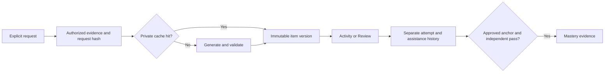

# Quiz sourcing proposal

Proposal only. Sources and repository behavior checked on November 4, 2026.

Put substantial practice quizzes in Review by default. Embed one to three optional questions inside Lecture, Deep Dive, and Code activities. Reserve Gate for an explicit mastery assessment.

## Separate purpose from source

| Purpose | Placement | Suggested format | Effect |
| --- | --- | --- | --- |
| Inline practice | Inside the current activity | One to three checks with hints and explanations | Practice history only |
| Scheduled review | Review | A short set across relevant objectives | Review completion and later scheduling |
| Mastery assessment | Gate | An approved assessment with independent answers | Reviewed mastery evidence |

Record source separately: external, author-created, or AI-generated. Record review status separately from source. A university question can be useful without becoming an approved mastery assessment. An AI-generated item remains practice until a reviewer approves a version.

Preserve the existing rule that only independent passes on approved reviewed anchors establish demonstrated proficiency. ([Assessment evaluation](/Users/garfield/dev/syllabus.build/crates/domain/src/syllabus.rs:370))

## What already exists

The board sends every `quiz` activity to Gate. ([Track mapping](/Users/garfield/dev/syllabus.build/apps/web/src/components/StudyFlowBoard.tsx:28))
The explicit mastery flag also sends activities to Gate. ([Gate override](/Users/garfield/dev/syllabus.build/apps/web/src/components/StudyFlowBoard.tsx:57))
Theory activities cannot currently show the existing concept-check subtask. ([Eligible types](/Users/garfield/dev/syllabus.build/apps/web/src/components/inspector/types.ts:49))

Generation already runs through an explicit action. The model receives activity text and objective context. ([Request construction](/Users/garfield/dev/syllabus.build/apps/web/src/browserAppController.ts:929))
The prompt contains no source excerpts or evidence references. ([Tutor prompt](/Users/garfield/dev/syllabus.build/apps/web/src/liveTutor.ts:280))
Provider failures become a null result. ([Server generation](/Users/garfield/dev/syllabus.build/apps/web/src/server.mjs:2969))
The controller then supplies a deterministic check. ([Fallback](/Users/garfield/dev/syllabus.build/apps/web/src/browserAppController.ts:1254))

Each generated check replaces the activity's current check. ([Replacement](/Users/garfield/dev/syllabus.build/apps/web/src/browserAppController.ts:1270))
The workspace saves this map and its variant seed. ([Workspace snapshot](/Users/garfield/dev/syllabus.build/apps/web/src/server.mjs:1428))
Signed-in persistence sends workspace JSON to the backend. ([Remote save](/Users/garfield/dev/syllabus.build/apps/web/src/server.mjs:1799))
This preserves the latest check, rather than a versioned question history. Practice answer and assistance flags reset together. ([Practice reset](/Users/garfield/dev/syllabus.build/apps/web/src/browserAppController.ts:416))

Backend assessment methods already record attempts and effective assistance. ([Attempt record](/Users/garfield/dev/syllabus.build/crates/persistence/src/store_learning.rs:294))
Runtime assistance currently accumulates one level per account and assessment. It does not retain each hint event. ([Assistance accumulator](/Users/garfield/dev/syllabus.build/crates/persistence/src/store_learning.rs:172))
Migrations define assessment, attempt, assistance-event, and correction tables. ([Assessment migration](/Users/garfield/dev/syllabus.build/crates/persistence/migrations/0004_assessments_adaptation_byok_and_reminders.sql:12))
The inspected runtime serializes assessment maps into the store snapshot. ([Snapshot fields](/Users/garfield/dev/syllabus.build/crates/persistence/src/pg_backend.rs:151))
PostgreSQL saves that snapshot separately from workspace rows. ([Snapshot write](/Users/garfield/dev/syllabus.build/crates/persistence/src/pg_backend.rs:495), [workspace write](/Users/garfield/dev/syllabus.build/crates/persistence/src/pg_backend.rs:556))
The table definitions alone do not prove row-level assessment persistence.

## Sources to start with

| Source | Useful material | Initial treatment |
| --- | --- | --- |
| [MIT OCW 6.006, Fall 2011](https://ocw.mit.edu/courses/6-006-introduction-to-algorithms-fall-2011/pages/exams/) | Two quizzes and a final, each with solutions | Link selected questions and solution locations into Review |
| [OpenStax Introduction to Computer Science](https://openstax.org/books/introduction-computer-science/pages/preface) | Chapter exercises and project assessments | Link public exercises with book and section attribution |
| [WeBWorK Open Problem Library](https://github.com/openwebwork/webwork-open-problem-library) | Community problem files | Curate a small mathematics collection after item review |

MIT OCW currently uses CC BY-NC-SA 4.0. Its terms also impose conditions on AI training. Treat those terms as a rights checkpoint for the intended use. ([MIT terms](https://ocw.mit.edu/pages/privacy-and-terms-of-use/))

OpenStax currently describes its textbook license as CC BY-NC-SA 4.0. ([OpenStax licensing](https://help.openstax.org/s/article/Licensing-information-of-OpenStax-textbooks))
The computer-science book explicitly requires prior written permission for LLM or generative-AI ingestion. ([Book attribution notice](https://openstax.org/books/introduction-computer-science/pages/preface))
Its instructor test banks also require verified educator access. Do not treat them as a public question corpus. ([Test-bank access](https://help.openstax.org/s/article/Importing-QTI-Test-Bank-into-Canvas))

The OPL default is CC BY-NC-SA 3.0 Unported. Contributions can declare alternative licenses. Check each file and its directory before reuse. ([OPL license](https://github.com/openwebwork/webwork-open-problem-library/blob/main/OPL_LICENSE))

These are discovery recommendations, not permission determinations. Public access does not establish rehosting or AI rights. Start with metadata and outbound links wherever the intended reuse lacks authorization. Store creator, course, edition, canonical URL, question locator, license URL, permission scope, and check date.

## Minimum extension

Reuse the current concept-check interaction and provider adapters. Generate only after an explicit learner request. Opening or rendering an activity must never trigger generation.

Use the learner's designated provider and model through the existing server-side BYOK credential resolver. A missing key must produce an explicit generation status. Do not silently switch to another paid provider.

Ground questions in authorized source excerpts, worked solutions, or author-owned notes. Attach stable source versions and page, section, or timestamp locators. A description alone cannot support a claim that a question tests the assigned material.

Cache within the learner's private account scope. Hash a canonical request containing source-content hashes, objective version, activity prompt, provider/model, prompt version, output-schema version, language, and variant seed. Retries should reuse that request. An explicit new-question action should create a new variant.

Persist an immutable item version containing its question, choices, key, explanation, evidence references, and review status. Keep the current activity map as a pointer. Preserve earlier versions when generating again. Store attempts separately with responses, item version, time, score, and assistance. Append hint and solution events to the attempt's history.

Keep approved assessment keys on the server. Return permitted feedback after submission without including the private key in the learner payload.

Reuse the backend assessment rules for approved anchors. Extend the existing store for private practice items and attempts. Keep workspace JSON for selection and current-item pointers. Require explicit sharing and rights review before publishing generated content. Never publish learner answers or assistance history with a syllabus.

Record provider, model, prompt version, evidence references, generation status, token usage when available, and cost status. Distinguish measured, estimated, and unavailable cost. Label deterministic output as fallback practice. Retain the failure reason and offer an explicit retry. Reject invalid answer keys instead of choosing a default answer.

## Rollout

1. Start with one syllabus and a manually curated external-link set. Define purpose independently from source. Check question relevance and answer availability.
2. Add inline practice to theory and route ordinary quizzes to Review. Preserve explicitly configured mastery gates.
3. Add private item versions and attempt history around the existing generation action. Verify reload, restart, duplicate requests, changed evidence, invalid output, assistance, and provider failure.
4. Add background generation only if measured latency requires it. Reuse existing idempotency and outbox machinery. ([Idempotency](/Users/garfield/dev/syllabus.build/crates/persistence/src/store.rs:470), [worker tick](/Users/garfield/dev/syllabus.build/crates/persistence/src/pg_backend.rs:1225))
   Implement an explicit quiz dispatcher first. Unknown job types currently receive a generic success receipt. ([Default dispatch](/Users/garfield/dev/syllabus.build/crates/persistence/src/pg_backend.rs:1207))

This proposal changes no application behavior. Static inspection does not verify deployed persistence, item correctness, permission grants, or provider costs.
