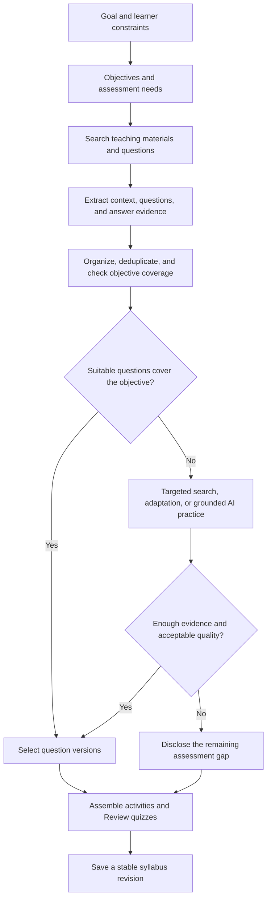

# Quiz discovery and assembly for any syllabus

Proposal only. Sources and repository behavior checked on November 4, 2026.

The syllabus creator should discover, organize, and assemble assessment material for each learner's goal. This applies to arbitrary subjects and internet sources. The development catalog and the example providers below are not the search boundary.

Treat assessment coverage as part of syllabus creation. For each objective, determine what the learner should be able to recall, explain, solve, implement, or justify. Find suitable teaching material and questions against that common objective. A lecture and its questions can come from different sources.

Put substantial practice quizzes in Review by default. Embed one to three optional questions inside Lecture, Deep Dive, and Code activities. Reserve Gate for an explicit mastery assessment. The question format must fit the objective. Literature may need a passage analysis and rubric; programming may need an implementation task; neither needs forced multiple-choice questions.

## General generation flow

1. Build the objective and prerequisite outline from the learner's goal, level, and constraints. For each objective, plan the task and evidence needed to check it.
2. Search for instructional material and assessment material together. Include course assignments, textbook exercises, problem sets, quizzes, exams, worked examples, and relevant repositories. Search the selected resource's course or book first, then other sources for missing coverage.
3. Inspect source content and access conditions. Record whether the system has metadata, the question text, all required figures or passages, and an answer or rubric. A search result alone is not an extracted question.
4. Extract complete questions with their context. Preserve dependent subparts, figures, definitions, and solution references. Separate unrelated questions from a long exam. Remove duplicate copies while retaining useful variants.
5. Map candidates to objectives and prerequisites. Estimate difficulty and time, with uncertainty. Check completeness, answer support, ambiguity, and fit before selecting an item.
6. Fill remaining gaps with adapted or AI-generated practice based on authorized evidence. Recheck alignment after generation. If evidence or evaluation remains insufficient, disclose that gap instead of manufacturing a trusted assessment.
7. Assemble a coherent learning sequence. Place a short check beside its activity and cumulative retrieval in Review. Persist the selected question versions before returning the completed plan.

## Handling messy and incomplete sources

| What discovery finds | Proposed treatment |
| --- | --- |
| Relevant question with a supported answer | Preserve its meaning and source reference. Present it through the common question interface when reuse permits. |
| Long exam mixing many topics | Select relevant questions, preserve required shared context, and order them by the syllabus prerequisites. |
| Broken numbering, layout, or duplicated copies | Normalize presentation and merge duplicate records. Keep the source location and original content where permitted. |
| Missing diagram, passage, data, or dependent subpart | Retrieve the missing context or exclude the incomplete item. |
| Question without a published solution | Record that the source answer is missing. An AI-proposed solution has separate provenance and requires checking. |
| Outdated or ambiguous question | Exclude it, or create an explicitly adapted version with a recorded change and fresh validation. |
| No suitable public question | Generate practice from the selected accessible material and objective, then validate it. |
| No reliable grading basis | Use a supported self-check or rubric where possible. Otherwise show an assessment gap. |
| External interactive quiz that cannot be imported | Keep a clean external activity with a precise link. Record completion as self-reported unless an authorized integration supplies stronger evidence. |

Formatting cleanup must preserve meaning. Changing premises, choices, difficulty, or the expected answer creates an adapted item. Record question provenance and answer provenance separately. A university question with an AI-written answer is not a university-supplied answer key.

AI can help extract, classify, align, and draft. Validation should also use source solutions, appropriate calculation or test tools, and human review when required. Model agreement alone does not establish correctness. Respect the current external-only coding policy when proposing code checks. ([Product decisions](/Users/garfield/dev/syllabus.build/specs/product.md:57), [Assessment validation](/Users/garfield/dev/syllabus.build/specs/product.md:869))

## Learner experience

Show a short title, purpose, question count, estimated time, and progress for each assembled quiz. Keep source attribution and validation details available through a secondary disclosure. Retain original, adapted, and AI-generated attribution.

The learner should receive an organized practice set even when its source questions came from several documents. Do not make the learner clean the source collection. If only an external link is usable, say so directly rather than implying the app can grade that material.

## Separate purpose from source

| Purpose | Placement | Suggested format | Effect |
| --- | --- | --- | --- |
| Inline practice | Inside the current activity | One to three checks with hints and explanations | Practice history only |
| Scheduled review | Review | A short set across relevant objectives | Review completion and later scheduling |
| Mastery assessment | Gate | An approved assessment with independent answers | Reviewed mastery evidence |

Record source separately: external, author-created, or AI-generated. Record review status separately from source. A university question can be useful without becoming an approved mastery assessment. An AI-generated item remains practice until a reviewer approves a version.

Preserve the existing rule that only independent passes on approved reviewed anchors establish demonstrated proficiency. ([Assessment evaluation](/Users/garfield/dev/syllabus.build/crates/domain/src/syllabus.rs:370))

## What already exists

The board sends every `quiz` activity to Gate. ([Track mapping](/Users/garfield/dev/syllabus.build/apps/web/src/components/StudyFlowBoard.tsx:28))
The explicit mastery flag also sends activities to Gate. ([Gate override](/Users/garfield/dev/syllabus.build/apps/web/src/components/StudyFlowBoard.tsx:57))
Theory activities cannot currently show the existing concept-check subtask. ([Eligible types](/Users/garfield/dev/syllabus.build/apps/web/src/components/inspector/types.ts:49))

Generation already runs through an explicit action. The model receives activity text and objective context. ([Request construction](/Users/garfield/dev/syllabus.build/apps/web/src/browserAppController.ts:929))
The prompt contains no source excerpts or evidence references. ([Tutor prompt](/Users/garfield/dev/syllabus.build/apps/web/src/liveTutor.ts:280))
Provider failures become a null result. ([Server generation](/Users/garfield/dev/syllabus.build/apps/web/src/server.mjs:2969))
The controller then supplies a deterministic check. ([Fallback](/Users/garfield/dev/syllabus.build/apps/web/src/browserAppController.ts:1254))

Each generated check replaces the activity's current check. ([Replacement](/Users/garfield/dev/syllabus.build/apps/web/src/browserAppController.ts:1270))
The workspace saves this map and its variant seed. ([Workspace snapshot](/Users/garfield/dev/syllabus.build/apps/web/src/server.mjs:1428))
Signed-in persistence sends workspace JSON to the backend. ([Remote save](/Users/garfield/dev/syllabus.build/apps/web/src/server.mjs:1799))
This preserves the latest check, rather than a versioned question history. Practice answer and assistance flags reset together. ([Practice reset](/Users/garfield/dev/syllabus.build/apps/web/src/browserAppController.ts:416))

Backend assessment methods already record attempts and effective assistance. ([Attempt record](/Users/garfield/dev/syllabus.build/crates/persistence/src/store_learning.rs:294))
Runtime assistance currently accumulates one level per account and assessment. It does not retain each hint event. ([Assistance accumulator](/Users/garfield/dev/syllabus.build/crates/persistence/src/store_learning.rs:172))
Migrations define assessment, attempt, assistance-event, and correction tables. ([Assessment migration](/Users/garfield/dev/syllabus.build/crates/persistence/migrations/0004_assessments_adaptation_byok_and_reminders.sql:12))
The inspected runtime serializes assessment maps into the store snapshot. ([Snapshot fields](/Users/garfield/dev/syllabus.build/crates/persistence/src/pg_backend.rs:151))
PostgreSQL saves that snapshot separately from workspace rows. ([Snapshot write](/Users/garfield/dev/syllabus.build/crates/persistence/src/pg_backend.rs:495), [workspace write](/Users/garfield/dev/syllabus.build/crates/persistence/src/pg_backend.rs:556))
The table definitions alone do not prove row-level assessment persistence.

## Example sources, not a fixed catalog

Discovery should choose sources for the requested subject and objective. These examples demonstrate available source shapes and reuse constraints. They do not define a provider allowlist or limit the product to computer science and mathematics.

| Source | Useful material | Initial treatment |
| --- | --- | --- |
| [MIT OCW 6.006, Fall 2011](https://ocw.mit.edu/courses/6-006-introduction-to-algorithms-fall-2011/pages/exams/) | Two quizzes and a final, each with solutions | Link selected questions and solution locations into Review |
| [OpenStax Introduction to Computer Science](https://openstax.org/books/introduction-computer-science/pages/preface) | Chapter exercises and project assessments | Link public exercises with book and section attribution |
| [WeBWorK Open Problem Library](https://github.com/openwebwork/webwork-open-problem-library) | Community problem files | Curate a small mathematics collection after item review |

MIT OCW currently uses CC BY-NC-SA 4.0. Its terms also impose conditions on AI training. Treat those terms as a rights checkpoint for the intended use. ([MIT terms](https://ocw.mit.edu/pages/privacy-and-terms-of-use/))

OpenStax currently describes its textbook license as CC BY-NC-SA 4.0. ([OpenStax licensing](https://help.openstax.org/s/article/Licensing-information-of-OpenStax-textbooks))
The computer-science book explicitly requires prior written permission for LLM or generative-AI ingestion. ([Book attribution notice](https://openstax.org/books/introduction-computer-science/pages/preface))
Its instructor test banks also require verified educator access. Do not treat them as a public question corpus. ([Test-bank access](https://help.openstax.org/s/article/Importing-QTI-Test-Bank-into-Canvas))

The OPL default is CC BY-NC-SA 3.0 Unported. Contributions can declare alternative licenses. Check each file and its directory before reuse. ([OPL license](https://github.com/openwebwork/webwork-open-problem-library/blob/main/OPL_LICENSE))

These are discovery recommendations, not permission determinations. Public access does not establish rehosting or AI rights. Start with metadata and outbound links wherever the intended reuse lacks authorization. Store creator, course, edition, canonical URL, question locator, license URL, permission scope, and check date.

## Minimum extension

Extend the existing syllabus-generation job to prepare initial assessment coverage. The learner's Create syllabus action should include the selected initial practice set. The learner should not have to generate every lesson's questions manually. Opening or rendering an activity must never repeat generation.

Reuse the current concept-check interaction and provider adapters. Reuse previously processed sources and suitable question versions before paying for more extraction or generation. Batch work by unit where practical. Generate additional variants only when requested or through an explicitly enabled preparation policy.

Use the learner's designated provider and model through the existing server-side BYOK credential resolver. A missing key must produce an explicit generation status. Do not silently switch to another paid provider.

Ground questions in authorized source excerpts, worked solutions, or author-owned notes. Attach stable source versions and page, section, or timestamp locators. A description alone cannot support a claim that a question tests the assigned material.

Cache within the learner's private account scope. Hash a canonical request containing source-content hashes, objective version, activity prompt, provider/model, prompt version, output-schema version, language, and variant seed. Retries should reuse that request. An explicit new-question action should create a new variant.

Use four logical records within the existing persistence layer:

- Source versions: canonical location, content hash, permitted retained content, locators, access and reuse conditions, and check date.
- Question versions: complete prompt and assets, answer or rubric, separate question and answer provenance, objective mapping, validation status, and derivation links.
- Syllabus assignments: pinned question versions, placement, order, and intended purpose for that syllabus revision.
- Attempts: learner responses, item version, time, score, and assistance events.

Keep the current activity map as a pointer. Preserve earlier question versions when generating again. Reusable permitted public material can enter a shared catalog. Private uploads and derived questions remain account-scoped unless the owner explicitly shares them with suitable rights. This does not require a new database or a separate service.

Pin versions so source changes do not silently change an active quiz. Recheck selected sources on refresh and when a failure or report occurs. Publish corrections as new versions, preserve old attempts, and explain any evidence recalculation. A learner should be able to report a broken source, ambiguous question, or incorrect answer.

Keep approved assessment keys on the server. Return permitted feedback after submission without including the private key in the learner payload.

Reuse the backend assessment rules for approved anchors. Extend the existing store for private practice items and attempts. Keep workspace JSON for selection and current-item pointers. Require explicit sharing and rights review before publishing generated content. Never publish learner answers or assistance history with a syllabus.

Record provider, model, prompt version, evidence references, generation status, token usage when available, and cost status. Distinguish measured, estimated, and unavailable cost. Label deterministic output as fallback practice. Retain the failure reason and offer an explicit retry. Reject invalid answer keys instead of choosing a default answer.

## Rollout

1. Implement objective-level assessment discovery and coverage reporting within general syllabus creation. Evaluate complete, messy, missing-answer, and absent-quiz sources across several subjects.
2. Add source and question versions, syllabus assignments, and attempt history. Preserve explicitly configured mastery gates while placing ordinary quizzes in Review and allowing inline checks in theory activities.
3. Add normalization, selection, and bounded AI gap filling. Verify answer provenance, incomplete source handling, reload, restart, duplicate requests, changed evidence, invalid output, assistance, and provider failure.
4. Reuse existing idempotency and outbox machinery for resumable preparation. ([Idempotency](/Users/garfield/dev/syllabus.build/crates/persistence/src/store.rs:470), [worker tick](/Users/garfield/dev/syllabus.build/crates/persistence/src/pg_backend.rs:1225))
   Implement an explicit quiz dispatcher first. Unknown job types currently receive a generic success receipt. ([Default dispatch](/Users/garfield/dev/syllabus.build/crates/persistence/src/pg_backend.rs:1207))

This proposal changes no application behavior. Static inspection does not verify deployed persistence, item correctness, permission grants, or provider costs.
