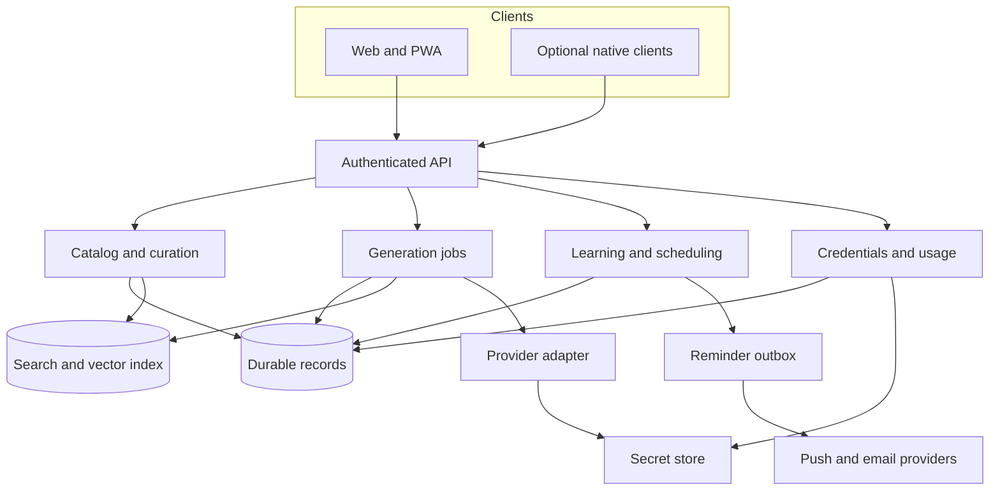
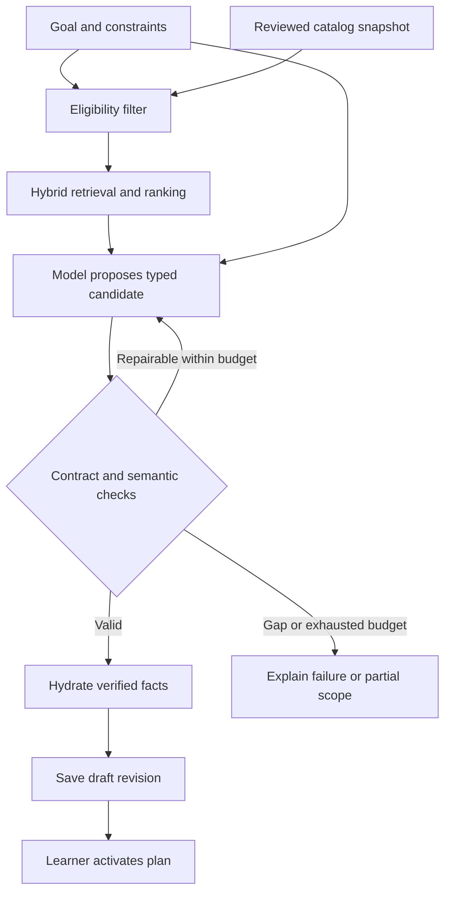
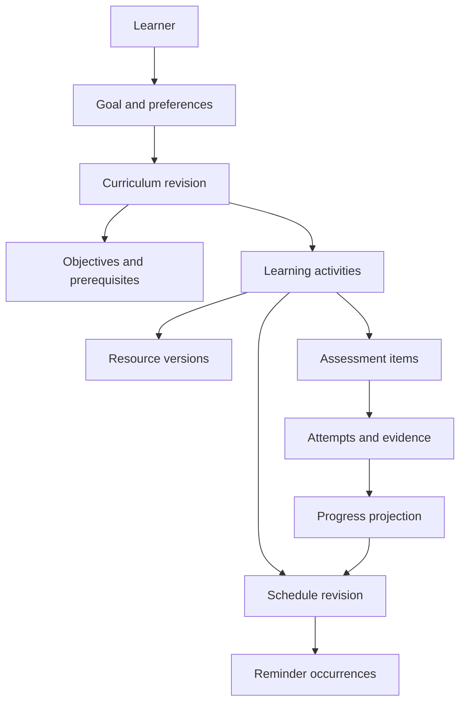

# Curriculum Platform — Complete Product Specification

**Current version:** 0.3.0  
**Updated:** 2026-10-20  
**Maintained file:** specs/product.md  
**Purpose:** complete specification for subsequent implementation with Codex.  
**Status:** owner decisions incorporated; proposed defaults and remaining release decisions are explicit.

This is the one maintained Markdown (`specs/product.md`) containing the latest product, pedagogy, UI, architecture, licensing policy, implementation plan, and embedded machine contracts. It supersedes the earlier versioned documents (`Curriculum_Product_Specification.md`) and specification ZIP. Future edits update `specs/product.md` in place. No companion archive is required.

Generated files may exist outside `specs/product.md` (such as extracted OpenAPI files, JSON Schemas, fixtures, design tokens, traceability CSVs, validation scripts, and generated Rust/TypeScript types), but they must never become independently maintained sources of truth. Every generated or extracted file that supports comments or metadata carries a generated-file notice (`GENERATED FILE — DO NOT EDIT MANUALLY. Source of truth: specs/product.md`), and CI runs `python3 scripts/extract_spec.py --check specs/product.md .` to fail the build whenever committed artifacts drift from `specs/product.md`.

The software is specified as source-available for individual personal use, with third-party organizational deployments prohibited. Exact operative terms still require drafting. The application itself is not implemented or scientifically validated by this document.

## Contents

1. [Revision changes](#1-revision-changes)
2. [How to use the specification](#2-how-to-use-the-specification)
3. [Decisions and release choices](#3-decisions-and-release-choices)
4. [Product requirements](#4-product-requirements)
5. [Product constitution](#5-product-constitution)
6. [Domain vocabulary](#6-domain-vocabulary)
7. [Pedagogy evidence and evaluation](#7-pedagogy-evidence-and-evaluation)
8. [Proficiency and adaptation](#8-proficiency-and-adaptation)
9. [Interface and interaction](#9-interface-and-interaction)
10. [Publishing and adoption](#10-publishing-and-adoption)
11. [BYOK and routing](#11-byok-and-routing)
12. [Security, rights and operations](#12-security-rights-and-operations)
13. [Architecture](#13-architecture)
14. [Data model](#14-data-model)
15. [Machine contract guide](#15-machine-contract-guide)
16. [Synthetic examples](#16-synthetic-examples)
17. [Software, contribution and content licensing](#17-software-contribution-and-content-licensing)
18. [Implementation slices](#18-implementation-slices)
19. [Codex handoff](#19-codex-handoff)
20. [Implementation agent instructions](#20-implementation-agent-instructions)
21. [Uploaded HTML analysis](#21-uploaded-html-analysis)
22. [Verification and limits](#22-verification-and-limits)
- [Appendix A: Acceptance scenarios](#appendix-a-acceptance-scenarios)
- [Appendix B: Architecture decision records](#appendix-b-architecture-decision-records)
- [Appendix C: Machine contracts](#appendix-c-machine-contracts)
- [Appendix D: Synthetic fixtures](#appendix-d-synthetic-fixtures)
- [Appendix E: Traceability](#appendix-e-traceability)
- [Appendix F: UI tokens and validation utilities](#appendix-f-ui-tokens-and-validation-utilities)

**Start with the UI:** [section 9](#9-interface-and-interaction). **Start implementation:** [section 19](#19-codex-handoff).

---

## 1. Revision changes

**Current revision: 0.3.0 · Updated: 2026-10-20.** This file (`specs/product.md`) supersedes the prior v0.1/v0.2 documents, `Curriculum_Product_Specification.md`, and ZIP as the sole maintained specification. Future revisions update this same Markdown. Historical copies are not parallel sources of authority.

### Decisions incorporated in this revision

- Establish `specs/product.md` as the single manually maintained source of truth. Embed both the core OpenAPI contract (`openapi.yaml`) and the companion application contract (`app-companion.openapi.yaml`) directly inside `specs/product.md`, require generated-file notices on extracted artifacts, enforce drift detection via `extract_spec.py --check`, and derive requirement, scenario, operation, and P0 counts dynamically from the specification scripts rather than hard-coding counts into release logic.
- Confirm initial-release product decisions `D01` (adult self-directed learners studying AI/LLM engineering and software engineering as the initial seeded domain), `D02` (responsive web and installable PWA initially; native wrappers deferred), `D03` (provider links and approved metadata by default; explicit permissions required for full-text ingestion, embedding, model submission, and derived assessment generation), `D09` (external coding environments only at launch; no hosted arbitrary-code execution), `D10` (English first with language-tagged records and contracts), and `D12` (provider-neutral inference interface: deterministic fake provider first, OpenAI as first live provider, Anthropic and Google Gemini added before public beta, no provider-specific domain leakage, and no silent fallback from BYOK to hosted paid inference).
- Adopt a polyglot monorepo architecture with a **Rust** backend (`Cargo` workspace: Axum, Tokio, Tower/`tower-http`, Serde, PostgreSQL + `pgvector`, SQLx with explicit SQL migrations, PostgreSQL `SELECT ... FOR UPDATE SKIP LOCKED` transactional outbox/job worker, `jsonschema` Draft 2020-12 runtime validation, RFC 8785 JCS verified byte-for-byte against all digest fixtures, OpenTelemetry tracing) and a **TypeScript** frontend (`pnpm` workspace: Next.js, React, strict TypeScript, CSS variables generated from canonical UI tokens, KaTeX with accessible MathML, Playwright + `axe-core`), using Python solely for the specification extraction and validation scripts.
- Resolve navigation hierarchy across the specification: top-level destinations are **Learn**, **Explore**, and **Settings**; inside **Learn** are **Today**, **Plan** (with synchronized **Map** and **Outline** views), **Progress**, and **Resources**.
- Clarify prerequisite and `mastery_gated` behavior (`PED-006`): ordinary learning content is never hard-locked; learners may study ahead with visible warnings and recommended bridging work; accessing or completing dependent content never creates prerequisite evidence; only activities explicitly marked `mastery_gated` require demonstrated proficiency, an auditable learner override when an active reviewed anchor exists, or an auditable acknowledgement (`Prerequisite unverified — no reviewed anchor available`) when no reviewed anchor exists; formative practice never creates `demonstrated` status.
- Clarify review scheduling and deterministic adoption conflict handling: `CurriculumRevision` remains immutable while review occurrences live in `ScheduleRevision` and `ReviewScheduleItem`, recalculating future entries without rewriting past learning evidence; deterministic adoption substitutes an approved eligible replacement when available or omits ineligible resources with `coverage_status: "partial"` and explicit `coverage_limitations` requiring learner review before activation.
- Add a detailed minimalist UI specification inspired by the owner's Neo Financial reference: neutral opaque study surfaces, restrained typography, focused diagrams, a small amount of glass for navigation, and optional soft depth. Define exact starting tokens, component states, responsive behavior, and accessibility fallbacks.
- Record **individual personal use only; third-party organizational deployments prohibited**, including nonprofit and educational deployments. The explicit organizational restriction controls the interpretation of the owner's two-part reply. Standard PolyForm Noncommercial is rejected for the software; tailored legal terms remain release work.
- Preserve contribution participation and the official paid service through explicitly scoped development and operator rights; do not infer an organizational deployment license from those exceptions.
- Add owner-only publication list and revision-history reads needed for My publications. Keep discovery filter controls aligned with the modeled query contract.
- Make diagnostic duration a burden/sampling target rather than a hidden speed test; preserve unknown evidence and provide accessible pause/stop behavior.

The prior accepted scope remains: reviewed source catalog/RAG, hosted AI and encrypted server-mediated BYOK, reviewed assessment anchors, study reminders, public curriculum revisions/upvotes/private adoption, objective-level proficiency, and mathematical depth independent of prior knowledge and teaching order.

### Document and contract versioning

This specification is version 0.3.0. Both embedded OpenAPI documents (`openapi.yaml` and `app-companion.openapi.yaml`) are version 0.3.0 and pin OpenAPI 3.1.2. Existing curriculum/resource/request payloads intentionally retain `schema_version` `0.2.0`: additive optional properties (`mastery_gated`, `coverage_status`, `review_schedule_items`) and companion endpoints preserve backward compatibility with all baseline fixtures and their cryptographic digests. Documentation versions, API description versions, and serialized payload versions are separate version spaces.

No application, payment integration, public deployment, or educational-efficacy study has been completed by this specification. See section 22 for actual artifact verification and remaining implementation work.
---

## 2. How to use the specification

This is the single maintained product specification (`specs/product.md`) for a curriculum and study application on web and mobile. Read sections 3–6 for decisions, requirements, durable principles, and vocabulary; section 9 for the complete UI; sections 7–8 for evidence and adaptation; sections 10–17 for sharing, BYOK, operations, architecture, data, contracts, and rights. Section 18 defines implementation slices and section 19 gives the Codex handoff.

Use the stable requirement IDs, Given/When/Then acceptance scenarios, JSON Schema Draft 2020-12, and pinned OpenAPI contracts. [ISO/IEC/IEEE 29148](https://www.iso.org/standard/72089.html) is the requirements-engineering reference; formal conformity to its full text is not asserted. The organization and slice workflow draw on [GitHub Spec Kit](https://github.com/github/spec-kit), without claiming that one agent specification framework is a universal standard or requiring its installation.

### Single-file authority

The product rules and recorded decisions govern behavior. The embedded contracts govern their declared wire shapes. A conflict is a specification defect to resolve in `specs/product.md`, not permission to invent behavior or silently weaken validation. The original split-file names occasionally identify logical components or the earlier analysis; they are not additional documents that the reader must obtain. All required machine artifacts are embedded below.

| Section / appendix | Contents |
| --- | --- |
| Sections 3–6 | Decision register, stable requirements, constitution, domain vocabulary |
| Sections 7–12 | Learning evidence, adaptation, detailed UI, sharing, BYOK, security and content rights |
| Sections 13–17 | Architecture, data, contract interpretation, example guide, licensing policy |
| Sections 18–22 | Implementation slices, Codex instructions, reference analysis, actual verification |
| Appendix A | Complete acceptance scenarios, including UI scenarios |
| Appendix B | Architecture decision records |
| Appendix C | Six JSON Schemas, the core OpenAPI document (`openapi.yaml`), and the companion OpenAPI document (`app-companion.openapi.yaml`) |
| Appendix D | Complete synthetic JSON fixtures |
| Appendix E | Requirement and supporting-control traceability CSVs |
| Appendix F | Extraction/validation scripts and pinned validation dependencies |

Embedded asset paths are intended extraction destinations for implementation and validation, not competing specification sources. The extraction script (`scripts/extract_spec.py`) writes generated files with generated-file notices, refuses unsafe paths or unintended overwrites, and provides `--check` mode for CI drift enforcement. Changes to any contract, fixture, token, or traceability artifact must first be reflected in `specs/product.md`. Do not create another independently maintained PRD, UX specification, companion contract, or dated Markdown on each revision.

### Product baseline and remaining defaults

The owner has confirmed the initial seeded domain (`D01`), responsive web + installable PWA launch target (`D02`), provider-link and permissioned ingestion boundary (`D03`), best-effort study reminders (`D04`), server-mediated BYOK custody (`D05`), individual-only source-available policy (`D06`, `D15`), reviewed assessment anchors (`D08`), external-only coding environments (`D09`), English-first language-tagged schemas (`D10`), provider-neutral inference adapter strategy (`D12`), public publishing/upvotes (`D13`), per-topic assessment/adaptation with independent mathematical depth (`D14`), minimalist Neo Financial–inspired UI (`D17`), single canonical Markdown (`D18`), and the Rust + TypeScript polyglot monorepo stack. These choices need not be reopened to implement the product.

Commercial pricing and payment vendor (`D07`), cloud/auth/secret-manager vendor and retention windows (`D11`, `D16`), and final operative legal text (`D15`, `D16`) remain deferred release decisions. They do not block local development, but production release gates must block the affected live features until those decisions are approved.

Synthetic examples are not an approved catalog, real prices, real learner evidence, or adopted license terms. Gherkin describes observable requirements; executable application bindings are implementation work. Follow the dependency-ordered execution sequence `T00 -> T01 -> T14-Core -> T02 -> T03 -> T04 -> T05 -> T06 -> T12 -> T07 -> T08 -> T13 -> T14-Full -> T09` (with `T10` and `T11` after `T09`), starting with the Foundation Tracer Bullet across `T00 -> T01 -> T14-Core -> T02 -> T03 -> T04`.
---

## 3. Decisions and release choices

## Product decisions and remaining choices

**Version:** 0.3.0 · **Date:** 2026-10-20 · **Status:** user decisions incorporated; deferred production release gates remain explicit.

The owner confirmed initial-release defaults for `D01`, `D02`, `D03`, `D09`, `D10`, and `D12`, resolved navigation, prerequisite gating, review scheduling, and deterministic adoption conflicts, and selected the Rust + TypeScript polyglot monorepo stack. Do not reopen these confirmed decisions during implementation.

### Confirmed intent and adopted design

| ID | Decision and status | Specification treatment |
| --- | --- | --- |
| D01 | **Confirmed:** adult self-directed learners (`18+`) studying AI/LLM engineering and software engineering as initial seeded domain | Launch content boundary, not a permanent architectural limitation. Domain models and schemas remain subject-neutral. |
| D02 | **Confirmed:** responsive web and installable PWA initially | Native wrappers (`T10`) remain deferred after initial launch (`T09`). |
| D03 | **Confirmed:** provider links and approved metadata by default | Full-text ingestion, embedding, model submission, and derived assessment generation require explicit recorded permissions (`CAT-003`). |
| D04 | **Confirmed:** study reminders initially | Best-effort opt-in reminders; no exact audible alarm requirement for launch. Native alarms stay an optional later extension (`T10`). |
| D05 | **Delegated by owner:** follow established BYOK service practice | Adopt server-mediated encrypted credential custody, masked management, explicit provider/model and mode, bounded jobs, and no automatic paid fallback. See [BYOK policy](#11-byok-and-routing). |
| D06 | **Confirmed:** individual personal cloning/use/modification and contributions; no commercial copying or third-party organizational deployment | Use a custom personal-use source-available license. Preserve narrowly scoped contribution and official-operator rights. Operative legal drafting remains pending; standard PolyForm Noncommercial is rejected. |
| D08 | **Confirmed:** maintain reviewed assessment anchors | Use reviewed objective-aligned gates and diagnostics; generated practice remains a separate assurance level. |
| D09 | **Confirmed:** external coding environments only at launch | Activities use `execution_mode: "external"`. No hosted arbitrary-code execution at launch (`CTRL-034`). |
| D10 | **Confirmed:** English first (`en`), with all stored content and contracts language-tagged | Every resource, curriculum, request, and diagnostic carries a BCP 47 `language` tag. |
| D12 | **Confirmed:** provider-neutral inference interface with phased providers | Implement the deterministic fake provider first, then OpenAI as the first live provider, and add Anthropic and Google Gemini through the same interface before public beta. Provider-specific request/response objects must not leak into the domain model, and a failed BYOK request must never silently fall back to hosted paid inference. |
| D13 | **Confirmed:** publish/share curricula and upvote | Private by default; public or unlisted immutable snapshots, private adapted adoption, revision-specific upvotes, and minimum moderation/privacy controls. |
| D14 | **Confirmed:** assess topic proficiency and adjust curricula; mathematical thoroughness is configurable | Separate evidence from desired depth, sequence, outcomes, and available time. Diagnose relevant objectives and preview adaptations. Strong linear algebra does not imply less mathematics or strength in unrelated prerequisites. |
| D15 | **Resolved:** all third-party organizational deployments are prohibited | Includes commercial, nonprofit, educational, public-research, and government deployments regardless of revenue. Final operative legal text remains a deferred release gate. |
| D17 | **Confirmed:** minimalist Neo Financial–inspired UI, with slight glass or soft depth | Section 9 supplies adopted design defaults and accessible opaque fallbacks; the complete Mobbin gallery was not accessible for inspection. |
| D18 | **Confirmed:** one maintained Markdown (`specs/product.md`) containing the latest complete specification | `specs/product.md` is canonical. Contracts (`openapi.yaml` and `app-companion.openapi.yaml`), schemas, examples, acceptance criteria, and traceability are embedded appendices extracted and verified in CI. |

### Deferred production release decisions

The following decisions remain deferred. They do not block local development, but production release gates in `T07`, `T09`, and `T13` must block the affected live features until approved:

| ID | Decision | Local development treatment | Production release gate | Needed before |
| --- | --- | --- | --- | --- |
| D07 | Commercial pricing, payment/tax vendor, and refund/expiration terms | Separate service entitlement and inference ledger with deterministic payment/checkout fakes | Block live credit checkout and paid hosted-credit top-ups (`FEATURE_LIVE_BILLING_ENABLED=false`) until approved | Real checkout (`T07` / `T09`) |
| D11 | Production cloud, secret-manager, and authentication vendor | Implement provider-neutral HTTP/domain auth boundary and local/test auth + envelope encryption adapter | Block production deployment until production auth provider, KMS, and hosting region are approved | Production data (`T09`) |
| D15 | Final operative legal text for custom personal-use license and contributor agreement | Enforce individual-only policy and non-OSI labeling in docs and release checks | Block public repository distribution and external CLA acceptance until legal text is approved | Public code release (`T09`) |
| D16 | Final public-curriculum content license text, retention periods, backup RPO/RTO targets, and analytics vendor | Enforce explicit terms-version consent, configurable retention windows, and no third-party analytics by default | Block public curriculum publishing in production (`FEATURE_PUBLIC_SHARING_ENABLED=false`) until final content license and retention periods are approved | First public publication (`T13` / `T09`) |

### Resolved permission scope and remaining legal work

The owner's explicit “organizational deployments should be banned; just individual use only” instruction resolves the prior choice. The preceding “A. Okay” is not treated as adopting standard PolyForm terms that contradict that explicit restriction. Standard PolyForm Noncommercial permits named organizational uses and is therefore unsuitable for the selected software policy. [PolyForm permitted purposes](https://polyformproject.org/licenses/noncommercial/1.0.0).

The permission boundary is decided; the actual custom license, named rights holder/operator, notices, contributor agreement, and publication terms still require drafting and review before release. Ordinary personal career-related study and authorized contribution development should remain possible under clearly defined terms. Section 17 specifies this brief. These tasks do not block reversible local implementation.

### Decision procedure

Keep the owner response, date, rationale, affected requirements, and migration implications together. Mark exact legal terms accepted only when chosen. Existing authorization for routine implementation persists. The current specification does not authorize launching payments, sending messages to people, or publishing source merely because it describes those capabilities.
---

## 4. Product requirements

## Curriculum Platform — product requirements specification

**Document version:** 0.3.0  
**Date:** 2026-10-20  
**Status:** reviewable specification draft; proposed defaults are explicitly identified.  
**Audience:** product owner, Codex implementation agent, engineers, curriculum curators, and evaluators.

### 1. Product outcome

Turn a learner's broad goal into a credible, achievable curriculum that combines explanation, practical work, assessment, and review, then helps the learner execute and revise it across web and mobile.

Example input: “I want to learn everything about LLMs.” The useful result is an agreed scope of observable capabilities, a prerequisite map, selected credible materials, a realistic study plan, and evidence of progress. The app must not present an undefined field as exhaustively covered.

The application will make its source available for individual personal use and community contributions under tailored terms. Third-party organizational deployments, including noncommercial institutions, and unauthorized commercial reuse are prohibited. The official service and authorized contribution development require the scoped rights in section 17. This is source-available, not OSI open source. The operative license and contributor grant remain release drafting work in [licensing policy](#17-software-contribution-and-content-licensing). It supports two explicitly selected AI payment modes: users provide their own provider key, or purchase hosted AI usage. Paid courses, exams, books, cloud labs, and app inference are separate expenses.

#### 1.1 Confirmed requirements from the request

| Confirmed requirement | Interpretation |
| --- | --- |
| Web and mobile | Shared product behavior and synchronized learning state across screen sizes; responsive web and installable PWA confirmed for initial launch (D02), with native wrappers deferred |
| BYOK and paid hosted AI | Both modes are first-class; source material purchases are separate |
| Public source and contributions | Individual personal cloning/modification and contributions; third-party organizational deployment prohibited; custom operative terms pending |
| Goal-based curriculum generation | Use a seeded, reviewed catalog; support ongoing catalog updates |
| RAG and vector indexing | Retrieval assists selection and grounding; structured facts remain authoritative |
| Paid/free preferences | Enforce eligibility and disclose costs, subscriptions, and unknowns |
| Extremely credible materials | Verify individual works and creator expertise; platform name alone is insufficient |
| Theory, coding, quizzes, optional certification | Support distinct activity types aligned with measurable objectives |
| Progress and notifications | Track execution and learning evidence; configurable reminders across supported channels |
| Minimal, diagram-first interface | Neo Financial–inspired visual restraint, small amounts of glass/soft depth, focused maps, and equivalent accessible outlines; full details in section 9 |
| Configurable teaching order | Theory-first, application-first, and balanced modes |
| Scientific grounding | Evidence-based component choices, qualified claims, and evaluation of the product itself |
| Publishing and upvotes | Opt-in shareable curriculum versions, public discovery, private adoption, and authenticated upvotes |
| Proficiency adaptation | Topic/objective-level evidence changes prerequisite support and pacing; mathematical depth remains a separate explicit preference |
| Reviewed assessments | The owner accepts maintaining reviewed anchor questions and rubrics for important evidence gates |
| Study reminders initially | Best-effort reminders are confirmed; precise alarms are outside initial scope |

#### 1.2 Confirmed initial launch scope

The following initial-release scope choices are confirmed (D01, D02, D03, D09, D10, D12): adult self-directed learners studying AI/LLM engineering and software engineering as the initial seeded domain (a launch content boundary, not a permanent architectural limitation); English-first interface and catalog content with all stored content and contracts remaining language-tagged; responsive web plus installable PWA initially (native wrappers deferred); provider links and approved metadata by default, with full-text ingestion, embedding, model submission, and derived assessment generation requiring explicit permissions; in-app practice and quizzes; external coding environments only at launch with no hosted arbitrary-code execution; and a provider-neutral inference interface implementing the deterministic fake provider first, OpenAI as the first live provider, and Anthropic and Google Gemini before public beta. See [decisions and release choices](#3-decisions-and-release-choices).

Implement a complete vertical slice before broadening subject coverage. A small catalog that genuinely covers its stated objectives is preferable to an arbitrary resource-count target. Choose catalog size from a coverage audit.

#### 1.3 Initial exclusions and extension points

The proposed launch does not include a course marketplace, automatic purchases/enrollment, accredited credential issuance, institutional gradebook, unrestricted web crawling, imported paid-content libraries, autonomous tutors, or an arbitrary-code execution service. These are scope choices rather than technical impossibilities. Native clients and precise alarms are explicit extensions unless the owner chooses them for launch.

### 2. Users and responsibility boundaries

| Actor | Responsibilities |
| --- | --- |
| Learner | State goals and constraints; select AI mode; choose a plan; learn; submit or self-report evidence; control reminders |
| Curator | Verify sources, permissions, objective coverage, prerequisite mappings, assessments, and resource revisions |
| Operator | Operate the service, investigate failures, manage provider adapters and quotas, handle supported data requests |
| Application | Enforce contracts and constraints; preserve state; schedule work; render progress; account for costs |
| Model provider | Return a candidate structured response; does not own learning state, eligibility, or financial decisions |
| Learning provider | Supplies external learning material under its own terms, access requirements, and availability |

Private learner data, keys, and answers are never part of the public seed catalog or public curriculum snapshots. A curator can review catalog entries without access to learner credentials. A publisher is an ordinary learner using an explicitly authorized sharing operation; a moderator may handle public reports without receiving unrestricted access to private learning evidence.

### 3. Core journeys

#### J1 — Create a feasible curriculum

1. The learner enters a goal and intended use: conceptual understanding, building applications, research preparation, employment preparation, or an exam.
2. The app elicits target capabilities, prior knowledge, hours available, deadline flexibility, preferred language, sequencing preference, and costs/access. Optional reviewed diagnostics establish evidence for specific prerequisite objectives. Mathematical depth and topic-specific depth overrides are chosen independently of current proficiency.
3. The app proposes the scope, exclusions, assumptions, and estimated effort. The learner can revise them before activation.
4. Retrieval selects eligible reviewed resources. Generation proposes objectives and activities. Deterministic validation checks the candidate.
5. The learner sees a map, a workload estimate, sources and rationale, a schedule preview, paid-resource disclosures, and unresolved gaps.
6. The learner activates a revision. Activities and review sessions appear in the study plan.

#### J2 — Study and demonstrate progress

The learner opens today's session, follows a selected resource, attempts related practice, receives feedback, and records completion. Independent assessment results create learning evidence. The app schedules revisits. The UI shows completion separately from demonstrated performance and review status.

#### J3 — Change time, preferences, or resources

The learner reduces availability, switches sequence mode, or loses access to a course. The app previews changes and tradeoffs. Accepted changes create a new curriculum or schedule revision as appropriate; earlier work remains recorded. An impossible fixed deadline produces options to reduce scope, extend time, or increase effort.

#### J4 — Use BYOK or hosted AI

The learner deliberately chooses one mode. BYOK uses an approved credential connection; hosted mode uses disclosed pricing and a budget. Authentication failure, insufficient credit, or a provider outage causes a recoverable error and never an automatic paid fallback.

#### J5 — Maintain the catalog

A curator proposes a resource, records credibility and permissions evidence, reviews it, and approves a version. Refresh jobs discover changes. Broken, inaccurate, or rights-restricted entries are quarantined. Affected learners receive an actionable replacement option without losing historical completion.


#### J6 — Publish, discover, and adopt a curriculum

The owner chooses a validated curriculum revision, writes a public title and summary, and reviews an allowlisted public preview. They choose public discovery or an unlisted link and confirm the publication terms. The app publishes an immutable template with resource references, target outcomes, prerequisites, mathematical depth, effort assumptions, and any coverage gaps. It excludes private goals, assessment results, schedules, notes, subscriptions, credentials, and personal identifiers. Others can inspect the map, upvote that version, report a problem, or create a private adapted copy. Publication is community sharing, not automatic educational endorsement.

#### J7 — Assess and adapt without flattening the learner

The learner records topic-specific self-reports and may take a short diagnostic with a visible effort target. Reviewed items cover the capabilities relevant to the goal; missing evidence stays unknown. The app proposes where to skip redundant introduction, retain support, or add bridging work. The learner reviews the evidence, rationale, workload change, and retained objectives before accepting a new revision. Selecting formal mathematical depth preserves derivation/proof-oriented outcomes when supported by the catalog, even when the learner already knows introductory linear algebra.

### 4. Pedagogy policy

The product is **evidence-informed**, with efficacy to be tested. Supported instructional components include retrieval practice, distributed practice, appropriate feedback, worked examples, and guidance responsive to prior knowledge. The research companion links the original studies and reviews and states their limits. A generated plan, a particular review interval, a diagram interface, and notification timing are not automatically scientifically validated by those papers.

#### 4.1 Teaching-order modes

| Mode | Default structure within a module | Invariant |
| --- | --- | --- |
| Theory-first | Compact explanation → worked example → practice → independent demonstration | Relevant application and feedback remain present |
| Application-first | Bounded useful challenge or example → identify missing ideas → explicit explanation → improve the artifact → independent demonstration | Prerequisite support and consolidation remain present |
| Balanced | Alternate short explanations and meaningful practice, then demonstrate | Practice and assessment align with the same objectives |

These are product definitions. They are not diagnosed learner types, and none is claimed universally superior. “Top-down” can also mean beginning with a system overview; that is a separate presentation preference from application-first instruction. Offer an overview in every mode.

#### 4.2 Assessment principles

An objective describes what a learner should be able to explain, implement, debug, evaluate, or justify. A quiz is useful only when its answer or rubric is trustworthy and it tests the intended objective. A coding objective needs relevant practical evidence; multiple-choice recall alone is insufficient to assert engineering capability.

Use reviewed anchor assessments for progress gates. Model-generated variants may be offered as clearly labeled practice after source, answer, ambiguity, and coverage checks. An unreviewed AI grade is advisory; it cannot independently establish a high-confidence demonstration. No universal percentage, number of quizzes, or review interval is asserted as a scientific law.

A disclosed assessment gap can coexist with a useful learning plan, but cannot fulfill a demonstration gate. If advancement requires such a gate, supply an available reviewed assessment, show the blocked gate, or offer a revised scope. Completing every scheduled activity does not erase an unresolved evidence gap. New curricula begin with unassessed objectives unless actual prior evidence is explicitly mapped.

When an answer key, rubric, or grader is later found incorrect, preserve the historical attempt and evaluation, append a correction or invalidation with a reason, and recompute affected evidence and prerequisite eligibility. Notify the learner of the change. Resource unavailability alone does not invalidate previously demonstrated learning; a defective assessment can invalidate the inference drawn from it.

### 5. Requirements conventions

“Shall” marks a normative obligation of this draft. **P0** means required for the proposed initial public release. **P1** means a planned extension or enhancement. An owner-approved change can alter priority. Numerical targets are proposed engineering/product policies, not established educational findings.

Each requirement below maps to acceptance scenarios and implementation work in `traceability.csv`. Companion documents elaborate controls without overriding these obligations.

### 6. Goal and learner profile requirements

| ID | Priority | Requirement |
| --- | --- | --- |
| GOAL-001 | P0 | When a learner submits a broad goal, the app shall produce an editable scope containing target capabilities, assumed prerequisites, intended depth, and explicit exclusions before activation. |
| GOAL-002 | P0 | The app shall capture weekly availability, session preferences, timezone, deadline and its flexibility, resource language, sequencing preference, mathematical depth with optional topic overrides, paid-material policy, existing access, and separately stated compute and AI budgets. |
| GOAL-003 | P0 | The app shall offer a prerequisite self-assessment or diagnostic, allow it to be skipped, and preserve uncertainty rather than inventing competence when evidence is absent. |
| GOAL-004 | P0 | When hard constraints conflict, the app shall explain the conflict and offer scope, time, or access changes without silently relaxing a constraint. |
| GOAL-005 | P0 | The learner shall be able to revise preferences, inspect their effect on a proposed plan, and accept or reject the revision while retaining prior work. |

### 7. Catalog and credibility requirements

| ID | Priority | Requirement |
| --- | --- | --- |
| CAT-001 | P0 | Every recommendable resource version shall have a verified canonical source, creator identity, review status, review evidence, objectives, prerequisites, format, language, availability, and access conditions. |
| CAT-002 | P0 | Resource approval shall apply an explicit rubric covering relevant expertise, sampled accuracy, instructional suitability, freshness, and availability; platform reputation, academic affiliation, or ratings shall not alone confer approval. |
| CAT-003 | P0 | Learner access and application reuse permissions shall be separate records. Storage, embeddings, provider processing, derived exercises, and redistribution shall each require a documented permitted use. |
| CAT-004 | P0 | Retrieval shall filter by approval, availability, access, required language, region where relevant, and rights before ranking; the generation validator shall recheck the selected versions. |
| CAT-005 | P0 | Prices, duration estimates, ratings, exam identifiers, and availability shall carry provenance and a verification timestamp or an explicit unknown value. Unknown price shall never be converted to zero. |
| CAT-006 | P0 | Catalog updates shall create versions, record diffs, and support proposed, approved, quarantined, and retired states; only approved eligible versions may enter a new plan. |
| CAT-007 | P0 | When a selected resource becomes unavailable, disallowed, or inaccurate, the app shall show its affected assignments and an eligible replacement path while preserving lawful historical metadata and learning evidence. |
| CAT-008 | P0 | The app shall expose why a resource was selected, which objectives it supports, its access conditions, last review, and credibility evidence, without claiming creator endorsement. |

### 8. Generation and retrieval requirements

| ID | Priority | Requirement |
| --- | --- | --- |
| GEN-001 | P0 | Generation shall be an asynchronous, cancelable operation with visible states, bounded time/cost, idempotent submission, and recoverable errors. |
| GEN-002 | P0 | Each generation run shall pin the catalog snapshot, request/preferences, provider/model, prompt/template version, retrieval configuration, and pedagogy policy necessary to investigate its result. |
| GEN-003 | P0 | The model shall select from approved candidate identifiers; backend hydration shall supply authoritative URLs, price/access facts, and catalog metadata. Invented or ineligible references shall prevent publication. |
| GEN-004 | P0 | Before publication, the backend shall validate structure, identifier uniqueness, all references, prerequisite acyclicity, objective coverage, resource eligibility, workload, and forbidden generated fields. |
| GEN-005 | P0 | For every required objective, the accepted plan shall provide relevant instruction or prerequisite evidence, meaningful practice, and an assessment path or an explicitly disclosed assessment gap. A gap shall not count as demonstrated learning. |
| GEN-006 | P0 | When credible catalog coverage is insufficient, the app shall return a partial draft or a coverage failure with missing objectives, and shall not invent a source or claim full coverage. |
| GEN-007 | P0 | The model shall not supply executable UI, credentials, billing actions, progress, permission grants, or arbitrary external operations. Renderers shall accept only known contract types. |
| GEN-008 | P0 | Regeneration shall create a new revision, present a diff, preserve permitted historical structure and learning evidence, and require an explicit equivalence mapping before transferring an objective's demonstrated status. Required rights redaction or account deletion takes precedence over retention. |

### 9. Learning and assessment requirements

| ID | Priority | Requirement |
| --- | --- | --- |
| PED-001 | P0 | Each required objective shall have a measurable performance statement, success criterion, relevant practice, and an assessment path with attributable answer/rubric provenance or an explicit coverage limitation. Learner evidence begins unassessed and accrues from actual attempts or explicitly mapped prior evidence. |
| PED-002 | P0 | Practice shall default to a learner attempt before revealing a full answer, support corrective explanations, and record assistance. An explicit study-worked-solution action may reveal a solution without an attempt, but shall be recorded as solution-assisted study and excluded from independent demonstration. |
| PED-003 | P0 | The scheduler shall allocate revisits in distinct study sessions and include review time in capacity calculations; the interval policy and its version shall be visible as a product heuristic. |
| PED-004 | P0 | Instructional guidance shall respond to prerequisite evidence and independent performance, with worked examples or partial scaffolds available for novices and redundant instruction skippable with evidence. |
| PED-005 | P0 | Each assessment item shall record objectives, answer/rubric provenance, version, evaluation method, and validation status. Private keys and unrevealed solutions shall be excluded from the learner curriculum payload. Corrected or invalidated evaluations shall preserve history and recompute affected evidence projections with an explanation. |
| PED-006 | P0 | Completion, assisted practice, independent performance, delayed performance, and transfer evidence shall be separately represented. Opening a resource or checking a completion box shall never alone establish demonstrated competence. Learners may study ahead; missing prerequisite evidence shall produce a visible warning and recommended bridging work without hard-locking ordinary content, and accessing or completing dependent content shall not create prerequisite evidence. Only activities explicitly marked as `mastery_gated` may require demonstrated proficiency: when an active reviewed anchor exists, the learner shall either demonstrate the prerequisite or record an explicit override; when no reviewed anchor exists, the app shall allow continuation after explicit acknowledgement and display `"Prerequisite unverified — no reviewed anchor available"`. Formative practice shall not create `demonstrated` status, and every override or acknowledgement shall be recorded as an auditable learner decision. |
| PED-007 | P0 | The three sequence modes shall retain required objectives, prerequisite support, practice, feedback, and review; switching modes shall not silently delete those obligations. |

### 10. Schedule and progress requirements

| ID | Priority | Requirement |
| --- | --- | --- |
| PROG-001 | P0 | An authenticated learner shall retrieve synchronized curriculum, schedule, and progress state on supported web/mobile clients; completion events shall record self-report versus independently observed evidence. |
| PROG-002 | P0 | Study time shall include media, reading, implementation, exercises, assessment, review, and setup where relevant; playback speed shall adjust only playable-media time. |
| PROG-003 | P0 | A schedule shall fit declared availability or report infeasibility. Missed work shall trigger a replanning proposal, without silently filling future sessions beyond their capacity. |
| PROG-004 | P0 | Progress submissions shall be idempotent and auditable. Offline queued updates shall preserve event identity, and conflicting schedule edits shall produce a visible conflict rather than silent loss. |
| PROG-005 | P0 | Learners shall be able to mark activities complete or skipped, report time spent, inspect assessment evidence, resume later, and export their plan and learning history without secrets or restricted source content. |
| PROG-006 | P1 | Official provider integrations may import progress only with supported APIs and learner permission; imported completion shall retain provenance and shall not imply verified independent learning. |

### 11. Interface requirements

| ID | Priority | Requirement |
| --- | --- | --- |
| UI-001 | P0 | The primary curriculum view shall show modules, prerequisite relationships, current position, optional branches, and review status; every arrow meaning shall be explicit. |
| UI-002 | P0 | Every graph action and essential fact shall be available through a keyboard- and screen-reader-usable outline or list. Mobile shall show a focused module/path and next action rather than shrink a desktop graph. |
| UI-003 | P0 | A Today view shall present the next feasible session, expected time, required access/setup, and the reason it is scheduled, with start, snooze, reschedule, and skip actions as appropriate. |
| UI-004 | P0 | An activity detail view shall show its objective, resource section when verified, task, expected effort range, practice/assessment conditions, and completion/evidence state. Unverified chapter or timestamp precision shall be omitted. |
| UI-005 | P0 | The interface shall distinguish required/core work from optional enrichment and optional certification; hidden optional work shall not count against required completion. |
| UI-006 | P0 | Loading, failed generation, no eligible resources, permission denied, stale source, insufficient credit, offline, and unsynchronized states shall each have a usable next action and accessible messaging. |

| UI-007 | P0 | The interface shall use the section 9 semantic tokens, typography, spacing, hierarchy, and original visual identity; visual defaults shall remain readable in light and dark themes. |
| UI-008 | P0 | Glass shall be limited to navigation or small tool surfaces with verified contrast; study content shall remain opaque. Soft shadows shall never be the sole control/state cue, and solid/forced-color fallbacks shall preserve all actions. |
| UI-009 | P0 | Learn, Explore, and Settings shall provide consistent labeled navigation. Deep links, selected revision/module, safe back navigation, and sign-in return context shall be preserved without implicit consequential actions. |
| UI-010 | P0 | Compact, medium, and wide layouts shall adapt to available space and text scaling. Primary work, access warnings, and actions shall remain usable at 320 CSS px without page-level horizontal scrolling or keyboard obstruction. |
| UI-011 | P0 | Intake shall independently expose topic self-report/evidence, mathematical depth and overrides, teaching order, familiar-material treatment, and hard constraints. Changing one dimension shall not silently rewrite another. |
| UI-012 | P0 | Diagnostics shall show reviewed coverage, optional participation, assistance conditions, and a sampling/effort target; stopping or reaching that target shall not fail unanswered objectives or create a hidden speed score. |
| UI-013 | P0 | The generation UI shall require applicable mode/cost authorization, show only authoritative job states, preserve recoverable requests, distinguish cancellation requested from confirmed, and activate a draft only on explicit action. |
| UI-014 | P0 | Map and outline shall preserve selected module and filters, expose equivalent essential facts/actions, label relationship meanings, and provide non-gesture navigation without misrepresenting a multi-parent graph as a tree. Study-ahead choices shall not satisfy prerequisite evidence gates or bypass rights/authorization. |
| UI-015 | P0 | Study and assessment surfaces shall support readable text, math and code, explicit answer submission, attributable feedback and assistance, external-resource return, and honest completion status without implying an unimplemented code runner. |
| UI-016 | P0 | Progress shall separate completion, objective evidence, and review timing. Adaptation shall show a readable before/after diff with reasons and effects; stale or rejected proposals shall preserve the active plan. |
| UI-017 | P0 | Discovery, publication, adoption, votes, and owner management shall expose exact revision/visibility/attribution and permissions; owner management shall survive public quarantine/withdrawal, and adoption shall never imply inference spending. |
| UI-018 | P0 | Provider UI shall disclose custody/billing, keep key entry transient, expose only masked saved metadata, distinguish testing/rotation/deletion, and require valid operation authorization without automatic hosted fallback. |
| UI-019 | P0 | Reminder/account settings shall show timezone, quiet hours, permission and privacy choices, retain learning functionality after denial, and explain export/deletion/withdrawal consequences under the actual policies. |
| UI-020 | P0 | Async surfaces shall distinguish empty, partial, loading, failed, unauthorized, stale, offline and unsynchronized states as applicable, preserve safe drafts, and provide recovery without duplicate charges or silent queued publication. |
| UI-021 | P0 | All supported web processes shall target WCAG 2.2 AA with semantic controls, keyboard/screen-reader operation, contrast, reflow, text scaling, appropriate target sizes, accessible math, deliberate focus, and actual-device verification. |
| UI-022 | P0 | Nonessential motion and translucency shall respect stricter system/product preferences. Graphs and UI effects shall have bounded, progressive rendering that preserves usable text/outline controls without decorative animation. |
| UI-023 | P0 | Appearance settings shall remain separate from learning and billing state; authentication shall support accessible input and safe session recovery, and public/private account context shall not leak through caches or navigation. |
| UI-024 | P0 | Every UI surface shall render validated typed data through reviewed components and use an explicit supported contract; role-restricted/admin surfaces shall enforce authorization, and unsupported functionality shall not simulate success. |

### 12. AI access and billing requirements

| ID | Priority | Requirement |
| --- | --- | --- |
| BILL-001 | P0 | Each chargeable operation shall identify BYOK or hosted mode and its applicable budget before execution; the app shall not switch modes without the learner's explicit choice. |
| BILL-002 | P0 | BYOK credentials shall be write-only through normal account APIs, securely stored only under disclosed custody rules, scoped to the correct tenant, removable from application custody, and excluded from prompts, logs, analytics, exports, URLs, and curriculum documents. Removing the app's copy shall be distinguished from revoking the key at its issuer. |
| BILL-003 | P0 | Hosted usage shall reserve a stated maximum before dispatch, settle confirmed usage according to the published policy, release unused reservations, and prevent duplicate ledger effects under retries or duplicate payment events. |
| BILL-004 | P0 | Charges for app/service access, AI usage, learning materials, certification exams, and compute shall be distinguished. A free-materials preference shall not imply free model usage or free cloud compute. |
| BILL-005 | P0 | Authentication, quota, provider, cancellation, and invalid-output failures shall return actionable status; automatic repairs/retries shall stay within the original budget and retry ceiling. The failed-generation charge/refund policy shall be disclosed. |
| BILL-006 | P0 | Hosted deployments shall use approved provider adapters and endpoints, isolate usage by tenant, rate-limit generation, and reject arbitrary user-controlled provider endpoints until a separately reviewed design exists. |
| BILL-007 | P0 | Hosted BYOK shall use server-mediated, tenant-bound encrypted credential storage and a provider/model allowlist. Every learner-specific AI operation shall retain its authorized credential and mode through retries and downstream gateways; an adapter unable to guarantee the selected route shall be unavailable for that mode. |
| BILL-008 | P0 | BYOK usage displays shall distinguish provider-reported usage, app estimates, service charges, and externally billed inference. The app shall bound its own requests and concurrent authorization, but shall not claim to cap unrelated provider-account use or guarantee exact external charges when provider limits/prices are unavailable. |

### 13. Notification requirements

| ID | Priority | Requirement |
| --- | --- | --- |
| NOT-001 | P0 | Notifications shall be opt-in per channel with quiet hours, timezone, pause, and snooze controls; declining permission shall preserve full learning functionality. |
| NOT-002 | P0 | Reminders shall reference a current session and schedule revision. Completion, skipping, or rescheduling shall cancel obsolete notifications, including retries already queued where cancellation remains possible. |
| NOT-003 | P0 | Notifications shall be deduplicated across retries and channel/device policy; the system shall distinguish scheduled, provider-accepted, and confirmed delivery when available. |
| NOT-004 | P0 | Web/PWA notifications shall be described as best-effort study reminders. The app shall expose relevant installation/permission requirements and shall not promise precise audible alarms. |
| NOT-005 | P1 | If precise alarms become a requirement, native platform implementation shall specify supported OS versions, permissions, fallback behavior, and timezone changes before release. |

### 14. Operations, privacy, and certification requirements

| ID | Priority | Requirement |
| --- | --- | --- |
| OPS-001 | P0 | Catalog administration shall enforce learner/curator/operator authorization, record changes and review evidence, and support quarantine and rollback while preserving permitted learner history. Required source redactions shall be attributable rather than silently altering learning evidence. |
| OPS-002 | P0 | Catalog refresh shall follow permission-aware adapters and configurable policies for volatile versus stable facts; failed refresh shall not fabricate fresh verification. |
| OPS-003 | P0 | Operators shall have metrics for generation outcomes, semantic rejection reasons, retrieval coverage, cost, stale resources, failed reminders, and synchronization errors, with sensitive data minimized. |
| OPS-004 | P0 | Users shall be able to request account export and deletion. Deletion shall cover active learner records, queued jobs, devices/tokens, provider credentials, and eligible derived data under a documented retention policy. |
| OPS-005 | P0 | Certification recommendations shall cite a current official issuer page and distinguish course-completion certificates from assessed credentials; dates, fees, exam versions, and career-signaling claims shall be verified or marked unknown. |
| OPS-006 | P0 | Release artifacts shall document the custom personal-use source license implementing the third-party organizational-deployment ban, scoped official-operator/contribution rights, separate public-curriculum/catalog/content terms, individual self-host configuration, secrets setup, migrations, backups, and extension boundaries. They shall not label commercially restricted code as OSI open source or redistribute unauthorized materials. |

### 15. Nonfunctional requirements and proposed targets

| ID | Priority | Requirement / measurement |
| --- | --- | --- |
| NFR-001 | P0 | Enforce authentication, object ownership, and privileged roles on the server for every protected operation; cross-tenant test cases must show no read, write, key, or billing leakage. |
| NFR-002 | P0 | Render only typed components and safe text/links; reject executable payloads, unsafe URL schemes, prompt-injected tool instructions, oversized graphs, and unknown required schema versions. |
| NFR-003 | P0 | Target WCAG 2.2 AA for web; verify keyboard navigation, visible focus, contrast, non-color status cues, reduced motion, touch target usability, and equivalent graph/list information. |
| NFR-004 | P0 | Proposed release target: p95 ordinary reads under 1 second at the API and generation job acknowledgement under 2 seconds at the specified acceptance load, excluding external inference duration. Generation has a configured timeout and honest progress. |
| NFR-005 | P0 | Proposed release target: all seeded hard-constraint/security/billing acceptance fixtures pass; no published curriculum contains an unresolved resource ID, dependency cycle, or known forbidden access condition. Quality review also evaluates factual and educational validity. |
| NFR-006 | P0 | Persist data transactionally, test restore, and document recovery objectives. Proposed beta RPO is 24 hours and RTO is 8 hours; production targets require owner selection and operating budget. |
| NFR-007 | P0 | Version curricula, resources, schema, prompt/retrieval policy, schedule, and assessments independently where their meanings differ. Migrations and rollbacks shall preserve interpretable historical learning evidence. |
| NFR-008 | P0 | Separate product analytics from optional research participation. Measure learning outcomes independently of engagement and report uncertainty, assistance, attrition, and evaluation conditions. |

The [WCAG 2.2 recommendation](https://www.w3.org/TR/WCAG22/) is the accessibility target; meeting it must be verified during implementation, not asserted from a design document. API latency acceptance load is proposed as 100 concurrent authenticated readers plus 10 queued generation requests against an approved representative dataset; change and record this load if launch expectations differ. External provider latency and outages must be measured separately.


### 15A. Proficiency and adaptation requirements

These obligations refine GOAL-003 and the PED/PROG requirements. See [adaptation policy](#8-proficiency-and-adaptation) for evidence and decision rules.

| ID | Priority | Requirement |
| --- | --- | --- |
| ADAPT-001 | P0 | The app shall represent proficiency per topic/objective independently from mathematical-depth preference, sequencing preference, desired outcomes, and resource format. A global beginner/advanced label shall not override more specific evidence. |
| ADAPT-002 | P0 | Self-reports, diagnostic attempts, practice, and independent demonstrations shall retain distinct provenance. Diagnostics shall be optional; skipping, incomplete coverage, and missing evidence shall remain unknown rather than be converted to low or high proficiency. |
| ADAPT-003 | P0 | Diagnostics used for prerequisite decisions shall select from reviewed, versioned items aligned with the relevant objective and conditions, record assistance/exposure, apply a visible sampling/effort target without a hidden response deadline or speed score, and explain coverage and limitations. Unreviewed AI-generated items shall not independently waive a prerequisite. |
| ADAPT-004 | P0 | Proficiency projections shall record objective/version, evidence references, assessment conditions, recency, policy version, and categorical evidence support. The initial product shall not present an uncalibrated mastery percentage, percentile, or probability as a measured ability. |
| ADAPT-005 | P0 | A prerequisite waiver shall reference sufficient valid evidence for the exact capability and required conditions under a reviewed policy. Self-report, upvotes, elapsed time, or completion alone shall not grant it. Target outcomes remain present; learners may study ahead or skip activities without falsely satisfying a gate. |
| ADAPT-006 | P0 | Adaptation shall produce an explainable preview of proposed changes and their time/access/budget impact. Acceptance shall create a curriculum or schedule revision as appropriate, preserve eligible evidence, reject stale proposals, and keep the prior active revision until commit. |
| ADAPT-007 | P0 | Mathematical depth shall support intuitive, applied, and formal modes with topic overrides. A formal request shall retain appropriate derivation, mathematical reasoning, and stated assumptions; knowledge gaps shall add bridging work or disclose infeasibility rather than silently reduce desired depth. |
| ADAPT-008 | P0 | New attempts and assessment corrections shall recompute only supported proficiency inferences and invalidate affected waivers or pending proposals when necessary. A review becoming due shall not by itself declare that the learner has lost a skill. |
| ADAPT-009 | P0 | Diagnostic selection and adaptation policies shall be inspectable and versioned. Any numeric thresholds or assessment budgets shall be identified as reviewed product policies and evaluated for the intended population before stronger scientific or certification claims are made. |
| ADAPT-010 | P0 | Evidence shall transfer only through explicit objective-equivalence mappings with compatible conditions. Proficiency in introductory linear algebra shall not imply matrix calculus, probability, optimization, all of linear algebra, or a preference for less mathematics; topic rollups shall show partial coverage. |

### 15B. Publishing, discovery, and upvote requirements

See [sharing policy](#10-publishing-and-adoption) for lifecycle, privacy, and moderation details. Public sharing and per-topic adaptation are part of the requested initial product; native apps and exact alarms remain separate scope choices.

| ID | Priority | Requirement |
| --- | --- | --- |
| SHARE-001 | P0 | Curricula shall be private by default. An owner shall be able to publish an immutable, validated template revision as public or unlisted after reviewing and explicitly confirming the exact public projection and publication terms. |
| SHARE-002 | P0 | Publication shall use a separate allowlisted schema and public identifiers. It shall exclude private prompts, account IDs, proficiency/attempt data, progress, schedules, notes, owned-access records, budgets, credentials, solutions, and private generation provenance. Private text shall never be copied into public title/summary fields automatically. |
| SHARE-003 | P0 | Public templates shall be discoverable through accessible search/filter/list and diagram views; unlisted templates shall be absent from discovery and indexing surfaces controlled by the app. The UI shall state that anyone with an unlisted link can access it and that unlisted is not confidential. |
| SHARE-004 | P0 | Adopting a published template shall create a private draft with origin attribution and a new owner. The app shall recheck current resource rights/access, the adopter's knowledge/depth/time/cost constraints, and coverage before activation. It shall not inherit the author's progress, evidence, waivers, votes, or spending authorization. During deterministic adoption, if a referenced resource is unavailable, quarantined, or incompatible with the adopter's access policy, the app shall substitute an approved and semantically suitable replacement when one exists and satisfies the adopter's access policy; otherwise it shall omit the ineligible resource from the private draft, set `coverage_status` to `partial`, include explicit `coverage_limitations`, require learner review before activation, never silently include paid, quarantined, unavailable, or otherwise ineligible material, and never reject the whole adoption when a useful partial curriculum can be created. |
| SHARE-005 | P0 | An authenticated, verified account shall be able to set or remove one upvote per published revision, with idempotent effects and a unique database constraint. Self-voting shall be rejected; repeated requests, concurrent writes, and forks shall not multiply a vote or inherit counts. |
| SHARE-006 | P0 | Upvotes shall be labeled community preference and kept separate from catalog approval, factual correctness, educational review, proficiency, and efficacy. Eligibility and active moderation/rights overlays shall apply before ranking or recommendation. |
| SHARE-007 | P0 | Publishing an edited curriculum shall create a new public revision with its own vote count. Old revision links and votes shall retain their version association while available. Republishing identical content shall reuse the version or be rejected as a duplicate under the declared policy. |
| SHARE-008 | P0 | Owners shall be able to unpublish their work; moderators shall be able to quarantine public content and resolve reports with attributable reasons. App-controlled reads, discovery, search indexes, and caches shall respect withdrawal. Existing private copies and externally saved copies shall follow explicit licensing, privacy, and rights policies rather than a promise of universal recall. |
| SHARE-009 | P0 | Publication shall record accepted terms and rights to share original annotations and structure, with attribution and an explicit scope excluding third-party materials. Paid resources shall remain labeled links; paid content, private solutions, or nonredistributable metadata shall not be exposed by sharing. |
| SHARE-010 | P0 | The public-release gate shall include report handling, spam/vote-abuse controls, safe rendering, publication authorization, and public/private cache isolation. Initial sharing excludes comments, direct messages, and social push notifications; study reminders remain the initial notification scope. |

### 16. Source selection and curriculum quality

Use a layered selection process: eligibility rules → keyword and semantic retrieval → relevance ranking → objective coverage and diversity checks → curriculum generation → deterministic validation → quality evaluation. Vector similarity retrieves candidates; it cannot establish a prerequisite, credibility, legal permission, or teaching effectiveness by itself.

Catalog matching and assessment grounding are different needs. Permitted resource descriptions can support resource selection, but detailed quizzes and feedback need authorized subject-matter references or independently authored reviewed rubrics. The app shall not pretend that a book description gives it verified knowledge of that book's full contents; absent evidence becomes an assessment gap under GEN-005/PED-005.

Approved catalog records may refer to Coursera, edX, Educative, Udemy, university lectures on YouTube, university/engineer repositories, O'Reilly books, textbooks, papers, or other materials. Approval is per work and version. Include practitioner-created materials when verifiable expertise and technical quality satisfy the same rubric. Ratings can supplement review; they cannot replace it. Do not invent a numerical scientific credibility score.

The curriculum should minimize redundant full-course assignments. Prefer one core instructional backbone per objective, then complementary reading, implementation, and assessment where they add distinct value. This is an initial product policy to evaluate, not a proven universal ratio.

### 17. Workload and budget rules

For a session, use:

`estimated total = playable media / playback speed + reading + coding/practice + assessment + review + setup`

Store ranges and estimate provenance. A learner watching at 2× does not write code or read a textbook twice as fast automatically. Account for prerequisite remediation, environment setup, assignment attempts, and recurring reviews. Record actual time when voluntarily supplied and explain subsequent recalibration.

Paid-material selection supports at least strict free-only, free plus already-owned/subscribed access, and paid allowed within a disclosed policy. A temporary free trial is not permanent free access; a free audit may exclude assignments or a certificate. Resources with unknown cost cannot satisfy a strict monetary cap unless existing entitlement or a confirmed free alternative covers required access.

Subscription costs count by required billing period; avoid counting one shared subscription once per course. Fees, currencies, taxes where applicable, compute, and exam costs may be unknown and must remain visible. No automatic purchase is part of this scope.

### 18. Example learning slice

For “build and evaluate a retrieval-augmented QA service,” possible objectives are: explain retrieval versus generation failures; implement a reproducible retrieval pipeline; evaluate on a held-out question set; and justify cost/latency tradeoffs. These are illustrative product examples, not claims of exhaustive LLM coverage.

| Mode | Entry activity | Shared outcome and evidence |
| --- | --- | --- |
| Theory-first | Explain embeddings, retrieval, and grounding using approved material | Implement retrieval, diagnose failures, and defend an evaluation result |
| Application-first | Run a small supplied example and inspect a retrieval failure | Same objective set; guided explanation and improvement follow |
| Balanced | Alternate a short retrieval concept with one implementation step | Same objective set and independent assessment conditions |

All modes include later revisits. A question such as “what is an embedding?” can support retrieval practice, but a novel failure-analysis task is needed for the troubleshooting objective. No real course or book is asserted to cover an exact chapter until the catalog has verified that mapping.

### 19. Release and efficacy gates

#### Software/public-beta gate

- Core journeys work end-to-end on desktop and selected mobile browser/device targets.
- All P0 acceptance criteria have bound verification, including negative cases. Requirement, scenario, HTTP operation, and P0 counts are derived dynamically from `scripts/check_current_spec.py` and `scripts/check_contracts.py` rather than hard-coded numbers such as 103 or 105 in release logic.
- CI runs `scripts/extract_spec.py --check specs/product.md .` and fails if any committed extracted contract, schema, fixture, traceability table, UI token file, or generated client/server type drifts from `specs/product.md`.
- Public/private snapshot separation, publishing/unpublishing, adoption, version-specific votes, and report handling work with privacy and abuse failure cases.
- Topic diagnostics and adaptation preserve evidence uncertainty and chosen mathematical depth; the reviewed objective slice supplies the necessary anchor items.
- Catalog coverage and mandatory assessment quality have been reviewed for the stated scope.
- Resource rights, server-mediated key custody, pricing, cancellation/refunds, retention, the custom individual-use software terms, contributor grants, and publication terms are explicit. Deferred decisions (D07 commercial pricing/failed-generation policy, D11 cloud/payment/production-auth vendors, D15 retention windows, and D16 operative legal instruments) do not block local development, but explicit feature and release gates block the affected production capabilities until those decisions are approved.
- T12, T13, and T14 UI/accessibility acceptance are complete for launch flows before T09.
- No critical cross-tenant, secret-exposure, arbitrary-execution, or duplicate-billing issue remains.
- Accessibility, workload feasibility, offline/conflict behavior, notification cancellation, and backups have been checked against the stated target.

#### Educational claims gate

An initial pilot measures feasibility and usability; it does not establish causality. To claim improved learning, compare against a credible baseline using equivalent materials/time, predeclare outcomes, and measure delayed retention and novel transfer with independent assessments. Use random assignment where feasible, justify sample size, record assistance, and report attrition and uncertainty. See `research.md` for the study proposal.

### 20. Risks and ownership

| Risk | Product response | Owner |
| --- | --- | --- |
| Credible but poorly matched material | Objective mapping, reviewer evidence, learner feedback and reassessment | Curriculum lead |
| Missing or unauthorized content | Link-only default; permission records; coverage gaps rather than invented content | Catalog lead |
| Plausible but invalid AI plan | Strict contracts, semantic checks, bounded repair, quality fixtures | Engineering |
| Learners feel productive without learning | Independent and delayed evidence, help tracking, transfer tasks | Pedagogy/evaluation |
| Unrealistic broad goal | Scope negotiation, effort ranges, prerequisites, infeasibility handling | Product |
| BYOK cost/privacy confusion | Explicit custody/mode and separated cost categories | Product/security |
| Notification fatigue | Opt-in, user-controlled frequency, burden metrics and pauses | Product |
| Native features broaden release substantially | Decide native and alarm requirements before committing a mobile release | Product |

### 21. Sources and related documents

Pedagogy sources are cited in [research.md](#7-pedagogy-evidence-and-evaluation). Rights, security, licenses, and platform sources are cited in [security-content-operations.md](#12-security-rights-and-operations). Architectural and specification sources appear in [plan.md](#13-architecture). BYOK precedents are in [byok-policy.md](#11-byok-and-routing), adaptation evidence in [adaptation.md](#8-proficiency-and-adaptation), and software/contribution/publication license boundaries in [licensing-policy.md](#17-software-contribution-and-content-licensing). The supplied `curriculum.html` is a structural reference, not evidence that its course mappings, credentials, hours, or interface are correct.
---

## 5. Product constitution

## Product constitution

**Version:** 0.3.0, engineering baseline incorporating the recorded owner decisions. Changes must identify affected requirements, contracts, and migrations.

1. **Evidence is attributable.** Resource facts, scientific claims, and assessment judgments have sources or are labeled as estimates, heuristics, or unresolved claims. The app's efficacy is not implied by using established learning techniques.
2. **The catalog bounds recommendation.** Only approved resource versions are recommended. Availability, credibility, rights, and learner constraints are enforced independently of similarity ranking.
3. **A model proposes; application rules decide.** Generated content cannot grant permissions, change balances, award credentials, set progress, read secrets, or bypass validation.
4. **Learning is more than completion.** Use the accepted reviewed assessment anchors for consequential evidence decisions. Record assistance and distinguish consumption, practice, independent performance, delayed retention, and transfer.
5. **Preferences do not erase prerequisites.** Sequence, format, depth, and pace are configurable; hard dependencies and honest workload estimates remain visible.
6. **A rejected plan is better than a false promise.** Report catalog gaps or infeasible schedules with actionable alternatives. Never invent coverage, prices, links, or evidence.
7. **Users control time and spending.** Replanning, study-reminder opt-in, inference mode, budgets, and paid-material eligibility are explicit. Follow the adopted server-mediated encrypted BYOK custody policy. Failures and gateway retries never silently switch credentials or activate paid hosted inference. Study reminders do not imply exact alarm delivery.
8. **Preserve history.** Revisions and learning evidence survive regeneration. Derived views are rebuildable; concurrency and retries do not duplicate charges or lose work.
9. **Render from a strict contract.** Accessible web and mobile surfaces share documented behavior and known components. No model-generated executable UI.
10. **Verify consequential behavior.** Security boundaries, billing, contract validation, source eligibility, scheduling, and learning-evidence handling require meaningful checks before release. Passing software tests does not validate pedagogy.
11. **Separate licenses.** Application code, catalog data, third-party material, published curricula, generated practice, and trademarks have explicit distinct treatment. Individual personal use and contribution participation are permitted in intent; third-party organizational deployments and unauthorized commercial reuse are prohibited. This boundary is accepted. Operative custom legal terms, scoped official-service/contributor grants, and separate publication terms remain release drafting work; do not adopt a standard license by inference.
12. **Build reviewable slices.** Every implemented slice maps to requirements and acceptance criteria. Unapproved business choices remain visible; routine reversible implementation proceeds under the stated draft defaults.
13. **Adapt from specific evidence.** Proficiency belongs to the supported objective and assessment conditions. Unknown evidence remains unknown. Mathematical depth and sequence are independent choices; strong foundations do not imply reduced rigor, and prerequisite waivers do not delete target outcomes. Preview consequential plan changes before committing them.
14. **Share the template deliberately.** Private learning records and public curriculum snapshots are separate data products with separate schemas. Public adoption starts a new private draft, rechecks current constraints, and carries no author's progress, private evidence, waivers, votes, or spending authorization.
15. **Popularity is not validation.** Upvotes express community preference for a specific public revision. Approval, rights, learning evidence, and educational claims remain independent. Publication requires privacy boundaries, report handling, withdrawal, and moderation before public beta.

Supporting policies: [adaptation](#8-proficiency-and-adaptation), [BYOK](#11-byok-and-routing), [sharing](#10-publishing-and-adoption), and [licensing](#17-software-contribution-and-content-licensing).
---

## 6. Domain vocabulary

## Curriculum and study

This context connects a learner's intended capabilities to credible resources, purposeful activities, and observable learning evidence.

### Intent and instruction

**Learning goal**:
A learner's desired capability or reason for studying, expressed before it is divided into concrete outcomes.
_Avoid_: Prompt as a synonym for the goal.

**Learning objective**:
A specific capability that can be demonstrated under stated conditions and evaluated against a success criterion.
_Avoid_: Topic, completed lesson, permanent mastery.

**Curriculum**:
A structured selection of objectives, prerequisite relationships, learning activities, and resource assignments.
_Avoid_: Schedule, course catalog.

**Curriculum revision**:
A preserved version of a learner's curriculum whose meaning does not change after it is accepted.
_Avoid_: Overwritten plan.

**Module**:
A coherent group of related objectives and activities organized around one capability or theme.
_Avoid_: Week when dates are not intrinsic to the module.

**Prerequisite**:
A capability needed for another objective or activity, with an explicit reason and evidence for that dependency.
_Avoid_: A purely decorative arrow or an arbitrary resource order.

**Sequencing preference**:
The learner's preferred ordering of explanation and application: theory-first, application-first, or balanced.
_Avoid_: Diagnosed learning style.

**Learning activity**:
A bounded instruction, practice, assessment, reflection, or review task connected to an objective.
_Avoid_: Resource; one resource can support many activities.

**Study session**:
A planned period in which a learner attempts one or more activities.
_Avoid_: Module.

**Schedule**:
The assignment of study sessions and reviews to available time.
_Avoid_: Curriculum.

### Materials and access

**Resource**:
A specific course, book, lecture, document, repository, or other learning material with an identifiable creator and source.
_Avoid_: Platform as a substitute for the individual work.

**Resource version**:
A particular reviewed edition or snapshot of a resource's content and associated facts.
_Avoid_: Current URL as sufficient version identity.

**Catalog**:
The collection of resource versions reviewed for recommendation and their recorded provenance.
_Avoid_: Search results, vector index.

**Learner access**:
The conditions under which a learner can use a resource, such as free access, a purchase, or an existing subscription.
_Avoid_: Reuse permission.

**Reuse permission**:
Documented permission for the application to perform a particular use of material, such as storing, embedding, or supplying it to a model.
_Avoid_: Free-to-read, purchased by a learner.

**Certification**:
An external issuer's credential or examination with its own conditions and verification status.
_Avoid_: An app completion badge or a guarantee of employment.

### Evidence and progress

**Completion**:
A record that an activity was finished, including whether completion was self-reported or independently observed.
_Avoid_: Learning, mastery.

**Assessment attempt**:
A learner's response to a particular assessment item under recorded conditions, including assistance used.
_Avoid_: A click or time spent.

**Demonstrated learning**:
Evidence of meeting an objective's success criterion under stated assessment conditions.
_Avoid_: A permanent claim that a skill cannot be forgotten.

**Review due**:
A recommendation to revisit an objective based on the review policy and available evidence.
_Avoid_: Proof that the learner has forgotten it.

**Learning evidence**:
Recorded attempts, artifacts, feedback, and observations that support a claim about a capability.
_Avoid_: Progress percentage alone.


### Adaptation and public sharing

**Proficiency evidence**:
Observations supporting a specific objective under stated conditions, with dated provenance and limits.
_Avoid_: A global learner type, an uncalibrated mastery percentage.

**Mathematical depth**:
The learner's desired mathematical treatment: intuitive understanding, applied quantitative reasoning, or formal derivation and justification where relevant.
_Avoid_: Current ability, teaching order, compulsory proof of every statement.

**Diagnostic**:
A bounded assessment of relevant prior knowledge using reviewed objectives, items, and scoring conditions.
_Avoid_: A universal intelligence test, a guaranteed neutral measurement, certification.

**Prerequisite waiver**:
A server-attributed decision that qualifying evidence can replace redundant prerequisite instruction for an exact capability and version.
_Avoid_: Falsely completed activity, removal of the target objective.

**Adaptation proposal**:
An explained, version-bound proposed change to a private plan using the learner's own evidence and preferences.
_Avoid_: Automatic overwrite of an accepted plan or proof of ability.

**Publication**:
A shareable curriculum identity with an owner and access/moderation lifecycle separate from private learning records.
_Avoid_: Public learner profile, private curriculum ID.

**Published revision**:
An immutable public template whose content, attribution, terms, and version-specific votes remain identifiable.
_Avoid_: A live view of the author's private plan.

**Adoption**:
Creation of a private draft from a published template, re-evaluated for the adopter's own knowledge, depth, time, and access.
_Avoid_: Copying the author's progress, waivers, votes, or spending permission.

**Upvote**:
One eligible account's recorded appreciation of one published revision.
_Avoid_: Source approval, demonstrated learning, educational efficacy.

### Availability and interface terms

**Individual personal use:** a person operating their own copy for their own learning or personal experimentation, within the final custom terms. This is distinct from running a service for an organization or other users.

**Organizational deployment:** operation of a copy for, by, or on behalf of a third-party organization, including internal company training, a classroom, a nonprofit, or a government institution. This is prohibited by the accepted software policy regardless of revenue; narrowly authorized contribution development is separately scoped.

**Official operator:** the named project rights holder or authorized service operator with the rights needed to run the intended paid service. A hosting vendor acting only for it receives no independent reuse permission.

**Appearance preference:** a presentation choice such as theme, solid surfaces, reduced motion, or map/outline view. It cannot change proficiency, curriculum content, or spending authorization.

**Public revision:** the immutable published snapshot whose identity determines attribution, content hash, and votes. Owner management metadata remains separately accessible when its public representation is unavailable.
---

## 7. Pedagogy evidence and evaluation

## Pedagogy and Evaluation Research

**Version:** 0.2 draft  
**Evidence reviewed:** 2026-10-20  
**Companion to:** Curriculum Platform specification  
**Proposed launch population:** Adult learners studying technical AI/LLM topics  
**Proposed learning model:** Original-provider materials, coordinated curricula, and in-app practice; a full autonomous tutor and hosted code-execution sandbox are outside the default launch scope.

### 1. Scientific claim and product boundary

The defensible launch description is **an evidence-informed curriculum and practice system**. Research supports several instructional techniques the system can implement. It does not establish that an LLM-generated curriculum, a particular resource ranking, or this application's complete learning experience is effective. Product efficacy requires evaluation of the actual implementation with the intended population.

This document distinguishes three kinds of statements:

- **Empirical findings:** Conclusions supported by the cited studies, within their populations, tasks, comparisons, and measurement conditions.
- **Engineering decisions:** Our proposed translation of those findings into implementable product behavior. These decisions require verification against the specification and, where appropriate, user studies.
- **Unvalidated heuristics:** Initial choices such as review intervals, workload buffers, default session lengths, and advancement criteria. These are versioned product policies, not established scientific constants.

Credibility of a resource and effectiveness of instruction are separate. A university affiliation, experienced engineer, respected publisher, or favorable course rating can support an admission decision for the catalog. None independently demonstrates that a selected resource will teach a particular learner the intended capability. The app must connect resources to explicit objectives, prerequisite knowledge, practice, and evidence of learning.

The system coordinates learning that often occurs outside the app. It can record an external activity as completed or self-reported; it cannot infer that a learner understood the material merely because a link opened. Course-provider completion records, where available and authorized, remain distinct from the app's own assessment evidence.

### 2. Evidence-to-product-rule matrix

The confidence descriptions below are a synthesis for product design, not a formal GRADE assessment. Requirement identifiers are local research identifiers for traceability.

| ID | Evidence and boundary | Proposed product rule |
| --- | --- | --- |
| PED-01 | Classroom retrieval-practice research supports testing as a learning activity; effects depend on the assessment, feedback, repetition, and comparison condition. It does not validate arbitrary generated questions. [R1] | Each assessable objective includes retrieval or application before answer disclosure, with corrective feedback and explicit item validation status. |
| PED-02 | Distributed practice supports retention; useful spacing depends on the intended retention interval and task. There is no universal optimum schedule. [R2] | Plan revisits across sessions, record the retention goal, and include review workload in the available time. Version review policies. |
| PED-03 | Formative feedback can improve learning when it gives useful information about the task. Learner and task characteristics affect appropriate timing and form. [R3] | Feedback explains a relevant error or principle and offers a next step. Avoid identity judgments, unsupported praise, and claims that immediate feedback is always best. |
| PED-04 | Worked examples support early skill acquisition when designed and connected to practice appropriately. [R4] Guidance requirements can change with expertise. [R5] | Offer worked examples, partially completed tasks, and independent practice; adjust scaffolding using domain-specific evidence. |
| PED-05 | Problem solving before instruction can support conceptual learning and transfer under appropriate design conditions. This does not endorse unstructured project work for every novice. [R6] | Application-first includes a bounded task followed by explanation and consolidation. Neither sequence is declared universally superior. |
| PED-06 | Interleaving effects vary by material; randomly mixing readings is not equivalent to mixing related problem categories. [R7] | Interleave suitable, previously introduced problem types when selecting among methods is an objective. Preserve prerequisites. |
| PED-07 | Learning preferences exist, but evidence does not justify assigning instruction by a diagnosed learning-style category. [R8] | Offer preferences without labeling learners as fixed types or claiming preference matching produces optimal learning. |
| PED-08 | Interventions promoting progress monitoring can improve goal attainment across studied contexts. A specific app dashboard still needs evaluation. [R9] | Support explicit goals, recorded progress, reflection, and replanning. Keep participation separate from demonstrated capability. |
| PED-09 | Large-scale online behavioral interventions have context-dependent effects; early engagement benefits need not produce completion benefits. [R10] | Treat reminder timing and frequency as product hypotheses. Measure learning, participation, and notification burden separately. |
| PED-10 | Performance during acquisition can diverge from later retention and transfer. [R11] | Separate completion, assisted performance, independent performance, and delayed evidence. Avoid permanent mastery claims from a single event. |
| PED-11 | A field experiment in high-school mathematics shows that unrestricted AI assistance can improve supported performance while harming subsequent unaided performance. Transfer to adult AI engineering remains uncertain. [R12] | Record help used; provide independent checks and progressive hints. Do not equate assisted success with independent capability. |
| PED-12 | Concept-map studies support some educational uses of node-link diagrams, with heterogeneous effects. A navigation graph is a different intervention. [R13] | Use labeled diagrams to explain relations and prerequisites, with an equivalent accessible outline. Test usability and learning effects separately. |

### 3. Retrieval, spacing, and feedback

#### 3.1 Retrieval practice

Yang and colleagues synthesized 222 independent classroom studies involving 48,478 students. Their results support retrieval practice in applied educational settings, while identifying several moderators. [R1] Dunlosky and colleagues' broader review also identifies practice testing and distributed practice as particularly useful techniques. [R14]

**Engineering decision:** Practice should require an observable cognitive action: explain why a design works, predict an output, identify a defect, choose a method and justify it, or implement a small component. Merely rereading a summary or revealing a flashcard answer is not evidence of retrieval.

The app should default to an initial attempt before showing answers, while allowing learners to request help or explicitly choose to study a worked solution. It must record whether the response was independent, hinted, or solution-assisted. Explicit solution study is instructional activity, not an unaided assessment pass; do not force a meaningless answer merely to unlock it.

**Unvalidated heuristic:** The number of questions per objective and proportion of free-response versus selected-response items require product-specific decisions. No cited study establishes one universally correct mix for AI/LLM engineering.

#### 3.2 Spacing and review

Cepeda and colleagues' synthesis found that the interval between learning episodes and the interval until final assessment jointly affect retention. [R2] This supports distributing practice, not a scientific guarantee for an arbitrary calendar such as days 1, 3, 7, and 14.

**Engineering decision:** Each review event references objectives, prior attempts, a due window, and the policy version that produced it. A due window is preferable to suggesting that memory changes at one exact timestamp. The scheduler must account for the learner's time zone, availability, and total workload.

A missed review should trigger an achievable updated plan. It must not silently accumulate an impossible backlog or imply that forgetting is a personal failure. If all requested instruction, practice, and review cannot fit, show the conflict and offer a longer timeline or narrower scope.

**Unvalidated heuristic:** Initial spacing intervals, overdue prioritization, and difficulty adjustments remain explicit, inspectable policies. A later adaptive scheduler needs calibration and evaluation; prediction accuracy alone does not demonstrate better learning.

#### 3.3 Feedback

Shute's review supports feedback that informs learning and identifies interactions with task and learner characteristics. [R3]

**Engineering decision:** Feedback should identify the relevant principle, explain the discrepancy, and offer an action. Where practical, the hint sequence moves from a conceptual cue to a more explicit example before disclosing a complete solution. These stages are our design, not a universal research prescription.

For generated responses, distinguish factual correctness from explanation quality. A fluent explanation is insufficient if its answer or rubric is unsupported. Feedback errors need a visible reporting path, item quarantine, and correction history.

### 4. Guidance, prerequisites, and configurable sequencing

Worked-example research supports demonstrations that make conceptual structure visible and connect to matched practice. [R4] Expertise-reversal research shows that guidance effective for inexperienced learners may become redundant for those with relevant knowledge. [R5] Prior knowledge is specific to a domain: an experienced backend engineer may still need substantial support with linear algebra or gradient-based optimization.

**Engineering decision:** Collect self-reported experience and offer a short diagnostic appropriate to the goal. Mark self-report as self-report and preserve uncertainty when the learner declines assessment. Permit the learner to challenge or skip material, while making any resulting prerequisite uncertainty visible.

All three sequence modes preserve required outcomes, appropriate prerequisites, practice, feedback, and later review. They change the order and emphasis of activities rather than the standard of evidence required to demonstrate an objective.

| API value | Learner-facing meaning | Proposed activity pattern |
| --- | --- | --- |
| `theory_first` | Build the conceptual explanation before applying it. | Explanation → worked example → guided practice → independent task → later review. |
| `application_first` | Begin with a useful task or question, then explain the concepts it exposes. | Bounded challenge or demonstration → identify the conceptual gap → explanation and worked example → improved attempt → independent task → later review. |
| `balanced` | Alternate explanation and application in compact steps. | Short conceptual segment → relevant practice → explanation of the result → next segment → independent integration task → later review. |

These patterns are engineering proposals. Research on productive failure supports some problem-before-instruction designs, particularly where the initial activity prepares learners for subsequent conceptual explanation. [R6] It does not establish that “code first” is optimal for every software topic or justify an unguided assignment with missing prerequisites.

An application-first attention module might begin with a small visualization or a bounded comparison of two sequence models. It need not begin by asking an unprepared learner to implement an entire transformer. A theory-first module should still introduce practice within a manageable unit rather than postpone application until every theoretical topic is exhausted.

Do not present a theory-to-coding percentage as scientifically optimal. Different goals require different evidence: implementing a tokenizer, explaining attention complexity, and evaluating a retrieval system are distinct tasks.

Interleaving belongs primarily in suitable practice design. Mixing related evaluation problems can require learners to decide which metric or method applies. Alternating unrelated videos without a pedagogical purpose is not the intervention established by interleaving research. [R7]

### 5. Preferences, accessibility, diagrams, and reminders

#### 5.1 Preferences are not learner diagnoses

Users may configure sequence, depth, medium, session length, pace, and accessibility requirements. Pashler and colleagues found insufficient evidence for the instructional matching pattern required to validate learning-style prescriptions. [R8]

**Engineering decision:** The app must not infer fixed identities such as “visual learner” or promise that matching a preference produces superior learning. Accessibility accommodations address access barriers and should not be treated as experimental preference optimizations. A transcript requirement is a constraint, not a stylistic weakness to overcome.

#### 5.2 Diagram-first navigation

Nesbit and Adesope reviewed studies in which learners constructed, modified, or viewed concept maps; benefits varied with use and comparison condition. [R13]

**Engineering decision:** Diagrams should show meaningful relations: prerequisites, topic groups, optional branches, and current position. Edge labels or a clear legend must distinguish these meanings. Progressive disclosure can keep the current area readable. Provide keyboard access, readable text, and an equivalent structured outline.

A navigation map and an instructional concept map are not interchangeable. The product can adopt diagram-first navigation because it fits the intended experience; claims about better learning require an appropriate study. Attractive graphics or a minimalist style alone do not establish reduced cognitive burden.

#### 5.3 Progress and reminders

Progress-monitoring interventions have experimental support across a range of goals. [R9] Large-scale online course research also demonstrates that apparently promising behavioral interventions can have small, heterogeneous effects and fail to improve final completion. [R10] Neither establishes the best push-notification policy for this app.

**Engineering decision:** Reminders should implement a plan the learner selected, with consent, quiet hours, snooze, pause, and adjustable frequency. Messages should identify an achievable next action. Replanning should be available after missed sessions. Streaks, shame, or escalating alerts are not necessary pedagogical components.

Opening a notification is an engagement event. Completing a reminder-triggered session is a participation event. Correct independent performance at a later time is learning evidence. Store and report these separately.

### 6. Assessment provenance and quality

The distinction between learning and performance makes independent and delayed assessment essential to credible claims about durable learning. [R11] The AI-assistance field experiment reinforces the need to distinguish supported performance from unaided outcomes; its setting does not validate this app's particular hint design. [R12]

#### 6.1 Required assessment information

Every item or task should carry:

- Stable identity and version; objective IDs and relevant prerequisite IDs.
- Provenance: curated, externally supplied with permission, or AI-generated; source references and applicable content version.
- Prompt, answer or rubric, feedback basis, and validation status.
- Intended evidence type: recall, explanation, implementation, debugging, design justification, or transfer.
- Evaluator type and known limitations; assistance allowed during the attempt.
- A mechanism for reporting ambiguity, factual errors, inaccessible content, or incorrect grading.

Resource metadata can support recommending a course without supporting a detailed quiz about its inaccessible chapters. Generated items must use material the system can legitimately access and substantiate, or a separately validated knowledge basis. Do not fabricate chapter-specific attribution from a title or marketing description.

#### 6.2 Publication and scoring rules

**Engineering decision:** AI generation produces a candidate assessment, not an automatically trusted measurement instrument. Before release, check objective alignment, answer correctness, ambiguity, difficulty suitability, accessibility, and consistency between item and rubric. Independent review or checks are preferable to asking the same model whether its own answer is correct; agreement between models is also not a correctness guarantee.

For launch, curated assessments may serve as evaluation anchors while generated items serve as clearly labeled formative practice. Free-response AI feedback can support revision without being the sole basis for a strong mastery claim. Keep rubrics versioned and provide a route to contest evaluations.

When an answer key, rubric, or evaluation is found erroneous, preserve the original attempt and evaluation historically, append a correction or invalidation record, and recompute affected evidence projections and gate eligibility. Explain consequential status changes. A resource becoming unavailable does not by itself invalidate prior learning; a defective assessment may invalidate the inference drawn from its result.

An explicitly disclosed assessment gap may coexist with a usable learning plan, but it cannot fulfill a demonstration gate. A required gate must reference an available reviewed assessment or remain visibly blocked pending a valid path or revised scope. Activity completion must not conceal the unresolved gap. New plans initialize learner evidence as unassessed; an assessment path and its source provenance are not evidence that the learner has succeeded.

Without a hosted code sandbox, coding evidence may be a learner-run check, an artifact, a rubric-guided review, or an authorized external assessment. Label which occurred. A screenshot or self-reported test result should not silently become independently verified execution.

Repeated success on an exposed item can reflect familiarity. Use equivalent but distinct items or tasks for delayed checks. A transfer task must require applying the target capability in a meaningfully changed setting; changing variable names alone is insufficient.

#### 6.3 Progress representation

Keep three independent dimensions, with supporting records and timestamps:

| Dimension | Example values | Meaning |
| --- | --- | --- |
| Activity execution | Not started, in progress, completed, skipped | What the learner has done or reported doing. |
| Learning evidence | Unassessed, assisted practice, demonstrated under criterion, needs practice | What valid assessment evidence currently supports; historical attempts remain inspectable. |
| Review scheduling | Not scheduled, scheduled, due, deferred | When the next revisit is planned, independent of activity completion or a prior demonstration. |

An objective may have been demonstrated on a recorded date while a review is due. A scheduling transition must not erase that historical demonstration. Specifically:

- `CurriculumRevision` remains immutable.
- Activity execution state (`ProgressProjection.activities[]`) tracks what the learner has started, completed, or skipped (`self_reported_completed` or `self_reported_skipped`). Completing an activity never sets `Proficiency.objective_evidence[].status` to `demonstrated`.
- Objective proficiency (`Proficiency.objective_evidence[]`) changes to `demonstrated` only through validated independent assessment attempts against a reviewed anchor (`reviewed_anchor_available`), or through an explicit reviewed objective-equivalence mapping. Formative practice supports learning but never creates `demonstrated` status.
- Review occurrences are represented in `ScheduleRevision` and `ReviewScheduleItem`. Completing or failing a review recalculates future schedule entries in a new `ScheduleRevision` while historical curriculum and schedule revisions remain inspectable; recalculation never rewrites past learning evidence.

Corrections to an assessment can change the current evidence projection while preserving the original record. If the UI uses “mastery,” the product must define its operational meaning and disclose the evidence supporting it.

Do not invent universal percentage thresholds. Advancement criteria must be objective-specific, documented, and evaluated. Missing evidence means uncertainty, not failure; an expired review window means a revisit is due, not that capability has certainly disappeared.

### 7. Evaluation plan

#### 7.1 Engineering verification before learner studies

Verify the system's promised behavior before measuring effectiveness:

1. Curriculum validation checks objective coverage, prerequisites, source provenance, access constraints, and total workload.
2. Assessment checks reject unsupported answer keys and preserve validation status.
3. Progress checks prevent completion or assisted success from becoming independent evidence.
4. Scheduling checks account for availability and review load without impossible backlog growth.
5. Notification checks enforce preferences, quiet hours, cancellation, and deduplication.

These establish implementation correctness, not learning efficacy.

#### 7.2 Formative pilot

The pilot should answer whether adult technical learners understand the plan, can access resources, complete the assigned practice, interpret feedback, and maintain a realistic schedule. Examine curriculum relevance, assessment errors, time-estimate error, and burden alongside preliminary learning measures.

Use the pilot to refine instruments and estimate variance and attrition. Avoid presenting pre/post improvement without an adequate comparator as a causal effect of the product. Volunteers who finish a curriculum are not representative of everyone who starts it.

#### 7.3 Efficacy study

Before claiming the application improves learning, evaluate the shipped intervention against a plausible comparator, such as a curated static curriculum using comparable resources and study opportunity. Randomize where feasible. Predefine the population, exposure, follow-up timing, app/model/policy versions, and analysis plan.

The primary outcome should measure **independent delayed learning**: a delayed assessment of target knowledge or capability using items not disclosed as practice answers. Specify an independent transfer measure as a key secondary outcome, or designate retention and transfer as co-primary outcomes with an explicit multiplicity plan. Select timing to match the intended learning claim; do not choose a universal delay by convention.

Assess baseline ability and account for it in a prespecified analysis. Use rubrics and items developed independently of the generator; blind evaluators where practical. Distinguish the app's own assessments from a third-party certification examination and from employment outcomes.

Determine sample size through a power analysis using the smallest educationally meaningful effect, plausible variance, design structure, expected attrition, and any planned multiple comparisons. Do not insert an arbitrary participant count or convert a literature average into a promised app effect.

Report allocation, uptake, study time, missing outcomes, withdrawals, and attrition by condition. Use an intention-to-treat analysis where appropriate and prespecified sensitivity analyses for missing data. A completers-only analysis is insufficient as the primary causal estimate. Subgroup findings, including sequence preference interactions, require prespecified hypotheses or clear exploratory labeling.

#### 7.4 Continuous product evaluation

Track delayed independent performance and transfer separately from engagement, retention in the app, revenue, and notification opens. Measure assessment error rates, learner-reported burden, resource access failures, and the frequency of unsupported or infeasible plans.

Version changes to content, models, grading, sequence policies, and scheduling. Material changes can affect the intervention being evaluated. Test reminders and sequence modes against meaningful learning outcomes rather than assuming that whichever produces more clicks teaches better.

### 8. Claims policy and unresolved hypotheses

Acceptable launch wording: “Uses retrieval practice, distributed review, guided practice, and progress monitoring informed by published research.” Pair claims with specific implementation descriptions.

Do not claim “scientifically proven curriculum,” “optimal for your learning style,” “guaranteed mastery,” or “AI-verified correctness.” Do not infer hiring value from a certificate's availability or learning efficacy from a provider's prestige.

Open empirical questions include the appropriate review scheduler for technical work, how sequence preferences interact with prior knowledge, the reliability of generated assessments, and whether the diagram interface or reminders improve outcomes. These questions belong in the evaluation backlog, not in marketing assertions.

### References

**[R1]** Yang, C., Luo, L., Vadillo, M. A., Yu, R., & Shanks, D. R. (2021). Testing (quizzing) boosts classroom learning: A systematic and meta-analytic review. *Psychological Bulletin, 147*(4), 399–435. [DOI](https://doi.org/10.1037/bul0000309). [Author institution record](https://scholars.hkbu.edu.hk/en/publications/testing-quizzing-boosts-classroom-learning-a-systematic-and-meta-/).

**[R2]** Cepeda, N. J., Pashler, H., Vul, E., Wixted, J. T., & Rohrer, D. (2006). Distributed practice in verbal recall tasks: A review and quantitative synthesis. *Psychological Bulletin, 132*(3), 354–380. [DOI](https://doi.org/10.1037/0033-2909.132.3.354). [PubMed](https://pubmed.ncbi.nlm.nih.gov/16719566/).

**[R3]** Shute, V. J. (2008). Focus on formative feedback. *Review of Educational Research, 78*(1), 153–189. [DOI and publisher](https://doi.org/10.3102/0034654307313795).

**[R4]** Atkinson, R. K., Derry, S. J., Renkl, A., & Wortham, D. (2000). Learning from examples: Instructional principles from the worked examples research. *Review of Educational Research, 70*(2), 181–214. [DOI and publisher](https://doi.org/10.3102/00346543070002181).

**[R5]** Kalyuga, S., Ayres, P., Chandler, P., & Sweller, J. (2003). The expertise reversal effect. *Educational Psychologist, 38*(1), 23–31. [DOI](https://doi.org/10.1207/S15326985EP3801_4). [University repository](https://ro.uow.edu.au/articles/journal_contribution/The_expertise_reversal_effect/27724950).

**[R6]** Sinha, T., & Kapur, M. (2021). When problem solving followed by instruction works: Evidence for productive failure. *Review of Educational Research, 91*(5), 761–798. [DOI and publisher](https://doi.org/10.3102/00346543211019105).

**[R7]** Brunmair, M., & Richter, T. (2019). Similarity matters: A meta-analysis of interleaved learning and its moderators. *Psychological Bulletin, 145*(11), 1029–1052. [DOI](https://doi.org/10.1037/bul0000209). [Author manuscript](https://www.uni-wuerzburg.de/fileadmin/06020400/2019/Brunmair_Richter_in_press__2019_META-ANALYSIS_OF_INTERLEAVED_LEARNING.pdf).

**[R8]** Pashler, H., McDaniel, M., Rohrer, D., & Bjork, R. (2008). Learning styles: Concepts and evidence. *Psychological Science in the Public Interest, 9*(3), 105–119. [DOI](https://doi.org/10.1111/j.1539-6053.2009.01038.x). [PubMed](https://pubmed.ncbi.nlm.nih.gov/26162104/).

**[R9]** Harkin, B., et al. (2016). Does monitoring goal progress promote goal attainment? A meta-analysis of the experimental evidence. *Psychological Bulletin, 142*(2), 198–229. [DOI](https://doi.org/10.1037/bul0000025). [Publisher PDF](https://www.apa.org/pubs/journals/releases/bul-bul0000025.pdf).

**[R10]** Kizilcec, R. F., et al. (2020). Scaling up behavioral science interventions in online education. *Proceedings of the National Academy of Sciences, 117*(26), 14900–14905. [DOI and publisher](https://doi.org/10.1073/pnas.1921417117).

**[R11]** Soderstrom, N. C., & Bjork, R. A. (2015). Learning versus performance: An integrative review. *Perspectives on Psychological Science, 10*(2), 176–199. [DOI](https://doi.org/10.1177/1745691615569000). [Publisher society record](https://www.psychologicalscience.org/journals/perspectives/1745691615569000/).

**[R12]** Bastani, H., Bastani, O., Sungu, A., Ge, H., Kabakcı, Ö., & Mariman, R. (2025). Generative AI without guardrails can harm learning: Evidence from high school mathematics. *Proceedings of the National Academy of Sciences, 122*, e2422633122. [DOI and publisher](https://doi.org/10.1073/pnas.2422633122). [Affiliation-only correction](https://doi.org/10.1073/pnas.2518204122).

**[R13]** Nesbit, J. C., & Adesope, O. O. (2006). Learning with concept and knowledge maps: A meta-analysis. *Review of Educational Research, 76*(3), 413–448. [DOI](https://doi.org/10.3102/00346543076003413). [Author abstract](https://www.sfu.ca/~jcnesbit/research/nesbitadesope2006.htm).

**[R14]** Dunlosky, J., Rawson, K. A., Marsh, E. J., Nathan, M. J., & Willingham, D. T. (2013). Improving students' learning with effective learning techniques: Promising directions from cognitive and educational psychology. *Psychological Science in the Public Interest, 14*(1), 4–58. [DOI](https://doi.org/10.1177/1529100612453266). [PubMed](https://pubmed.ncbi.nlm.nih.gov/26173288/).

### Adaptation evidence addendum — v0.2

The new [adaptation companion](#8-proficiency-and-adaptation) separates demonstrated proficiency, requested mathematical depth, sequencing, and review preferences. Its policies are product decisions, with normative requirements maintained in the main specification.

A recent meta-analysis supports adapting instructional assistance to prior domain knowledge, with contextual moderators; it does not establish that high proficiency calls for less mathematical depth. [A1] An earlier adaptive algebra-tutor experiment supplies a concrete example of assessing expertise to adjust instruction, not a validated recipe for this app. [A2] Prior-knowledge research also cautions against universally predicting individual learning gains from baseline knowledge. [A3]

Diagnostic interpretation must be supported for its use. Per-topic summaries and prerequisite waivers require appropriate coverage and evidence, not only a reviewed answer key. [A4] Because pretesting itself can influence learning, retain item exposure and feedback history; later success on an exposed question should not be treated as independent evidence of baseline knowledge. [A5]

Our resulting policy is to waive redundant instructional activities only when attributable evidence supports the exact prerequisite criterion; preserve the objective and evidence link. Self-report, skipped diagnostics, missing items, or a preference for rigorous mathematics cannot create demonstrated status. Increasing depth may introduce new objectives that remain unassessed even when related foundations are demonstrated. All detailed policies, boundaries, acceptance scenarios, and full bibliographic entries for A1–A5 appear in [adaptation.md](#8-proficiency-and-adaptation).
---

## 8. Proficiency and adaptation

## Proficiency Assessment and Curriculum Adaptation

**Version:** 0.2 draft  
**Date:** 2026-10-20  
**Scope:** Adult technical learners; reviewed assessment anchors; original-provider learning with in-app practice.  
**Authority:** This companion defines adaptation semantics and implementation guidance. Normative requirement IDs live in `spec.md`; exact field names and enumerations live in `contracts/`.

### 1. Product decision

The app assesses relevant prior knowledge by topic and objective, then proposes a curriculum that responds to that evidence. The learner independently chooses the mathematical thoroughness they want. **High proficiency and a desire for deep mathematical treatment are fully compatible.**

Keep these dimensions separate:

| Dimension | Question it answers | What it may change |
| --- | --- | --- |
| Current proficiency evidence | What has this learner demonstrated, under which conditions? | Entry point, prerequisite waivers, scaffolding, diagnostic follow-up. |
| Target outcomes and mathematical depth | What does the learner want to understand or do, and at what mathematical depth? | Included outcomes, derivations, proofs where relevant, assumptions, mathematical exercises. |
| Sequence preference | In what order does the learner want explanation and application? | `theory_first`, `application_first`, or `balanced` ordering. |
| Review preference | Does the learner want to revisit material already demonstrated? | A full recap, a condensed recap, or proposed omission of redundant instruction. |
| Practical constraints | What time, resource access, language, and budget are available? | Feasible schedules and resource selection; explicit conflicts when the requested scope cannot fit. |

The review preference is a proposed UX control, not a newly inferred user instruction. A successful diagnostic can justify offering to condense foundations; it does not authorize ignoring a learner's request to revisit them.

These dimensions are not fixed learner types. Choosing rigorous mathematics must not increase a proficiency estimate. Demonstrating strong mathematics must not reduce the requested mathematical depth or silently switch the learner to application-first instruction.

### 2. What research supports

The following are evidence summaries. Subsequent sections are our product policies, not claims that the cited papers validate this exact implementation.

| Evidence | Supported conclusion | Boundary |
| --- | --- | --- |
| Tetzlaff et al. (2025), meta-analysis of 60 experiments. [A1] | The amount of useful instructional assistance depends on prior domain knowledge; effects vary by educational status, domain, and assessment method. | This concerns assistance, not a rule that knowledgeable learners should receive less mathematical depth. It does not validate our proficiency classifier. |
| Kalyuga and Sweller (2005), an elementary-algebra tutor experiment with a yoked comparison. [A2] | Adapting instruction using assessed knowledge and cognitive-load information improved outcomes in that experiment. | This does not establish an appropriate test length or adaptation policy for adult LLM engineering. |
| Simonsmeier et al. (2022), prior-knowledge meta-analysis. [A3] | Prior and later knowledge are related, while associations with knowledge gains vary substantially. | High prior knowledge is not a universal predictor of how quickly an individual will learn new material. |
| AERA, APA, and NCME testing standards (2014). [A4] | Score interpretations need evidence for their intended uses; reliability/precision matters for subscores and classification decisions. | These are measurement standards, not an efficacy trial or certification of our assessments. Reviewed items alone do not establish calibrated ability estimates. |
| Pan and Carpenter (2023), review of pretesting. [A5] | Questions before instruction can affect subsequent learning when followed by opportunities to learn correct answers. | A diagnostic is not always a neutral measurement. A repeated item after feedback is not independent confirmation of baseline knowledge. |

The existing research companion covers why learning-style diagnoses are inappropriate and why immediate, assisted, delayed, and transfer performance must remain distinct. A learner's preferences matter as product choices without becoming a scientifically validated predictor of the best instruction for that person. [R8 and R11 in `research.md`]

### 3. Represent proficiency at the level the evidence supports

#### 3.1 Topic summaries and objective evidence

A topic such as linear algebra contains multiple capabilities. The app may show a topic summary, but it must retain the underlying objective evidence and its coverage. For example, successfully checking matrix dimensions does not establish the ability to derive an eigendecomposition or reason about numerical stability.

Every proficiency observation should identify the learner, topic/objective version, assessment-item version, attempt, evaluation, assistance used, allowed tools, timestamp, and evidence validity. Retain the evaluation policy and evaluator version. A self-report remains a claim attributed to the learner; imported completion remains completion attributed to its provider.

Present interpretable statements such as “demonstrated these prerequisite objectives,” “partial evidence,” “needs additional practice on these objectives,” or “not yet assessed.” These labels describe evidence rather than immutable traits. Topic-level summaries should show which facets remain untested.

Do not display a precise probability of mastery or a percentile without a model and validation appropriate to that interpretation and population. A numeric item score may be shown as an observed score; it must not be relabeled a probability of expertise. Expert review establishes content quality and proposed decision criteria, not psychometric calibration by itself.

#### 3.2 Missing, mixed, and stale evidence

- Declining a diagnostic, stopping early, or lacking an accessible assessment yields incomplete or unknown evidence, not a low-ability classification.
- Mixed results remain mixed. Good performance on computational procedures does not erase a gap in conceptual explanation.
- A failed attempt can suggest targeted practice but does not erase a previously valid demonstration. The current readiness projection can change under the stated policy while preserving both observations.
- Record the age and context of evidence. A review becoming due does not prove the learner forgot; topic or assessment changes may justify a new check without inventing a universal expiry date.
- An invalidated answer key or evaluator result triggers correction of dependent readiness and waiver decisions. Preserve historical records and explain changed projections.

### 4. Diagnostic flow

The proposed initial implementation uses transparent branching over a reviewed item bank. It need not begin with computerized adaptive testing, item-response theory, or a knowledge-tracing probability model.

1. **Establish the target.** Map the accepted goal and requested mathematical depth to explicit target objectives and relevant prerequisites.
2. **Inspect existing evidence.** Reuse compatible valid evidence with provenance; do not ask the learner to repeat a diagnostic merely because a new plan was generated.
3. **Offer a targeted diagnostic.** Explain which prerequisites it checks and how the results can change the plan. Use self-report to suggest an initial branch, not to certify a waiver.
4. **Collect independent responses.** Record allowed tools and actual assistance. Let the learner answer “not sure,” stop, or switch to worked-solution study. A solution-study event is not an independent answer.
5. **Branch using a versioned policy.** Select follow-up items to resolve relevant coverage gaps or conflicting evidence. Preserve the item-selection reason and a bounded assessment budget.
6. **Stop honestly.** End when the reviewed decision criteria have adequate supporting evidence, the learner stops, coverage is unavailable, or the configured time/item budget is reached. Budget exhaustion does not establish proficiency.
7. **Explain the result.** Show the assessed objectives, evidence limits, proposed curriculum changes, and options to challenge the result, request more support, or keep the original route.

Item counts, sampling/effort targets, and stopping rules are initial design policies to pilot and refine. Do not describe a fixed-length quiz as scientifically sufficient for every topic. Initial formative diagnostics do not impose a response timer; accommodations and pause/stop controls remain available. Administration conditions must be included in the interpretation of results.

Do not issue a waiver from an arbitrary aggregate across unrelated objectives. The reviewed assessment blueprint identifies the required facets and how evidence supports each intended decision. Items used for independent checks need protection from answer exposure; after revealing feedback, a subsequent check should use appropriate distinct items and retain the exposure history. Distinct wording alone does not establish equivalent difficulty or validity.

### 5. Mathematical depth is an independent target

Proposed learner-facing choices are **conceptual overview**, **working mathematics**, and **rigorous mathematical treatment**. These are product labels whose precise mappings must be authored per topic; they are not scientific ability levels. The contracts are authoritative for machine values.

| Requested treatment | Typical intent | What must not be inferred |
| --- | --- | --- |
| Conceptual overview | Understand intuitions, important quantities, and practical implications with limited formal detail. | That the learner has weak mathematical ability, or that a goal requiring a derivation can be satisfied without one. |
| Working mathematics | Use relevant notation, equations, quantitative examples, and derivations needed for the stated task. | That all prerequisites have been demonstrated. |
| Rigorous mathematical treatment | Examine assumptions, derive central results, work through mathematical exercises, and include proofs when they serve the chosen outcomes. | That the learner is already proficient, wants all introductory material repeated, or prefers theory-first ordering. |

A global preference supplies a default. Topic-specific choices should be possible where the learner wants, for example, rigorous optimization but only an overview of distributed serving. Every topic resolves to an explicit effective preference rather than depending on a hidden inference from proficiency.

Increasing mathematical depth may add target objectives or strengthen their criteria. Such changes create objective versions or explicit new objectives. Existing evidence transfers only where its meaning still matches; a prior calculation check cannot fulfill a newly requested proof objective. Decreasing depth cannot silently remove an agreed requirement: show the resulting scope change.

If a low-mathematics preference conflicts with a selected outcome such as “derive backpropagation,” propose a different outcome or explain the necessary mathematical work. If rigorous depth plus prerequisite remediation exceeds the time budget, offer a longer plan, narrower scope, or a changed commitment. Never silently reduce the requested depth because of a low diagnostic result.

### 6. Prerequisite waivers and gates

**A waiver concerns redundant instructional work, not deletion of the objective.** Keep the prerequisite objective and its role in the graph. Show whether its requirement is satisfied by valid prior evidence, remains uncertain, or is being approached despite a recorded learner override.

A proposed waiver must reference the exact prerequisite objective/version, qualifying assessment evidence, expected conditions, and the decision-policy version. Confirm that:

- The anchor is reviewed and authorized for the intended diagnostic or gate use.
- The evidence covers the objective's required facets and meets its documented criterion.
- Assistance, allowed tools, task context, and assessment conditions match the intended inference.
- The evidence has not been invalidated and remains applicable to the objective version.
- Any transfer between versions is explicit and supported; similar titles or embeddings are insufficient.

The backend makes this decision from attributable records. An LLM-generated assertion, client-supplied “passed” flag, self-rating, course completion, or advisory AI grade cannot manufacture gate evidence. Reviewing the anchor and decision criteria does not require human review of every attempt: deterministic scoring or an evaluated grading method can be used within its documented scope; unresolved judgments remain advisory.

Keep these cases distinct:

| Case | Execution record | Evidence and gate meaning |
| --- | --- | --- |
| Prior evidence satisfies a prerequisite | Introductory activity may be omitted or marked waived; never falsely marked completed. | The prerequisite is satisfied by the referenced evidence. |
| Learner asks to skip without sufficient evidence | Record the skip or ordering override and preserve accessible support. | Proficiency remains uncertain; a demonstration gate remains unsatisfied. |
| Learner revisits a demonstrated topic | Record new study as recap or enrichment. | Prior demonstration remains valid unless corrected; repetition is not regression. |
| Assessment path is missing | Disclose the gap and offer a valid path or revised scope. | A missing assessment cannot satisfy a gate. |

Do not hard-lock ordinary learning content merely because proficiency has not been demonstrated:

- Learners may study ahead on ordinary activities; missing prerequisite evidence produces a visible warning and recommended bridging work.
- Accessing or completing dependent content does not create prerequisite evidence.
- Only activities explicitly marked as `mastery_gated` (`mastery_gated: true`) may require demonstrated proficiency.
- When an active reviewed anchor exists for a `mastery_gated` activity's prerequisite, the learner must either demonstrate the prerequisite or record an explicit auditable override (`prerequisite_override_recorded`).
- When no reviewed anchor exists for a `mastery_gated` activity's prerequisite, the app allows continuation after explicit auditable acknowledgement (`unverified_prerequisite_acknowledged`) and displays `Prerequisite unverified — no reviewed anchor available`.
- Formative practice may support learning but must not create `demonstrated` status.
- Every override or acknowledgement is recorded as an auditable learner decision.

Waiving introductory instruction does not waive a new target capability, integrated application, or later independent transfer task. If the learner has already demonstrated the same target objective under equivalent conditions, the system may credit that evidence explicitly. It must not mark the broader curriculum completed merely because a prerequisite was waived.

### 7. Revisions and learner control

Proficiency observations can update evidence projections as new results arrive. Changes to an accepted curriculum or schedule follow the existing revision workflow: propose a diff, explain the evidence, recalculate time and cost, and apply after the learner accepts the relevant change. Evidence itself is not rewritten to obtain a preferred plan.

An adaptation proposal should explain what will be added, condensed, retained, or waived; why; the evidence used; any uncovered objectives; and the effect on workload and reminders. The proposal must preserve the learner's mathematical-depth and sequence choices unless the learner changes them explicitly.

The learner can reject a proposed shortcut, request additional examples, contest a diagnostic, or take a different valid assessment. Retrying should not discard previous evidence or disguise repeated exposure to the same item. If corrections invalidate a waiver after activation, update the evidence projection immediately and explain it; propose remediation without erasing completed work or silently replacing the active plan.

### 8. Worked example: strong linear algebra and deep mathematics

**Learner request:** “I know linear algebra well. I want a mathematically thorough curriculum on LLMs, and I prefer application-first.”

The first statement is a self-report until supported. Suppose reviewed anchors then demonstrate the specific abilities to reason about matrix dimensions, use linear transformations and projections, and explain an appropriate low-rank approximation. Matrix calculus and probability remain unassessed. These are illustrative capabilities, not a claim that a particular short diagnostic measures all of linear algebra.

The proposed plan can now:

1. Offer to condense already-demonstrated introductory matrix operations, while keeping a recap available.
2. Retain a rigorous treatment of attention: notation, dimensions, assumptions, derivation of the relevant operations, and mathematical exercises aligned with the chosen goal.
3. Assess or teach the needed matrix-calculus and probability prerequisites instead of extending the linear-algebra result to untested topics.
4. Begin a module with a bounded attention implementation or discrepancy to investigate, then connect it to the detailed mathematics. Application-first changes order, not mathematical depth.
5. Include independent explanation, implementation, and later novel application as required by the target objectives. Basic-prerequisite success is not evidence of LLM-specific capability.

The outcome is a deeper route that spends less compulsory time on demonstrated basics. If the learner asks for a complete mathematical recap anyway, keep it and show the additional time. If the total cannot fit, disclose the conflict instead of cutting derivations.

### 9. Acceptance scenarios for implementation

These scenarios are proposed behavior checks; `spec.md` and the central acceptance suite assign the normative identifiers.

| Given / when | Expected result |
| --- | --- |
| Valid linear-algebra prerequisite evidence, rigorous math preference, and `application_first`; generate a plan. | Eligible basics can be proposed for condensation, while requested derivations and mathematical target objectives remain. Sequence stays application-first. |
| Identical evidence and constraints; change only mathematical depth. | Proficiency evidence is byte-for-byte unchanged. The proposal changes relevant scope/resources/practice and workload, with explicit objective-version effects. |
| Identical depth preference; add new independent prerequisite evidence. | Eligible scaffolding or instruction changes are proposed. The mathematical-depth preference and required target outcomes do not decrease. |
| High self-rating but no eligible anchor evidence; request a shortcut. | Offer diagnosis or record an informed skip; no verified waiver or demonstrated status is created from the rating. |
| A diagnostic covers matrix shapes but not decomposition or matrix calculus. | Only the covered objective can influence a waiver. Untested facets remain unknown. |
| The learner declines, stops early, or reaches the configured diagnostic budget. | Record the reason and observed evidence; unassessed objectives remain unknown, not failed or proficient. |
| A correct response used a full solution or an advisory AI grade only. | Record assistance and scoring provenance; it cannot satisfy a gate that requires independent reviewed evidence. |
| A valid anchor meets a prerequisite criterion. | Preserve the objective node and evidence link; redundant instruction can be waived without being falsely marked completed. |
| A waived prerequisite was supported by an answer key later invalidated. | Preserve history, append correction, recompute dependent status, and explain the need for reassessment/remediation. Do not silently erase work. |
| A new math-depth choice adds a proof objective while prior evidence supports a calculation objective. | Do not transfer demonstrated status to the new proof objective without qualifying evidence and explicit mapping. |
| Rigorous math plus necessary remediation exceeds availability. | Return an explained scope/time conflict and options; do not silently lower depth or remove required prerequisites. |
| The learner rejects an adaptation or requests a full recap. | Keep the accepted plan until a new revision is accepted; retain evidence and show the time implications of the requested recap. |
| A new review becomes due for a previously demonstrated objective. | Update the review dimension only; keep the dated demonstration and expose any uncertainty separately. |
| An objective has no valid assessment path. | Disclose the gap; permit study but prevent the gap from fulfilling a demonstration gate. |

### 10. Evaluate adaptation itself

Pilot the diagnostic's content coverage, accessibility, burden, item ambiguity, scoring agreement, and consequences of suggested waivers. Check unnecessary repetition as well as premature skipping. Assess recommendations with independent subsequent tasks; observed failures should trigger a review of the item, rubric, prerequisite mapping, or decision policy rather than automatic blame of the learner.

For an efficacy comparison, hold relevant goals, resource quality, and study opportunity comparable, and compare adaptation against a credible fixed route. Measure independent delayed performance and transfer, along with time and burden. Include assessment time in efficiency calculations. Preserve self-selection and attrition information; learners who accept shortcuts are not automatically comparable to those who do not.

If probabilistic proficiency modeling is introduced later, evaluate its calibration, discrimination, missing-data behavior, and subgroup performance before displaying probabilities or using them as strong gate evidence. Predicting the next item correctly is not alone proof that an adaptive curriculum improves learning. Mathematical-depth preferences should remain user choices even when predictive models change.

### References

**[A1]** Tetzlaff, L., Simonsmeier, B., Peters, T., & Brod, G. (2025). A cornerstone of adaptivity—A meta-analysis of the expertise reversal effect. *Learning and Instruction, 98*, 102142. [DOI](https://doi.org/10.1016/j.learninstruc.2025.102142). [Publisher article](https://www.sciencedirect.com/science/article/pii/S0959475225000660).

**[A2]** Kalyuga, S., & Sweller, J. (2005). Rapid dynamic assessment of expertise to improve the efficiency of adaptive e-learning. *Educational Technology Research and Development, 53*, 83–93. [DOI](https://doi.org/10.1007/BF02504800). [Publisher article](https://link.springer.com/article/10.1007/BF02504800).

**[A3]** Simonsmeier, B. A., Flaig, M., Deiglmayr, A., Schalk, L., & Schneider, M. (2022; online 2021). Domain-specific prior knowledge and learning: A meta-analysis. *Educational Psychologist, 57*(1), 31–54. [DOI](https://doi.org/10.1080/00461520.2021.1939700). [Author-hosted paper](https://www.uni-trier.de/fileadmin/fb1/prof/PSY/PAE/Team/Schneider/SimonsmeierEtAl2021.pdf).

**[A4]** American Educational Research Association, American Psychological Association, & National Council on Measurement in Education. (2014). *Standards for Educational and Psychological Testing*. Particularly Standards 1.0–1.1, 1.14–1.15, 2.0, 2.3, and 2.16. [Official open-access PDF](https://www.testingstandards.net/uploads/7/6/6/4/76643089/standards_2014edition.pdf). [NCME publication page](https://ncme.org/resources/books/testing-standards/).

**[A5]** Pan, S. C., & Carpenter, S. K. (2023). Prequestioning and pretesting effects: A review of empirical research, theoretical perspectives, and implications for educational practice. *Educational Psychology Review, 35*, 97. [DOI](https://doi.org/10.1007/s10648-023-09814-5). [Publisher article](https://link.springer.com/article/10.1007/s10648-023-09814-5).

### Diagnostic timing clarification — v0.3

The requested maximum_minutes selects a bounded sample/effort target. It is not an enforced response deadline or speed-based skill score. Initial formative diagnostics permit pausing/stopping and do not mark unanswered objectives wrong when that target is reached. Submitted observations remain attributable; incomplete coverage remains unknown. Any future assessment of speed needs a separately justified construct, accommodations, and timing requirements. Section 9 defines the visible behavior.
---

## 9. Interface and interaction

### 9.1 Intent, authority, and reference fidelity

**Status:** detailed UI specification v0.3.0. The owner selected minimalist Neo Financial–inspired design, with a small amount of glassmorphism or neumorphism. The exact colors, spacing, components, and responsive rules below are adopted implementation defaults under that direction; they are not claimed to be Neo's design tokens or scientifically optimal values. UI-001 through UI-024 are normative product requirements. The detailed rules in this section make them implementable.

The supplied [Mobbin Neo Financial iOS gallery](https://mobbin.com/apps/neo-financial-ios-f87b0370-a06e-4ae5-b1c7-9fe502588fba) could not be inspected through the available retrieval service on 2026-10-20. An app image linked from [Neo's official site](https://www.neofinancial.com/) was inspected: it shows an off-white interface, dark typography, restrained controls, and a simple chart with pale colored marks. This limited public image supports the broad visual direction, not a claim to have reviewed the gallery's complete screens or flows. [Inspected official image](https://n9typqfrnexj4eg9.public.blob.vercel-storage.com/cta_mobile-WXYz1ysNSMKTf715Mt3XL3qJlN4TVo.png).

The product should feel calm, precise, and useful for sustained study. Use visual hierarchy to answer: What am I learning? What should I do next? Why is this activity here? What evidence do I have? Use an original composition, product identity, iconography, and copy. Do not copy Neo's branding, illustrations, screenshots, or financial terminology into the application. The uploaded curriculum HTML remains a structural reference only.

The diagram explains the plan. Today enables action. An equivalent outline gives full access to the plan's information and actions. Minimalism, diagrams, translucency, and soft shadows are design preferences; the learning evidence in section 7 does not establish that those aesthetics improve retention or transfer.

### 9.2 Visual system and materials

#### Palette

Use semantic tokens shared by web and future native clients. The following hex values are initial product defaults. Test the actual rendered combinations, including interactive states and composited backgrounds; the table alone is not an accessibility certification.

| Token | Light | Dark | Use |
| --- | --- | --- | --- |
| canvas | #F7F8FA | #101216 | Page background |
| surface | #FFFFFF | #191D24 | Reading, forms, cards, questions |
| surface-secondary | #EDF0F4 | #242A33 | Quiet grouping and inset areas |
| text-primary | #17191C | #F4F6F8 | Titles and body text |
| text-secondary | #5B636E | #B5BEC9 | Explanations and metadata |
| border-subtle | #D5DAE0 | #3D4654 | Decorative grouping only |
| border-control | #7D8794 | #8793A5 | Essential control boundaries |
| action-fill | #17191C | #F4F6F8 | Primary button fill |
| action-text | #FFFFFF | #17191C | Primary button label |
| accent | #2259D4 | #9DBAFF | Links, selection, focus |
| accent-surface | #EAF0FF | #1B2C4D | Quiet selected background |
| success-text | #166534 | #86E2AC | Evidence/success labels with text |
| success-surface | #EAF6EF | #162E23 | Success grouping |
| warning-text | #854D0E | #F3CD7A | Access, cost, coverage warnings |
| warning-surface | #FFF6DE | #342B18 | Warning grouping |
| danger-text | #B42318 | #FFA6A0 | Error/destructive-action text |
| danger-surface | #FFF0EE | #3A2020 | Error grouping |

Use a dark neutral primary button, one restrained accent family, and semantic colors only where they communicate state. Color is always accompanied by visible wording, shape, or an icon. The faint decorative border is not sufficient to identify a form field, selected option, focus ring, or meaningful graph edge. Required dependency lines use border-control or another verified 3:1 color. All normal text, including cost disclaimers and secondary labels, targets at least 4.5:1; qualifying large text may use the WCAG 3:1 threshold. [Text contrast](https://www.w3.org/WAI/WCAG22/Understanding/contrast-minimum.html); [non-text contrast](https://www.w3.org/WAI/WCAG22/Understanding/non-text-contrast.html).

#### Typography and density

Use the platform's system sans-serif stack initially. Do not block rendering on a downloaded font. A later branded font needs appropriate rights, a readable fallback, and measured loading behavior. Use monospace for code, identifiers that a user needs to inspect, and aligned numbers where helpful. Render mathematical notation through a vetted semantic math renderer, with a readable equivalent for assistive technology; equations must not be screenshot-only content.

| Role | Compact default | Wide default | Weight / line height |
| --- | --- | --- | --- |
| Page title | 28 px | 36 px | 600 / 1.15 |
| Section title | 22 px | 24 px | 600 / 1.25 |
| Card or module title | 18 px | 18 px | 600 / 1.35 |
| Body and controls | 16 px | 16 px | 400–500 / 1.5 |
| Supporting metadata | 14 px | 14 px | 400–500 / 1.45 |
| Code | 14 px | 14 px | 400 / 1.55 |

These are base sizes, not fixed limits. Honor text scaling. Body columns should ordinarily remain within 60–75 characters per line; use a 70ch maximum for long explanations. Long titles wrap. Disclosure, expandable metadata, or a detail view preserves full text when a compact summary is truncated. Never ellipsize a price, permission consequence, safety warning, or the distinction between required and optional work.

Use a 4 px spacing base with named increments 4, 8, 12, 16, 24, 32, 48, and 64. Default compact page gutters are 16 px; medium 24 px; wide 32 px. Standard card padding is 20 px compact and 24 px wide. Use 12 px control corners, 16 px ordinary card corners, and 24 px sheet corners. Reserve pills for chips and compact status/filter controls. Avoid placing every sentence in a separate card; use whitespace and dividers for related rows.

#### Glass and soft depth

Keep content surfaces opaque. A translucent layer is allowed for the app header, mobile bottom navigation, or a compact map toolbar. Use at most one overlapping glass layer in a local region. Initial treatment: a 92% opaque light/dark surface tint, 12 px backdrop blur, a visible edge where needed, and a restrained shadow. Verify contrast over the actual allowed underlying content. Blur is an enhancement; the layout and hierarchy must work without it.

Do not put glass behind reading text, mathematics, code, quiz answers, assessment feedback, evidence, prices, licensing consent, or destructive confirmations. Do not stack translucent cards, animate their blur, use refractive distortion, or place animated artwork behind controls. If contrast cannot be established for a particular background, use the solid token.

A slight neumorphic effect is allowed only as secondary decoration on a static inset panel or a nonessential selected background. It may use a faint inner shadow or soft raised edge. Buttons, switches, input fields, pressed states, and diagram nodes must remain identifiable through explicit labels, borders, fill, or symbols when every shadow disappears. Never rely on a pale embossed shape as an affordance.

Provide **Solid surfaces** and **Reduce motion** appearance settings. System preferences requesting reduced transparency, greater contrast, or reduced motion take precedence over an app preference that enables more effects. Where reduced-transparency detection is unavailable, the app's Solid surfaces switch remains available. Unsupported blur, forced-colors mode, and constrained rendering use opaque surfaces without changing content or actions. The web implementation must implement these fallbacks explicitly; a CSS blur does not inherit native platform accessibility behavior. [W3C reduced-transparency preference](https://www.w3.org/TR/mediaqueries-5/#prefers-reduced-transparency); [Apple materials guidance](https://developer.apple.com/design/human-interface-guidelines/materials).

### 9.3 Navigation and responsive layout

Use three top-level destinations: **Learn**, **Explore**, and **Settings**. Learn contains Today, Plan, Progress, and Resources. Publishing controls belong to a curriculum and My publications; they do not create a social-feed destination. Curator and moderator tools appear only for authorized roles in a separate administration context.

| Layout | Range in CSS pixels | Navigation and content |
| --- | --- | --- |
| Compact | Below 768 | Three labeled bottom-navigation items; one main column; focused plan plus outline; full-screen detail for long work |
| Medium | 768–1199 | Same destinations in a compact navigation bar; one main column or a main/detail arrangement only when both remain readable |
| Wide | 1200 and above | 224 px left navigation; maximum 1280 px content area; optional 320–400 px module detail panel |

Breakpoints are starting implementation rules. Container width and text scaling determine whether a split panel actually fits; do not force a narrow center column to preserve a decorative sidebar. At high zoom, use the compact layout. A 320 CSS px viewport must support normal page content without page-level horizontal scrolling. Genuine two-dimensional diagrams, code, and long equations can have a separately labeled scrolling region; the surrounding text and controls still reflow. [W3C reflow](https://www.w3.org/WAI/WCAG22/Understanding/reflow.html).

Use a 64 px header as a base height, allowing content to grow with text size. Compact navigation uses a 64 px base plus the device's safe-area inset; content padding reserves that space. Bottom action bars, virtual keyboards, and browser chrome must not cover a field, error, or primary action. A sticky action may become an ordinary in-flow action when viewport height is too small. No orientation lock.

Default entry for a returning learner is Today for the last explicitly selected curriculum. Preserve a directly requested deep link or active study context. Public URLs open the requested publication revision; signing in must preserve that revision and intended action without automatically voting, publishing, or spending. Browser Back returns to the previous selection, filters, and scroll position when safe.

Do not put private goal text, keys, diagnostic answers, or unlisted-link secrets in analytics events or URL query strings. Public exploration filters may be URL state; private form drafts are not.

### 9.4 Screen inventory and information hierarchy

Screens below are user-facing surfaces, not a requirement for one route per row. Reuse components where their semantics match. Every surface includes meaningful loading, empty, failure, and permission states where applicable.

| Surface | Content in priority order | Primary action and important states |
| --- | --- | --- |
| Entry and sign-in | Product purpose; public exploration; save/private-learning benefit | Sign in or explore; session expired, verification needed, preserved return destination |
| Today | Selected plan; next feasible session; duration/access/setup; why now; due reviews | Start/Resume; no plan, no session, paused, overdue, unavailable resource, unsynchronized work |
| New curriculum | Goal and intended outcome; proposed scope; editable assumptions | Continue; ambiguous goal, no relevant catalog coverage, preserved draft |
| Planning constraints | Time/capacity/deadline; access; language; separate spend categories | Review choices; impossible deadline, unavailable subscription, unknown cost |
| Background and preferences | Topic claims/evidence; math depth; order; known-material treatment | Continue or check prerequisites; unknown, partial evidence, explicit override |
| Diagnostic introduction | Sampled objectives; effort target; conditions; optional nature | Start or Skip for now; missing reviewed coverage |
| Diagnostic task | One task; instructions; response; assistance controls; session progress | Submit; draft, pending, offline, stopped early, invalidated item |
| Diagnostic results | Assessed objectives; evidence/limitations; unassessed areas | Review planning implications; partial result, no demonstrated evidence |
| AI authorization | Mode/provider/model; operation; applicable cost basis/ceiling; terms | Authorize generation; expired quote, missing key, insufficient credit |
| Generation status | Authoritative job state; retained request; available recovery | Open draft or Cancel; queued, running, validating, failed, cancellation requested |
| Draft review | Bounded outcomes; map/outline; gaps; effort; costs; assumptions | Activate plan; partial coverage, infeasible schedule, stale draft |
| Plan | Modules and explicit relationships; selected module; outline/map control | Open module; large graph, inaccessible resource, unsupported schema |
| Activity | Objective; assigned material/task; effort/access; assistance/evidence status | Open material or Start task; changed source, saved draft, completed/skipped |
| Practice and feedback | Task/response; help; attributable feedback and next step | Submit or Continue; evaluation pending, advisory result, correction |
| Progress and evidence | Required completion; objective evidence; review timing; history | Inspect evidence; unknown, assisted, corrected, unmapped old evidence |
| Schedule and reminders | Session list; timezone; feasibility; quiet hours and permission | Reschedule or Save; DST conflict, stale schedule, denied/unsupported permission |
| Adaptation review | Proposed diff; reasons; preserved outcomes/depth; access/time/cost effects | Accept revision; no change, infeasible, stale, retained current plan |
| Resource detail | Exact work/creator; assigned portion; review evidence; access/freshness | Open source or propose replacement; unknown price, no eligible alternative |
| Explore | Search; supported filters; public revision summaries | Open template; no results, unavailable selection, pagination |
| Public curriculum | Audience/outcomes; depth/prerequisites; diagram/outline; resources; attribution/version | Use this curriculum; signed out, author view, old revision, unavailable |
| Publish preview | Exact public content; publisher identity; terms/origin; visibility | Publish this revision; missing rights, changed/expired preview |
| My publications | Owner-authorized lifecycle records; revision history; counts when available | Manage or Unpublish; active, quarantined, withdrawn, stale metadata |
| Adopt a curriculum | Origin revision; learner's own preferences/evidence/constraints; resulting differences | Create private draft; deterministic fit, generation required, incompatibility |
| Provider connections | Approved provider; connection label; masked metadata; eligible models | Connect, replace, or delete; invalid, revoked, rotated, unavailable model |
| Usage and billing | Service charges; hosted usage; BYOK estimates; reservations/reconciliation | Inspect usage; unknown external charge, pending settlement |
| Settings and privacy | Appearance; reminders; profile; export/deletion; service/legal information | Save relevant setting; unsaved changes, conflict, expired session |
| Curation and moderation | Review queue; public/source evidence; role-scoped decisions | Approve, reject, or quarantine; missing rights, stale version, unauthorized role |

### 9.5 Intake, proficiency, and rigor

Start with a single goal field: **What do you want to learn?** Ask for intended use, such as building applications, understanding foundations, or studying research. A broad goal such as “everything about LLMs” opens editable scope choices and makes exclusions visible. Do not label a finite catalog plan exhaustive.

Use a short staged flow: Goal and scope → Background and approach → Time and access → Review and generate. Diagnostics branch from Background and return with the original form preserved. Do not demand a long compulsory survey. Progressively disclose subscriptions, per-topic overrides, compute setup, and detailed budgets, while showing all consequential assumptions before generation. Back navigation preserves nonsecret values. Keys and payment data never enter general draft persistence.

Present four independent labeled groups:

| Group | Choices / contents | Meaning |
| --- | --- | --- |
| What I already know | Topic self-reports; objective evidence; View evidence; optional Check prerequisites | Claims and observations about prior knowledge |
| Mathematical depth | Intuitive / Applied / Formal, plus topic overrides | Desired treatment of relevant mathematics |
| How I want to start | Theory first / Application first / Balanced | Instructional order; does not imply a learning-style diagnosis |
| Familiar material | Condense / Keep full treatment / Skip only when demonstrated | Maps to condensed / retain_full / skip_if_demonstrated |

Use labeled radio choices with brief descriptions, not a combined beginner-to-expert slider. **Intuitive:** conceptual explanations with necessary mathematical ideas. **Applied:** mathematics used for implementation and evaluation. **Formal:** relevant assumptions, derivations, and proof or mathematical reasoning where appropriate. Do not promise proofs for every engineering activity. Application first can include an early working example followed by formal derivation; it is compatible with Formal depth.

Show inherited topic depth and explicit overrides separately. Changing the global default updates inherited values only. A Reset to default action removes an override. Reject unknown or duplicate topic IDs near the relevant field. Editing preferences or self-report cannot alter assessed proficiency.

For the owner's example, the UI can show “Linear algebra: introductory matrix operations demonstrated” alongside “Matrix calculus: not assessed,” “Mathematical depth: Formal,” and “Start: Application first.” The result may condense only supported introductory material while retaining derivations and adding unassessed prerequisites. Every waiver offers View evidence. If the requested depth does not fit the time/resources, offer a scope or schedule adjustment without quietly lowering rigor.

### 9.6 Diagnostics, study, and feedback

A diagnostic introduction shows the exact objective coverage available, reviewed-item status, assistance conditions, and an effort target. The existing maximum_minutes request is a target for sample selection and learner burden, not a timed ability score. Initial formative diagnostics must not lock a response or mark it wrong when the target is reached. Offer pause, stop, and continued work without penalty; where session continuation needs another sampled set, preserve submitted evidence and explain the new session. Pause initially suspends the local task view without inventing a new server session state. Resume reads the same active session and preserves permitted nonsecret draft input. Stop uses the explicit stop operation. Expiration of authentication or server leases is a separate recoverable technical condition: preserve submitted evidence, explain the expiry, and create a new reviewed session if required; do not silently score or submit expired draft responses. A future speed-assessed task requires an explicit construct, accommodation policy, and timing design before use. [W3C timing requirements](https://www.w3.org/WAI/WCAG22/Understanding/timing-adjustable.html).

Show one coherent task at a time. Selecting an answer does not submit or advance it. Use an explicit Submit button. Preserve the task and learner response when revealing feedback. The results distinguish assessed, unassessed, self-reported, needs-practice, and demonstrated objectives using the server projection. A stopped or skipped diagnostic leaves unobserved objectives unknown. Never show an uncalibrated global mastery percentage, percentile, or confidence probability.

The study workspace prioritizes objective, task, material, and response. Long reading, code, and formal mathematics receive a full page, not a cramped mobile sheet. Desktop may use a resource/task split view when both columns remain legible. A resource opens at a verified section or timestamp only when the catalog contains that fact. Show external destination and access requirements before navigation; opening it does not mark completion. Returning resumes the same activity.

Provide progressive hints and an explicit Study worked solution action. Record assistance without shaming the learner. An independent check states its conditions and does not expose protected solutions before the authorized release step. Generated practice/feedback carries its assurance label. A pending or uncertain grade is not displayed as demonstrated competence. Invalidated assessment evidence shows a correction and its consequence rather than silently deleting the historical attempt.

Coding activities initially use a local or external environment, with setup requirements, expected output, rubric, and submission/evidence instructions. Do not imply an in-app code runner exists. Display source code as inert text. Formula rendering, code highlighting, and links pass through the safe renderer boundary; model output cannot supply executable HTML, SVG, CSS, components, or tool commands.

### 9.7 Today, plan diagrams, and progress

**Today composition:** a concise title and selected-plan control; one prominent next-session panel; a compact review queue; and secondary links to the plan and schedule. The next-session panel shows the capability, task, effort range, required access/setup, and Why this is next. Use a concrete action such as “Continue attention mechanisms” instead of a decorative achievement score. Completed work appears in a quiet history section. No punitive streak-loss treatment, ranking, social feed, or mandatory celebratory animation.

**Plan composition on wide screens:** plan title and bounded outcome; progress summary; Map/Outline control; focused module graph; selected-module detail. Show level of mathematical treatment and resource/access warnings in readable text. The graph uses modules as top-level nodes; books, chapters, and quizzes remain activities within modules unless a real dependency warrants more detail. Group large plans into navigable regions with counts and disclosed filters. Never silently hide required work.

Each module has an app-controlled icon/shape, title, objective count, effort range, required/optional label, execution summary, and evidence/review summary. Distinguish a completed activity from an objective demonstrated under stated conditions. Due review is an additional label, not a replacement status such as “skill lost.”

| Relationship | Visual treatment | Required text meaning |
| --- | --- | --- |
| Prerequisite | Solid directed edge | Required capability before an activity; identify unmet capabilities |
| Recommended sequence | Distinct directed style | Suggested order, not a hard gate |
| Optional enrichment | Dashed branch with label | Optional work excluded from required-completion denominator |
| Review | Separate badge/list connection | Scheduled revisit; does not form a prerequisite cycle |

When prerequisite evidence is missing or insufficient, show the unmet capabilities and available support together with an explicit **Study ahead** action. Starting the dependent activity records only its started event, with unmet-prerequisite context derived and attributed by the server; it does not complete or skip prerequisite activities, create a waiver, change proficiency, or satisfy a demonstration gate. A separate **Skip this activity** action records self_reported_skipped for the explicitly selected activity. Subsequent completion of the dependent activity does not manufacture prerequisite evidence. These choices never bypass resource rights, account authorization, or paid-use authorization.

The exact edge style is accompanied by an accessible legend and explicit predecessor/successor text in detail and outline. App code lays out validated relationships deterministically. Do not render model-authored Mermaid or SVG. No hardcoded mastery from node color and no layout change that moves keyboard focus unpredictably.

On compact screens, the Plan view begins with a focused module neighborhood and an expandable vertical outline. Today and module detail require no horizontal panning to reach their primary task, costs, or warnings. A larger overview is available on demand. Provide labeled Zoom in, Zoom out, Fit, and Reset focus controls where relevant; selecting a module and inspecting its prerequisites never requires pinch, drag, or hover.

Map and outline share selected module and filter state. Switching views preserves context. All essential facts and actions exist in the outline using semantic headings, lists, links, and disclosure buttons. A DAG can have several prerequisites; do not label the entire graph as an ARIA tree unless the actual interaction satisfies the tree pattern. [W3C complex-image alternatives](https://www.w3.org/WAI/tutorials/images/complex/); [APG tree guidance](https://www.w3.org/WAI/ARIA/apg/patterns/treeview/examples/treeview-navigation/).

**Progress composition:** three distinct summaries: required activities completed, objectives with qualifying evidence, and reviews due. For example, “6 of 10 activities completed,” “3 of 7 objectives demonstrated,” and “2 reviews due” describe different quantities. Any percentage must name its denominator; completion percentages are not proficiency scores. Optional activities and certificates stay separate. Evidence detail includes objective version, attempt/source, date, conditions/assistance, policy interpretation, coverage limits, and corrections. Historical unmapped evidence remains inspectable.

### 9.8 Generation, adaptation, and financial choices

Before chargeable inference, show the operation, mode, provider/model, selected masked connection if BYOK, stated budget/ceiling, and the relevant charging terms. Keep service fees, hosted inference, externally billed BYOK inference, learning materials/subscriptions, certification, and compute distinct. Free learning materials do not imply free generation. An unknown price is labeled Unknown, not zero. User-selected mode is visible in the final authorization action.

Hosted execution requires the current quote/reservation flow. A changed request, origin template, model, terms, quote expiry, or credential version requires renewed review where the authorization no longer covers it. Selecting BYOK must not silently fall back to hosted credits. The app can describe and limit its own calls, not guarantee the total bill on an external account. Avoid fake price examples in a live screen before business terms are selected.

Generation uses the actual server states queued, running, validating, succeeded, failed, cancel_requested, and cancelled. Human-facing labels can be friendly equivalents. Do not invent a progress percentage, source-verification stage, or countdown absent reliable telemetry. The user may leave and return to the same job. A transient HTTP retry reuses the original idempotency identity; a deliberate new generation is a separately authorized operation. Cancellation requested remains distinct from cancellation confirmed and from refund eligibility.

Draft review shows scope and exclusions, source coverage/gaps, plan map/outline, effort range, resource and compute cost, mathematical depth, and assumptions. Generating a draft never activates it. Activate plan is explicit; concrete reminder times are separately scheduled. Partial plans are visibly partial, with the affected objectives and corrective options.

Adaptation review uses a grouped before/after diff: retained outcomes, condensed/removed instruction, new bridges, proposed waivers, changed resources, effort/access/cost, and unchanged or affected schedule context. Each waiver links to the exact qualifying evidence. Explain the proposed change in ordinary language; “recommended” is a product recommendation, not a scientific certainty badge. Offer Accept revision and Keep current plan. Stale curriculum, evidence, schedule, rights, or proposal state produces a preserved-current-plan conflict and a refreshed preview. Do not autoaccept the new proposal. New dates use the separate schedule review; a curriculum diff cannot conceal a reschedule.

### 9.9 Public discovery, publishing, and adoption

Explore uses quiet rows or modest cards with title, intended audience, bounded outcomes, depth, prerequisites summary, effort, access, author attribution, and exact revision. Upvotes are secondary metadata. Default ordering is Newest; Popular means upvotes for the displayed revision. Explain that a community-published plan has not automatically passed educational review. Catalog approval, an institution's reputation, and popularity cannot produce a scientifically verified curriculum badge.

Initial interactive filters match the supplied discovery contract: query, topic, math depth, access (free-only or paid allowed), and ordering (newest or upvotes). Language, intended prerequisites, sequencing, and effort can appear as factual metadata where the public snapshot supports them; dedicated filters for these require a later explicit contract extension. Do not display nonfunctional filter chips. Use a Load more control or equivalent accessible pagination; no endless-scroll dependency.

The public detail page identifies the specific immutable revision, community attribution/origin, content terms, and current source/access overlays. Use this curriculum is the primary action; vote and report are secondary. Signed-out readers can inspect public content. Voting requires a verified account, one vote per revision, no self-vote. The vote button has an accessible pressed state and returns to the authoritative state on failure. New versions and forks start with zero votes.

Publishing starts from an eligible private revision but uses intentionally authored public title, audience, and summary. Do not prefill from a raw private prompt, diagnostic narrative, or learner notes. Show the exact allowlisted snapshot plus display identity, attribution, origin, license/terms, and visibility. The confirmation is bound to that complete preview. Edits to any bound field, source, terms, or visibility require a refreshed preview. The published plan has new public module/activity IDs and no learner history.

Visibility choices use explicit descriptions: **Public — appears in discovery and can be read by others. Unlisted — anyone with the link can read it; excluded from app-controlled discovery.** Unlisted does not mean confidential. Do not send unlisted links to third-party preview or tracking services. Default remains private until the owner publishes. Private edits do not update a public snapshot; Publish new revision creates another preview and makes its separate votes clear.

My publications uses owner-authorized metadata, including withdrawn or quarantined records. It must remain usable when public content routes return unavailable. Owners can inspect lifecycle and revision history, refresh a management token, or withdraw all revisions. Do not obtain management cards by fetching inaccessible public content. Display an allowed moderation reason only if the owner contract supplies a safe reason; otherwise use a generic status and available support action. Reporter identities and private moderation notes never appear here.

Unpublish confirmation states that all public revisions of this publication become unavailable through app-controlled publication routes. It does not claim to erase permitted private copies or external copies. Counts are revision-specific, and historical votes are never transferred. Externally acquired content rights depend on the finalized publication terms in section 17.

Adoption first personalizes a new private draft using the adopter's own proficiency, mathematical depth, sequencing, time, access, and budgets. It preserves source attribution but copies no author evidence, waivers, progress, schedule, votes, key, or spending authority. Deterministic adoption requires no AI configuration or inference budget. If rewriting needs a model call, explain why and open the normal authorization flow. Use this curriculum is not permission to charge. Activation remains a separate reviewable action.

### 9.10 Connections, reminders, and account controls

The connection form explains before submission that the service receives and stores the key encrypted, identifies the provider, and names who bills inference. Secret entry is transient, masked, excluded from general autosave/storage/logging, and cleared after success or departure. A temporary show/hide control can help verify the just-entered value; a saved credential is never retrievable through the normal UI. List only masked metadata, connection labels, provider/model compatibility, and health state.

Do not silently infer that saving a key authorizes a chargeable model test. A test that can incur usage must state that consequence before execution and use the same bounded authorization policy. Replace key and Delete connection are separate actions. Explain affected queued jobs, in-flight requests, and the distinction between deleting the app's copy and revoking it at the issuer. Rotation does not switch queued jobs to a different account or key version.

Study reminders are opt-in. Show chosen times, IANA timezone with readable local label, quiet hours, snooze, pause, channel permission, and best-effort delivery expectations. Ask for browser notification permission in response to Enable reminders, after explaining its purpose. A denied or unsupported permission leaves Today and the schedule fully usable. Initial notification copy is privacy-preserving, such as “Your study session is ready”; detailed goals or results require an explicit preference. No social upvote notifications in the initial release.

The schedule uses an accessible session list; an optional calendar is supplementary. Reschedule has a conventional date/time form and preview, even if drag-and-drop is later added. Ambiguous or nonexistent local times require a clear adjustment/choice. Show timezone changes and invalidate obsolete reminders after a committed schedule change. Snoozing or missing a session never changes assessed proficiency.

Settings groups Account, Appearance, Reminders, AI connections, Usage, Privacy, and About/Terms. Export and account deletion explain scope, retention status, active jobs, and effects on published work. A deletion confirmation does not falsely promise immediate removal from every backup or revocation of external keys. Account-provider and payment checkout interfaces remain provider-specific contract work; use accessible integration patterns when those providers are chosen.

Public-facing product wording uses source-available for the software. About/Terms describes individual personal self-hosting, the organizational-deployment ban, and contribution participation accurately. No organization/workspace switcher, classroom dashboard, institutional deployment CTA, or enterprise plan is implied by this UI specification.

### 9.11 Shared components, states, and accessibility

| Component | Required behavior |
| --- | --- |
| App shell | Skip link, labeled navigation, current location, page title, safe-area handling |
| Action button | Visible verb, focus/hover/pressed/disabled/pending states; no duplicate submission |
| Radio group / segmented choice | One logical labeled group, descriptions, keyboard behavior, wraps without truncating choices |
| Form field | Persistent label, help/error association, retained nonsecret input, explicit required/optional status |
| Module / resource row | Semantic heading or link; no nested interactive element inside another interactive element |
| Evidence badge | Server-supported label and View evidence; no color-only or decorative accuracy claim |
| Dialog / sheet | Accessible name, intentional initial focus, contained tab order while modal, visible close/cancel, focus restoration |
| Toast / inline status | Nonblocking announcement; persistent location for consequential failures; no focus theft |
| Cost summary | Named categories, currency, estimate/confirmed/unknown state, observation time when material |
| Revision diff | Before/after values with text descriptions; readable without color or side-by-side width |
| Vote control | Exact revision, pressed state, count, eligibility reason, rollback/reconciliation on failure |
| Empty / error panel | What happened, retained work, available next action, support identifier when appropriate |

Use native HTML controls where feasible. APG patterns guide custom-widget behavior; APG is not itself a conformance certification. Modal sheets follow the [W3C dialog pattern](https://www.w3.org/WAI/ARIA/apg/patterns/dialog-modal/). Large study tasks and long consent previews use full pages or adequately sized dialogs, with a safe way back.

Adopt WCAG 2.2 AA for the complete web processes, including authentication, payment integrations within scope, errors, dialogs, and administration. Automated checks are supplemented by keyboard, screen-reader, contrast, zoom, and actual-device review. Project rules go beyond the AA minimum where stated:

- Primary touch controls use at least 44 × 44 CSS px hit areas, with 48 px preferred for the principal compact action. This is a product default; WCAG 2.2 AA's target-size criterion specifies 24 × 24 CSS px or its defined exceptions. Native implementations use their platform units and guidance rather than relabeling CSS pixels as points. [Target size](https://www.w3.org/WAI/WCAG22/Understanding/target-size-minimum.html).
- Keep the entire focused control visible above sticky navigation, sheets, and keyboards. Use a 2 px contrasting focus ring with a 2 px offset as the initial treatment; verify it on each adjacent surface. This project rule is stronger than AA's minimum prohibition on complete focus occlusion. [Focus not obscured](https://www.w3.org/WAI/WCAG22/Understanding/focus-not-obscured-minimum.html).
- Support 200% text resizing, 320 CSS px reflow, user text-spacing overrides, long labels, and both orientations. No fixed-height card may clip instructions, answers, or errors. [Resize text](https://www.w3.org/WAI/WCAG22/Understanding/resize-text.html); [text-spacing overrides](https://www.w3.org/WAI/WCAG22/Understanding/text-spacing.html).
- All actions work with a keyboard. Dragging interactions additionally provide a single-pointer alternative without dragging; keyboard support alone does not satisfy that pointer requirement. [Dragging movements](https://www.w3.org/WAI/WCAG22/Understanding/dragging-movements.html).
- Announce submission, save, failure, and result availability without interrupting unnecessarily. Do not announce every timer tick, vote update, or graph repositioning. Preserve focus after async results unless the user chose navigation. [Status messages](https://www.w3.org/WAI/WCAG22/Understanding/status-messages.html).
- Sign-in supports password managers, paste, and accessible alternatives to any cognitive authentication challenge. Session expiry preserves nonsecret drafts safely and resumes the intended action only after fresh authorization where needed. [Accessible authentication](https://www.w3.org/WAI/WCAG22/Understanding/accessible-authentication-minimum.html).

Default transitions are 120–180 ms for small state changes and at most 220 ms for a sheet. These durations are design choices. Reduce motion removes translation, parallax, animated graph layout, decorative progress sweeps, and shimmer; information remains in static states. Loading skeletons are static under reduced motion. No confetti, autoplay sound, or flashing effect is necessary for learning. Interaction-motion disabling is an additional product commitment, not a claim that WCAG AA universally requires the AAA animation criterion. [Animation from interactions](https://www.w3.org/WAI/WCAG22/Understanding/animation-from-interactions.html).

For every asynchronous operation distinguish loading, empty, partial, failed, unauthorized, stale, offline, and unsynchronized as applicable. Show field-level errors near the field and an error summary for long forms. Duplicate submissions stay tied to the same operation. A generic spinner must not replace preserved work indefinitely. Prefer a useful cached/skeleton structure without fabricating facts or progress.

Private offline data follows the security/retention policy and is opt-in where persistence adds privacy risk. Cached permitted study content can remain readable with a clear timestamp/state. A saved offline completion event is pending until the server accepts it; it does not claim new proficiency. Publication, voting, new paid authorization, key management, and adoption requiring current server checks are not silently queued for later execution. Session/account changes clear or isolate private cache namespaces. Never cache API keys or protected answer banks for offline use.

### 9.12 Rendering ownership, scope, and implementation evidence

The AI returns typed curriculum content, never a visual layout specification. The backend validates and enriches the payload. Frontend code maps a finite set of activity kinds into reviewed components. Component hierarchy, styles, layout, graph coordinates, icons, focus order, and accessibility behavior belong to application code. Unknown required schema versions produce a readable update/unsupported-state screen without executing or silently discarding fields.

Appearance settings are presentation-only preferences: system/light/dark theme, Solid surfaces, Reduce motion, and remembered map/outline choice. They do not change proficiency, curriculum content, learning evidence, or billable requests. An initial local-device appearance preference is acceptable; cross-device preference synchronization requires its own owned settings contract. Do not invent a profile write endpoint to edit the server's proficiency projection.

The supplied core OpenAPI gains owner publication list and revision-history reads for My publications. Filter controls are limited to the discovery parameters already modeled. Authentication/provider selection, general profile/export/deletion operations, device registration, complete curator/moderator queues, and production payment flows remain explicitly scoped integration contracts to define before implementing those live surfaces. Each such UI must either use a documented implementation contract or show a deliberate unavailable/development state; never invent a successful response. A screen inventory is not evidence that its endpoint already exists.

T14 applies this visual and interaction system across T03–T08, T12, and T13 and is required before T09 public beta. Begin with Today, intake, Plan, and activity detail; use the same components for adaptation and publishing. Do not build a separate decorative mockup that diverges from the typed application.

Before release, capture and review the implemented core flows at 320, 390, 768, 1280, and 1440 CSS px, including long content, light/dark, solid surfaces, reduced motion, keyboard focus, and representative assistive technologies. Include browser/PWA-specific permission and keyboard behavior on real supported devices. Record browser/OS versions at the release checkpoint; these dimensions are a test matrix, not a promise of support for every historical browser.

Manual review must demonstrate the end-to-end paths for formal mathematics with partial prior knowledge; a free-materials request with separately paid inference; denied reminders; generation cancellation; stale adaptation; exact public preview; deterministic adoption without a key; failed vote rollback; and withdrawal during quarantine. Automated coverage focuses on semantic rendering, contrast-sensitive states, privacy separation, and real error/concurrency risks. Visual snapshots alone cannot establish these behaviors.

Evaluate usability with representative learners, including keyboard and screen-reader users. Observe whether they can find the next task, explain a prerequisite, distinguish completion from demonstrated evidence, configure Formal depth independently, understand charges, and predict what will be published. Separately evaluate delayed learning and transfer under section 7. Neither a polished interface nor passing accessibility checks establishes educational efficacy.
---

## 10. Publishing and adoption

## Publishing and adopting curricula

**Version:** 0.3.0 · **Status:** proposed implementation policy for confirmed sharing/upvote requirements.  
**Authority:** elaborates SHARE-001–SHARE-010; contracts define wire fields. Exact content-license text remains a release decision.

### 1. What is shared

A published curriculum is a reusable template: desired capabilities, prerequisite expectations, a module/activity graph, resource assignments, assessment expectations, effort estimates, sequence, and mathematical depth. It is a separate object from the author's private plan and learning history.

Publishers do not need to finish a curriculum before sharing it. Every snapshot must pass structural, semantic, rights, and source-reference validation. Passing those checks makes it a valid community publication, not an educationally reviewed curriculum. Display a community label by default. A curriculum-review badge, if later supported, requires a separate attributable review for that exact revision; resource approval alone cannot award it.

| Data | Public snapshot policy |
| --- | --- |
| Public title, summary, intended audience | Author supplies these specifically for publication; do not prefill them from raw private goals, notes, or diagnostic narratives. |
| Target objectives and prerequisite graph | Include generic capabilities and reviewed mappings; remove author-specific mastery, waivers, and evidence links. |
| Sequence and mathematical depth | Include intended instructional design and topic overrides, not inferred author ability. |
| Activities and effort | Include reusable instructions, objective mapping, and effort assumptions. Exclude dates, calendar slots, personal accommodations, completion, and actual time logs. |
| Learning resources | Include approved redistributable descriptions or canonical resource references. Resolve current public facts through rights-aware catalog views. |
| Assessment | Include objective coverage and assurance/gap labels. Exclude protected item identifiers where they reveal a private bank, question sets, answers, rubrics, hidden tests, and learner responses. |
| Publisher attribution | Use a public author identifier and chosen display name. Never publish the internal account identifier or email. |
| Prior origin | Include permitted public attribution to the source publication/version. Do not expose private copy history or private learner IDs. |
| Costs | Show generic free/paid/subscription/unknown access conditions and effort assumptions. Never publish the author's owned subscriptions, personal budgets, invoices, keys, or negotiated account prices. |

Public snapshots have a dedicated strict schema. Allocate new public module/activity IDs and remap their references; do not expose private plan IDs. Globally public taxonomy and resource IDs may be reused only when their catalog scope permits it. Implement the transformation as field-by-field construction. Removing a blacklist of private properties from an arbitrary serialized private object is insufficient: newly added private fields would otherwise become public accidentally. The publication validator also checks reusable free text for disallowed content and warns about apparent personal details, but automated scanning cannot guarantee identification of all personal information. The explicit preview remains essential.

### 2. Publication workflow

1. The owner selects a validated private curriculum revision and creates public title, summary, and audience text.
2. The server builds a sanitized public projection, rechecks public-display permissions and all referenced objects, and issues an expiring preview containing content, publisher identity, attribution/license terms, origin, visibility, hashes, and policy version. Missing rights or forbidden private data blocks publication; coverage gaps that are pedagogically permissible remain visible.
3. The owner reviews the exact snapshot, publication visibility, attribution, content terms, and the consequences of sharing. No provider call or model spending is necessary to publish a valid existing template.
4. Confirmation binds the preview ID, complete public-envelope hash, source revision, selected visibility, terms version, and authenticated owner. If any of them changed, regenerate the preview. No stale or substituted payload can be published under the old confirmation.
5. The server creates an immutable public revision and a separately mutable publication record. Transactions and idempotency prevent duplicate revisions. New public revisions start with zero votes.

Private is the default and means no public projection exists. **Public** revisions appear in app discovery; **unlisted** revisions are available to anyone with the unguessable link but omitted from discovery, sitemaps, and app-controlled indexing. Do not describe an unlisted link as confidential. Avoid third-party embeds or trackers that could disclose its link, and use an appropriate referrer policy for outbound links. Public and unlisted reads must check current access/rights state before serving any cached data.

A stable publication link leads to the current published revision. An explicit revision link shows that revision and, when appropriate, a newer-version notice. Old revisions remain immutable while available. A publisher can create a new revision only within a publication they own. An authenticated owner-management read exposes lifecycle state and its ETag even when public serving is quarantined or withdrawn; no quarantined content is returned. Owner authoring/withdrawal operations use that token. Repeated withdrawal succeeds idempotently after ownership is checked. Identical content plus identical attribution/terms is not a new revision: return the existing revision under idempotent retry or reject deliberate duplicate submission with a useful response.

Editing a private plan does not update its publication automatically. Publication requires a new explicit preview and confirmation. Unpublishing withdraws all revisions of that publication from app-controlled public access; this avoids old URLs silently exposing work the owner intended to withdraw. Restoring a publication, if supported later, is a new explicit action rather than a side effect of editing the private plan.

### 3. Adoption and personal adaptation

The action should read **Use this curriculum**, with a visible indication that it creates a private draft. It is more than copying the author's calendar.

The adopter supplies or confirms their own goal, time, region, resource access, sequence, mathematical depth, and AI mode/budget if generation is needed. The app resolves their own proficiency evidence. It revalidates the template's resources and current availability, identifies prerequisite gaps, and shows the resulting effort/cost differences. A free-only adopter is never automatically charged for an author's paid resource choice.

A deterministic adoption preserves the template structure without an AI request or inference spending. When a referenced resource in the public template is unavailable, quarantined, or incompatible with the adopter's access policy during deterministic adoption:

- Use an approved and semantically suitable replacement from the catalog when one exists and satisfies the adopter's access policy.
- Otherwise omit the ineligible resource from the private draft, set `coverage_status` to `partial`, include explicit `coverage_limitations`, and require learner review before activation.
- Never silently include paid, quarantined, unavailable, or otherwise ineligible material.
- Never reject the whole adoption when a useful partial curriculum can be created.

If significant rewriting or new resource generation requires a model, show the operation, quote/ceiling, and chosen inference mode through the normal generation authorization flow. Clicking a public link, voting, or viewing a template never authorizes inference spending.

The new draft has its own owner, private curriculum ID, revisions, and schedule. It retains a public origin reference and applicable attribution/license notice. It inherits no votes, completion, attempts, proficiency, waiver, credential, calendar, spending authorization, or private author text. Previously obtained evidence belonging to the adopter may be mapped using the same objective-equivalence rules as any other plan.

Changing a formal mathematical template to applied or intuitive depth is an explicit adopter choice and may change objectives, assessments, and duration. That produces a distinct draft with an explained difference. The template is not an excuse to silently lower the depth that the adopter requested.

Origin withdrawal does not automatically erase an adopter's private evidence or plan. Stop future adoption and stop serving impermissible content. Existing permissible references and independently owned learning history remain subject to the agreed content license and deletion/rights policy. Do not promise that unpublishing recalls copies already obtained outside the service. If a CC license is eventually adopted, its downstream continuation conditions must be explained at publication time; see [licensing policy](#17-software-contribution-and-content-licensing).

### 4. Votes and discovery

An upvote expresses that an eligible user values a particular public revision. It is not a grade, evidence of having completed it, or proof of retained learning. Anyone with an active verified account may vote on an accessible revision; the system does not require course completion before voting and therefore must not label voters as successful learners.

Use idempotent set/remove operations, not a toggle. The database enforces one vote per account and published revision. Reject votes on the user's own publication, including an edited revision of it. Retrying a request or racing two clients cannot increment the count twice. A new publication revision or fork starts with zero votes. A public page shows the count for the displayed revision, with version information visible; historical counts do not get silently moved to a revised curriculum.

Store the authenticated voter's relationship privately. Public counts and optional current-user state use separate response/cache paths so that a cached response cannot reveal another account's vote. Voter identities are not public by default. Administrative removal of abusive votes is attributable and recomputes the displayed total. The system cannot guarantee one account equals one human; do not describe basic verification as proof of that identity claim.

Start with query, topic, mathematical-depth, and resource-access filters, plus newest and most-upvoted ordering, matching the modeled API. Language, required background, sequencing, and effort can appear as factual metadata; dedicated filters for those fields require an explicit later contract extension. Apply current publication state, rights, and moderation exclusions before ranking. Do not use votes to autoapprove a resource or validate a scientific claim. Avoid an unexplained composite quality score at launch. Affiliate relationships must not determine eligibility or ranking.

Map and outline views use the same typed rendering principles as private plans. On a phone, show the intended audience, depth, prerequisites, effort, access summary, and primary adoption action before requiring map navigation.

### 5. Moderation, withdrawal, and deletion

Public release requires a small operational moderation path. Users can report inaccurate descriptions, inaccessible resources, leaked personal data, rights problems, spam, misleading credentials, or unsafe links. A report captures the published revision and reason. Report text and reporter identity remain private; acknowledgements contain no private moderation notes.

A moderator can quarantine a publication/revision, add an attributable reason, and resolve or dismiss a report. Quarantine removes public serving/discovery and prevents new adoption or votes until resolved. Report count alone does not automatically erase content, award a quality label, or declare a curriculum false. Rate-limit reports and votes with account-based controls and proportionate abuse signals; do not retain unnecessary precise identifiers for an unsupported anti-abuse claim.

Mutable lifecycle and resource-rights overlays have priority over immutable snapshots. Within the application's own serving layer, authorization/overlay changes take effect after the authoritative transaction commits; caches must consult that state before delivery. Search indexes are updated asynchronously but filtered at query and read time so stale indexes cannot expose withdrawn content. Use bounded caching and a purge path; already loaded pages and external copies cannot be recalled with this design.

For account deletion, unpublish the owner's publications by default, revoke future authoring, delete/private-minimize account relationships as specified, remove the deleted account's votes from counted totals, and invalidate queues. Preserve only lawful minimal moderation/financial records under the chosen retention policy. Existing adopted copies follow their own rights and privacy boundaries. Attribution may become an agreed neutral/tombstoned label where allowed; never reveal the former email/account ID to preserve provenance.

No comments, follows, direct messages, social push notifications, or paid curriculum marketplace are included initially. Public curriculum discovery, voting, and reporting are enough to deliver the requested sharing loop; initial notifications stay study reminders.

### 6. Consequential implementation checks

Verify private/public projection with a fixture containing a distinctive private prompt, test key, diagnostic result, owned subscription, note, and protected solution. None may appear in the preview, public JSON, search index, public export, HTML metadata, analytics, or cache entry. Repeat with a newly introduced private field to verify allowlist behavior.

Verify publishing someone else's revision, a stale preview, a changed terms version, private source identifiers, forbidden text, and revoked resources cannot pass publication. Verify an unlisted publication is absent from discovery and is not misrepresented as secret. Verify concurrent votes, self-votes, deleted accounts, forked versions, and stale links retain correct count and lifecycle semantics.

Verify an adopter with a different proficiency snapshot and free-only preference receives a private feasible draft or an explained constraint conflict, never the author's evidence or spending authorization. These are application acceptance checks to implement; the specification fixture validation alone does not execute them.
---

## 11. BYOK and routing

## BYOK policy and provider routing

**Version:** 0.2  
**Status:** chosen product default, implementing the owner's request to follow established BYOK service practice.  
**Research checked:** 2026-10-20  
**Relationship:** elaborates `BILL-001`–`BILL-008` and the credential controls in [security-content-operations.md](#12-security-rights-and-operations). Implementation belongs primarily to T07, with identity, generation, and operations dependencies in T01, T03, and T09.

### 1. Decision

Use **server-mediated BYOK with encrypted credential storage**, a provider-specific connection flow, masked credential management, and attributed usage. The learner supplies an API credential issued by an approved inference provider; the backend uses that credential for the learner's authorized requests. A separate hosted mode uses the application's credentials and billing policy.

This is an established service pattern, not a universal technical or commercial standard. OpenRouter documents encrypted provider credentials and configurable routing; Vercel supports team-level and request-scoped credentials; Cloudflare stores provider keys using its Secrets Store.[B1][B2][B3] These examples support the architecture choice. They do not establish that a particular fee, fallback policy, gateway vendor, or key-retention period is the market standard.

The application SHALL default to **BYOK-only execution with no paid hosted fallback**. Copying an upstream gateway's permissive fallback default could charge another account or send learning data to an unexpected provider. This app chooses an explicit payment and routing boundary. A gateway implementation is optional; the product is not committed to OpenRouter, Vercel, or Cloudflare.

### 2. What current services actually do

The following are dated observations, not dependencies to hard-code into this product's pricing.

| Service | Documented behavior | Consequence for implementation |
| --- | --- | --- |
| OpenRouter | Supports encrypted BYOK credentials, provider/model/key filters, and configurable shared-capacity fallback. Provider-only routing and shared-capacity restrictions are distinct settings.[B1] | A preference or ordering field alone does not prove BYOK-only execution. Test the complete routing policy. |
| OpenRouter pricing | Its current Standard/Business pricing includes a BYOK allowance of $25,000 of list-price inference per month, then a 5% fee; the upstream provider bills inference directly.[B4] | BYOK does not universally mean that a gateway is free. Negotiate/recheck commercial terms before adopting it. |
| Vercel AI Gateway | Supports stored and request-scoped credentials, requires purchased gateway credits for BYOK, defaults to system-credential fallback, and excludes BYOK spend from its gateway budgets.[B2] | This default cannot be assumed to satisfy this app's strict BYOK-only and spend-control requirements. |
| Vercel pricing and attribution | Documents no BYOK markup or fee and exposes whether each attempt used BYOK or system credentials.[B5][B6] | Capture the actual credential path and distinguish upstream charges from app charges. |
| Cloudflare AI Gateway | Stores keys in Secrets Store and supports aliases, rotation, and deletion. Its documented routing paths have different credential-precedence behavior.[B3] | Credential isolation and failure behavior must be verified for the selected request path. |

OpenRouter's credential API describes encrypted-at-rest key rotation without returning raw secrets, and deletion that wipes the encrypted key material while retaining a deleted record.[B7][B8] This is evidence for separating credential material from nonsecret audit metadata, not evidence that every gateway has identical deletion behavior. The reviewed Vercel BYOK page does not establish a complete credential-deletion retention policy; do not invent one.

### 3. Learner connection and management flow

1. The learner chooses **Use my API key** or **Use hosted AI credits**. Existing subscriptions to learning providers do not select either mode.
2. In BYOK mode, the learner selects an approved provider and sees the custody/billing disclosure before submitting the credential. The default connection is saved for future authorized use; the UI clearly states that it will be stored encrypted.
3. The backend validates the credential structure and performs a bounded connection check. Prefer a non-generating validation operation where supported; if a billable test request is necessary, disclose that fact before running it. A successful check does not promise access to every model or unlimited future quota.
4. The learner selects a supported model or explicitly accepts a displayed default for that provider. The server checks capabilities required for the operation, including output size and structured-data handling.
5. The account page provides rename, test, replace/rotate, disable, and delete actions. After creation it displays only provider, label/masked suffix, status, timestamps, and applicable restrictions.

The product disclosure SHALL explain: the service receives and can use the key; the selected provider receives the minimum learning context required for the task; the provider bills BYOK inference under the learner's agreement; any app service charge is separate; and errors will not trigger paid hosted fallback. Do not claim that encryption makes the service incapable of accessing a key.

### 4. Credential storage and lifecycle

The server SHALL store credentials in a managed secrets service or an equivalent reviewed envelope-encryption design. Encryption keys and ciphertext must have separate access controls. Normal application APIs, support tools, and curator interfaces SHALL NOT return raw credential material. Only the narrowly authorized execution path may obtain it, after verifying the authenticated learner, selected connection, and job state.

Browsers SHALL NOT persist provider credentials in local storage, session storage, service-worker caches, analytics, or curriculum documents. Credentials SHALL NOT appear in prompts, URLs, logs, request traces, crash reports, public curriculum snapshots, exports, or queue payloads. Queue jobs carry an opaque connection ID and a credential-version reference. The worker resolves the secret just before dispatch and discards runtime references afterward; garbage-collected runtimes must not promise guaranteed memory zeroization.

Credential rotation creates a new version and disables future resolution of the old version. A queued job whose pinned version has changed SHALL stop with a recoverable connection-changed state or require a new authorized submission; it must not silently switch accounts. Deletion SHALL block new dispatch after the deletion commits and cancel queued work. Already dispatched requests may complete and incur provider charges. Removing the application's copy is distinct from revoking the credential at the issuer.

The retention policy SHALL cover secrets, nonsecret audit records, backups, and optional downstream gateway copies. Restore procedures reapply deletion/revocation records before serving traffic. If a gateway also stores a credential, deletion must propagate there with an observable retry/failure state. An adapter lacking the required lifecycle controls is ineligible. Dedicated least-privilege provider project keys are recommended; provider availability of scopes and revocation APIs must be checked rather than assumed.

### 5. Provider-specific routing and tenant isolation

Every job SHALL pin the account owner, payment mode, connection ID/version, model, permitted inference provider, operation, and usage ceiling. Distinguish the **model publisher**, **inference provider**, **optional gateway**, and **credential issuer** in internal records. A model name alone is not enough to identify where requests are processed or who bills them.

For the initial BYOK implementation, prefer direct approved provider adapters. Adding a shared gateway is acceptable only after proving that its credentials, caches, logs, and routing settings isolate each learner. Never put unrelated learners' credentials into an unrestricted team-wide routing pool. Provider ordering is a preference; an allowlist and credential-policy enforcement establish the permitted destinations. OpenRouter and Vercel both document controls that distinguish ordering from restriction.[B1][B9]

The backend SHALL reject arbitrary user-supplied provider endpoints in hosted deployment. Provider-specific cloud deployment identifiers may be supported through validated adapter fields and controlled egress, not a general-purpose URL proxy. Retry only approved transient failures, within the original mode/provider/model policy and budget. Credential failure, exhausted quota, forbidden routing, or uncertain compatibility produces an actionable error.

Changing to hosted mode, another provider, another model, or another provider account requires a new explicit authorized choice. No gateway, SDK, or retry middleware may broaden that choice. A provider-filter setting that still permits system credentials on the same provider is insufficient. The reviewed Vercel documents describe that possibility; use a direct adapter or prove a supported strict mode before enabling it here.[B2]

Hosted mode may later support a disclosed automatic-routing choice with an approved provider/model set, compatible privacy conditions, and a single budget. It is not implied by selecting BYOK.

### 6. Charges, limits, and usage attribution

Maintain separate amounts for application service fees, hosted inference charges, estimated BYOK provider charges, optional gateway fees, materials/exams, and practical computing. BYOK provider charges SHALL NOT be debited again as hosted inference. The platform's BYOK service pricing remains a business decision; neither zero fees nor a percentage surcharge follows from the word BYOK.

Record one operation and its attempts with: opaque learner/job identifiers; provider/model; credential mode and nonsecret connection/version; provider request ID when supplied; timestamps/status; token usage; cached/reasoning usage when billable and reported; cost estimate basis; confirmed application charge; and reconciliation state. Show a concise learner receipt. Per-attempt credential attribution is a documented gateway practice, but this app must enforce the expected path before dispatch rather than merely detect an unauthorized charge afterward.[B6]

Enforce the application's limits independently of gateway budgets. Vercel explicitly excludes BYOK spend from its gateway budget limits; OpenRouter offers an option to include a list-price equivalent in particular budgets.[B2][B1] These are not necessarily the learner's actual contracted provider prices.

For app-originated BYOK usage, use bounded input/output, maximum attempts, maximum parallel jobs, rate limits, and atomic local reservations based on a versioned estimate. Reject new dispatch when the adopted limit is reached. Reserve conservative upper bounds where reliable prices are known; unknown or incomplete tariffs require an explicit estimate/ceiling limitation, not a fabricated exact guarantee. Aggregate budgets for provider accounts used outside this app cannot be enforced by this app. Recommend complementary provider-side project limits where available, while describing their actual enforcement semantics accurately.

App ledger mutations SHALL be idempotent. An ambiguous timeout must not automatically release reservations and resubmit a possibly completed operation. Reconcile against provider IDs/usage where available; otherwise retain an explicit unresolved outcome and apply the published policy. Cancellation stops future dispatch but cannot undo already incurred provider usage. Retrying an invalid JSON result is still a model request and counts toward the authorized attempt/usage ceiling. App failure/refund policy and provider billing are separate contracts.

### 7. Data handling and release checks

Send only the task-relevant learning goals, selected profile dimensions, and permitted source context. Keys, unrelated account information, voting history, and private publication metadata do not belong in model inputs. BYOK is a billing/credential arrangement; it does not automatically provide zero retention, regional processing, or exemption from provider policies. Provider privacy/region claims must be supported by the actual account and route used.

Before live customer credentials are accepted, verify:

- Cross-account connection IDs cannot cause another learner's key to be read or used.
- Raw secrets are absent from logs, traces, queues, exports, snapshots, and normal API responses.
- Invalid keys, quota exhaustion, adapter timeouts, and malformed model responses cannot activate hosted credentials.
- The actual provider and credential mode match the authorized routing policy.
- Parallel jobs and retries cannot bypass local reservations or duplicate application charges.
- Rotation/deletion affects queued jobs correctly; backup restoration cannot reactivate removed keys.
- The UI accurately separates provider estimates from application charges and states the limitations of BYOK spending controls.

All numeric budgets, retry ceilings, timeouts, and retention periods are operational product policies to configure and test. No value in this policy is presented as a scientifically established learning parameter.

### Official sources

- **[B1]** OpenRouter, [BYOK guide](https://openrouter.ai/docs/guides/overview/auth/byok): encrypted credentials, routing restrictions, filters, and budget treatment.
- **[B2]** Vercel, [Bring Your Own Key to AI Gateway](https://vercel.com/docs/ai-gateway/authentication-and-byok/byok): team/request scope, fallback, purchased-credit requirement, and BYOK budget exclusion.
- **[B3]** Cloudflare, [BYOK: Store Keys](https://developers.cloudflare.com/ai-gateway/configuration/bring-your-own-keys/): Secrets Store, management, aliases, and route-dependent credential precedence.
- **[B4]** OpenRouter, [Pricing](https://openrouter.ai/pricing): current BYOK allowance and fees.
- **[B5]** Vercel, [AI Gateway pricing](https://vercel.com/docs/ai-gateway/pricing): BYOK fee and paid fallback terms.
- **[B6]** Vercel Academy, [Bring Your Own Keys](https://vercel.com/academy/ai-gateway/bring-your-own-keys): per-attempt `credentialType` and usage attribution.
- **[B7]** OpenRouter, [Update a BYOK provider credential](https://openrouter.ai/docs/api/api-reference/byok/update-a-byok-provider-credential): rotation, masked output, encrypted key material.
- **[B8]** OpenRouter, [Delete a BYOK provider credential](https://openrouter.ai/docs/api/api-reference/byok/delete-a-byok-provider-credential): credential material removal and deleted metadata record.
- **[B9]** Vercel, [Provider routing and fallbacks](https://vercel.com/docs/ai-gateway/models-and-providers/provider-options): provider ordering versus allowlisting.
---

## 12. Security, rights and operations

## Security, Content Rights, and Operations

**Status:** v0.2 draft for product-owner review  
**Scope:** Companion requirements for the curriculum platform; not a legal clearance or an implementation design freeze.  
**Research checked:** 2026-10-20  
**Control IDs:** `CTRL-*` elaborate the requirements in [the main specification](#4-product-requirements); trace these companion controls to the relevant main requirement IDs, implementation tasks, and acceptance tests. These controls do not override the main specification.

### 1. Proposed operating boundaries

The initial recommendation is an adult learning service with a responsive, installable web app, a backend API suitable for later native clients, and opt-in study reminders. Native iOS/Android launch remains a proposed scope choice. The owner confirmed study reminders initially and delegated BYOK design to established service practice; this draft adopts server-mediated encrypted credential custody. Treat the adult-only scope as a proposed product boundary, not a conclusion about the laws applicable in every jurisdiction.

The service organizes learning from approved resources. A resource can be recommended without copying its contents. A user's purchase or subscription establishes their access to a provider; it does not establish the application's permission to ingest, embed, redistribute, or send that content to an AI provider.

`CTRL-001` The release configuration SHALL identify supported countries, account eligibility, client platforms, inference providers, billing arrangements, and data retention policies. Unresolved items SHALL remain visible in the decision log rather than becoming implicit implementation choices.

`CTRL-002` A durable database SHALL own accounts, resource approvals, curriculum versions, progress events, notification preferences, and billing records. Vector indexes SHALL be rebuildable derived indexes. A separate vector database is optional; transactional data and authorization cannot be delegated to vector similarity.

### 2. Permissions-aware catalog and ingestion

#### 2.1 Independent access and rights models

`CTRL-010` Each resource SHALL have separate records for:

- **Learner access:** free, purchase, subscription, audit/limited access, institution-provided access, or unknown; currency, observed price, required external accounts, region, and observation date.
- **Application permissions:** permitted metadata display, storage, full-text retrieval, embedding, transmission to named categories of model providers, derived exercise generation, and redistribution.
- **Evidence:** applicable license or agreement, permission scope, provenance URL, reviewer, review date, expiry/refresh obligation, and any attribution conditions.

Unknown permissions SHALL block the associated ingestion operation. They need not block a separately approved link-only recommendation. Public availability and a public repository are insufficient evidence of reuse permission; GitHub documents the default copyright position for repositories without a license.[S1]

`CTRL-011` Each connector SHALL declare an approved acquisition method and allowed fields. Metadata-only ingestion is not a universal exemption: API terms, descriptions, thumbnails, database rights, and attribution can still impose restrictions. Prefer permitted APIs/feeds, creator submissions, and curator-authored factual descriptions. Do not infer permissions from `robots.txt` alone.

#### 2.2 Source-specific realities

| Source | Consequence for this product |
| --- | --- |
| O'Reilly | Membership terms restrict automated retrieval and AI use of accessed content. Default to approved bibliographic records and outbound links; full-content ingestion requires a separate documented basis.[S2] |
| MIT OpenCourseWare | Free learner access coexists with CC BY-NC-SA conditions and explicit noncommercial restrictions. Commercial ingestion or derivative lessons need a use-specific rights review. Attribution must not imply MIT endorsement.[S3] |
| Coursera | Ordinary user access is personal and noncommercial under its terms; commercial arrangements are separate. Do not treat a learner account as a catalog ingestion license.[S4] |
| YouTube | API policies prohibit scraping and unauthorized audiovisual downloads, require handling of attribution and stored-data freshness, and constrain derived API-data metrics. Use an approved connector; do not assume unrestricted transcript or video ingestion.[S5] |
| GitHub/university projects | Verify the particular repository owner, revision, code license, and separate licenses for books, datasets, images, and course material. Public visibility is not a blanket license.[S1] |
| Udemy, edX, Educative, textbooks, other providers | Support catalog records through approved acquisition paths. Connector availability, commercial reuse, access, and price freshness require provider-specific review before automation. No universal integration is promised. |

These examples motivate operational gates, not definitive judgments about every possible licensed arrangement or statutory exception. The release owner must obtain the appropriate review for the actual use.

#### 2.3 Processing and revocation

`CTRL-012` Ingestion SHALL proceed through acquire → permission check → parse → provenance attachment → content validation → approval → index publication. A model may suggest metadata but cannot approve rights or publish a resource.

`CTRL-013` Every chunk SHALL retain its resource/version ID, permitted-use scope, source locator, retrieval date, and attribution. Filters SHALL exclude expired, withdrawn, quarantined, unauthorized, and tenant-inaccessible content before retrieval. An operation cannot broaden its permissions merely by embedding or summarizing the content.

`CTRL-014` A rights change SHALL disable affected retrieval and generation promptly, remove prohibited cached/derived copies according to the applicable obligation, and flag affected curricula. Preserve only audit information permitted by the retention and rights policy. Previously saved plans may retain permissible bibliographic references; they SHALL NOT keep withdrawn full content solely to preserve reproducibility.

### 3. Curation, credibility, and freshness

`CTRL-020` Resource approval SHALL evaluate the individual resource against a published rubric:

1. Verified creator identity and relevant expertise.
2. Sampled technical accuracy, references, and known errata.
3. Clear learning outcomes, prerequisites, level, exercises, and assessment fit.
4. Currency appropriate to the subject and software versions.
5. Relevant practitioner or learner evidence, with its provenance and limits.
6. Accessibility, availability, and approved usage rights.

Institutional prestige, platform membership, view counts, or star ratings SHALL NOT automatically approve a resource. An exact channel or repository owner must be verified; a matching name or domain is not enough. Udemy describes its ratings as learner feedback weighted by engagement and recency and solicits reviews early in courses; these are not measurements of retained competence.[S6]

`CTRL-021` Approval SHALL record reviewer, date, rubric results, evidence, caveats, and the reason the resource fits a particular audience. Display a concise rationale. Do not present an internally invented score as scientifically validated. Affiliate status SHALL be disclosed and SHALL NOT affect eligibility or ranking.

`CTRL-022` Catalog states SHALL include proposed, approved, quarantined, and retired. Learner reports can open a review; they cannot directly overwrite approved facts. Administrative mutations require authorization and an audit record.

`CTRL-023` Refresh cadence SHALL follow provider obligations and field volatility. Proposed starting policies are daily checks of permitted availability signals, weekly checks of approved price feeds, and curator reassessment after substantive content changes. These frequencies are product policies, not scientifically established thresholds, and may need source-specific adjustment. Stable foundational material need not be rejected because it is old.

`CTRL-024` Curriculum versions SHALL reference resource versions and record the generation policy/model/index version. Updating the catalog SHALL NOT silently rewrite completed work. Replacement proposals explain the change and preserve progress identity. Index rollback SHALL restore a compatible approved snapshot without re-enabling revoked permissions; rights and quarantine state take precedence over historical availability.

### 4. Tenant boundaries and untrusted data

`CTRL-030` The server SHALL authenticate and authorize every account-specific read/write, generation job, progress event, export, notification subscription, and billing operation. Ownership checks SHALL use the authenticated identity, not a client-supplied owner ID. Test cross-account access at database, API, object storage, worker, and vector-query boundaries.

Public approved catalog data and private learner data SHALL have separate authorization scopes. Private notes, answers, goals, submissions, and embeddings SHALL NOT appear in another learner's retrieval, shared caches, examples, exports, analytics, or model context. Jobs re-check authorization and account state at execution time.

`CTRL-031` External pages, resource text, learner input, retrieved chunks, model output, and provider error messages SHALL be treated as untrusted. Retrieved instructions cannot change system policy, approve resources, request credentials, spend money, or call arbitrary tools. Model tools SHALL use narrow typed arguments and allowlisted operations. Prompts SHALL contain no provider credentials.

`CTRL-032` All outbound ingestion/provider requests SHALL use controlled egress. Hosted deployments SHALL initially reject user-supplied arbitrary provider endpoints. Approved destinations require HTTPS verification, bounded responses/timeouts, redirect validation, and protection against loopback, private/link-local networks, cloud metadata endpoints, and DNS rebinding. Domain allowlisting alone is insufficient.[S7]

`CTRL-033` Clients SHALL render only supported, versioned data components. Reject invalid schema versions and unknown executable content; handle unsupported component types with an explicit compatibility state. Escape text, restrict link protocols, and sanitize any approved rich-text subset. Never execute model-produced HTML, JavaScript, event handlers, SVG scripts, or framework components. The backend independently validates references, graph invariants, cost constraints, and activity eligibility before publication.

`CTRL-034` Downloading or running project code SHALL require a separate explicit user action. Untrusted code execution on the application backend is outside the initial boundary. Any future grading runner requires its own isolation, resource limits, restricted network access, and no application/provider secrets.

### 5. BYOK lifecycle and commercial boundaries

#### 5.1 Key custody

The adopted hosted BYOK design is a server-mediated provider adapter, under the owner's direction to follow established BYOK service practice. See [BYOK policy](#11-byok-and-routing) for primary examples and precise routing/cost limits. This enables consistent validation and asynchronous jobs but means the service receives and can use the credential. Encryption at rest must not be described as “the service cannot access your key.” Device-only credentials would require a future explicitly chosen background and multi-device design; they are not the initial default.

`CTRL-040` Before key submission, the UI SHALL explain which system receives the key, whether it is saved, which provider receives learning data, and who bills inference usage. Consent to BYOK SHALL NOT imply consent to paid hosted fallback or unrelated data use.

`CTRL-041` Saved keys SHALL be encrypted using an appropriate secrets-management system with separately controlled encryption keys and least-privilege access. Account APIs SHALL return only masked metadata after creation. Keys SHALL NOT enter logs, analytics, error reports, prompt traces, source control, client bundles, URLs, curriculum JSON, or exports. OWASP recommends keeping encryption keys separate from the secrets they protect and provides lifecycle guidance.[S8]

`CTRL-042` Workers SHALL fetch keys just in time through a credential reference; queue messages SHALL NOT contain raw keys. Runtime access SHALL be bounded to the operation. Avoid dumps and diagnostic captures containing secrets, discard references when finished, and do not promise guaranteed memory zeroization in a garbage-collected runtime.

`CTRL-043` Deleting a saved key SHALL immediately disable new credential resolution after the deletion transaction commits and request cancellation of queued/in-flight work where possible. Already-issued provider requests may still complete and incur charges. The UI SHALL distinguish removing the application's copy from revoking the key at its issuer. Encrypted backups and deletion propagation SHALL follow an explicit published retention policy; no claim of instant removal from all backups is permitted without that capability. Restore procedures SHALL reapply deletion and revocation records before service resumes, so restoring an older backup cannot reactivate a removed credential or prohibited content.

#### 5.2 Four different costs

`CTRL-044` The product SHALL distinguish:

| Cost | Example | Responsible system |
| --- | --- | --- |
| Application service | Hosted storage, sync, curation, notifications | Application billing policy |
| AI inference | BYOK usage or hosted generation credits | Selected inference mode |
| Learning material | Course purchase, textbook, provider subscription, exam | External provider; shown as an estimate |
| Practical computing | GPU rental, cloud notebook, API calls in a project | Learner's chosen execution environment |

A “free-only” curriculum SHALL NOT hide required paid labs or examinations. Already-owned subscriptions and shared subscriptions across recommended courses SHALL be represented without double-counting. Unknown external prices remain unknown, with timestamps and verification links. Resource selection does not authorize purchases.

`CTRL-045` Every generation request SHALL record its authorized inference mode, provider/model, usage ceiling, retry policy, and cost estimate. Insufficient BYOK quota SHALL produce a recoverable error, not a silent switch to paid inference. Hosted limits SHALL be enforced before requests and across concurrent jobs using reservations or an equivalent transactional mechanism.

`CTRL-046` Application charges SHALL be idempotent across retries and webhook redelivery. Provider requests, measured usage, credit reservations, settlements, refunds, and unresolved provider outcomes SHALL have reconciliable IDs. No blind retry after an ambiguous timeout without accounting for possible provider completion. The treatment of failed/invalid generations must be stated before payment; BYOK provider charges can exist even when the app produces no valid plan.

### 6. Scheduling and notifications

`CTRL-050` Reminders SHALL be opt-in, channel-specific, adjustable, and pausable. A learner may use the product without notifications. Store an IANA timezone, local study-time intent, quiet hours, and the resulting scheduled instant. Do not use a fixed UTC offset as a substitute for a timezone.

`CTRL-051` Daylight-saving transitions and timezone changes SHALL follow a visible, deterministic policy. Proposed policy: move nonexistent local times to the next valid instant, send once during duplicated local times, and request confirmation before moving future study times to a newly detected timezone. These are product choices, not pedagogical findings.

`CTRL-052` Notifications SHALL reference a learner, session, plan version, channel, and occurrence ID. Completion, skipping, replanning, or preference changes SHALL invalidate obsolete occurrences. Transactional enqueueing, idempotent dispatch, provider retry handling, and cross-device preferences SHALL prevent duplicate application-originated dispatch for a known occurrence. Ambiguous provider outcomes SHALL follow an explicit channel retry/reconciliation policy; the service SHALL NOT promise exactly-once device delivery. Avoid sensitive goal/assessment details in lock-screen content by default.

`CTRL-053` Distinguish scheduled, dispatched, failed, and delivered only where delivery is actually evidenced. Offline devices, expired subscriptions, revoked permissions, operating-system controls, and network failures SHALL degrade gracefully. On reconnection, suppress expired reminder backlogs; synchronize current state rather than replaying every missed push. Progress synchronization SHALL use stable event IDs and explicit conflict handling.

`CTRL-054` Web push SHALL use capability detection and explain platform prerequisites. On iOS/iPadOS, WebKit documents Home Screen installation and user interaction for requesting permission; notifications respect Focus settings.[S9] The PWA SHALL NOT promise precise audible alarm behavior.

Native alarms are outside the confirmed initial study-reminder scope. Android exact alarms require appropriate access and use-case eligibility; many new installations do not receive exact-alarm permission automatically.[S10] Apple's AlarmKit supports native alarms/timers beginning with iOS/iPadOS 26 and requires authorization.[S11] Therefore the specification must neither promise universal exact alarms nor claim that native iOS alarms are impossible.

### 7. Licensing and release gates

`CTRL-060` The owner requires individual personal use and contributions while prohibiting third-party organizational deployments, including noncommercial institutions, and unauthorized commercial reuse. Draft a custom personal-use source-available license; do not describe it as OSI open source.[S16] Standard PolyForm Noncommercial is rejected because its named institutional permissions conflict with the accepted scope.[S17] Apache-2.0 and AGPL-3.0 do not implement the restriction.[S12][S13] Record the scoped official-operator and contribution-development permissions, required inbound commercial grants, and separate publication terms before release; see section 17.

`CTRL-061` Code, original catalog annotations, third-party content, original exercises, documentation, and trademarks SHALL have separately identified licensing treatment. The software license SHALL NOT be represented as relicensing external books, courses, repositories, or provider metadata. Redistributable seed catalogs must exclude fields/content whose permissions do not cover redistribution.

`CTRL-062` Native releases SHALL review current storefront-specific payment rules, purchase restoration, entitlement reconciliation, account deletion, and BYOK presentation. Do not assume that a web payment link is uniformly permitted. Apple's rules currently distinguish storefronts; Google Play has requirements and exceptions for in-app digital services.[S14][S15]

#### Release acceptance checks

- Unauthorized full-content ingestion is rejected; an approved link-only resource remains recommendable.
- Quarantined or revoked content stays unavailable after an index rollback.
- A forged tenant ID and poisoned retrieval document cannot expose another account or cause tool execution.
- Injected script, unsafe URL, invalid graph, and invented resource ID cannot reach the published UI.
- Key deletion blocks new jobs; logs and exports contain no test secrets.
- Concurrent jobs and duplicate billing events do not bypass caps or double-charge the account.
- A BYOK provider failure cannot activate paid hosted inference without a new authorized choice.
- Replanning and DST changes do not produce duplicate or obsolete reminders; denied notification permission preserves core functionality.
- Public source, seed data, dependencies, and native billing flows satisfy their documented release gates.

These are required properties to verify with representative failure cases. Numeric service objectives, retention periods, and operational budgets remain proposed policies until explicitly adopted; they are not research-backed learning claims.

### 8. Public sharing and proficiency privacy

`CTRL-070` A publication SHALL be created only from a server-built allowlisted projection after an owner preview and confirmation. Public records, identifiers, caches, search indexes, and analytics SHALL be separated from private learner records. No generic serialization or recursive private-object copying may be used. Validate public text and links; public preview alone is not permission to expose hidden fields.

`CTRL-071` Publication, revision creation, unpublishing, adoption, votes, and reports SHALL use server-side ownership/eligibility checks and idempotent effects. Public-read authorization SHALL use current lifecycle/rights overlays before cache delivery. Unlisted tokens are bearer links and must not enter discoverable lists, referrer-dependent external resource loads, or unnecessary telemetry.

`CTRL-072` Upvote uniqueness SHALL be enforced transactionally per eligible account and published revision. Exclude self-votes and invalidated abusive votes; use documented rate limits and review signals. Counts are not proof of resource quality, learning outcomes, or a unique human population. Reports require attributable moderation handling before public launch.

`CTRL-073` Diagnostic answers, item exposure, proficiency projections, and prerequisite waivers SHALL remain private to the learner and explicitly authorized services. A model may receive the minimum necessary authorized summary; it cannot set actual proficiency, fetch protected answer keys, or grant a waiver. Shared copies do not inherit author evidence.

### Primary sources

- **[S1]** GitHub, [Licensing a repository](https://docs.github.com/en/repositories/managing-your-repositorys-settings-and-features/customizing-your-repository/licensing-a-repository).
- **[S2]** O'Reilly, [Membership Agreement](https://www.oreilly.com/membership-agreement/), particularly Content Use and Limitations and Content Accessed via the Service.
- **[S3]** MIT OpenCourseWare, [Privacy and Terms of Use](https://ocw.mit.edu/pages/privacy-and-terms-of-use/).
- **[S4]** Coursera, [Terms of Use](https://www.coursera.org/about/terms).
- **[S5]** Google, [YouTube API Services Developer Policies](https://developers.google.com/youtube/terms/developer-policies), particularly III.E.
- **[S6]** Udemy, [Course Reviews FAQ](https://teach.udemy.com/course-reviews-101/).
- **[S7]** OWASP, [Server-Side Request Forgery Prevention Cheat Sheet](https://cheatsheetseries.owasp.org/cheatsheets/Server_Side_Request_Forgery_Prevention_Cheat_Sheet.html).
- **[S8]** OWASP, [Secrets Management Cheat Sheet](https://cheatsheetseries.owasp.org/cheatsheets/Secrets_Management_Cheat_Sheet.html).
- **[S9]** WebKit, [Web Push for Web Apps on iOS and iPadOS](https://webkit.org/blog/13878/web-push-for-web-apps-on-ios-and-ipados/).
- **[S10]** Android Developers, [Schedule alarms](https://developer.android.com/develop/background-work/services/alarms) and [Schedule exact alarms are denied by default](https://developer.android.com/about/versions/14/changes/schedule-exact-alarms).
- **[S11]** Apple, [AlarmKit](https://developer.apple.com/documentation/alarmkit) and [Wake up to the AlarmKit API, WWDC25](https://developer.apple.com/videos/play/wwdc2025/230/).
- **[S12]** Apache Software Foundation, [Apache License, Version 2.0](https://apache.org/licenses/LICENSE-2.0.html).
- **[S13]** Open Source Initiative, [GNU Affero General Public License version 3](https://opensource.org/license/agpl-3-0), section 13.
- **[S14]** Apple, [App Review Guidelines](https://developer.apple.com/app-store/review/guidelines/).
- **[S15]** Google Play, [Payments policy](https://support.google.com/googleplay/android-developer/answer/9858738?hl=en).

- **[S16]** Open Source Initiative, [Open Source Definition](https://opensource.org/osd), including commercial/business-use freedom.
- **[S17]** PolyForm Project, [Noncommercial License 1.0.0](https://polyformproject.org/licenses/noncommercial/1.0.0), including Personal Uses and Noncommercial Organizations.
---

## 13. Architecture

## Architecture and implementation plan

**Version:** 0.3.0 · **Status:** proposed architecture. Requirements in `spec.md` take precedence over these implementation choices.

### 1. Recommended starting architecture

Build a modular monolith with one shared API, a web client, durable storage, and asynchronous workers. Use separate modules for catalog/curation, curriculum generation, learning evidence/diagnostics/adaptation, scheduling, publications/moderation, identity/credentials, and usage/billing. This preserves meaningful ownership without immediately operating many distributed services.

Approved implementation stack: a polyglot Rust + TypeScript monorepo using a Cargo workspace for the Rust backend, a `pnpm` workspace for the TypeScript frontend, and Python solely for the specification-validation and extraction scripts:

- **Repository layout:**
  - `apps/web/` — Next.js, React, TypeScript strict mode, responsive web + installable PWA, CSS variables generated from `design/ui-tokens.json`, KaTeX with accessible MathML output, Playwright + `axe-core`.
  - `services/api/` — Rust Axum HTTP API binary (`tokio`, `tower`, `tower-http`, `serde`, OpenTelemetry structured tracing without secrets or private curriculum contents).
  - `services/worker/` — Rust Tokio background-worker binary consuming jobs from the PostgreSQL transactional outbox/job table (`SELECT ... FOR UPDATE SKIP LOCKED` with retry, lease/visibility timeout, dead-letter, and idempotency behavior).
  - `crates/domain/` — Framework-independent domain rules, pure workload math, DAG acyclicity checks, proficiency/waiver state machines, and schedule recalculation.
  - `crates/application/` — Use cases and transaction orchestration.
  - `crates/contracts/` — Generated contract models, authoritative runtime JSON Schema Draft 2020-12 validator (`jsonschema` crate), and RFC 8785 JCS canonicalizer verified byte-for-byte against all supplied digest fixtures.
  - `crates/persistence/` — PostgreSQL + `pgvector` repositories and explicit SQLx SQL migrations.
  - `crates/providers/` — Provider-neutral AI adapters (`DeterministicFakeProvider`, `OpenAiProvider`, `AnthropicProvider`, `GeminiProvider`).
  - `crates/jobs/` — Transactional outbox/job definitions and execution.
  - `crates/security/` — Envelope-encrypted secret custody, authorization helpers, and SSRF-safe controlled egress.
  - `crates/test-support/` — Fixtures and integration-test support.
  - `packages/ui/` — Shared TypeScript UI system and semantic design tokens.
  - `packages/api-client/` — OpenAPI-generated TypeScript API types and thin typed fetch client.
  - `scripts/` — Specification extraction and validation scripts (`extract_spec.py`, `check_current_spec.py`, `check_contracts.py`).
- **Explicitly excluded backend technologies:** Do not use Fastify, Drizzle, `pg-boss`, Lucia/Auth.js as the backend authentication implementation, or Ajv as the authoritative backend validator (Ajv may be used only for optional frontend-side validation).

A durable database is necessary for the proposed cross-device state, provenance, billing, and operations. A separate vector-database service is optional. Keep the index rebuildable from permissioned source records, so retrieval infrastructure can change without becoming the system of record.



This diagram shows logical responsibilities. It is not a requirement to deploy each box independently. The secret store must enforce separate access even if other modules share a deployment.

### 2. Generation boundary



Each generation run binds a frozen request and an eligible catalog snapshot. Retrieval returns source IDs, sections only when verified, and allowed evidence. The LLM cannot invent its own verified source facts. Hydration draws canonical links, current availability overlays, cost facts, and attribution from catalog services.

Validate both before and after hydration: the candidate must contain no forbidden fields, and authoritative facts may reveal a price/access mismatch. The final committed plan is the canonical contract. Revalidate immediately before activation if resources or permissions changed since generation.

#### 2.1 Structural checks

Use JSON Schema 2020-12 with bounded text, array lengths, depth, identifiers, supported types, and explicit handling of additional fields. Enable actual date/time/URI format validation in the chosen validator; a format annotation alone is not a URL safety policy. Enforce maximum response size and parse time before traversing a graph.

#### 2.2 Semantic checks

- IDs are unique and references resolve to the correct object types and snapshot.
- Prerequisite and activity dependency graphs are acyclic. Reviews repeat activities in a schedule rather than creating prerequisite cycles.
- Required objectives are aligned with instruction, meaningful practice, and appropriate assessment or disclosed gaps.
- Sources meet current approval, rights, availability, language, regional, and access constraints.
- Theory/application ordering preserves hard prerequisites. No fixed global theory-to-coding ratio is required.
- Time and money constraints hold after including reading, setup, projects, assessment, review, subscriptions, and known compute needs.
- Canonical documents exclude secret values, arbitrary URLs supplied by the model, executable markup, hidden answer keys, and model-assigned progress.
- Retrying repair is bounded by request budget, token cap, deadline, and attempt count. Exhaustion produces a useful failure, not an unvalidated plan.

Schema validation is structural assurance. It does not establish factual correctness, high-quality sequencing, or sound assessment. Catalog review and independent evaluation address those separate risks.

### 3. Catalog ingestion and retrieval

Curator submission or permitted connector → raw staging → rights and provenance checks → normalized resource version → educational review → approval → indexing. Treat source pages and documents as untrusted data. A resource may be approved for recommendation while remaining ineligible for full-text retrieval.

Store factual filters in relational columns. Index approved curator descriptions and other text only within recorded permissions. Combine keyword retrieval with semantic similarity, then rank by objective relevance, level, access, instructional fit, and complementary coverage. Evaluate retrieval on a curator-labeled set of representative goals and missing-resource cases. Do not choose a vector backend or an embedding model solely because it is fashionable.

Keep topic taxonomy and prerequisite relationships explicit. Their provenance can be curator-authored, source-supported, or model-proposed awaiting review. A top-ranked text chunk does not by itself prove a prerequisite relation.

Distinguish two retrieval uses. **Catalog retrieval** can select resources using permitted descriptions, outcomes, and prerequisites. **Assessment grounding** needs authorized subject-matter evidence or independently authored reviewed answers/rubrics. Bibliographic metadata alone cannot justify a detailed quiz answer about an inaccessible book. If the second evidence base is unavailable, recommend the book while using an independently reviewed assessment or explicitly disclosing the assessment gap.

Maintain separate freshness policies for price, availability, exam versions, software tutorials, and stable conceptual resources. Updating an index does not rewrite an accepted curriculum. Quarantine/rights revocation overrides a historical snapshot at serving time.

### 4. Learning and scheduling

Learning evidence is append-oriented and source-attributed. Correcting an erroneous attempt, answer key, rubric, evaluator judgment, or completion creates a correction/invalidation record; affected demonstrations and prerequisite eligibility are recomputed with an explanation. The original observation remains historical evidence, not an eternally valid conclusion. The product need not adopt full event sourcing for every entity. Rebuildable projections support the Today view, completion bars, and review queue.

The scheduler consumes an accepted curriculum revision, available study windows, activity estimates, prerequisites, review policy, actual progress, and timezone. It outputs a separate schedule revision. It never reduces a required coding task merely because playback speed rises.

If the learner misses a session, preserve the old event and propose new times. If due reviews cannot fit, expose a workload conflict and prioritize under the stated policy. Do not create infinite backlog or claim a scientifically optimal schedule. Avoid reusing identical questions as the sole evidence of delayed transfer.

Maintain separate dimensions:

| Dimension | Example values |
| --- | --- |
| Activity execution | Not started, in progress, completed, skipped |
| Learning evidence | Unassessed, assisted practice, demonstrated under criterion, needs practice |
| Review scheduling | Not scheduled, scheduled, due, deferred |

A learner can have demonstrated an objective and still have a review due. These values must not be compressed into one misleading state machine.

### 5. Client architecture and interaction

Render canonical documents with an allowlisted component registry. The same API supports a desktop map, accessible outline, mobile focused path, Today list, activity detail, resource catalog, progress view, and settings.

The navigation hierarchy follows Section 9.3: top-level destinations are **Learn**, **Explore**, and **Settings**, and **Learn** contains **Today**, **Plan** (with synchronized **Map** and **Outline** views), **Progress**, and **Resources**. Keep the navigation adaptable on narrow screens without hiding required actions. A curator console is separately authorized. On desktop, select a module in the graph to open details without losing location. On mobile, show one module or local neighborhood and a vertical task list. Graph pan/zoom is optional; it cannot be the only navigation method.

Persist offline only the minimum allowed plan/evidence data. Never cache provider credentials, unrevealed assessment solutions, or unauthorized external materials in a service worker. Show offline and pending-sync status. Use stable event IDs for offline progress and revision preconditions for mutable schedules. A stale page cannot overwrite a newer plan without a conflict response.

### 6. AI provider and cost control

Use provider adapters behind a narrow, provider-neutral Rust trait: capability discovery, token/cost estimate, structured generation, cancellation when supported, normalized errors, and usage reconciliation. Provider-specific request or response objects must never leak into the domain model. Implement the deterministic fake provider first, then OpenAI as the first live provider, and add Anthropic and Google Gemini through the same interface before public beta (D12). Native structured-output support is useful but does not replace validation. Providers that fail the capability/contract suite remain unavailable.

Hosted mode uses a transactionally reserved usage ceiling before dispatch. Store the quote version and usage/price basis. Provider completion can remain uncertain after timeouts; reconcile before duplicating work. Internal repair or background actions are part of the original authorization and cap, not unbounded new spending.

BYOK mode uses the adopted server-mediated encrypted custody pattern, an owned credential/version reference, explicit provider/model selection, and a custody disclosure. The selected route remains fixed through all retries and any downstream gateway; unsupported strict routes are unavailable. Keys never enter model context. The hosted service may still charge for hosting/curation if that policy is chosen; BYOK is not a promise of zero service cost. Record how provider costs differ from app credits.

Use a payment-service adapter for hosted service/credit purchases. Final checkout, webhook signing, refund behavior, taxes, fraud handling, and native-store entitlements are implementation release gates, not fully specified by the core OpenAPI alone.

### 7. Jobs, consistency, and errors

Recommended generation states: queued → retrieving → generating → validating → succeeded; with failed, cancel-requested, and canceled outcomes. A status endpoint reports the job and safe error category. Cancellation is cooperative: already-issued provider requests may still complete or be billed.

Use an outbox or equivalent transactional enqueue mechanism for notifications and work dependent on committed records. Consumers deduplicate stable operation IDs. At dispatch, recheck session revision, completion, permission, and account status. Do not replay a backlog of expired reminders on reconnect.

Return structured errors with a stable code, safe explanation, correlation ID, retryability, and actionable next step. Proposed categories include invalid input, missing prerequisites, coverage gap, infeasible workload, unknown price under strict budget, stale revision, provider authentication failure, insufficient credit, rate limit, invalid generated output, and temporarily unavailable service. The exact core API enum is defined in the contract.

### 8. Deployment and self-hosting

Provide local development configuration, a reproducible dependency lock, database migrations, a minimal redistributable catalog fixture, and a documented worker startup. Deployment secrets come from environment/secrets management, never checked-in files. Production key encryption and payment keys are separate concerns.

Individual personal self-hosting uses the same contract and supports personally supplied providers. Third-party organizational deployment is prohibited; authorized official-service operations are a separate scoped exception. A personal instance does not inherit permissions to redistribute third-party materials. Separate source distribution from the commercial hosted catalog where their licenses differ. Data backups must preserve referential integrity; test restoration with expired credentials disabled.

Exact cloud, authentication vendor, notification provider, payment provider, and framework version are proposed implementation choices for T00. Do not make a broad provider shopping exercise a prerequisite to implementing the domain and fixture-backed vertical slice.

### 9. Proficiency and depth in the planning pipeline

The learner's profile supplies self-reports and references to private server-owned evidence; the planning request separately carries mathematical depth, optional topic overrides, and known-material review preference. The evidence service resolves exact objective versions, conditions, corrections, and recency before the planning service can propose a prerequisite waiver. A generated reference is not proof that evidence exists or meets a criterion.

Begin with reviewed diagnostic selection rules and categorical evidence support. Do not introduce an uncalibrated psychometric score to make the interface appear precise. The reviewed policy determines what evidence is sufficient for a particular instructional decision; the UI exposes uncovered capabilities. A good linear-algebra result does not populate probability or matrix-calculus proficiency.

An adaptation proposal pins the active curriculum, current schedule (including its absence), proficiency snapshot, candidate revision, and policy. It lists changes, exact qualifying waivers, uncertainty, and workload/access consequences. Creation can compare an already generated draft or make supported deterministic changes without inference. If a new model call is needed, use the normal request-bound quote/authorization flow first. Acceptance rechecks all pinned inputs and current rights before atomically updating the active plan and invalidating obsolete reminders. It never changes underlying assessment facts to fit a preferred plan.

The curriculum-adaptation contract excludes schedule-only changes. Those use the separate schedule workflow and concurrency checks. A changed curriculum may require a new schedule preview; it does not authorize the app to commit unseen replacement dates. See [adaptation.md](#8-proficiency-and-adaptation).

### 10. Public templates and private adoption

Publication is an explicit transformation from a validated private plan to a dedicated public schema. Remap private module/activity identities into a public namespace; only globally public catalog/taxonomy identifiers may be reused. Build reusable text through an allowlist and review checks. Private account identifiers, goals, evidence, credentials, calendars, and personal access facts never become public fields.

The owner preview includes the actual content, display identity, attribution, license terms, origin, and visibility. An expiring preview record binds those fields, source/base revisions, authenticated owner, and terms version. Its confirmation hash covers the complete reviewed public envelope. The publication aggregate owns mutable lifecycle/current-revision pointers; public snapshots own immutable content; votes belong to one published revision. Private management reads remain available to an authorized owner during public quarantine/withdrawal and supply the concurrency token for authoring actions.

Public discovery queries and caches apply live lifecycle/rights filters. Personalized vote status uses a private response path. Source facts are hydrated through a rights-aware public catalog projection, while public snapshots keep their original structure and transparent limitations. Moderation rights do not grant access to the author's private assessment history.

Adoption uses either a planning-only deterministic branch, requiring no AI key or inference budget, or an explicitly authorized generation branch. The template's ID, revision, and content hash are part of the generation request/quote fingerprint. Both branches enforce the adopter's own depth, evidence, time, access, and budget; both create new private identities and retain only permitted public origin attribution. See [sharing.md](#10-publishing-and-adoption).

### 11. Technical references

- [GitHub Spec Kit](https://github.com/github/spec-kit): workflow/templates, not a universally mandated format.
- [ISO/IEC/IEEE 29148](https://www.iso.org/standard/72089.html): requirements-engineering reference; no claim of full audited conformance.
- [EARS](https://alistairmavin.com/ears/): conditional requirements syntax where it clarifies behavior.
- [Gherkin](https://cucumber.io/docs/gherkin/reference/): acceptance-scenario syntax; executable only with bindings.
- [JSON Schema Draft 2020-12](https://json-schema.org/draft/2020-12): document validation dialect.
- [OpenAPI 3.1.2](https://spec.openapis.org/oas/v3.1.2.html): deliberately pinned API contract dialect; not a claim that it is the latest.
- [OWASP improper output handling](https://genai.owasp.org/llmrisk/llm052025-improper-output-handling/): validate and safely render generated output.
- [PostgreSQL full-text search](https://www.postgresql.org/docs/current/textsearch.html), [pgvector](https://github.com/pgvector/pgvector): candidate retrieval foundation.
- [Next.js documentation](https://nextjs.org/docs), [Expo documentation](https://docs.expo.dev/): candidate web and optional native clients.

These choices should be revisited when concrete load, device, organizational, or deployment constraints justify a change.
---

## 14. Data model

## Domain records, ownership, and invariants

**Status:** v0.2 persistence model, including per-objective adaptation, public curriculum revisions, and server-mediated BYOK. JSON field shapes live in `contracts/`; this document describes meaning and ownership and does not introduce competing wire enums.

### Record boundaries

| Record | Owns | Version / identity rule |
| --- | --- | --- |
| Account | Identity and account status | Server-owned account ID; tenant ownership never taken from generated content |
| Learner profile | Prior-knowledge claims, diagnostic evidence references, preferences, accessibility and language settings | Private; changes timestamped; generation stores a request snapshot |
| Topic preference | Mathematical depth, sequence, desired outcome, and format preferences | Intuitive/applied/formal depth with explicit topic overrides; preferences are not proficiency evidence |
| Goal | Intended capability, scope, exclusions, success context | Editable draft; accepted interpretation retained with each curriculum |
| Objective | Measurable capability and success criteria | Stable conceptual identity plus version; semantic changes require explicit mapping |
| Resource | Canonical creator/work identity | Distinguish identity from edition, metadata, and availability |
| Resource version | Reviewed metadata, outcomes, prerequisites, permitted source locators | Immutable reviewed record; current withdrawal/rights overlays can disallow serving |
| Permission record | Specific uses, basis, scope, expiry, restrictions, reviewer | Revocation has precedence over prior snapshots |
| Catalog snapshot | Approved resource versions available for a generation run | Rebuildable snapshot identity; does not grant perpetual use rights |
| Curriculum revision | Goal, objectives, modules, prerequisites, assigned activities | Immutable accepted revision; active pointer is separately mutable |
| Activity | Instruction, worked example, practice, coding, project, quiz, review, or reflection | Aligned objectives and versioned resource assignments |
| Assessment item | Prompt, private answer/rubric, objective mapping, provenance, validation status | Item version pinned per attempt; public prompt and private solution are separate projections |
| Assessment attempt | Response, evidence, timestamp, assistance, evaluation, grader version | Append-oriented; corrections preserve provenance |
| Diagnostic session | Reviewed item selection, target objectives, sampling/effort target, exposure/assistance conditions, stopping reason, coverage | Private versioned session; skipped or incomplete coverage does not imply low ability |
| Proficiency projection | Objective/version, evidence references, conditions, recency, policy version, categorical evidence support | Derived private state; no model-authored mastery probability or global-level override |
| Prerequisite waiver | Exact capability, supporting evidence, applicable conditions, policy, validity | Private, revocable derived decision; does not remove target learning outcomes |
| Adaptation proposal | Proposed objective/activity/schedule changes, reasons, evidence mappings, access/effort/cost impacts | Pins base plan/schedule/profile/evidence/catalog-policy revisions; acceptance is transactional |
| Progress event | Started/completed/skipped/reported-time/evidence-linked event | Stable client event ID scoped to account; server sequence provides ordering |
| Progress projection | Current execution/evidence summaries | Derived from authorized events and criteria, never authored by a model |
| Schedule revision | Study sessions, review schedule items (`ReviewScheduleItem`), timezone policy, capacity | Independent of immutable `CurriculumRevision`; completing or failing a review recalculates future schedule entries in a new `ScheduleRevision` while historical revisions remain inspectable and past learning evidence is never rewritten |
| Reminder occurrence | Session/version/channel/due instant and dispatch state | Stable dedupe key; invalidated by session/preference changes |
| Credential connection | Owner, provider metadata, masked label, status, secret reference and credential version | Server-mediated encrypted vault; raw secret outside curriculum, public snapshots, queues, and ordinary query responses |
| Generation job | Request snapshot, state, provider/model/key-version/cost authorization, provenance, outcome | Idempotency key and request fingerprint; same key/different request conflicts; no implicit mode/provider/account change |
| Usage ledger | Reservations, provider usage, settlements, adjustments | Append-only financial entries with transactionally enforced uniqueness |
| Provider attempt | Job/attempt identity, route, credential mode/version, provider request ID, usage/cost basis, result | Nonsecret attribution; unknown provider outcomes stay unresolved until reconciled or handled under policy |
| Certification reference | External issuer, exam/certificate kind, official reference, verified facts | Versioned; never represented as an app-issued credential |
| Publication | Public identity, private owner association, public/unlisted visibility, lifecycle and latest available revision | Separate from the private curriculum; mutable access state does not mutate snapshot content |
| Published curriculum revision | Allowlisted template structure, intentional public title/summary, audience/prerequisites, resource links, attribution and content digest | Immutable validated snapshot with its own public revision ID; no automatic copying of private text or state |
| Publication terms acceptance | Publisher, terms version, accepted rights scope, timestamp and target revision | Retained under the applicable policy; excludes any purported relicensing of third-party material |
| Publication access/moderation overlay | Availability, quarantine/withdrawal, reason, effective time, authorized actor | Current overlay governs reads, discovery, caches and voting despite historical snapshot state |
| Upvote | Verified voter account and published revision | Unique pair; idempotent set/remove; author's own account is ineligible |
| Vote-count projection | Current eligible upvotes for one published revision | Server-derived; no inheritance by a new revision, duplicate copy, fork, or private adoption |
| Adoption origin | Private draft's source publication/revision and permitted attribution | Never imports source-owner evidence, schedule, keys, waivers, votes, or payment authorization |
| Content/vote report | Target, reporting actor, reason, disposition and moderation audit references | Private operational record; does not make reporting/voter identities public |
| Audit record | Privileged mutations, actor, reason, target, safe diff | Retention/minimization policy; no raw secrets |

### Relationship diagram



The loop from evidence through progress to a future schedule is not a prerequisite cycle. The prerequisite graph itself must remain acyclic. Proficiency projections and waivers are private derived records between assessment evidence and adaptation; publication uses a separate explicit projection of curriculum structure.

### Proficiency, preferences, and adaptation

An objective identifies an assessable capability, not a person's overall intelligence or seniority. A topic may contain several objectives with different evidence support. Self-reports, reviewed diagnostic attempts, assisted practice, independent demonstration, and delayed/transfer evidence retain their own provenance and conditions. Topic summaries must reveal coverage gaps rather than turn a small sample into an exhaustive proficiency claim.

For example, supported evidence about matrix multiplication cannot waive matrix calculus, probability, optimization, or every linear-algebra objective. A learner can have strong evidence for introductory linear algebra and still choose formal mathematical depth. Requested depth controls the intended treatment of concepts; proficiency controls which prerequisites need bridging and how much guidance is appropriate. Neither field overwrites the other.

Depth preferences support intuitive, applied, and formal values with topic overrides. The effective preference is the most specific explicit applicable override; conflicting or overlapping overrides must be resolved visibly instead of guessed. Record the effective preferences in the generation/adaptation snapshot. A formal request retains derivations, assumptions, and mathematical reasoning even where remedial work is needed.

Diagnostic selection pins reviewed item versions, objective alignment, selection policy, visible effort target, prior exposure, and assistance conditions. A session can finish without assessing every objective. Unattempted, skipped, uncovered, or invalidated evidence remains unknown for the affected inference. An unknown projection is not a zero score. An item may be quarantined without erasing the original attempt; corrected evaluation produces an attributable change and recomputes affected projections and waivers.

An adaptation proposal pins the revisions it relied on and describes the exact changes, evidence justification, preserved outcomes, proposed waivers, prerequisite bridges, and effort/access/cost deltas. A new relevant attempt, changed preference, corrected assessment, changed rights overlay, or changed active plan can make it stale. Accepting a stale proposal returns a conflict and a refreshed preview; it does not overwrite newer work. Automatic recomputation of evidence is distinct from automatically activating a different curriculum.

| Conceptual lifecycle | State rules |
| --- | --- |
| Diagnostic session | Created → active → completed, skipped, expired, or otherwise ended; stopping reason and assessed coverage remain explicit |
| Proficiency projection | Recomputed from valid evidence and policy; unknown and partial coverage remain representable; a due review alone does not erase evidence |
| Prerequisite waiver | Proposed/valid/invalidated decisions remain traceable; only currently valid evidence can support a new gate decision |
| Adaptation proposal | Proposed → accepted, rejected, or stale; acceptance atomically creates/activates the appropriate plan or schedule revision |

These labels describe lifecycle meaning. The contracts define exact serialized state names.

### Public snapshots and private adoption

A publication is not a flag that grants strangers access to the underlying private curriculum record. Publishing constructs a new allowlisted snapshot, validates it, shows exactly that projection to its owner, records terms acceptance, and creates a public revision. Public identifiers cannot authorize private APIs or expose internal owner/account identifiers.

Include only intentionally supplied public text, curriculum structure, stated generic audience/prerequisites, requested treatment/depth where publishable, permitted source links/metadata, attribution, and publication metadata. Exclude private goal prompts, proficiency and diagnostics, attempts, progress, dates/schedules, notes, budgets, owned subscriptions/access, keys, answer solutions, and private generation provenance. A generated personal goal cannot automatically become a public title or summary. The creator may intentionally describe a generic audience, such as learners comfortable with introductory linear algebra, without publishing their diagnostic record.

The immutable snapshot and its mutable access/moderation overlay are separate. Public revisions are eligible for app discovery when available; unlisted revisions are excluded from discovery and app-controlled indexing but readable by anyone with the link. Neither unlisted URLs nor difficult-to-guess identifiers make the content confidential. Current rights, withdrawal, and moderation overlays govern every served projection, including cached/indexed views.

Each meaningful published edit creates a new revision and a new vote count starting at zero. Existing links and votes continue to refer to the old revision while it remains available. A public content digest helps identify identical republication: reuse the existing revision or reject the duplicate according to the declared policy, rather than creating another vote target accidentally. A latest-revision link resolves to an identified version; the voting API must use that resolved version ID, not a moving alias.

Adopting a template creates a new private draft owned by the adopter and preserves permitted origin attribution. Re-evaluate current resources/rights, prerequisite evidence, math-depth preferences, sequence, capacity, access, and costs for that learner. The author's demonstrated capabilities, waived prerequisites, progress, dates, votes, keys, and spending authorization are never copied. No plan activates merely because its source was popular.

| Record/action | Identity and authorization invariant |
| --- | --- |
| Public or unlisted publication | Explicit owner action and preview; same private curriculum can yield separately identified public revisions |
| Publishing changed content | New immutable public revision; zero starting votes; no vote transfer from older versions |
| Upvote | One active vote per verified account and published revision; reject self-votes using the private owner association |
| Remove upvote | Idempotent desired-state removal; no retry-unsafe toggle or client-supplied aggregate count |
| Fork and republish | New owner/publication/revision with origin attribution and zero votes; reuse rights must permit the operation |
| Unpublish/quarantine | Immediately update availability checks and invalidate app-controlled discovery/index/cache representations; no universal recall claim for external copies |

Vote counts are community preference, not evidence of resource approval, pedagogical efficacy, correctness, or anyone's proficiency. Eligibility and active moderation/rights overlays apply before discovery ranking. Voter and reporter identities are not part of the public projection. Publication and vote activity creates no social push notification in the initial product.

### Canonical curriculum fields

The canonical document uses `schema_version`, server-owned curriculum/revision identifiers and timestamps, `goal`, `sequence_preference_applied`, `objectives`, `prerequisite_edges`, `modules`, `activities`, `certification_options`, derived time totals, and `provenance`. Exact names and required fields are in `curriculum.schema.json`.

Each activity links objective IDs, prerequisite activity IDs, resource-version assignments, duration estimates, and typed content. References to assessments identify a separate item; they do not disclose a private answer key. Resource sections require verified source locators. A candidate's free text cannot override resource metadata.

The model candidate is a distinct schema definition excluding server identity, provenance stamps, aggregate totals, actual progress, pricing, and credentials. A syntactically valid canonical document received from a model must not be accepted as proof that those server fields are authentic.

### Persistence invariants

1. Account-scoped records cannot be referenced across tenants. Curricula are private by default; the authorized sharing feature exposes a separate allowlisted public snapshot, never the underlying private record.
2. Every module/activity/edge reference resolves within the relevant curriculum revision or to an explicitly allowed canonical objective/resource record.
3. Prerequisite edges are acyclic; optional enrichment does not silently become a mandatory prerequisite.
4. The active curriculum pointer refers to an accepted valid revision. Generation creates a draft first.
5. Schema version, curriculum revision, catalog snapshot, scheduler policy, schedule revision, and item version mean different things and are not combined into one number.
6. Evidence transfer between revisions requires a mapping with an explanation of objective equivalence and retained assessment conditions. Similar titles or embeddings are insufficient.
7. A completed activity remains historical evidence even if a resource later becomes unavailable. This does not justify retaining revoked full text or prohibited derivative content.
8. A skipped prerequisite remains skipped/uncertain unless independent evidence supports it. A learner may override suggested ordering, but the app records the override and cannot claim the prerequisite demonstrated.
9. Financial entries use integer minor units or an explicitly precise decimal representation and currency. Never use floating-point arithmetic for billed balances.
10. Material, compute, and AI budgets remain separate; estimated external costs do not debit the internal usage ledger.
11. Reusing an idempotency key with a different request body returns a conflict. Idempotency applies before provider dispatch and ledger mutation.
12. Notification delivery status is bounded by the evidence returned by the provider; API acceptance is not evidence that the learner saw a reminder.
13. A corrected/invalidated assessment answer, rubric, or grader appends an attributable correction, preserves the historical attempt, and recomputes affected learning claims and prerequisite eligibility. A withdrawn link alone does not erase valid prior performance.
14. New plans require an assessment path, not fabricated assessment results. A disclosed assessment gap cannot satisfy a demonstration gate. Explicit solution study is assistance, even if no answer was submitted.
15. Proficiency is per objective/version with inspectable evidence and policy; math depth, sequence, outcomes, format preferences, and public votes cannot manufacture proficiency evidence.
16. Prerequisite waivers require valid evidence for the exact capability and conditions. Skipping or studying ahead does not falsely satisfy a gate or delete required target outcomes.
17. Proposal acceptance checks all pinned relevant revisions and current permissions. It preserves the old active plan until a valid new revision commits atomically.
18. Published snapshot payloads are immutable and contain no private learner state. Lifecycle/rights overlays may make a revision unavailable or redact prohibited content without silently replacing its meaning.
19. A unique database constraint on voter account plus published revision enforces one upvote. Author identity checks, verification state, moderation, and availability checks happen on the server within the vote mutation boundary.
20. Vote counters are derived from eligible vote records. Concurrent sets/removals cannot underflow or multiply counts; new versions, forks, and private copies have no inherited votes.
21. Public and private response caches have distinct authorization scopes. An authenticated private response cannot populate an anonymous public cache, and public origin IDs grant no private account access.
22. Credential connections pin owner, provider, and credential version. A worker cannot substitute another learner's connection or hosted credentials when a key fails, changes, or is deleted.
23. Usage attribution records the actual credential mode and provider without secrets. Estimated external BYOK charges are not duplicate hosted-inference ledger charges.

### Revision and concurrency examples

**Lost course access:** retain the old plan and completed attempts; create a replacement proposal; evaluate whether the new activity covers the same objective; activate only after the proposed change is accepted. A current disallowance hides restricted content immediately even before a replacement is accepted.

**Two devices mark one activity complete:** deduplicate repeated event IDs. Distinct completion reports can coexist as history, while the projection counts one completed activity. Conflicting assessment answers are separate attempts, not last-write-wins edits.

**Two devices edit the schedule:** require the last observed schedule revision or ETag. The stale edit receives a conflict plus current revision; the client can reapply intentional changes. No implicit full-plan overwrite.

**Application-first after theory-first:** changing presentation order does not imply learning regression. Preserve existing objective evidence; remap only activities whose meaning is unchanged. Recompute dates and reminders from the new accepted schedule.

**Delete account with in-flight work:** disable future authorization, cancel queued jobs, revoke credential resolution, invalidate reminders, then complete deletions under the published retention policy. Already-issued provider requests and required financial retention must be honestly disclosed.

**Strong linear algebra, formal LLM study:** preserve formal depth; assess or reuse evidence for specific relevant prerequisites; remove only justified redundant prerequisite work and keep derivations, mathematical objectives, and unknown areas visible. Recompute the schedule without assuming competence in adjacent topics.

**Adopt a popular curriculum:** create a private draft from the selected public revision, show origin attribution, and readapt to the adopter's evidence and constraints. None of the author's proficiency or votes crosses into the adopter's account.

**Publish an improved version while someone votes:** the vote targets the immutable revision displayed to the voter. Publishing revision 2 creates a separate zero-vote target; a concurrent vote for revision 1 remains associated with revision 1.

**Rotate a key while generation is queued:** resolve the pinned credential version immediately before dispatch. If it is no longer eligible, stop with a recoverable connection-changed state and require a newly authorized request; do not switch key accounts or paid modes silently.

### Owner publication navigation projections — v0.3

OwnedPublicationPage and OwnedPublicationRevisionPage are private read projections over the existing publication aggregates/revisions, not public templates or new ownership grants. Listing includes the owner's active, quarantined, and withdrawn records under retention policy. Titles and vote counts may be withheld as null; counts remain revision-specific. No private learner evidence, reporter identity, secret, or protected content is added. Pagination tokens are owner/filter bound. Lists do not issue mutation ETags; read PublicationManagement immediately before a lifecycle mutation. A revision's public_readable flag is an observation rechecked by the public read path, not permanent authorization.
---

## 15. Machine contract guide

### Core contracts — documentation/API revision v0.3

These are specification artifacts, not an implemented API. They describe the core generation and learning loop in [spec.md](#4-product-requirements). Product decisions remain governed by the specification and open-decision register.

### Formats and scope

| Artifact | Contract |
| --- | --- |
| generation-request.schema.json (embedded asset: `specs/001-curriculum-platform/contracts/generation-request.schema.json`) | Learner intent, prior-knowledge evidence, constraints, distinct budgets and explicit AI mode |
| resource.schema.json (embedded asset: `specs/001-curriculum-platform/contracts/resource.schema.json`) | Versioned curator-controlled catalog facts, access, credibility evidence, freshness and ingestion permissions |
| curriculum.schema.json (embedded asset: `specs/001-curriculum-platform/contracts/curriculum.schema.json`) | Immutable learner-facing curriculum revision |
| curriculum.schema.json#/$defs/modelCandidate | A narrower, untrusted plan the model may propose |
| proficiency.schema.json (embedded asset: `specs/001-curriculum-platform/contracts/proficiency.schema.json`) | Private server-owned objective evidence and partial topic coverage |
| adaptation-proposal.schema.json (embedded asset: `specs/001-curriculum-platform/contracts/adaptation-proposal.schema.json`) | Version-bound curriculum changes, qualifying waivers, and impact preview |
| public-curriculum.schema.json (embedded asset: `specs/001-curriculum-platform/contracts/public-curriculum.schema.json`) | Separate immutable public content with attribution and no learner history |
| openapi.yaml (embedded asset: `specs/001-curriculum-platform/contracts/openapi.yaml`) | Core HTTP operations including diagnostics, adaptation, publication, adoption, votes, reports and owner management |
| app-companion.openapi.yaml (embedded asset: `specs/001-curriculum-platform/contracts/app-companion.openapi.yaml`) | Companion HTTP operations for session auth, account export/deletion, curriculum list/goal-interpretation, resource version catalog/alerts, assessment assistance/reports/key-corrections, admin queues, billing wallet/checkout/webhooks, push subscriptions, reminder snooze, and external completion import |

JSON Schemas pin Draft 2020-12. The HTTP description intentionally pins OpenAPI 3.1.2 for a chosen toolchain compatibility baseline; it is not a statement that 3.1.2 is the latest OpenAPI release. The schema namespace uses example.invalid until the owner chooses a real project namespace. These schema identifiers are resolution identifiers, not live endpoints.

The canonical application contract is provider-independent. A model provider may support only a subset of JSON Schema. An adapter may transform the candidate schema into that subset, but the backend must still validate against the canonical candidate schema and domain rules. Never weaken the canonical validator to accommodate a model.

### The model/backend boundary

The model may propose the goal scope, language, teaching order, requested instructional depth, objectives, prerequisite edges, modules, activities, optional certification references and explicit coverage limitations. Requested depth and sequence must still match the learner's authorization; a model cannot lower depth to conceal a knowledge gap. It may select only resource and assessment identifiers that the backend has made eligible for the request.

The backend owns account identity, curriculum/revision identifiers, revision numbers, timestamps, activation, duration-policy parameters, aggregate duration calculations, coverage status, generation provenance, resource facts, prices, URLs, source approval, credential custody, assessment keys, scheduling, evidence and billing.

A canonical revision is created only after structural and semantic validation. Server-only properties are excluded from the modelCandidate definition. Their readOnly annotations in the canonical document are documentation annotations; the narrower candidate schema and application authorization enforce the actual boundary.

The renderer uses fixed components for theory, worked_example, coding, quiz, review, reflection and project. Treat text as text; do not evaluate model HTML, JavaScript, CSS, Mermaid, SVG, component names or tool commands. Do not auto-link URLs embedded in model prose. Resolve navigable resource links through the catalog. A private assessment reference is an identifier, not an answer key.

### Required semantic invariants

JSON Schema does not establish these rules. Implement and verify them separately.

1. Every objective, module, activity and edge identifier is unique within its revision. Every reference resolves. Objective and activity prerequisite graphs are acyclic. Every module member exists, and module/assessment mappings are consistent with the objective they claim to support.
2. Referenced resource versions belong to the pinned catalog snapshot and pass approval, current eligibility, region/language, rights, access and source-freshness policies. Synthetic fixtures are never eligible in a production catalog. A real university or provider name alone does not establish approval.
3. Resource segment identifiers are real catalog identifiers. Missing chapter or timestamp metadata must not be invented. Backend hydration supplies authoritative titles, URLs and access facts.
4. An objective has relevant instruction or verified prerequisite evidence, practice and a future assessment path with a reviewed answer or rubric. A new curriculum does not require the learner to have already supplied assessment evidence. Any missing obligation is recorded in coverage_limitations. A partial plan is visibly partial; a gap does not count as demonstrated competence. With no useful eligible coverage, generation fails with a coverage explanation.
5. Every assessment reference belongs to an authorized private assessment version whose objective alignment, provenance, scoring method and validation status are known. An assessment gap cannot satisfy a demonstration gate. Model-generated practice and unvalidated grades do not independently establish high-confidence demonstration.
6. Source permissions are checked for the actual operation: metadata embedding, full-text embedding, model-provider processing, exercise derivation and redistribution are distinct uses. Approval for recommendation does not grant any of them.
7. Source_resource_version_ids in provenance matches the union of referenced activity/certification resource versions. Provenance pins the generation job, request snapshot, retrieval policy, catalog snapshot, prompt, model and validation/pedagogy policies. The candidate hash identifies the exact archived UTF-8 candidate bytes.
8. Only the authenticated owner may access private revisions, evidence, jobs, credentials and usage. Role checks are additional to ownership checks. A curator role alone cannot access a learner's API key or answers.
9. Budget, availability, prerequisite, assessment and rights constraints are rechecked after model output. A model explanation cannot override a hard policy.
10. The generation service cannot append learner progress or assessment attempts. A user-authored completion event is self-reported completion, not a competence decision.
11. Changes create new versions. Reusing an objective label or ID in a new revision does not by itself establish equivalence to old learning evidence. Preserve unmapped evidence and show the mapping decision.
12. Schema and request-body size, array counts, strings and processing time are bounded before expensive parsing, graph traversal or provider calls.

### Adaptation, publication, and hashing semantics

`instruction_preferences` separates `math_depth` (`intuitive`, `applied`, `formal`), per-topic overrides, and `known_material_review` from the learner profile and sequencing preference. `topic_self_reports` remains self-report; `proficiency_snapshot_ref` resolves a server-owned private projection. Duplicate/unknown override topic IDs are rejected by semantic validation. A `self_reported` or `unknown` objective has no demonstrated evidence; `needs_practice` and `demonstrated` require actual observations. `evidence_support` is a categorical policy label, not a probability. Review status remains independent.

Diagnostics select reviewed item versions under an owned session. The client submits answers/assistance, never a score or proficiency verdict. Reviewed items and criteria can use valid deterministic grading without a human reviewing every attempt. The initial 1–30 minute request range is a configurable sampling/effort target, not an enforced response deadline, ability score, or established effective test length. Reaching it does not fail unanswered objectives; pause/stop and preserved submitted evidence follow sections 8–9. Target, assessed, and unassessed objective-version sets must form a consistent partition; early stop leaves unsupported objectives unknown.

Prerequisite waivers are produced only by server evidence policy. Model-proposed prior-evidence references must resolve to the authenticated learner's supplied context and cannot grant a waiver. A curriculum adaptation pins base curriculum, current schedule, proficiency snapshot, candidate and policy, with exact evidence/criterion references for waivers. Acceptance checks the proposal digest, active versions, evidence validity, source rights, and feasibility. `reschedule` is not an allowed curriculum-change kind: date-only changes use the separate schedule path. New dates require their own preview/acceptance; obsolete reminders are invalidated when their plan becomes inapplicable.

Publication uses a separate schema, public identifiers, reusable content, and no private learning-state inheritance. Public module/activity IDs are remapped; globally public catalog/objective identifiers may remain stable. `PublicCurriculum.content_sha256` hashes its `content`. `PublicationPreview.preview_sha256` hashes the exact object `{content: public_content, publisher, publication_terms, origin, visibility}`. The preview record also binds its owner, source revision, target/base publication, terms version, and expiry; those private bindings must be checked at confirmation. Final system-generated publication IDs and commit timestamps are excluded from the user-authored envelope. They never introduce new private identity data.

Use SHA-256 over UTF-8 [RFC 8785 JSON Canonicalization Scheme](https://www.rfc-editor.org/rfc/rfc8785) output for these content/preview hashes and for an adaptation proposal excluding its own `proposal_sha256` field. No extra Unicode normalization is applied. The fixture validator uses a simpler stable serialization only for its restricted fixture values; production must use a tested JCS implementation, including its numeric and Unicode rules. In contrast, the archived model candidate's `candidate_sha256` intentionally hashes the exact archived bytes, not JCS.

Owner management state has its own authenticated read and strong ETag, available even when public content is quarantined/withdrawn. Owner mutations use that management token; it is distinct from content digests and vote counts. Public content routes never supply private viewer state. Votes use `PUT` to set and `DELETE` to remove, with uniqueness per authenticated verified account and revision, no self-vote, and no count inheritance. Authorization, rate limits, rights overlays, and count recomputation are application rules.

`AdoptionRequest` has two branches. Deterministic adoption contains `planning`, which omits inference configuration, keys, and inference budget. Generated adoption contains the full generation request and normal hosted/BYOK authorization. Both require a non-null `template_origin`; its publication/revision/hash must equal the path and expected content hash. Quote fingerprints for generated adoption therefore bind the selected source template. Private adoption remaps plan IDs and uses only the adopter's own evidence; the author's learning state and spending authority are never copied.

### Duration and scheduling semantics

Duration components are non-overlapping estimates at 1x media playback. Practice includes setup, installation, implementation and exercises. Reading, practice, assessment and review are not accelerated by video playback speed.

For each activity, compute total minutes as the ceiling of media_minutes divided by playback_speed, plus reading_minutes, practice_minutes, assessment_minutes and review_minutes. Sum these per-activity ceilings to compute the canonical total. Compute the lower and upper planning totals with the same formula applied to lower_bounds and upper_bounds. Each component must satisfy lower bound <= point estimate <= upper bound.

The ranges are declared planning bounds, not calibrated confidence intervals, universal teaching ratios or delivery guarantees. A workload estimator and later observed data may refine them. UI labels should preserve that distinction.

Schedule is a separate resource and revision. The model cannot supply calendar dates. Only the scheduler commits sessions after checking capacity, prerequisites, review spacing, timezone and deadline policy. The caller may request a reschedule through a typed patch. Use the planning upper bounds when a fixed deadline requires conservative feasibility; if that does not fit, ask for a scope/time change instead of silently shrinking work.

An empty available_slots list means the user has not supplied recurring day/time restrictions; weekly_minutes still applies. The scheduler must obtain or propose concrete session times before activating reminders. A no_deadline policy requires a null target_end_date. Other deadline policies require a date, interpreted in the requested IANA timezone. End-before-start and DST consistency checks are application rules.

Use If-Match for mutable activation, schedule and preference state. A stale version returns 412; a missing required header returns 428. An accepted schedule patch creates a new schedule revision and invalidates obsolete reminders.

### Access and budget semantics

| Field | Meaning |
| --- | --- |
| access_policy.mode = free_only | Every assigned portion is verified usable without purchase, trial or pre-existing paid entitlement |
| free_or_owned | Verified free portions or access already held by this learner |
| owned_only | Access already held by this learner |
| allow_paid | Free, owned or paid materials subject to the explicit new-spend budget |
| budgets.materials | New learning-material and required exam spend for the whole curriculum; existing paid access is a separate entitlement |
| budgets.compute | Additional compute/lab spend for the whole curriculum |
| budgets.inference | Per-generation AI authorization ceiling, including bounded repair attempts |

Unknown incremental cost does not become zero. An owned entitlement may establish zero additional spend even when the current retail price is unknown. A verified free course segment may be eligible while its paid certificate is not. Unknown required compute or setup cost prevents a confident claim that a zero-compute budget is satisfied.

Currency values use ISO currency codes and integer minor units. Validate supported currencies and minor-unit precision; do not assume every currency has two decimal places or silently convert amounts. Prices are observations with timestamps, not guaranteed future offers.

Hosted generation requires a compatible, unexpired quote and reservation. A quote must not itself trigger a paid model generation. One reservation funds one job and is settled/released once. Idempotent retries cannot duplicate a job, charge or ledger entry. Quote fingerprints bind the request, model policy and pricing snapshot; a stale or mismatched quote cannot authorize different work.

BYOK uses an owned opaque credential reference, a pinned credential version, an approved provider/model policy, and `allow_hosted_fallback=false`. Rotation stops queued jobs pinned to the old version; the app cannot silently replace the user's provider account. The storage-disclosure version and acceptance are captured at key creation. It never silently changes to hosted mode. The app can bound the calls it initiates, but cannot cap unrelated charges on a user's external provider account. Separately disclose any service-access fee; it is not hidden inside a material price.

Cancellation stops new calls and requests cancellation of in-flight work where supported. It does not guarantee that already incurred provider usage disappears. The finalized product must disclose the failed-output and cancellation settlement policy.

### State, evidence and retry behavior

Curriculum revision documents and submitted attempts/events are immutable. Current activation and derived progress are projections. Schedule patches create schedule revisions. Catalog changes create resource versions; an administrative review updates future eligibility without overwriting past versions.

Progress events identify self-report, skipping and time reporting. Assessment purpose distinguishes diagnostics, practice, independent probes, delayed probes and transfer probes. Assistance declarations are separate from assistance observed in the app. Even observed in-app independence cannot prove that no external help was used. Studying a worked solution is a legitimate solution-assisted activity and must not require a dummy attempt. Record solution viewing separately from an independent attempt. If a key, rubric or grader is later found defective, append an invalidation or correction evaluation, preserve the historical attempt, and recompute dependent demonstration projections.

Idempotency keys are account/method/route scoped. A repeated key with a different normalized request returns 409. Evidence event_id and attempt_id are additionally deduplicated independently of HTTP keys to handle offline sync. The implementation must specify retention windows for replay records and preserve durable evidence identity beyond those windows.

The API key creation field is write-only. It must be absent from all responses, traces, ordinary audit events, exports and idempotency response snapshots. Use a secret-safe keyed fingerprint for request matching, not an exposed hash of the key. Revoke credentials for new calls immediately. Already in-flight requests may complete.

### Covered API operations

| Area | Core coverage |
| --- | --- |
| Generation | Quote, reserve, start, status and cancel |
| Curriculum | Read revision pointers, fetch immutable revision, activate, regenerate |
| Learning | Append progress events, read projection, fetch assessment delivery, submit/read attempts |
| Schedule | Fetch current revision and typed optimistic-concurrency patch |
| Credentials | Write-only create/rotate, metadata list/detail with ETag, and revoke/delete |
| Reminders | Read/update channel, quiet-hour, cap and sound preferences |
| Catalog | Privileged review creating a resource version |
| Usage | Account usage and hosted ledger read APIs |
| Diagnostics | Start/read/stop reviewed sessions, submit responses, and read private proficiency |
| Adaptation | Build/read an explained content proposal and accept with evidence/schedule concurrency |
| Publications | Complete preview/confirmation, public discovery/reads, private owner lifecycle read, new versions and withdrawal |
| Adoption and votes | Planning-only or explicitly authorized AI adoption; private idempotent set/remove vote state |
| Moderation | Private reports and privileged attributable quarantine/restore/dismiss actions |

Bearer authentication is a contract boundary; it does not select an identity provider or require JWT format. Only explicitly marked public discovery/content GETs permit anonymous access. Unlisted content is accessible by an unguessable bearer link but absent from discovery. Owner management, adoption, voting, diagnostics, evidence, credentials, and all mutations require authentication. Administrative operations additionally require the stated role. Return 404 for objects that are not visible to the caller where revealing their existence would leak tenant information.

### Companion contract and contract-first boundary

The canonical OpenAPI files (`openapi.yaml` and `app-companion.openapi.yaml`) and JSON Schemas embedded in Appendix C are authoritative over both Rust and TypeScript code:

- **Companion operations (`app-companion.openapi.yaml`):** Rather than maintaining an unembedded companion file that could drift, the 21 application-companion operations (session auth, account export/deletion, `/me/curricula`, `/curricula/goal-interpretations`, `/resources/versions`, `/curricula/{curriculum_id}/resource-alerts`, `/assessments/{assessment_id}/assistance-events`, `/assessments/{assessment_id}/reports`, `/admin/assessments/{assessment_id}/key-corrections`, admin catalog/moderation queues, `/me/billing/wallet`, `/me/billing/checkout-sessions`, `/webhooks/billing`, push subscriptions, reminder snooze, and external completion import) are canonically specified in Appendix C.8 and extracted to `specs/001-curriculum-platform/contracts/app-companion.openapi.yaml`.
- **TypeScript boundary:** Generate frontend API types from the canonical OpenAPI specifications into `packages/api-client` and use a thin typed fetch client. Never duplicate request or response interfaces manually.
- **Rust boundary:** Generate schema-derived data types where practical, implement Axum route handlers against the canonical contracts, validate untrusted payloads at runtime with the `jsonschema` crate (Draft 2020-12), and run OpenAPI contract tests against the live API. Never make Rust annotations or a code-first OpenAPI generator the source of truth, and do not depend on a beta Rust Axum server generator.
- **Vendor-specific production gates:** Vendor-specific webhook envelopes, production identity-provider callbacks, and commercial tariff tables remain gated by deferred decisions `D07`, `D11`, `D15`, and `D16`.

### Validation status and source references

Validated on 2026-10-20 using jsonschema 4.26.0 and openapi-spec-validator 0.9.0: six standalone schemas, two OpenAPI 3.1.2 documents (`openapi.yaml` with 50 core operations and `app-companion.openapi.yaml` with 21 companion operations; 71 total operations), 19 positive synthetic fixtures, 36 expected negative-schema rejections, and 52 focused semantic/reference checks. See [verification.md](#22-verification-and-limits) and its machine report for the current exact results and reproduction commands.

These checks validate artifacts, selected privacy boundaries, and fixture arithmetic. They do not establish a running backend, live provider integration, actual authorization/cache behavior, a production-quality item bank, content clearance, or educational efficacy. The public-projection transformation, live concurrency, moderation and vote-abuse checks still require implementation bindings.

Primary format/security references:

- [OpenAPI 3.1.2](https://spec.openapis.org/oas/v3.1.2.html).
- [JSON Schema Draft 2020-12](https://json-schema.org/draft/2020-12).
- [JSON Schema object constraints](https://json-schema.org/understanding-json-schema/reference/object).
- [OWASP improper output handling](https://genai.owasp.org/llmrisk/llm052025-improper-output-handling/).

JSON Schema format annotations require a validator configured to assert the relevant formats. IANA timezone membership, currency precision, URL allowlisting, source rights, graph acyclicity, budget arithmetic and source truth remain application checks.

### Owner navigation additions — API v0.3

GET /me/publications lists owned lifecycle metadata across active, quarantined, and withdrawn publications. GET /me/publications/{publication_id}/revisions lists owned revision metadata without requiring public content access. Both are authenticated, owner-scoped, paginated, and Cache-Control: no-store. They do not return private learning data, protected publication bodies, reporter identities, or moderation notes. Safe titles/counts can be null; a null count means unavailable, not zero. Exact object shapes are embedded in Appendix C.

The existing GET /me/publications/{publication_id} remains the source of a strong management ETag for authoring/withdrawal. Neither list response supplies a lifecycle mutation token. Stable owner-bound cursors and authorization are runtime rules. The public_readable field is current metadata, rechecked on actual read. These two additive reads close the My publications navigation gap without weakening public quarantine.

General account/profile/export/deletion, session authentication, curriculum listing, goal interpretation, resource alerts, assessment assistance/reporting/key-corrections, admin queues, billing wallet/checkout/webhooks, push subscriptions, reminder snooze, and completion import are modeled in `app-companion.openapi.yaml` (Appendix C.8). Vendor-specific production auth/payment callbacks remain gated on D07 and D11. Initial Explore controls use only the existing supported filter parameters.
---

## 16. Synthetic examples

## Synthetic contract examples

Every JSON file in this directory is a synthetic contract fixture. None is a real catalog seed, credible course recommendation, price, affiliation, source permission, assessment or provider credential.

The URLs use example.invalid. No real service should be contacted when these examples are loaded. In a production catalog, is_synthetic_fixture=true must prevent recommendation eligibility regardless of the synthetic review status.

| File | Validation target |
| --- | --- |
| generation-request.hosted.synthetic.json | generation-request.schema.json |
| generation-request.byok.synthetic.json | generation-request.schema.json |
| resource.synthetic.json | resource.schema.json |
| resource-unknown-price.synthetic.json | resource.schema.json |
| curriculum-candidate.synthetic.json | curriculum.schema.json#/$defs/modelCandidate |
| curriculum.synthetic.json | curriculum.schema.json |
| schedule.synthetic.json | openapi.yaml#/components/schemas/Schedule |
| progress-event.synthetic.json | openapi.yaml#/components/schemas/ProgressEventRequest |
| generation-request.formal-math.synthetic.json | generation-request.schema.json; formal depth with application-first order |
| proficiency.synthetic.json | proficiency.schema.json; exact matrix-shape evidence and unassessed matrix calculus |
| diagnostic-session.synthetic.json | openapi.yaml#/components/schemas/DiagnosticSession; partial session stopped by learner |
| adaptation-proposal.synthetic.json | adaptation-proposal.schema.json; narrow prerequisite waiver plus bridging work |
| public-curriculum.synthetic.json | public-curriculum.schema.json; sanitized content and new public module/activity IDs |
| publication-preview.synthetic.json | openapi.yaml#/components/schemas/PublicationPreview; content, identity, terms and origin preview |
| adoption-request.synthetic.json | openapi.yaml#/components/schemas/AdoptionRequest; deterministic planning without AI credentials |
| adoption-request.hosted.synthetic.json | Same adoption schema; request-bound hosted quote/reservation |
| adoption-request.byok.synthetic.json | Same adoption schema; pinned BYOK credential and no hosted reservation |

The approved-state resource is intentionally fictional. Its evidence and permissions exercise typed fields and do not prove anything about an actual source. The unknown-price resource demonstrates pending review and explicit unknown cost; unknown must not be interpreted as free.

The candidate contains only fields the model may propose. The canonical curriculum adds server identity, duration totals, coverage status and provenance. The candidate_sha256 value hashes the exact UTF-8 bytes of the candidate fixture file.

This example has one objective, six activities and no certification. It estimates 48 minutes at 1x playback, with a declared planning range of 38–76 minutes. Those numbers are synthetic examples of contract arithmetic, not pedagogical findings. Setup is included in practice time. The schedule separates the first attempt and later review into different sessions; it is not a scientifically validated spacing schedule.

Private assessment identifiers point to imaginary seeded records. Answer keys and hidden rubrics are deliberately absent. Curriculum-schema validity alone does not establish that a private assessment exists, has a correct answer or validly measures learning; those are separate application and content checks.

The progress example is self_reported_completed. It must never be interpreted as demonstrated mastery. No model provider keys, payment tokens or live learner information are included.

The example scheduling and money fields exercise named product policies. They are not accepted choices of launch platform, pricing model, source licensing or a universal learning sequence.


The formal-math/proficiency/adaptation fixtures form a separate illustrative slice from the tokenization plan. They reference fictional anchor, criterion, schedule, and candidate records; not every dependent service record is materialized in this folder. Validation establishes the represented schema and explicit evidence mappings, not a complete runnable database seed. A single matrix-dimension observation is deliberately not described as mastery of all linear algebra. The adaptation may add more bridging time than it saves through one waiver.

The public snapshot publishes a generic tokenization template, not the formal-math learner's private diagnostic. It has no private IDs, prior-evidence references, calendar, actual progress, or answers. Content/license IDs marked synthetic are not legally adopted terms. A fixture's reviewed-assessment availability label is illustrative only and cannot authorize production publication.

Content and preview digests use the canonicalization policy documented in the contracts README. The candidate archive hash remains a hash of exact file bytes. The validator includes negative fixtures for private data in public structures, ungrounded demonstration, missing waiver evidence, invalid depth modes, hosted fallback, stale-binding shapes, and unauthorized adoption branches. Runtime semantic/authorization checks remain necessary even when JSON validates.

### Owner navigation fixtures — v0.3

owned-publications.synthetic.json targets OwnedPublicationPage and includes active and quarantined metadata with explicitly withheld fields. owned-publication-revisions.synthetic.json targets OwnedPublicationRevisionPage and shows separate per-revision counts and public-readability observations. They contain no publication body, reporter identity, or learner evidence. Null counts are unavailable, not zero. These synthetic pages exercise shape and privacy exclusions; application ownership and cache policy still require runtime tests.
---

## 17. Software, contribution and content licensing

### Licensing policy — accepted scope; operative terms pending

**Specification version:** 0.3.0  
**Status:** individual-only permission scope accepted; the operative software license, contributor agreement, and public-content terms are not adopted by this document.  
**Source review date:** 2026-10-20

### 1. Accepted policy and terminology

The owner permits individual personal cloning, use, modification, and community contributions, prohibits third-party commercial copying, and explicitly bans third-party organizational deployments. The official hosted service may charge for service/inference. Describe this model as **source-available under a custom personal-use license**. Restrictions of this kind do not meet the Open Source Definition; Apache/AGPL and other OSI-approved licenses are not ways to impose the requested prohibition. [OSI Open Source Definition](https://opensource.org/osd).

This is a product-policy specification, not an operative license grant or a promise of enforceability. The selected permission boundary is no longer an open question. Drafting the instrument, naming the rights holder, and reviewing it for the relevant jurisdiction remain release tasks.

### 2. Custom personal-use and contribution policy

| Use | Accepted policy to implement |
| --- | --- |
| An individual inspects, clones, and runs their own copy for personal learning | Permit under the custom terms |
| An individual modifies a personal copy or publishes a restricted source fork | Permit with notices and the same applicable use restrictions; source distribution does not authorize hosted service operation for others |
| A company, school, university, charity, public-research body, government, or other organization deploys a copy | Prohibit, including free/internal deployments and organization use through a nominal individual account |
| A third party sells, rents, offers a competing hosted copy, or otherwise commercially exploits the software | Prohibit absent a separate express grant from the rights holder; no such general grant is part of this product policy |
| The named official operator runs the intended paid hosted service | Permit only with adequate project/contributor rights and a scoped official-service exception |
| A contributor develops/tests/submits improvements to the official project | Preserve an express contribution-development permission; it does not authorize an organization's operational deployment |
| Infrastructure or development providers act solely for the official operator | Permit only to the extent expressly authorized for that work; no independent fork/deployment rights |

The official-service and contribution exceptions reconcile the original paid-service/community-contribution goals with the restriction on third-party deployments. They do not create institutional customer accounts or a general enterprise-hosting offer.

**Drafting interpretation:** ordinary individual study to improve professional skills should remain personal use even if that knowledge later benefits a career. An employer-issued device by itself should not determine the result; operation for an organization's training/service purposes does. A classroom instance, departmental service, or business training platform falls outside personal use. Define these distinctions and the contribution-development exception plainly in the final terms and FAQ.

**Rejected software candidate:** unmodified PolyForm Noncommercial 1.0.0 expressly permits named organizational categories, so it does not meet the selected individual-only rule. Do not modify it and label the result with the unqualified standard name or identifier. The final custom license needs its own accurate tooling metadata after the text is reviewed. [PolyForm permitted purposes](https://polyformproject.org/licenses/noncommercial/1.0.0).

### 3. Separate policies for code, content, and data

The following are proposed release policies, not grants of rights made by this document.

| Material | Proposed policy | Required boundary |
| --- | --- | --- |
| Project-owned application code, tests, build scripts, schemas, and generated SDK code | Custom personal-use software terms implementing section 2, with explicit scope and notices. | Do not imply ownership of dependency code or contributors' retained copyrights. |
| Third-party packages and bundled code | Their existing licenses and notices remain applicable; review compatibility before distribution or hosted integration. | A repository-wide notice does not replace a dependency's terms. |
| Original project documentation, illustrations, and explanatory curriculum templates | Select separate content terms for eligible project-owned material; CC BY-NC 4.0 remains an evaluated option, not an adopted default. | No content license is automatically applied to this draft or all files; a purpose-based noncommercial content license is not individual-only. |
| Catalog annotations and curated collections created by the project | License only the original protectable annotations and any applicable collection/database rights that the project controls. | Preserve source attribution and per-item rights; do not claim exclusive ownership of public facts, titles, or URLs. |
| Courses, books, videos, transcripts, papers, exercises, images, or other external learning materials | Retain each provider's terms and the recorded ingestion/processing/display permissions. | A link, subscription, purchase, or catalog entry does not itself grant redistribution or commercial processing rights. |
| Private curricula, learner notes, submissions, schedules, credentials, and progress evidence | Private by default; governed by user-facing service and privacy terms. | The source-code license does not publish user data or grant the public rights in it. |
| A curriculum deliberately published by its creator | A separate, visible content license and a clear record of consent, applying only to material the publisher is entitled to license. | Exclude private data, protected assessment material, and third-party source content that cannot be republished. |
| Product name, logo, and other branding | Separate trademark/brand policy; no implication that a fork is the official service. | Public code access does not itself confer official status or endorsement. |

Creative Commons recommends software-specific licenses for software and permits CC licenses for documentation and separate artistic material. Consequently, any CC option is evaluated only for eligible content, independently of the software restriction. [Creative Commons FAQ: software](https://creativecommons.org/faq/#can-i-apply-a-creative-commons-license-to-software)

The resource rights workflow in the main specification continues to apply independently of these public licenses. Ingestion, embedding, model-provider processing, assessment derivation, learner display, and redistribution each require the appropriate recorded authority. A public software license does not clear any of those source rights.

### 4. The paid service and contributions

The project must hold sufficient rights to operate its paid service and distribute its releases. Receiving a contribution under the public personal-use restriction alone must not be assumed to supply the official operator with commercial or sublicensing rights. Obtain an explicit inbound grant from contributors who have authority to give it.

**Recommended inbound policy:** contributors retain ownership and sign a project-specific, nonexclusive contributor license agreement before their contributions are merged into commercial-service code or official content. The agreement should expressly authorize the designated project rights holder to use, modify, distribute, sublicense, and commercially license the contributed material, including incorporation into the paid service. It should address relevant contributor patent rights, authority to contribute, employer rights where applicable, and disclosure of third-party material. These are requirements for drafting the agreement, not operative agreement text.

The contributor experience must plainly disclose that public users receive restricted permissions while the official operator may commercialize accepted contributions. No copyright assignment is proposed by default. A submitter must not have to guess that sending a patch gives the operator additional rights.

A nonexclusive CLA is an established mechanism for specifying these rights. For example, Apache's ICLA distinguishes retained contributor ownership, copyright and patent grants, employer authority, and third-party disclosures. Apache's form is evidence of that mechanism, not a ready-made agreement for this commercial product; it contains Foundation-specific obligations. [Apache ICLA, sections 2–5](https://www.apache.org/licenses/icla.pdf)

A provenance sign-off is useful but does not substitute for the required commercial grant. The standard Developer Certificate of Origin certifies submission under an identified open-source license; it neither supplies the proposed commercial relicensing agreement nor matches this project's terminology without further consideration. Do not modify and republish its text as if it were the standard DCO. [DCO 1.1](https://developercertificate.org/)

The final licensing package must also authorize contributors to run, test, modify, and submit improvements for the official project, including where that project's paid operation is anticipated. Inbound permission from a contributor and permission for that contributor to work on the existing code are separate directions of permission. Record both expressly in the final public/contribution terms.

Maintain a rights record for each accepted contribution and a separate inventory for dependencies and licensed learning content. If sufficient rights are absent, use a compatible alternative or secure permission before including that material in the paid service. Repository ownership is not evidence that the operator owns every included work.

### 5. Public curriculum sharing

Publishing a curriculum is a distinct action from creating one or marking study progress. The sharing workflow should offer a preview of exactly what becomes public and record the selected content-license version, attribution, excluded material, curriculum revision, and consent time. Public snapshots must not include secrets, private learner evidence, assessment answers, or private reviewer rubrics.

**Separately evaluated content option: CC BY-NC 4.0 for eligible original plan text and illustrations; it is not adopted.** It allows noncommercial sharing and adaptation with attribution, including qualifying uses by entities, and does not implement an individual-only boundary. The software organizational-deployment ban does not itself decide whether organizations may reuse original curriculum text under a separate content grant. Choose that scope before public publication; do not silently select broader terms or add ShareAlike. [CC BY-NC 4.0, sections 1–3](https://creativecommons.org/licenses/by-nc/4.0/legalcode.en)

Public content licensing and permission for the official paid platform to host content are separate. The service terms should obtain a disclosed, limited grant needed to store, process, display, and deliver the user's material, including through the paid service. It must cover required infrastructure providers while respecting deletion and privacy commitments. Do not assume another author's public noncommercial license supplies the operator's commercial permissions. Conversely, private service processing must not silently become permission to republish or train models on learner content.

License only rights that exist and that the publisher controls. Do not promise exclusive ownership of every model-produced sentence or third-party fragment. A public curriculum may link to an O'Reilly book or university course without offering that material under its own content license. Mark excluded material and retain provider links and notices. [Creative Commons FAQ: rights and third-party material](https://creativecommons.org/faq/#may-i-apply-a-creative-commons-license-to-my-work-if-it-incorporates-material-used-under-fair-use-or-another-exception-or-limitation-to-copyright)

If a CC license is adopted, unpublishing can remove a snapshot from this service but cannot revoke its permissions already granted to compliant recipients. Explain this before the publication action. Rights holders can separately authorize commercial uses, subject to having the necessary rights. [CC BY-NC 4.0, sections 6–7](https://creativecommons.org/licenses/by-nc/4.0/legalcode.en)

### 6. What this protects

The intended restrictions concern reuse of protected code and content. They do not reserve the abstract idea of generating curricula from credible materials. The U.S. Copyright Office distinguishes protected expression from ideas, systems, and methods; a copyright license cannot by itself stop an independently written product based on the same general concept. Patents, trademarks, contractual commitments, and other rights are distinct issues, and no such protection is assumed here. [U.S. Copyright Office: what copyright protects](https://www.copyright.gov/help/faq/faq-protect.html)

### 7. Release work for the accepted policy

Before public code release, draft and review terms implementing the accepted section 2 scope, identify the actual rights holder and official operator, and add the exact operative custom license with appropriate notices and identifiers. Specify which files are covered and which retain separate licenses. Prepare the contributor agreement and the development/contribution permission before accepting external patches into commercial-service releases.

Before public curriculum sharing, finalize the separate publishing terms, eligible content license, platform hosting grant, attribution and exclusion fields, and unpublish behavior. Keep the UI's wording consistent with those actual permissions.

These are release/legal drafting tasks. They do not block implementing private generation, schemas, catalog review, progress tracking, or other reversible work on this specification.
---

## 18. Implementation slices

## Implementation slices

**Version:** 0.3.0 · **Status:** work plan, not completed implementation. Each checkbox remains open until its behavior and meaningful verification are delivered. IDs correspond to the traceability table. T12–T14 preserve the appended numbering and are P0 dependencies of T09, not post-launch additions.

### T00 — Baseline and runnable development environment

- [ ] Read sections 3–6 and section 20 of this Markdown; identify genuine conflicts.
- [ ] Read [adaptation](#8-proficiency-and-adaptation), [BYOK policy](#11-byok-and-routing), [sharing](#10-publishing-and-adoption), and [licensing policy](#17-software-contribution-and-content-licensing); distinguish adopted decisions from remaining exact legal/pricing terms.
- [ ] Adopt or revise explicit provisional stack choices; pin dependency versions and verify JSON Schema/OpenAPI tooling compatibility.
- [ ] Validate canonical AI request/candidate/response contracts and synthetic fixtures before wiring generation; define explicit contracts for any uncovered feature before implementing it.
- [ ] Scaffold web, API, worker, database migrations, and configuration using synthetic data and a deterministic fake model adapter.
- [ ] Write development and validation commands in the repository; avoid credentials and copyrighted course contents in fixtures.

**Exit:** a repeatable local setup with contracts validating and the unresolved business decisions still visible. Final license, live checkout, and native-store rules need not block a fixture-backed local slice.

### T01 — Identity, ownership, revisions, and durable state

- [ ] Implement account ownership, learner profile, curriculum/resource revisions, progress events, and schedule revision preconditions.
- [ ] Implement role boundaries for learner, curator, operator, and public-content moderator; moderation must not grant unrestricted private-evidence access.
- [ ] Establish separate identifiers and storage projections for private learner revisions and future public template revisions.
- [ ] Establish idempotency, transaction boundaries, and safe audit conventions.

**Exit:** cross-tenant negative cases, stale-revision conflict, and event retry behavior verified. No generated field can assign account ownership or learning results.

### T02 — Small reviewed catalog and rights-aware retrieval

- [ ] Implement resource/permission/review records, states, verified source links, and an approval interface.
- [ ] Seed a small, genuinely reviewed objective slice; preserve synthetic fixtures separately.
- [ ] Add permissioned indexing, structured filtering, keyword/semantic retrieval, snapshotting, and quarantine overlays.
- [ ] Implement freshness jobs with allowed acquisition methods and evidence-backed timestamps.

**Exit:** every required objective in the chosen slice has an auditable path; free-only, unknown-price, no-permission, and revoked-resource scenarios pass.

### T03 — Goal intake and validated generation

- [ ] Implement goal interpretation, editable outcomes, prerequisite uncertainty, budgets/access, and sequence preference; preserve mathematical-depth and topic override inputs independently from proficiency.
- [ ] Add async generation, status, cancel, request identity, provenance, and bounded repair using the fake adapter first.
- [ ] Implement schema and semantic validation, including acyclicity, source resolution, objective coverage, and feasibility.
- [ ] Hydrate authoritative source facts and save a draft revision; add one tested live model adapter only after the path is sound.

**Exit:** valid fixtures generate a usable draft; invented sources, cycles, script fields, unmet constraints, and catalog gaps fail safely. Provider invocation cannot outrun authorized budgets.

### T04 — Responsive curriculum and activation

- [ ] Implement Today, diagram, accessible outline, activity detail, resource rationale, and required/optional distinctions.
- [ ] Implement draft preview, activation, diffs, and clear error/empty/offline states.
- [ ] Verify mobile layout, keyboard/focus, screen-reader information parity, contrast, reduced motion, and safe links.

**Exit:** a learner can go from goal to active plan to one recorded activity on web and mobile viewports without opening development tools.

### T05 — Practice, assessment evidence, and honest progress

- [ ] Create the accepted reviewed anchor items for the chosen objectives and protected answer/rubric storage; do not reopen whether reviewed anchors are required.
- [ ] Implement attempt-before-reveal, staged hints, feedback, assistance recording, and invalid-item reporting.
- [ ] Keep completion, independent demonstration, delayed checks, and transfer separate.
- [ ] Support explicit worked-solution study as assisted instruction, and assessment correction/invalidation with attributable reprojection.
- [ ] Add generated practice variants only behind quality/provenance checks; retain advisory status for unvalidated grading.

**Exit:** completing a resource cannot award competence; solutions are absent before intended reveal; objective-aligned evidence and grader conditions are inspectable.

### T06 — Scheduling, review, and preservation during replanning

- [ ] Implement full workload calculation, availability, timezone, review policy versioning, and infeasibility explanations.
- [ ] Add missed-session handling, plan/schedule diffs, objective-equivalence mapping, and explicit conflict resolution.
- [ ] Add stable offline event IDs, synchronization feedback, export, and progress corrections.

**Exit:** the playback example totals 170 minutes at 2×; overdue work stays within adopted capacity; switching sequence or replacing resources preserves permitted evidence.

### T07 — BYOK and hosted paid usage

- [ ] Implement the adopted D05 server-mediated encrypted custody from [BYOK policy](#11-byok-and-routing), including disclosed secret use, masking, rotation, and revocation.
- [ ] Finalize D07 actual prices/failed-generation terms and D12 provider selection before the corresponding live integration; use deterministic provider/payment fakes during local work.
- [ ] Implement provider adapters, write-only credentials, secret lifecycle, quotas, cost disclosure, and no-fallback behavior through every downstream route and retry.
- [ ] Distinguish external provider billing and estimates from service charges; bound the app's own requests without claiming to cap unrelated provider-account spending.
- [ ] Implement reservation/settlement ledger, payment integration, signed webhooks, refunds/adjustments, and reconciliation under chosen terms.
- [ ] Extend the core API contract for the selected payment and authentication integrations rather than inventing undocumented endpoints.

**Exit:** invalid keys, concurrent reservations, duplicate events, cancellation, ambiguous timeouts, and invalid generations have correct financial effects. Secret scanning and tenant-isolation tests pass.

### T08 — Notifications and installable mobile web

- [ ] Deliver the accepted best-effort study-reminder scope: opt-in preferences, capability guidance, quiet hours, timezone/DST, pause and snooze; exact alarms are outside this slice.
- [ ] Add transactional enqueue, occurrence dedupe, completion/reschedule invalidation, and expired-backlog suppression.
- [ ] Complete installability, safe offline caching, permission-revocation handling, and selected-device verification.

**Exit:** core learning works with permissions denied; obsolete reminders are suppressed; best-effort delivery language is accurate.

### T09 — Release operations and distribution

- [ ] Complete T12, T13, and T14, including learning/privacy, sharing/abuse, and UI/accessibility failure cases, before this public-beta gate.
- [ ] Complete export/deletion, log minimization, safe support tools, migration/restore checks, and service targets.
- [ ] Draft/review the custom software terms for the accepted individual-only and no-organizational-deployment boundary, plus scoped official-service/contribution permissions and inbound contributor grants; document separate public-curriculum/catalog/content terms. Do not silently adopt PolyForm, label restricted code OSI open source, or apply a blanket license to third-party materials.
- [ ] Prepare redistributable fixtures and individual personal self-host instructions; record publication consent, attribution, withdrawal behavior, and moderation procedures.
- [ ] Review catalog/assessment coverage, access costs, certification facts, accessibility, and all P0 acceptance bindings.
- [ ] Run the formative pilot and record usability/feasibility findings without claiming proven efficacy.

**Exit:** public-beta gates in section 4 are met; unresolved launch decisions are closed or explicitly removed from launch scope.

### T10 — Native clients and precise alarms, if selected

- [ ] Decide supported iOS/Android versions, native framework, app-store scope, and actual alarm semantics.
- [ ] Add native session/key storage, offline reconciliation, notification/alarm authorization, and shared contract tests.
- [ ] Implement and review storefront-specific purchase/entitlement behavior and device matrix.

**Exit:** native release-specific requirements are tested; PWA behavior is not used as a claim of native alarm capability. If D02 selects native at launch, this task becomes a dependency of T09.

### T11 — Evaluate efficacy and expand scope

- [ ] Design an independently assessed study with an appropriate comparator, delayed/transfer measures, power analysis, and attrition handling.
- [ ] Evaluate retrieval and curriculum quality on broader goals before adding subjects or resource providers.
- [ ] Expand providers, languages, integrations, automatic code evaluation, and recommendation sophistication only with corresponding contracts and evidence.

**Exit:** new claims match actual evaluation results; expansion does not weaken credibility, rights, security, or learning-evidence rules.

### T12 — Objective diagnostics and curriculum adaptation

**Priority:** P0, before T09. **Requirements:** ADAPT-001–ADAPT-010 and the related GOAL/PED/PROG obligations. **Policy:** [adaptation.md](#8-proficiency-and-adaptation).

- [ ] Define bounded diagnostic, proficiency-projection, prerequisite-waiver, and adaptation-proposal contracts; add synthetic cases and objective/version references before endpoint implementation.
- [ ] Model self-reports, reviewed diagnostic attempts, practice, and independent demonstrations with separate provenance, assistance/exposure, conditions, validity, and recency.
- [ ] Implement optional targeted diagnostics from reviewed versioned items, a visible sampling/effort target, honest early-stop/coverage states, and accessible alternatives where speed is not the objective.
- [ ] Compute inspectable objective-level evidence categories; keep missing evidence unknown and avoid uncalibrated mastery probabilities or broad topic inferences from narrow checks.
- [ ] Apply reviewed waiver policies to exact capabilities and compatible conditions. Preserve prerequisite/target objectives, record unsupported skips as skips, and transfer evidence only through explicit equivalence mappings.
- [ ] Keep intuitive/applied/formal mathematical-depth choices and topic overrides separate from proficiency and `theory_first`/`application_first`/`balanced` order; retain required derivations and bridge gaps or disclose infeasibility.
- [ ] Preview additions, condensation, waivers, retained outcomes, and time/access/budget effects; commit accepted adaptations as revisions under optimistic concurrency while retaining the current active plan until commit.
- [ ] Recompute affected inferences and waivers after new evidence or assessment corrections, preserving historical attempts and invalidating stale pending proposals without silently rewriting the active curriculum.

**Exit:** partial or declined diagnostics leave untested objectives unknown; solution-assisted responses cannot satisfy independent gates; strong basic linear algebra does not establish matrix calculus or reduce requested formal depth. Accepted adaptations preserve eligible evidence and target outcomes, and rejected/stale proposals do not change the active revision.

### T13 — Publishing, discovery, votes, and moderation

**Priority:** P0, before T09. **Requirements:** SHARE-001–SHARE-010 and related NFR/OPS obligations. **Policy:** [sharing.md](#10-publishing-and-adoption).

- [ ] Define separate allowlisted public-template and publishing/adoption/vote/moderation contracts with public identifiers; never expose a private learner DTO by removing a few fields.
- [ ] Implement private-by-default owner-authorized publication, exact public preview, separately entered title/summary, accepted terms, attribution, and immutable public or unlisted revisions.
- [ ] Verify public snapshots exclude prompts, account IDs, evidence/proficiency, progress, schedules, notes, owned access, budgets, credentials, solutions, and private provenance; apply the same boundary to caches, indexes, exports, and logs.
- [ ] Implement accessible discovery/search/filter/list and diagram views. Exclude unlisted revisions from app-controlled discovery/indexing, while explaining that anyone with the link can read them.
- [ ] Adopt a template into a new private draft with origin attribution; revalidate current rights/access and the adopter's own knowledge, depth, time, and cost constraints. Inherit no author's evidence, waivers, progress, votes, or spending authorization.
- [ ] Implement idempotent set/remove upvotes for authenticated verified accounts, a unique account/revision constraint, and self-vote rejection. New public revisions have their own votes; duplicate publication must not manufacture popularity.
- [ ] Separate community preference from educational/source approval and evidence. Apply current eligibility and moderation overlays before ranking or recommending.
- [ ] Implement reports, rate/abuse controls, moderator authorization, attributable quarantine/resolution, unpublishing, and withdrawal from app-controlled reads, discovery, indexes, and caches. Respect explicit rights and retention rules for existing private adoptions.
- [ ] Keep comments, direct messages, and social push outside this initial slice; align publishing consent and withdrawal text with finalized public-content terms before actual publication.

**Exit:** private markers cannot be recovered through any public read/discovery/export/cache route; adoption recomputes the learner's plan without copying private evidence. Concurrent/retried votes count once, self-votes fail, revision counts stay separate, and withdrawal/quarantine/report flows pass meaningful authorization and stale-cache checks.

### T14 — Complete responsive UI and accessibility

- [ ] Implement section 9's semantic tokens, typography, spacing, component states, themes, and restrained glass/soft-depth rules.
- [ ] Deliver Learn/Explore/Settings navigation and compact/medium/wide layouts without obstructing large text, keyboards, or primary actions.
- [ ] Implement the screen inventory through the relevant T03–T08/T12/T13 contracts; define remaining integration contracts before building their live surfaces.
- [ ] Expose independent proficiency/depth/order/recap controls; preserve partial diagnostics and accessible math/code study.
- [ ] Implement exact authorization, generation recovery, adaptation diff, publication preview, owner list/history, adoption, and vote-failure behavior.
- [ ] Make diagram and outline information/actions equivalent and provide non-dragging pointer plus keyboard interactions.
- [ ] Verify actual composited contrast, focus, screen readers, text scaling/reflow, solid surfaces, reduced motion, and supported-device/PWA behavior.
- [ ] Bind S69–S88 to observable application checks; record representative visual/interaction evidence and unresolved integration limits.

**Exit:** every launch surface meets the section 9 acceptance and accessibility requirements; the UI renders the typed product without invented progress, evidence, costs, or unsupported functionality. This slice is P0 before T09, not optional polish.

### Dependency and verification policy

The canonical implementation and launch dependency ordering is:

`T00 → T01 → T14-Core → T02 → T03 → T04 → T05 → T06 → T12 → T07 → T08 → T13 → T14-Full → T09` (with `T10` and `T11` post-`T09`).

- **Foundation Tracer Bullet (`T00 → T01 → T14-Core → T02 → T03 → T04`):** Establishes the polyglot Rust + TypeScript workspace, contract extraction/drift checks, PostgreSQL migrations, seeded catalog slice, deterministic fake provider generation, `Learn -> Plan (Map/Outline)` + `Today` UI shell, and one idempotent `self_reported_completed` progress event while `Proficiency` remains `unknown`/`unassessed`.
- **Evidence, Scheduling, and Adaptation (`T05 → T06 → T12`):** Establishes reviewed anchor assessments, `mastery_gated` prerequisite checks and auditable overrides/acknowledgements, `ScheduleRevision` + `ReviewScheduleItem` recalculation, and objective-level diagnostics/adaptation (`T12`).
- **AI Custody/Billing, Reminders, and Sharing (`T07 → T08 → T13`):** Establishes server-mediated encrypted BYOK custody and live provider adapters (`OpenAI` first, then `Anthropic` and `Gemini`), hosted credit reservations, PWA study reminders, and public curriculum publishing, voting, moderation, and partial deterministic adoption (`T13`).
- **Complete UI/Accessibility and Public Beta Gate (`T14-Full → T09`):** Completes all Section 9 responsive/accessibility gates (`S69–S88`) before `T09`. `T09` depends on all P0 slices (`T00–T08`, `T12`, `T13`, `T14`), derived dynamically from `traceability.csv`.

Write meaningful checks for consequential behavior, especially contracts, authorization, billing, evidence, scheduling, rights, public/private isolation, and vote/withdrawal concurrency. Use deterministic model/provider fakes for fault cases. Do not call a Gherkin file a test run or substitute mocks for live provider smoke checks before production. Avoid tests that merely repeat trivial implementation details. Operative legal drafting and remaining publication-term choices do not block local synthetic implementation, and an implemented first slice does not waive the remaining P0 release criteria.
---

## 19. Codex handoff

Keep this file at `specs/product.md` in the implementation repository. It is the sole manually maintained specification. Codex can extract the embedded contracts, fixtures, CSVs, and validation scripts into their indicated implementation paths; those files are derived artifacts until consciously changed through this specification. No framework installation or companion archive is required.

[GitHub Spec Kit](https://github.com/github/spec-kit) remains an optional workflow aid. Verify current tool integration when installing it; do not let generated templates overwrite the accepted decisions. The instructions in section 20 can be placed in an implementation agent configuration as a short pointer to this file, without duplicating the specification into multiple maintained documents.

### Initial implementation prompt

```text
Read specs/product.md as the single authoritative latest spec.
Use its section index and read the relevant embedded assets. Begin T00–T04 with
synthetic catalog/evidence and a deterministic provider. Implement one complete
local path: goal/preferences, validated generation, immutable draft/activation,
responsive Plan map and equivalent outline, Today/activity detail, and a
synchronized honest progress event.

Apply section 9's UI system from the first slice: minimalist neutral surfaces,
clear typography, opaque study content, restrained navigation glass with solid
fallbacks, compact/wide layouts, keyboard/screen-reader operation, and independent
proficiency, mathematical depth, teaching order, and familiar-material controls.

Honor accepted decisions: reviewed anchors; study reminders; server-mediated
BYOK with no automatic hosted fallback; P0 adaptation/public sharing/upvotes;
individual-only source availability with third-party organizational deployment
prohibited; one maintained Markdown. Do not adopt an operative legal license or
invent real prices. Remaining proposed defaults support reversible local work.

Extract the embedded schemas/API/examples as needed and validate them. Server
code owns authorization, resource eligibility, secrets, prices, evidence,
canonical metadata, versioning, and spending controls. AI output is untrusted
structured content rendered through a fixed set of safe components.

Complete T12 adaptation, T13 sharing/moderation, and T14 UI/accessibility before
T09 public beta. Show exact proposed changes before adaptation/publication;
keep public templates separate from private learning. Deterministic adoption
needs no model key or inference budget. Keep owner management available when
public content is quarantined or withdrawn.

Resolve material contradictions in this same specification, implement reviewable
slices, run meaningful verification, and report what works and what remains.
Continue until the first local slice works. Do not deploy or enable live billing
or notifications as part of this initial local implementation request.
```

The final sentence scopes this initial handoff; a later explicit deployment/live-integration instruction supplies its own authorization.

### Slice discipline

Record requirement IDs, outcome, changed code, verification, and material limits for each slice. Update this Markdown and affected embedded contracts before accumulating incompatible behavior. Make application scenarios executable as their features are implemented; do not call specification parsing a test of the application.

T05–T06 establish assessment evidence and schedule/revision behavior. T07 implements the adopted BYOK pattern and chosen commercial integration, with actual prices/settlement selected before checkout. T08 provides opt-in best-effort study reminders and the proposed PWA. T12/T13 complete adaptation/sharing with exact evidence and public/private isolation. T14 starts during T04 and completes all launch visual/interaction/accessibility paths before T09. T10 becomes a launch dependency only if native-at-launch is selected.

Use the strict public projection for publication. Preserve exact preview consent, separate owner management tokens, private voter state, safe adoption, and source rights. Define authentication, provider-specific payment/webhook, device registration, account-data, and full admin contracts explicitly before their live integration; the core API is intentionally scoped and cannot be assumed to cover them.

The custom personal-use license, contribution-development permission, commercial inbound contributor rights, and separate curriculum-content/platform terms are release drafting tasks implementing the accepted policy. Do not reopen the organizational-deployment boundary or select PolyForm/CC as adopted terms by inference. A working local slice is not a legal, security, accessibility, or educational-efficacy certification.
---

## 20. Implementation agent instructions

**Authority:** this single Markdown, version 0.3.0. Read decisions/requirements/constitution/vocabulary first, then the detailed UI, policies, architecture, relevant embedded contracts, and acceptance scenarios for the slice.

- Maintain this same specification file. Do not create a separate PRD or new dated Markdown on each change. Runtime contract/code files may be extracted, but changes must stay synchronized with the authoritative embedded definitions.
- Complete reviewable slices, starting with T00–T04 and applying section 9 immediately. T12, T13, and T14 are P0 dependencies of the T09 public-beta gate.
- Respect confirmed owner decisions and distinguish adopted engineering defaults from remaining proposed launch/business choices. Continue reversible local work under stated defaults; raise only material unresolved conflicts.
- Model output proposes typed content. Server code owns identity, resource eligibility, canonical links/prices, credentials, learning evidence, billing, provenance, and revisions. The frontend renders fixed safe components, not model-generated code or arbitrary layout instructions.
- Keep topic evidence, desired mathematical depth, teaching order, and recap preference independent. Missing evidence stays unknown; exact qualifying reviewed evidence is required for a waiver. Preserve historical evidence and explicit correction history.
- Use original minimal UI composition, stable opaque study surfaces, restrained optional effects, and complete accessible map/outline alternatives. Do not claim the aesthetics are scientifically proven or copy the rejected uploaded HTML styling.
- Make costs, inference mode, key custody, cancel/retry effects, publication visibility, public identity/terms, and adaptation changes reviewable before the relevant commitment. Never use UI ambiguity as spending or publication authorization.
- Public templates use a strict allowlist with public identifiers and no private prompts, account data, evidence, answers, schedules, notes, subscriptions, budgets, or secrets. Adoption uses only the new learner's evidence and authority. Votes remain revision-specific and private by voter.
- Owner metadata access survives public quarantine/withdrawal. Moderation roles do not grant private learner or credential access. Lists, caches, search, exports, and logs preserve these boundaries.
- The software permission scope is individual personal use, with third-party organizational deployments prohibited. Preserve the expressly scoped official-service/contribution intent. Operative custom terms and separate content terms still need drafting; do not substitute a standard license or advertise OSI open source.
- Do not ingest/index/redistribute provider content without operation-specific recorded rights. Catalog links, learner purchases, and reputable institution names are not permission to process full text.
- Start with synthetic fixtures and deterministic providers. Treat all included example catalog records, money, dates, evidence, and legal identifiers as synthetic.
- Bind relevant acceptance scenarios to meaningful runtime assertions. Verify consequential authorization, contracts, payments, evidence, schedules, accessibility, content rights, and public/private isolation. Passing artifact checks does not establish app correctness or efficacy.
- Mark unsupported contracts/features explicitly. Do not fake a successful export, grade, key test, publication, payment, or administrative action.
- Follow the owner's actual authorization for external actions. The product specification alone is not an instruction to publish source, deploy, purchase/enroll, send messages, or start live payment/notification traffic.
---

## 21. Uploaded HTML analysis

## What the supplied HTML contributes

**Input:** `curriculum.html`, supplied with this task. This is a source inspection, not a verified review of every external course, book, exam, or estimate named in it.

### Useful structure

The reference combines a material catalog, certification-preparation matrix, overview flow, and eight topic-aligned rows. Each row links lectures, books, coding/labs, and a completion gate. It contains 32 selectable activity/gate nodes, filtering, a detail dialog, playback-speed controls, and browser-local completion persistence.

Retain the conceptual connection between a topic, learning materials, practical output, and assessment. Retain optional versus core resources, resource filters, a visible overview, and progressively disclosed details. Do not copy the visual styling: the owner explicitly dislikes the reference UI.

### Corrections required by the new product

| Reference behavior | New product requirement |
| --- | --- |
| An eight-week plan is fixed in the document | Derive schedule from accepted scope, prerequisites, actual capacity, and review load |
| `updateSpeed()` divides all node `data-base-hours` by speed, including book and lab nodes | Divide playable media only; preserve reading, implementation, practice, and assessment time |
| A checkbox marks a node done | Preserve completion as self-report; maintain separate independent learning evidence |
| Completion is stored in `localStorage` | Durable, authenticated, multi-device state with safe offline reconciliation |
| Resource names and precise chapter/exam mappings are written directly into HTML | Approved versioned catalog records with verification evidence and known uncertainty |
| Some resources have links while many are plain text | Every recommended work has a verified canonical source; precise section references require verification |
| A desktop matrix dominates the layout | Desktop map/outline and mobile focused path/Today view share the same semantics |
| Week and module are effectively the same | A module describes a capability; a schedule places its activities in time |
| Gate completion is a boolean | Gate success is tied to an assessment/rubric and recorded conditions; certification remains external |

The source declares lecture-related and lab estimates separately in some row attributes, but its per-node and detail-dialog playback logic still scales the node time regardless of activity type. The product must define one consistent duration model rather than inherit those mixed semantics.

### Visual direction

The latest owner-selected visual direction and normative UI behavior are defined in section 9. The earlier HTML is not a visual template.

Use a calm neutral canvas, restrained accent colors, readable type, clear dependency edges, and strong focus states. Prefer compact modules with a focused detail panel over a dense poster. The diagram communicates prerequisites and optional branches; a schedule view communicates time. Users should be able to find their next action without studying the entire graph.

No course edition, certification code, career signal, or chapter assignment from the HTML is approved for the seed catalog solely because it appears in this reference.
---

## 22. Verification and limits

**Revision:** 0.3.0 · **Date:** 2026-10-20. The checks below concern this single-file specification and its embedded artifacts. They do not represent a completed application or a visual prototype.

### Verification results

| Check | Current result |
| --- | --- |
| Stable requirements with exact acceptance/task mapping | 105 requirements |
| Written scenarios/outlines | 88, S01–S88 |
| Implementation slices | 15, T00–T14 |
| Supporting controls with valid parents/tasks | 36 |
| Integrity-checked embedded machine assets | 35 |
| JSON Schema Draft 2020-12 metaschema checks | 6 schemas |
| OpenAPI 3.1.2 validation | 71 modeled HTTP operations (50 core in `openapi.yaml` + 21 companion in `app-companion.openapi.yaml`) |
| Positive synthetic fixtures | 19 |
| Invalid synthetic shapes rejected | 36 negative fixtures |
| Selected semantic/reference/arithmetic checks | 52 |
| Static opaque palette pairs | 30 pairs satisfy their declared contrast thresholds |
| Single-file structure | Requirement/scenario/task/control consistency, internal links, fence balance, exact asset hashes, and no unresolved relative document dependencies |

These results are populated after running the embedded validators against the extracted current assets. The existing six payload schemas and 17 baseline fixture bytes are preserved; their archival/public/proposal hash relationships remain valid. Two additional owner-navigation fixtures exercise private list/history shapes and withheld metadata. The API description adds two authenticated reads without altering the existing payload schema version.

The color checks cover specified opaque token pairs only. They do not establish actual composited glass contrast, font rendering, focus visibility, screen-reader behavior, or WCAG conformance. Those are implementation gates in T14. The UI specification has been reviewed for consistency; no UI application or screenshots of an implemented product have been produced in this revision.

### Reproduce from this one file

Copy the Appendix F extraction script to a temporary file named extract_spec.py, then run it against this Markdown and a new temporary directory. It extracts only machine assets, never another maintained Markdown, and refuses to overwrite changed files. Create a Python environment, install the extracted scripts/validation-requirements.txt, and run:

```sh
python3 scripts/extract_spec.py specs/product.md .
python3 scripts/extract_spec.py --check specs/product.md .
python3 scripts/check_current_spec.py specs/product.md
python3 scripts/check_contracts.py
```

The first validator checks the canonical document, exact embedded-asset hashes, requirement/scenario/task/control mappings, internal links, and static color tokens. The second validates the extracted API/schemas/fixtures and selected semantics; it writes a temporary docs/contract-validation-report.json. Direct validation dependencies are pinned in the embedded requirements file. Neither validator contacts a provider, spends credits, dispatches reminders, publishes a curriculum, or tests a real service.

### What is still unverified

No application is implemented. Gherkin lacks runtime step bindings. Real authorization, isolation, races, payments, provider routing, moderation, offline behavior, notifications, content rights, diagnosis reliability, accessibility, and educational efficacy require implementation and evaluation. The core OpenAPI intentionally leaves named production integrations for subsequent contract work. Synthetic fixture consistency cannot establish those behaviors.

The static specification retains evidence references and distinguishes supported pedagogical components from unvalidated product hypotheses. The Neo reference is limited to the inspected public imagery, with the Mobbin access limitation recorded in section 9. Final custom licensing and public-content terms are not operative legal instruments in this document.

---

## Appendix A. Acceptance scenarios

These are complete behavior specifications. Application bindings remain implementation work.

<!-- embedded-asset: specs/001-curriculum-platform/acceptance.feature sha256=526f3d972f0d9d65e15377df4723aefcf11557dc98550b43cce1bef214c3775f -->
````gherkin
# GENERATED FILE — DO NOT EDIT MANUALLY. Source of truth: specs/product.md
Feature: Credible, feasible, evidence-informed curricula across web and mobile
  These are acceptance specifications. Step bindings and application assertions
  must be implemented before any scenario is described as an executed test.
  Synthetic sources are fixtures, never production catalog approvals.

  @S01 @GOAL-001 @GOAL-002 @GOAL-003
  Scenario: Turn a broad request into a reviewable scope
    Given a learner requests "everything about LLMs"
    And the learner has not completed a diagnostic
    When the app prepares the goal interpretation
    Then it shows editable target capabilities, prerequisites, depth, and exclusions
    And it records available time, timezone, language, sequencing, access, and separate budgets
    And it marks prior knowledge as uncertain instead of assuming expertise

  @S02 @GOAL-004 @PROG-003
  Scenario: A fixed deadline cannot fit the required work
    Given required activities and reviews exceed the learner's declared capacity
    And the deadline is fixed
    When the app constructs the schedule
    Then it reports infeasibility with the estimated excess
    And it offers reduced scope, extended time, or increased availability
    And it does not silently remove required practice or overbook future sessions

  @S03 @GOAL-005 @GEN-008 @NFR-007
  Scenario: Regeneration preserves meaningful history
    Given a learner has an accepted revision and recorded independent attempts
    When a new revision changes selected resources and objectives
    Then the app shows a diff before activation
    And permitted old structure and learning evidence remain inspectable
    And unchanged evidence transfers only through an explicit equivalence mapping
    And any required content redaction is recorded without inventing new learning results

  @S04 @CAT-001 @CAT-002 @CAT-008
  Scenario: Prestige or ratings alone cannot approve a resource
    Given a proposed resource has a famous platform name and a high rating
    But creator identity or sampled technical accuracy is unverified
    When a curator attempts to approve it
    Then the app requires the missing review evidence
    And only an approved record can explain its objective fit, access, and review provenance

  @S05 @CAT-003
  Scenario: A recommendable book lacks permission for full-text RAG
    Given a book is approved for link-only recommendation
    And its permission record does not allow full-text storage or model transmission
    When an ingestion job attempts to embed the book text
    Then that operation is rejected with an auditable reason
    And the independently permitted link-only recommendation remains available

  @S06 @CAT-004 @CAT-005 @BILL-004
  Scenario: Strict free-only filtering respects actual access conditions
    Given a learner requires free learning materials and has no paid subscriptions
    And candidate resources include free, purchase-required, trial-only, and unknown-price entries
    When retrieval and final validation select mandatory resources
    Then only verified free access meeting the required content needs is accepted
    And paid exams and required paid labs are disclosed separately or excluded
    And unknown cost is never treated as zero
    And AI and compute budgets remain distinct from learning-material cost

  @S07 @CAT-006 @CAT-007 @OPS-001 @OPS-002
  Scenario: A quarantined resource stays excluded after index rollback
    Given a published resource version is now quarantined or its reuse permission revoked
    When an older search index is restored
    Then current eligibility and permission checks still exclude prohibited use
    And affected learners see the assignment issue and an eligible replacement proposal
    And permitted completion evidence is preserved
    And a failed refresh does not update the last-verified timestamp

  @S08 @GEN-001
  Scenario: Generation submission is asynchronous and idempotent
    Given a valid generation request and a unique idempotency key
    When the client retries the same submission
    Then both responses identify the same logical generation job
    And status and cancellation remain available
    And reuse of the key with a different body produces a conflict

  @S09 @GEN-002 @NFR-007
  Scenario: A saved plan has investigation provenance
    Given a valid generated candidate
    When the backend commits a draft revision
    Then it stamps the request, catalog, provider/model, retrieval, prompt, and pedagogy versions
    And server-owned provenance is not copied from a model claim
    And changing the schedule alone does not change the meaning of the curriculum revision

  @S10 @GEN-003
  Scenario: The model invents a resource
    Given the request uses a known approved catalog snapshot
    And the candidate names a resource version outside that snapshot
    When the backend validates the candidate
    Then no plan containing the invented reference is published
    And bounded repair or an actionable coverage failure is returned
    And the frontend never receives an invented canonical source URL as approved fact

  @S11 @GEN-004 @GEN-007 @NFR-002
  Scenario: Structurally invalid or executable output is rejected
    Given a candidate includes an unknown activity type, script field, raw secret, or oversized graph
    When backend validation runs
    Then the invalid candidate is not published
    And the renderer accepts only supported typed components and safe text
    And unknown required schema versions produce a compatibility state

  @S12 @GEN-004
  Scenario: Cyclic prerequisites cannot become a published curriculum
    Given objective A requires B and objective B requires A
    When semantic validation traverses the prerequisite graph
    Then the candidate fails with the conflicting dependencies identified
    And repeated scheduled reviews are not misclassified as prerequisite edges

  @S13 @GEN-005 @GEN-006 @PED-001
  Scenario: An objective has no credible instruction or assessment path
    Given the approved catalog cannot cover a required objective
    When generation proposes a plan
    Then the app explicitly identifies the gap or refuses a complete plan
    And it does not invent a course, chapter, outcome, or assessment
    And the uncovered objective cannot be counted as demonstrated
    And any demonstration gate depending on that gap remains visibly unsatisfied

  @S14 @PED-002 @PED-005
  Scenario: Practice requires an attempt and gives attributable feedback
    Given a valid practice item with a private reviewed answer or rubric
    When the learner opens it
    Then the unrevealed solution is absent from the learner payload
    When the learner attempts it and requests a hint
    Then help use is recorded
    And feedback explains the error and a useful next action

  @S15 @PED-005 @PED-006
  Scenario: An unreviewed AI assessment or formative practice cannot silently become a trusted gate
    Given an AI-generated assessment has no validated answer or rubric
    When the app considers its use for a mastery_gated activity or progress gate
    Then it remains a draft or labeled formative practice item
    And formative practice or an advisory AI grade does not alone establish demonstrated competence
    And when no reviewed anchor exists for a mastery_gated prerequisite the app requires explicit acknowledgement and displays "Prerequisite unverified — no reviewed anchor available"
    And the acknowledgement is recorded as an auditable learner decision
    And the item's objective, version, provenance, and validation state remain available

  @S45 @PED-002 @PED-006
  Scenario: Explicit solution study is permitted without a fake attempt
    Given a learner wants to study a worked solution
    When the learner explicitly selects solution study instead of independent practice
    Then the solution may be revealed
    And the activity records solution assistance rather than a successful independent attempt

  @S46 @PED-005 @PED-006
  Scenario: A defective answer key can invalidate an earlier learning inference
    Given an assessment supported a demonstrated objective
    And a review finds the answer key or grading rubric incorrect
    When the correction is applied
    Then the original attempt and evaluation remain historically inspectable
    And a reasoned correction or invalidation is appended
    And affected evidence and prerequisite eligibility are recomputed and explained

  @S16 @PED-006 @PROG-001
  Scenario: Completing a resource does not prove learning
    Given a learner checks a video activity complete
    When the progress projection updates
    Then activity completion increases with self-report provenance
    And independent, delayed, and transfer performance remain unchanged
    And the same state is visible from the learner's other authenticated device

  @S17 @PED-003 @PROG-002
  Scenario: Reviews consume real study capacity
    Given a curriculum contains due review activities
    When the scheduler assigns the next week's study sessions
    Then reviews occupy declared available time in distinct sessions
    And their interval policy and version are recorded as a configurable heuristic
    And the workload does not hide review time inside a media-speed adjustment

  @S18 @PED-004 @GOAL-003
  Scenario: Guidance responds to prerequisite evidence
    Given a learner has weak or absent evidence for a prerequisite
    When a dependent activity is proposed
    Then relevant instruction or a scaffold is available
    And a skipped diagnostic does not imply prerequisite competence
    And independent evidence can support skipping redundant introductory work

  @S19 @PED-007 @GOAL-005
  Scenario: Switching sequence preference retains educational obligations
    Given a valid theory-first curriculum
    When the learner requests application-first or balanced ordering
    Then required objectives and genuine prerequisites remain intact
    And meaningful practice, feedback, consolidation, and review remain present
    And the app previews changed ordering and dates without diagnosing a learning style

  @S20 @PROG-002
  Scenario: Playback speed changes only media time
    Given a session contains 60 minutes of media, 40 of reading, 80 of coding, and 20 of assessment
    When playback speed changes from 1 to 2
    Then the estimated total changes from 200 to 170 minutes
    And reading, coding, setup, and assessment are not divided by playback speed

  @S21 @PROG-001 @PROG-004
  Scenario: Offline progress retries do not duplicate completion
    Given one device records a completion event while offline
    When reconnection sends that event more than once
    Then the server retains one logical event for that event ID
    And both devices eventually show one completed activity
    And pending synchronization is visible until acknowledgement

  @S22 @PROG-004
  Scenario: A stale schedule edit produces a recoverable conflict
    Given two devices observed the same schedule revision
    And one device has committed a new revision
    When the other submits an edit against the old revision
    Then the server returns a conflict and the current revision
    And no newer schedule is silently overwritten

  @S23 @PROG-005 @OPS-004
  Scenario: The learner controls progress and exports
    Given an authenticated learner owns a curriculum and attempts
    When the learner marks an activity skipped, reports study time, and requests export
    Then those actions retain their intended evidence meaning
    And the export includes the plan and permitted learning history
    And it excludes credentials, other learners' records, and restricted source material

  @S24 @PROG-006
  Scenario: Provider completion import retains its limited meaning
    Given an authorized supported integration returns external course completion
    When the app imports it
    Then the provider and import time are recorded
    And the imported completion does not become independent assessment evidence

  @S25 @UI-001 @UI-002 @NFR-003
  Scenario: Diagram navigation has an accessible equivalent
    Given a curriculum has prerequisites, optional branches, and a due review
    When a learner uses keyboard navigation, a screen reader, or a narrow mobile viewport
    Then essential facts and actions are available in a usable outline or focused path
    And prerequisite edges and states have text meanings rather than color alone
    And focus, contrast, motion, and touch interactions meet the stated accessibility checks

  @S26 @UI-003 @UI-004 @UI-005
  Scenario: The learner can identify and begin the next useful activity
    Given an active plan and a feasible upcoming session
    When the learner opens Today and then activity details
    Then the app shows its time, prerequisites, objective, required access, and next action
    And only verified chapter or section details are presented as precise assignments
    And optional enrichment and certification are clearly distinct from required work

  @S27 @UI-006
  Scenario Outline: An unavailable operation has a useful next action
    Given the app enters the <state> state
    When the relevant screen is displayed
    Then its message is accessible and explains a useful recovery or alternative
    And no invalid curriculum or invented progress is displayed as a success
    Examples:
      | state |
      | generation failed |
      | no eligible resources |
      | insufficient credit |
      | notification permission denied |
      | offline with pending progress |
      | stale source |

  @S28 @BILL-001 @BILL-005
  Scenario: BYOK failure never causes an undisclosed hosted charge
    Given the learner selected BYOK
    And the provider rejects the credential or quota
    When generation fails
    Then the app reports the selected mode and an actionable provider failure
    And no paid hosted request or app credit charge is created as an automatic fallback
    And any repair remains within the original authorized mode and limits

  @S29 @BILL-002 @NFR-001
  Scenario: Credentials cannot leak through normal application data
    Given a learner saved a test provider key under disclosed server custody
    When account data, job status, prompts, logs, analytics, and exports are inspected
    Then the raw key is absent outside the authorized secret resolution path
    And another tenant cannot read, resolve, or use the key
    And the normal account view exposes only safe connection metadata

  @S30 @BILL-003
  Scenario: Concurrent usage and retried settlement respect the budget
    Given a learner has a finite hosted credit balance
    When concurrent generation jobs reserve usage and a settlement is retried
    Then the total authorized reservations never exceed the usable balance
    And each usage operation has one effective settlement
    And unused reservations are released under the documented policy
    And an ambiguous provider timeout is reconciled before blind paid retry

  @S31 @BILL-006 @NFR-002
  Scenario: User input cannot redirect provider traffic to internal services
    Given a learner or retrieved page supplies an arbitrary provider base URL
    When a hosted generation or ingestion operation is constructed
    Then unsupported endpoints are rejected
    And approved egress checks reject unsafe redirects and internal-address resolution
    And retrieved instructions cannot request credentials or authorize tools or spending

  @S32 @NOT-001
  Scenario: Notifications remain optional
    Given a learner denies push permission
    When the learner studies or changes reminder settings
    Then curriculum, practice, and progress remain usable
    And no notification channel is enabled without opt-in
    And quiet hours, pause, and snooze choices are respected

  @S33 @NOT-002 @NOT-003
  Scenario: Completed or rescheduled work does not generate stale reminders
    Given a reminder is queued for a session revision
    And the learner completes or reschedules that session
    When the worker retries dispatch
    Then it rechecks the current revision and suppresses the obsolete occurrence
    And duplicate attempts do not create duplicate application dispatch records
    And provider acceptance is not described as confirmed viewing by the learner

  @S34 @NOT-003 @NOT-004
  Scenario: Daylight-saving and reconnect behavior is deterministic
    Given a study time falls in a missing or repeated local time
    When the scheduler resolves that occurrence and a device later reconnects
    Then the documented timezone policy yields one intended reminder occurrence
    And expired reminder backlogs are suppressed
    And the UI describes delivery as best effort

  @S35 @NOT-004 @NOT-005
  Scenario: Mobile alarm promises match implemented capabilities
    Given a learner uses the PWA on a supported mobile device
    When configuring study reminders
    Then installation and permission prerequisites are explained where applicable
    And no precise audible alarm guarantee is presented
    And a future native alarm feature is enabled only for its tested OS and permission matrix

  @S36 @OPS-001 @NFR-001
  Scenario: Curator privileges do not grant learner credential access
    Given a curator may approve catalog records but is not another learner
    When the curator or a forged account ID requests that learner's progress, export, or credential
    Then the server rejects the unauthorized object access
    And privileged catalog changes retain actor, reason, and safe diff history

  @S37 @OPS-003
  Scenario: Operators can investigate quality and reliability failures safely
    Given generation, validation, refresh, reminder, and sync operations have outcomes
    When operational dashboards and traces are inspected
    Then they expose rates, causes, timing, coverage, and usage suitable for diagnosis
    And they omit raw credentials and unnecessary learner answers or private text

  @S38 @OPS-004 @BILL-002
  Scenario: Account and credential deletion stop new authorized work
    Given an account has stored credentials, devices, and queued jobs
    When its deletion request or credential-removal transaction commits
    Then new applicable job authorization and secret resolution are disabled
    And affected queued reminders and jobs are canceled or invalidated
    And the user is told about in-flight requests, issuer revocation, and retained backup/financial policy

  @S39 @OPS-005
  Scenario: Certification recommendations do not invent issuer facts
    Given the learner requests certification preparation
    When the app proposes a credential
    Then it identifies the credential type and verified official issuer source
    And uncertain exam version, dates, fees, and career signaling remain explicitly uncertain
    And a course-completion certificate is not labeled an accredited qualification or verified skill guarantee

  @S40 @OPS-006
  Scenario: Source-available distribution requires adopted and separately scoped permissions
    Given a release is prepared for public distribution
    When its code, seed catalog, fixtures, and documentation are reviewed
    Then public release requires an adopted source-available license and its required notices
    And the terms implement individual personal use and prohibit third-party organizational deployments including noncommercial institutions
    And scoped official-service and contribution-development rights do not become general organizational deployment rights
    And commercially restricted code is not described as OSI open source
    And contributor rights cover the owner's paid service and permitted contribution development
    And dependency, catalog, public-curriculum, and third-party content terms retain their separate scope
    And third-party content is distributed only within recorded permission
    And self-host setup, migrations, secrets, backups, and extension boundaries are documented

  @S41 @NFR-004
  Scenario: Ordinary API responsiveness is measured separately from inference
    Given the documented representative dataset and acceptance load
    When ordinary reads and generation submission are measured
    Then p95 reads and acknowledgement satisfy the adopted service targets
    And external model duration and outages are reported separately
    And configured generation timeout and progress states are observable

  @S42 @NFR-005
  Scenario: Release checks include hard constraints and educational quality
    Given seeded normal, adversarial, and infeasible curriculum fixtures
    When the release gate runs
    Then all required hard-constraint, security, and billing assertions pass
    And independent review checks factual accuracy and objective/practice/assessment alignment
    And schema success alone is not reported as educational validity

  @S43 @NFR-006
  Scenario: Backup restoration preserves state without restoring revoked access
    Given a backup and later credential revocations and source withdrawals
    When the service performs a recovery exercise
    Then references, progress, and ledger consistency are verified
    And revocation and deletion state is reapplied before service resumes
    And observed recovery time and data loss are compared with the adopted objectives

  @S44 @NFR-008
  Scenario: Learning evaluation is separate from engagement analytics
    Given a pilot or controlled evaluation is configured
    When outcomes are reported
    Then independent delayed performance and transfer are distinguished from clicks and completion
    And assistance, attrition, timing, versions, and uncertainty are reported
    And optional research participation is not inferred from ordinary product use

  @S47 @ADAPT-001 @ADAPT-007 @ADAPT-010 @PED-007
  Scenario: Strong linear algebra evidence and formal mathematics remain compatible
    Given reviewed evidence demonstrates matrix dimensions and projections for their stated objectives
    And matrix calculus, probability, and optimization have not been assessed
    And the learner selects formal mathematical depth, an intuitive override for serving, and application_first sequencing
    And a legacy global profile label says beginner
    When the app proposes an LLM curriculum
    Then proposed condensation is limited to demonstrated introductory work with an available recap
    And attention retains formal derivations, mathematical reasoning, assumptions, and aligned exercises
    And serving resolves to the explicit intuitive override without changing other topics' depth
    And application_first changes the order without removing mathematical outcomes
    And the global label does not override objective-specific evidence
    And unassessed prerequisites remain unknown and the linear algebra rollup shows its limited coverage

  @S48 @ADAPT-002 @ADAPT-003 @ADAPT-004
  Scenario Outline: An optional diagnostic can end with incomplete evidence
    Given a learner self-reports strong linear algebra knowledge
    And the optional diagnostic targets several distinct prerequisite objectives
    When the learner <ending>
    Then any recorded attempts retain their item versions, assistance, and evaluation provenance
    And independent proficiency for unassessed objectives remains unknown rather than failed or demonstrated
    And the self-report remains distinguishable from independent evidence
    And the result explains assessed coverage, the stopping reason, and unresolved coverage
    And the learner can continue planning with disclosed uncertainty and available prerequisite support
    Examples:
      | ending |
      | declines the diagnostic before starting |
      | stops after answering only the matrix-dimensions item |
      | reaches the visible session effort target with other objectives unanswered |

  @S49 @ADAPT-003 @ADAPT-005 @ADAPT-009 @PED-005
  Scenario: Diagnostic branching preserves item eligibility and assistance conditions
    Given a bank contains reviewed anchors, a previously exposed anchor, and an unreviewed AI variant
    And the intended prerequisite criterion requires independent performance
    When the diagnostic selects items and evaluates responses
    Then each gate-eligible item matches the objective, reviewed version, and required conditions
    And selection reasons, policy version, allowed tools, actual assistance, and prior exposure are recorded
    And viewing a worked solution creates an assisted study record rather than an independent pass
    And an unreviewed AI variant cannot independently grant a prerequisite waiver
    And the visible assessment budget and stopping rules are inspectable product policies
    And no fixed item count or policy threshold is presented as universally scientifically sufficient

  @S50 @ADAPT-004 @ADAPT-008 @ADAPT-009 @NFR-008
  Scenario: Proficiency projections expose evidence without invented measurement precision
    Given a projection combines attributable attempts under a reviewed decision policy
    When a new independently assessed attempt targets one objective
    Then only inferences supported by that attempt and the policy are recomputed
    And unrelated objective evidence and prior observations remain unchanged
    When a learner opens the topic evidence view
    Then each inference identifies the objective and version, evidence references, conditions, recency, and policy version
    And categorical support is distinguished from an observed item score
    And missing or mixed evidence remains visible
    And an uncalibrated mastery percentage, percentile, or probability is not displayed as measured ability
    And expert review alone is not labeled psychometric validation or certification
    And stronger measurement claims require evaluation for the intended population and use

  @S51 @ADAPT-005 @ADAPT-010 @PED-006
  Scenario Outline: A learner can study ahead without manufacturing a prerequisite waiver
    Given the only support for a prerequisite is <nonqualifying_support>
    And no sufficient valid independent evidence satisfies its reviewed criterion
    When the learner studies ahead on an ordinary activity or requests an override on a mastery_gated activity
    Then ordinary content is not hard-locked and displays a visible missing-prerequisite warning with recommended bridging work
    And if the activity is mastery_gated with an active reviewed anchor the learner must either demonstrate the prerequisite or record an explicit auditable override
    And it does not create a verified waiver or mark the skipped activity completed
    And accessing or completing the dependent activity does not create prerequisite evidence
    And the prerequisite objective remains in the graph with its demonstration gate unsatisfied
    And neither the dependent objective nor the broader curriculum becomes demonstrated
    Examples:
      | nonqualifying_support |
      | a high self-rating |
      | completion of an external course |
      | elapsed study time |
      | upvotes on a published curriculum |
      | an assisted answer or advisory AI grade |
      | an assessment gap with no valid assessment path |

  @S52 @ADAPT-005 @ADAPT-010 @GEN-008
  Scenario: Valid evidence waives only the equivalent capability under compatible conditions
    Given valid reviewed evidence satisfies a matrix-calculation prerequisite under the required conditions
    And a new objective version has an explicit reviewed equivalence mapping for that same capability
    And a new proof objective has neither qualifying evidence nor an equivalence mapping
    When the backend evaluates an adaptation proposal
    Then the proposal identifies the mapped prerequisite as waiver-eligible using the referenced evidence and policy version
    And its redundant instruction may be waived without being falsely recorded as completed
    And its objective and prerequisite edges remain inspectable
    And the proof objective and unrelated mathematics objectives remain unassessed
    And a similar title, embedding match, or incompatible assessment condition cannot transfer credit

  @S53 @ADAPT-001 @ADAPT-006 @ADAPT-007 @PROG-003
  Scenario: A mathematical-depth change produces a learner-controlled revision
    Given an active applied-depth curriculum with valid evidence and limited weekly availability
    When the learner requests formal depth and a full prerequisite recap
    Then the proposal shows changed objectives, retained evidence, resources, workload, access, and budget impact
    And the existing proficiency evidence and sequencing choice remain unchanged
    And required bridging work is included or the resulting time conflict is explicitly disclosed
    And a time conflict does not silently reduce formal depth or remove required mathematical outcomes
    And the requested recap remains available despite prior evidence that could support a shortcut
    When the learner rejects the proposed revision or leaves the preview
    Then the prior curriculum and schedule remain active
    When the learner accepts a feasible current proposal
    Then a new curriculum revision commits with eligible evidence preserved and any necessary schedule revision
    And reminder changes follow the committed schedule rather than an unaccepted preview

  @S54 @ADAPT-006 @ADAPT-008 @GEN-008
  Scenario Outline: A stale adaptation preview cannot overwrite newer facts
    Given a learner has an unaccepted adaptation preview bound to its source revisions and evidence
    And <change> occurs before acceptance
    When the learner accepts the old preview
    Then the server rejects the stale proposal with an actionable conflict
    And the prior active curriculum remains active without partial revision or schedule changes
    And a refreshed proposal recomputes affected waivers, eligibility, and time or cost effects
    Examples:
      | change |
      | another device commits a different curriculum revision |
      | supporting assessment evidence is invalidated |
      | a selected resource loses required display or reuse permission |

  @S55 @ADAPT-008 @PED-005 @PED-006 @PROG-001
  Scenario: Due review and invalidated assessment evidence have different effects
    Given valid evidence supports a demonstrated objective and an accepted prerequisite waiver
    And a pending adaptation also depends on that evidence
    When its next review becomes due
    Then the review state becomes due without erasing the dated demonstration or automatically invalidating the waiver
    When a reviewed answer-key correction invalidates the supporting evaluation
    Then the original attempt and evaluation remain inspectable and a reasoned correction is appended
    And only dependent proficiency inferences, waivers, and proposals are recomputed or invalidated
    And the affected gate no longer claims satisfaction from the invalid evidence
    And unrelated objectives retain their supported status
    And the learner sees an explanation and a reassessment or remediation proposal without silent replacement of the active plan

  @S56 @SHARE-001 @SHARE-002 @SHARE-009 @SHARE-010
  Scenario: Publication requires owner authorization and consent to an exact public projection
    Given a newly created curriculum is private and has no public snapshot
    When another account attempts to publish it or references its private identifier
    Then the server rejects the operation without exposing the private curriculum
    When its owner prepares an intentional public title and summary and a validated template preview
    Then the preview shows exactly the proposed public or unlisted projection and its applicable publication terms
    And neither preview creation nor ordinary curriculum acceptance publishes it
    When the owner confirms that exact current preview and terms
    Then the app creates a separately identified immutable public revision in the chosen visibility mode
    And it records the terms version, consent, attribution, and rights scope for original structure and annotations
    And changing the projection before commit requires renewed review and confirmation

  @S57 @SHARE-002 @SHARE-009 @SHARE-010 @NFR-001 @NFR-002
  Scenario: The public snapshot schema and caches cannot disclose private learner state
    Given a private plan contains a sensitive goal, account identifiers, attempts, proficiency, progress, dates, notes, subscriptions, budgets, and credential references
    And its assessments contain private solutions and generation provenance
    And an approved paid resource has only link-display permission
    When a client submits those private fields or nonredistributable material in a publication payload
    Then validation rejects the prohibited payload and no snapshot is published
    When the owner publishes an eligible allowlisted projection
    Then public title and summary contain only intentionally provided public text rather than copied private text
    And public responses, search documents, and caches exclude all private fields and protected answers
    And paid material remains a labeled permitted link with third-party content excluded from the publication license
    And a public cache hit after the owner visits cannot expose owner-only fields to another viewer
    And public identifiers do not authorize access to private curricula, attempts, or account APIs

  @S58 @SHARE-003 @NFR-003
  Scenario: Unlisted access is distinct from public discovery and confidentiality
    Given one available template is public and another is unlisted
    When a visitor uses app search, filters, lists, diagrams, or app-controlled indexing surfaces
    Then only the public template is discoverable there
    And its essential content and actions have accessible list and keyboard equivalents
    When a visitor opens the unlisted template's valid link
    Then the permitted snapshot is readable without discovery eligibility
    And publication settings explain that anyone with that link can access it and that unlisted is not confidential
    And possession of the link grants no access to the author's private learning state

  @S59 @SHARE-004 @ADAPT-005 @CAT-004 @CAT-007
  Scenario: Adopting a popular template rechecks the new learner's constraints and handles partial coverage
    Given a public template assumes paid access, demonstrated mathematics prerequisites, and more weekly time than the adopter has
    And the adopter requires free materials, requests formal mathematics, and has no qualifying prerequisite evidence
    And a referenced resource has since lost required usage permission
    When the adopter creates a deterministic or generated copy
    Then a new private draft belongs to the adopter and retains permitted origin attribution
    And it contains none of the author's progress, evidence, waivers, schedule, votes, credentials, or spending authorization
    And current rights, access, depth, prerequisite coverage, time, and cost constraints are checked before activation
    And an approved semantically suitable replacement satisfying the adopter's access policy is used when available
    And when no eligible replacement exists the ineligible resource is omitted with coverage_status set to partial, explicit coverage_limitations, and required learner review before activation
    And paid, quarantined, unavailable, or ineligible material is never silently included and a useful partial curriculum is not rejected outright
    And popularity cannot activate the draft or supply missing gate evidence

  @S60 @SHARE-005 @SHARE-010
  Scenario: Upvote sets and removals remain unique under retries and concurrent writes
    Given an available published revision and an authenticated verified account other than its author
    When that account sends repeated and concurrent requests to set its upvote
    Then a unique account-and-revision constraint permits exactly one active vote
    And the count increases once rather than toggling with retries
    When the account repeatedly and concurrently removes its upvote
    Then no active vote remains and the count returns once without underflow
    When an anonymous account, an unverified account, or the author attempts to upvote
    Then the server rejects each ineligible request without changing the count
    And client-supplied aggregate counts cannot change the server-derived total

  @S61 @SHARE-005 @SHARE-007
  Scenario: Published revisions and forks never inherit another revision's votes
    Given revision one has eligible upvotes and the declared duplicate policy rejects identical republication
    When its owner publishes a meaningful edit as revision two while another learner votes on revision one
    Then revision two has a distinct immutable identity and starts with zero votes
    And the concurrent vote and existing link remain associated with revision one while it is available
    And a moving latest link resolves to an explicit revision before voting
    When another learner publishes a permitted attributed fork
    Then the fork has its own identity and zero inherited votes
    When the original owner resubmits identical public content as another revision
    Then the declared duplicate policy rejects it without creating another vote target

  @S62 @SHARE-006 @CAT-001 @CAT-006 @NFR-008
  Scenario: Community preference cannot override educational review or current eligibility
    Given one template has many upvotes but contains a currently quarantined or rights-restricted resource
    And another eligible template has fewer upvotes
    When discovery ranking and recommendations are computed
    Then current eligibility and moderation or rights overlays are applied before popularity ranking
    And the ineligible template or resource is withheld as required by the active restriction
    And upvotes are labeled community preference rather than factual verification, educational approval, or proven efficacy
    And votes neither approve catalog entries nor change any learner's proficiency or gate evidence

  @S63 @SHARE-008 @SHARE-009 @CAT-007
  Scenario: Unpublishing affects app-controlled access while current rights still govern existing copies
    Given a publication has public links, indexed results, cached responses, and a previously adopted private copy
    When its authorized owner unpublishes it
    Then direct app reads, discovery, search results, and app-controlled caches stop serving the withdrawn snapshot
    And retries or an older index cannot restore availability against the current withdrawal overlay
    And the private copy retains only what its applicable license, privacy, and current resource-rights policies permit
    And a later source-rights restriction applies to current use even when an older snapshot allowed it
    And permitted learning history remains attributable
    And the UI explains the treatment of existing copies without promising recall of externally saved copies

  @S64 @SHARE-008 @SHARE-010 @NFR-001 @NFR-002
  Scenario: Public reports and moderation do not widen access or permit executable content
    Given a report identifies a public revision with unsafe link or markup content
    When the report is processed and an authorized moderator quarantines that revision
    Then the report outcome and quarantine retain an attributable actor and reason
    And active reads, discovery, cached views, and vote mutations honor the quarantine
    And any permitted displayed text is safely rendered without executing the reported payload
    And reporting and moderation do not disclose reporter or voter identities publicly
    And moderator privileges for public reports do not grant access to private attempts, schedules, or credentials
    And an ordinary viewer cannot unpublish or change another owner's publication through forged identifiers

  @S65 @SHARE-010 @NOT-001
  Scenario: Sharing release controls and notifications stay within the initial scope
    Given publication and voting are enabled in a release candidate
    When the release gate checks report handling, publication authorization, safe rendering, cache isolation, and configured spam or vote-abuse controls
    Then each required control must pass before public sharing is released
    And repeated abusive publication or voting requests are constrained by the declared policy without multiplying votes
    When a curriculum is published, forked, reported, or upvoted
    Then no social push notification is queued
    And initial sharing exposes no comments or direct-message feature
    And separately opted-in study reminders continue to follow the learner's study schedule and quiet-hour settings

  @S66 @BILL-002 @BILL-006 @BILL-007 @NFR-001
  Scenario: Server-mediated BYOK pins an encrypted tenant-owned connection
    Given a learner saves a credential for an approved provider after the custody disclosure
    When the backend creates the connection and authorizes a learner-specific AI job
    Then credential material is stored in the approved encrypted secret store with tenant-scoped access
    And the job pins the learner, connection version, mode, approved provider and model, and usage ceiling
    And ordinary responses and queue payloads contain nonsecret references rather than the raw key
    When another account submits that connection identifier or an unapproved provider-model combination
    Then authorization rejects the request before secret resolution or provider dispatch
    And the original learner incurs no usage or charge from that rejected operation

  @S67 @BILL-001 @BILL-005 @BILL-007
  Scenario Outline: Downstream retries cannot escape the authorized BYOK route
    Given <operation> is authorized for one learner's BYOK connection, provider, model, and request ceiling
    And a downstream gateway or SDK defaults to system-credential fallback on a provider error
    When an authentication failure, quota failure, timeout, or repair retry occurs
    Then every permitted attempt retains the authorized credential mode and routing restrictions
    And no hosted credential, different learner's key, provider, or model is selected implicitly
    And an adapter unable to guarantee that behavior is unavailable for BYOK before dispatch
    And recoverable failures offer an explicit new choice without creating an unauthorized hosted charge
    Examples:
      | operation |
      | curriculum generation |
      | invalid-output repair |
      | adaptation proposal generation |
      | AI-assisted practice feedback |
      | a learner-specific embedding request required by an enabled workflow |

  @S68 @BILL-004 @BILL-005 @BILL-008
  Scenario: BYOK ceilings bound app requests without claiming control of external account spending
    Given parallel BYOK jobs share a local authorization limit and retry ceiling
    And the provider account is also used outside the app and its exact contracted tariff is unavailable
    When app jobs reserve capacity, dispatch attempts, and report usage
    Then atomic authorization prevents the app's concurrent requests and retries from bypassing its configured limits
    And provider-reported token usage, estimated provider charges, confirmed app service charges, and externally billed inference remain distinct
    And estimated provider charges are not debited again as hosted inference
    And cost uncertainty and the estimate basis remain visible rather than reporting an exact external bill
    And the app does not claim to cap unrelated provider-account usage or enforce an unavailable provider-side spending limit
    And ambiguous timeouts retain an unresolved outcome for reconciliation instead of silently releasing capacity and duplicating dispatch


  @S69 @UI-007 @UI-021 @UI-023 @NFR-003
  Scenario: Theme tokens preserve readable information
    Given light and dark versions of the same long-content study view
    When normal and large text, controls, warnings, and selected states are inspected
    Then applicable text and non-text contrast requirements are met on their actual backgrounds
    And the same content, actions, and evidence meanings remain available in both themes

  @S70 @UI-008 @UI-021 @UI-022
  Scenario: Effects are optional and content surfaces remain opaque
    Given glass navigation and softly shaded decorative panels
    When solid surfaces, forced colors, or unavailable backdrop blur is applied
    Then navigation remains operable and selected states and focus remain explicit
    And reading, math, code, quizzes, evidence, prices, and consent use opaque surfaces

  @S71 @UI-009 @UI-010
  Scenario: Compact navigation preserves the intended task
    Given a selected public revision or private module and a 320 CSS pixel viewport
    When the learner signs in if needed, navigates back, enlarges text, or opens the keyboard
    Then the intended permitted context and primary action remain usable
    And no vote, publication, activation, or payment occurs from navigation alone

  @S72 @UI-011
  Scenario: Background and desired rigor remain independent
    Given introductory linear algebra evidence and unknown matrix calculus
    And Formal global depth with an Applied deployment override and Application first order
    When the learner changes the global depth and then restores it to Formal
    Then the explicit deployment override and assessed evidence remain unchanged
    And familiar-material treatment remains a separate labeled choice

  @S73 @UI-012
  Scenario: Diagnostic effort target is not a speed-based score
    Given a reviewed diagnostic with partial submitted work and an effort target
    When that target is reached or the learner pauses or stops
    Then unanswered objectives remain unknown and submitted evidence is retained
    And no response is failed or locked merely because the target was reached

  @S74 @UI-013 @BILL-001 @BILL-005
  Scenario: Generation has honest authorization and recovery
    Given an authorized generation job and its server state
    When a transient network failure occurs and the learner returns or retries the HTTP request
    Then the interface observes the same job without another chargeable submission
    And it shows only authoritative status rather than a fabricated percentage
    And cancellation requested remains distinct from confirmed cancellation and refund terms

  @S75 @UI-014 @UI-001 @UI-002
  Scenario: Map and outline expose equivalent facts and actions
    Given modules with multiple prerequisites, optional enrichment, and due reviews
    When the learner selects a module and switches between map and outline
    Then selection and filters are preserved and essential facts and actions are equivalent
    And keyboard and non-dragging pointer controls can reach all required information
    And Study ahead leaves unmet prerequisite activity states and evidence unchanged
    And study-ahead or skip actions cannot bypass source rights or paid-use authorization

  @S76 @UI-015 @UI-004
  Scenario: Study content stays readable and externally opened work stays incomplete
    Given a formal math activity with a verified source and code task
    When the learner enlarges text and opens and returns from the external material
    Then readable math/code and the same task remain available
    And external navigation alone does not record completion or demonstration

  @S77 @UI-015
  Scenario: Answer selection and feedback preserve deliberate assessment conditions
    Given a reviewed question with optional permitted help
    When the learner selects an answer or requests a worked solution
    Then selection alone does not submit or advance the question
    And help is recorded according to the assessment conditions
    And feedback preserves the question, response, assurance, and any uncertainty

  @S78 @UI-016
  Scenario: Progress and adaptation do not conflate evidence with activity
    Given completed activities, demonstrated objectives, and due reviews
    When the learner inspects progress and rejects or encounters a stale adaptation proposal
    Then those progress dimensions remain separately labeled
    And the active curriculum is unchanged and a refreshed proposal requires new review

  @S79 @UI-017
  Scenario: Publication confirms the exact public presentation
    Given a private curriculum and an intentionally authored publication preview
    When identity, content, attribution, terms, origin, or visibility changes
    Then the prior preview confirmation is invalidated
    And the user reviews the refreshed public snapshot before it is published
    And an unlisted link is described as readable by anyone who possesses it

  @S80 @UI-017 @SHARE-008
  Scenario: Owner navigation remains available while public content is quarantined
    Given a publication owned by the learner that is quarantined or withdrawn
    When the learner opens My publications and its revision history
    Then owner-scoped no-store metadata is available without fetching the prohibited public body
    And null titles or counts are shown as unavailable rather than invented values
    And a current management read supplies the withdrawal precondition token
    And another account cannot access that metadata

  @S81 @UI-017
  Scenario: Adoption and votes retain their revision and spending boundaries
    Given a displayed public revision and a deterministic compatible adoption
    When the learner chooses Use this curriculum or a vote request fails
    Then deterministic adoption creates a private draft without an AI key or inference budget
    And a failed vote reconciles to the authoritative state for that same revision
    And generated adaptation requires a separate authorized inference flow

  @S82 @UI-018 @BILL-002 @BILL-007
  Scenario: Key management does not silently authorize or reroute usage
    Given a disclosed approved provider connection form
    When the learner saves, rotates, deletes, or tests a key
    Then raw key input never enters general draft storage or logs and saved UI shows only masked metadata
    And any chargeable test requires disclosed bounded authorization
    And affected queued jobs never silently switch credential version or hosted mode

  @S83 @UI-019 @NOT-001 @NOT-004
  Scenario: Reminder denial and privacy preserve study access
    Given a learner viewing the reminder controls with timezone and quiet hours
    When permission is declined or unsupported
    Then Today and the schedule remain usable and delivery limitations are clear
    And enabled reminders use the selected privacy-preserving content policy

  @S84 @UI-020 @UI-006
  Scenario: Offline and stale operations have safe recovery
    Given retained nonsecret work and a failed or unsynchronized operation
    When the network returns or a conflicting revision is detected
    Then the interface explains retained work and the available retry or refresh action
    And it does not silently queue publication, voting, key changes, or paid authorization
    And pending completion does not claim server-confirmed proficiency

  @S85 @UI-021 @NFR-003
  Scenario: Complete processes remain usable with assistive input
    Given core learning, publication, billing-authorization, and settings flows
    When tested with keyboard, supported screen readers, text scaling, reflow, and modal dialogs
    Then labels, errors, status changes, focus order, dismissal, and focus return are usable
    And sticky surfaces and the software keyboard do not hide the focused control

  @S86 @UI-022 @NFR-003
  Scenario: Reduced effects preserve information and usable navigation
    Given a large plan and loading or transition states
    When reduced motion or solid surfaces is requested
    Then decorative movement, shimmer, parallax, and animated graph rearrangement stop
    And a usable outline and explicit static status remain available

  @S87 @UI-023 @NFR-001
  Scenario: Appearance and session recovery preserve privacy and authority
    Given a private study view and nonsecret draft
    When theme changes or the session expires and another account signs in
    Then appearance changes do not alter learning or spending state
    And private caches and draft content are isolated or cleared according to policy
    And restored consequential actions require the current account's valid authorization

  @S88 @UI-024 @NFR-002
  Scenario: Rendering and administrative controls require supported contracts
    Given an unknown required schema or an unavailable administrative integration
    When the interface attempts to display or operate the surface
    Then it presents a deliberate unsupported or unauthorized state with a useful next action
    And no model-authored executable layout or simulated success is rendered
````
<!-- /embedded-asset -->


---

## Appendix B. Architecture decision records


---

## Reviewed catalog and validated curriculum candidates

The product promises credible, constrained curricula, so resource eligibility and authoritative source facts belong to a reviewed catalog; the model proposes references and instructional structure. This trades unrestricted generation for traceability and honest coverage failures, while allowing a simple typed UI renderer.

**Consequences:** source ingestion, objective mappings, permissions, and assessment curation become core operational work. Vector retrieval cannot substitute for those records. A canonical server document must remain distinct from the model's candidate.

---

## Keep curriculum, schedule, and learning evidence independent

Curriculum revisions describe intended learning; schedule revisions place work in time; attempts and progress events record what actually happened. Separate ownership preserves meaningful history during replanning and avoids treating a changed date or generated plan as a change to demonstrated capability.

**Consequences:** revision mapping and derived projections require explicit implementation. The alternative of keeping one mutable JSON document is simpler initially but risks lost evidence and conflicting multi-device updates.

---

## Modular service with a relational source of truth

Build a modular polyglot system with a Rust backend (`services/api` using Axum and `services/worker` using Tokio, organized into `crates/{domain,application,contracts,persistence,providers,jobs,security,test-support}`), a TypeScript frontend (`apps/web` using Next.js/React and `packages/{ui,api-client}`), and PostgreSQL-owned state (`sqlx` + `pgvector`), with full-text/vector indexes and transactional outbox jobs (`SELECT ... FOR UPDATE SKIP LOCKED`) derived from approved records. This keeps transactional progress, runtime JSON Schema 2020-12 validation (`jsonschema` crate), RFC 8785 JCS hashing, and billing together while allowing retrieval infrastructure and clients to change.

**Consequences:** module boundaries, contract-first generation, and authorization remain explicit across Cargo crates and TypeScript packages. PostgreSQL plus `pgvector` is an engineering architecture decision, not a pedagogy requirement or a universal scaling claim.

---

## Separate public templates from private learning

Publish an explicit allowlisted snapshot with public identities and an independently controlled lifecycle; adoption creates a new private curriculum using the adopter's own constraints and evidence. Votes target the exact public revision, so edits cannot inherit endorsements and public sharing cannot expose a learner record.

---

## Keep proficiency and mathematical depth independent

Resolve proficiency from objective-specific evidence while keeping mathematical depth, sequence, and review preference explicit learner choices. This permits a strong linear-algebra learner to skip demonstrated basics and still receive formal derivations, while untested prerequisites remain unknown.

---

## Use server-mediated encrypted BYOK custody

Use a tenant-bound credential vault and approved provider adapters with pinned key versions and explicit billing mode. Established services support this architecture, but their fees and fallback rules vary; this product requires no implicit hosted fallback and separately attributed provider/service costs.

---

### Use individual-only source availability

The owner permits individual personal use and contributions and prohibits third-party organizational deployments, including noncommercial institutions, and unauthorized commercial reuse. Standard PolyForm Noncommercial conflicts with this scope. Draft custom personal-use terms and scoped contribution-development/official-service permissions; obtain the operator's required inbound commercial grants. The accepted boundary is distinct from unadopted operative legal and public-content terms.

### Original minimalist UI with accessible content surfaces

**Decision:** use section 9's original minimalist design system, opaque study content, restricted navigation glass, and optional decorative soft depth. Preserve equivalent map/outline information and independent evidence/depth/order controls. The observed official Neo image is broad inspiration; the inaccessible Mobbin gallery is not treated as inspected or reproduced.

**Consequence:** token values and layout are explicit implementation defaults, tested for usability and accessibility. They are not pedagogical-efficacy claims.

### One maintained specification

**Decision:** this Markdown contains the latest full product specification and embedded machine artifacts. Future revisions update it in place. Earlier split files and archives are historical inputs, not parallel authorities.

**Consequence:** implementation artifacts may be extracted, but behavior/contract changes must be reflected here. The validation bootstrap reconstructs machine assets without requiring another maintained Markdown.


---

## Appendix C. Machine contracts

The complete strict payload schemas and scoped API are embedded here. Preserve the asset paths on extraction so local references resolve. Existing payload schemas retain version 0.2.0; the additive API description is version 0.3.0. See section 15 for semantic invariants that schemas cannot enforce.

### C.1. adaptation-proposal.schema.json

<!-- embedded-asset: specs/001-curriculum-platform/contracts/adaptation-proposal.schema.json sha256=2ddee5c8eba3465e31494a5b30f48204385a3832102543d4887f45df6cd929db -->
````json
{
  "$comment": "GENERATED FILE — DO NOT EDIT MANUALLY. Source of truth: specs/product.md",
  "$schema": "https://json-schema.org/draft/2020-12/schema",
  "$id": "https://curriculum.example.invalid/schemas/v0.2/adaptation-proposal.schema.json",
  "title": "Private adaptation proposal — v0.2",
  "type": "object",
  "properties": {
    "schema_version": {
      "const": "0.2.0"
    },
    "proposal_id": {
      "type": "string",
      "minLength": 3,
      "maxLength": 128,
      "pattern": "^[A-Za-z0-9][A-Za-z0-9._:-]{2,127}$"
    },
    "curriculum_id": {
      "type": "string",
      "minLength": 3,
      "maxLength": 128,
      "pattern": "^[A-Za-z0-9][A-Za-z0-9._:-]{2,127}$"
    },
    "base_revision_id": {
      "type": "string",
      "minLength": 3,
      "maxLength": 128,
      "pattern": "^[A-Za-z0-9][A-Za-z0-9._:-]{2,127}$"
    },
    "candidate_revision_id": {
      "type": "string",
      "minLength": 3,
      "maxLength": 128,
      "pattern": "^[A-Za-z0-9][A-Za-z0-9._:-]{2,127}$"
    },
    "proficiency_snapshot_ref": {
      "type": "string",
      "minLength": 3,
      "maxLength": 128,
      "pattern": "^[A-Za-z0-9][A-Za-z0-9._:-]{2,127}$"
    },
    "policy_version": {
      "type": "string",
      "minLength": 3,
      "maxLength": 128,
      "pattern": "^[A-Za-z0-9][A-Za-z0-9._:-]{2,127}$"
    },
    "created_at": {
      "type": "string",
      "minLength": 20,
      "maxLength": 40,
      "format": "date-time"
    },
    "expires_at": {
      "type": "string",
      "minLength": 20,
      "maxLength": 40,
      "format": "date-time"
    },
    "proposal_sha256": {
      "type": "string",
      "minLength": 64,
      "maxLength": 64,
      "pattern": "^[a-f0-9]{64}$"
    },
    "instruction_preferences_applied": {
      "$ref": "./generation-request.schema.json#/$defs/instructionPreferences"
    },
    "changes": {
      "type": "array",
      "items": {
        "type": "object",
        "properties": {
          "kind": {
            "type": "string",
            "enum": [
              "add_bridge",
              "condense_instruction",
              "retain_recap",
              "waive_instruction",
              "change_resource",
              "change_target_scope"
            ]
          },
          "objective_version_ids": {
            "type": "array",
            "items": {
              "type": "string",
              "minLength": 3,
              "maxLength": 128,
              "pattern": "^[A-Za-z0-9][A-Za-z0-9._:-]{2,127}$"
            },
            "minItems": 0,
            "maxItems": 200,
            "uniqueItems": true
          },
          "activity_ids": {
            "type": "array",
            "items": {
              "type": "string",
              "minLength": 3,
              "maxLength": 128,
              "pattern": "^[A-Za-z0-9][A-Za-z0-9._:-]{2,127}$"
            },
            "minItems": 0,
            "maxItems": 200,
            "uniqueItems": true
          },
          "evidence_refs": {
            "type": "array",
            "items": {
              "type": "string",
              "minLength": 3,
              "maxLength": 128,
              "pattern": "^[A-Za-z0-9][A-Za-z0-9._:-]{2,127}$"
            },
            "minItems": 0,
            "maxItems": 100,
            "uniqueItems": true
          },
          "reason": {
            "type": "string",
            "minLength": 1,
            "maxLength": 3000
          }
        },
        "required": [
          "kind",
          "objective_version_ids",
          "activity_ids",
          "evidence_refs",
          "reason"
        ],
        "additionalProperties": false
      },
      "minItems": 1,
      "maxItems": 200
    },
    "proposed_waivers": {
      "type": "array",
      "items": {
        "type": "object",
        "properties": {
          "waiver_id": {
            "type": "string",
            "minLength": 3,
            "maxLength": 128,
            "pattern": "^[A-Za-z0-9][A-Za-z0-9._:-]{2,127}$"
          },
          "objective_id": {
            "type": "string",
            "minLength": 3,
            "maxLength": 128,
            "pattern": "^[A-Za-z0-9][A-Za-z0-9._:-]{2,127}$"
          },
          "objective_version_id": {
            "type": "string",
            "minLength": 3,
            "maxLength": 128,
            "pattern": "^[A-Za-z0-9][A-Za-z0-9._:-]{2,127}$"
          },
          "criterion_policy_id": {
            "type": "string",
            "minLength": 3,
            "maxLength": 128,
            "pattern": "^[A-Za-z0-9][A-Za-z0-9._:-]{2,127}$"
          },
          "qualifying_evidence_refs": {
            "type": "array",
            "items": {
              "type": "string",
              "minLength": 3,
              "maxLength": 128,
              "pattern": "^[A-Za-z0-9][A-Za-z0-9._:-]{2,127}$"
            },
            "minItems": 1,
            "maxItems": 100,
            "uniqueItems": true
          },
          "conditions_summary": {
            "type": "string",
            "minLength": 1,
            "maxLength": 2000
          }
        },
        "required": [
          "waiver_id",
          "objective_id",
          "objective_version_id",
          "criterion_policy_id",
          "qualifying_evidence_refs",
          "conditions_summary"
        ],
        "additionalProperties": false
      },
      "minItems": 0,
      "maxItems": 200
    },
    "impact": {
      "type": "object",
      "properties": {
        "before_minutes": {
          "type": "integer",
          "minimum": 0,
          "maximum": 1000000
        },
        "after_minutes": {
          "type": "integer",
          "minimum": 0,
          "maximum": 1000000
        },
        "materials_access_changes": {
          "type": "array",
          "items": {
            "type": "string",
            "minLength": 1,
            "maxLength": 1000
          },
          "minItems": 0,
          "maxItems": 100
        },
        "inference_charge_summary": {
          "type": "string",
          "minLength": 1,
          "maxLength": 1000
        },
        "constraint_status": {
          "type": "string",
          "enum": [
            "feasible",
            "requires_changes"
          ]
        },
        "warnings": {
          "type": "array",
          "items": {
            "type": "string",
            "minLength": 1,
            "maxLength": 2000
          },
          "minItems": 0,
          "maxItems": 100
        }
      },
      "required": [
        "before_minutes",
        "after_minutes",
        "materials_access_changes",
        "inference_charge_summary",
        "constraint_status",
        "warnings"
      ],
      "additionalProperties": false
    },
    "unassessed_objective_version_ids": {
      "type": "array",
      "items": {
        "type": "string",
        "minLength": 3,
        "maxLength": 128,
        "pattern": "^[A-Za-z0-9][A-Za-z0-9._:-]{2,127}$"
      },
      "minItems": 0,
      "maxItems": 200,
      "uniqueItems": true
    },
    "base_schedule_revision_id": {
      "anyOf": [
        {
          "type": "string",
          "minLength": 3,
          "maxLength": 128,
          "pattern": "^[A-Za-z0-9][A-Za-z0-9._:-]{2,127}$"
        },
        {
          "type": "null"
        }
      ]
    }
  },
  "required": [
    "schema_version",
    "proposal_id",
    "curriculum_id",
    "base_revision_id",
    "candidate_revision_id",
    "proficiency_snapshot_ref",
    "policy_version",
    "created_at",
    "expires_at",
    "proposal_sha256",
    "instruction_preferences_applied",
    "changes",
    "proposed_waivers",
    "impact",
    "unassessed_objective_version_ids",
    "base_schedule_revision_id"
  ],
  "additionalProperties": false,
  "readOnly": true,
  "description": "Server-built preview from immutable draft/evidence versions. Accept only when base revision, evidence, resources, rights and proposal hash remain current. A model cannot author qualifying waivers. Infeasible proposals cannot activate. This contract changes curriculum content only. Pin the current schedule revision to detect intervening edits; schedule-only changes use the separate schedule workflow. Acceptance invalidates obsolete sessions/reminders but does not silently commit replacement dates."
}
````
<!-- /embedded-asset -->

### C.2. curriculum.schema.json

<!-- embedded-asset: specs/001-curriculum-platform/contracts/curriculum.schema.json sha256=108d5aafbdcabf6f92b2d51b6c4211a4004c94215a5af5328eb0b248ebcceed9 -->
````json
{
  "$comment": "GENERATED FILE — DO NOT EDIT MANUALLY. Source of truth: specs/product.md",
  "$schema": "https://json-schema.org/draft/2020-12/schema",
  "$id": "https://curriculum.example.invalid/schemas/v0.2/curriculum.schema.json",
  "title": "Curriculum revision — draft contract v0.2",
  "description": "An immutable, server-validated learner-facing plan. Schedule dates, current activation, learning evidence, mastery state, secrets, prices and provider URLs are deliberately stored elsewhere.",
  "type": "object",
  "properties": {
    "schema_version": {
      "const": "0.2.0",
      "readOnly": true
    },
    "curriculum_id": {
      "type": "string",
      "minLength": 3,
      "maxLength": 128,
      "pattern": "^[A-Za-z0-9][A-Za-z0-9._:-]{2,127}$",
      "readOnly": true
    },
    "revision_id": {
      "type": "string",
      "minLength": 3,
      "maxLength": 128,
      "pattern": "^[A-Za-z0-9][A-Za-z0-9._:-]{2,127}$",
      "readOnly": true
    },
    "revision_number": {
      "type": "integer",
      "minimum": 1,
      "readOnly": true
    },
    "predecessor_revision_id": {
      "anyOf": [
        {
          "type": "string",
          "minLength": 3,
          "maxLength": 128,
          "pattern": "^[A-Za-z0-9][A-Za-z0-9._:-]{2,127}$"
        },
        {
          "type": "null"
        }
      ],
      "readOnly": true
    },
    "account_id": {
      "type": "string",
      "minLength": 3,
      "maxLength": 128,
      "pattern": "^[A-Za-z0-9][A-Za-z0-9._:-]{2,127}$",
      "readOnly": true
    },
    "created_at": {
      "type": "string",
      "minLength": 20,
      "maxLength": 40,
      "format": "date-time",
      "readOnly": true
    },
    "revision_reason": {
      "type": "string",
      "enum": [
        "initial_generation",
        "regeneration",
        "manual_edit",
        "catalog_repair"
      ],
      "readOnly": true
    },
    "goal": {
      "$ref": "#/$defs/goal"
    },
    "language": {
      "type": "string",
      "minLength": 2,
      "maxLength": 35,
      "pattern": "^[A-Za-z]{2,8}(-[A-Za-z0-9]{1,8})*$"
    },
    "sequence_preference_applied": {
      "type": "string",
      "enum": [
        "theory_first",
        "application_first",
        "balanced"
      ]
    },
    "objectives": {
      "type": "array",
      "items": {
        "$ref": "#/$defs/objective"
      },
      "minItems": 1,
      "maxItems": 200
    },
    "prerequisite_edges": {
      "type": "array",
      "items": {
        "$ref": "#/$defs/prerequisiteEdge"
      },
      "minItems": 0,
      "maxItems": 800
    },
    "modules": {
      "type": "array",
      "items": {
        "$ref": "#/$defs/module"
      },
      "minItems": 1,
      "maxItems": 60
    },
    "activities": {
      "type": "array",
      "items": {
        "$ref": "#/$defs/activity"
      },
      "minItems": 1,
      "maxItems": 600
    },
    "certification_options": {
      "type": "array",
      "items": {
        "$ref": "#/$defs/certificationOption"
      },
      "minItems": 0,
      "maxItems": 10
    },
    "coverage_limitations": {
      "type": "array",
      "items": {
        "type": "object",
        "properties": {
          "objective_id": {
            "type": "string",
            "minLength": 3,
            "maxLength": 128,
            "pattern": "^[A-Za-z0-9][A-Za-z0-9._:-]{2,127}$"
          },
          "missing_requirement": {
            "type": "string",
            "enum": [
              "instruction",
              "practice",
              "assessment",
              "source_coverage"
            ]
          },
          "explanation": {
            "type": "string",
            "minLength": 1,
            "maxLength": 2000
          }
        },
        "required": [
          "objective_id",
          "missing_requirement",
          "explanation"
        ],
        "additionalProperties": false
      },
      "minItems": 0,
      "maxItems": 200
    },
    "duration_policy": {
      "type": "object",
      "properties": {
        "playback_speed": {
          "type": "number",
          "minimum": 0.5,
          "maximum": 3
        },
        "rounding": {
          "const": "ceil_per_activity"
        },
        "policy_version": {
          "type": "string",
          "minLength": 3,
          "maxLength": 128,
          "pattern": "^[A-Za-z0-9][A-Za-z0-9._:-]{2,127}$"
        }
      },
      "required": [
        "playback_speed",
        "rounding",
        "policy_version"
      ],
      "additionalProperties": false,
      "readOnly": true
    },
    "total_estimated_minutes": {
      "type": "integer",
      "minimum": 1,
      "maximum": 10000000,
      "readOnly": true
    },
    "total_estimate_range_minutes": {
      "type": "object",
      "properties": {
        "lower": {
          "type": "integer",
          "minimum": 0,
          "maximum": 10000000
        },
        "upper": {
          "type": "integer",
          "minimum": 1,
          "maximum": 10000000
        }
      },
      "required": [
        "lower",
        "upper"
      ],
      "additionalProperties": false,
      "readOnly": true
    },
    "coverage_status": {
      "type": "string",
      "enum": [
        "complete",
        "partial"
      ],
      "readOnly": true
    },
    "provenance": {
      "type": "object",
      "properties": {
        "generation_job_id": {
          "type": "string",
          "minLength": 3,
          "maxLength": 128,
          "pattern": "^[A-Za-z0-9][A-Za-z0-9._:-]{2,127}$"
        },
        "catalog_snapshot_id": {
          "type": "string",
          "minLength": 3,
          "maxLength": 128,
          "pattern": "^[A-Za-z0-9][A-Za-z0-9._:-]{2,127}$"
        },
        "request_snapshot_id": {
          "type": "string",
          "minLength": 3,
          "maxLength": 128,
          "pattern": "^[A-Za-z0-9][A-Za-z0-9._:-]{2,127}$"
        },
        "retrieval_policy_version": {
          "type": "string",
          "minLength": 3,
          "maxLength": 128,
          "pattern": "^[A-Za-z0-9][A-Za-z0-9._:-]{2,127}$"
        },
        "source_resource_version_ids": {
          "type": "array",
          "items": {
            "type": "string",
            "minLength": 3,
            "maxLength": 128,
            "pattern": "^[A-Za-z0-9][A-Za-z0-9._:-]{2,127}$"
          },
          "minItems": 1,
          "maxItems": 400,
          "uniqueItems": true
        },
        "pedagogy_policy_version": {
          "type": "string",
          "minLength": 3,
          "maxLength": 128,
          "pattern": "^[A-Za-z0-9][A-Za-z0-9._:-]{2,127}$"
        },
        "generator_policy_version": {
          "type": "string",
          "minLength": 3,
          "maxLength": 128,
          "pattern": "^[A-Za-z0-9][A-Za-z0-9._:-]{2,127}$"
        },
        "prompt_template_version": {
          "type": "string",
          "minLength": 3,
          "maxLength": 128,
          "pattern": "^[A-Za-z0-9][A-Za-z0-9._:-]{2,127}$"
        },
        "provider_id": {
          "type": "string",
          "minLength": 3,
          "maxLength": 128,
          "pattern": "^[A-Za-z0-9][A-Za-z0-9._:-]{2,127}$"
        },
        "model_id": {
          "type": "string",
          "minLength": 1,
          "maxLength": 150
        },
        "candidate_sha256": {
          "type": "string",
          "minLength": 64,
          "maxLength": 64,
          "pattern": "^[a-f0-9]{64}$"
        },
        "validation_policy_version": {
          "type": "string",
          "minLength": 3,
          "maxLength": 128,
          "pattern": "^[A-Za-z0-9][A-Za-z0-9._:-]{2,127}$"
        }
      },
      "required": [
        "generation_job_id",
        "catalog_snapshot_id",
        "request_snapshot_id",
        "retrieval_policy_version",
        "source_resource_version_ids",
        "pedagogy_policy_version",
        "generator_policy_version",
        "prompt_template_version",
        "provider_id",
        "model_id",
        "candidate_sha256",
        "validation_policy_version"
      ],
      "additionalProperties": false,
      "readOnly": true
    },
    "instruction_preferences_applied": {
      "$ref": "./generation-request.schema.json#/$defs/instructionPreferences"
    },
    "adaptation_context": {
      "type": "object",
      "properties": {
        "proficiency_snapshot_ref": {
          "anyOf": [
            {
              "type": "string",
              "minLength": 3,
              "maxLength": 128,
              "pattern": "^[A-Za-z0-9][A-Za-z0-9._:-]{2,127}$"
            },
            {
              "type": "null"
            }
          ]
        },
        "adaptation_policy_version": {
          "type": "string",
          "minLength": 3,
          "maxLength": 128,
          "pattern": "^[A-Za-z0-9][A-Za-z0-9._:-]{2,127}$"
        },
        "waiver_refs": {
          "type": "array",
          "items": {
            "type": "string",
            "minLength": 3,
            "maxLength": 128,
            "pattern": "^[A-Za-z0-9][A-Za-z0-9._:-]{2,127}$"
          },
          "minItems": 0,
          "maxItems": 200,
          "uniqueItems": true
        },
        "origin_publication_revision_id": {
          "anyOf": [
            {
              "type": "string",
              "minLength": 3,
              "maxLength": 128,
              "pattern": "^[A-Za-z0-9][A-Za-z0-9._:-]{2,127}$"
            },
            {
              "type": "null"
            }
          ]
        }
      },
      "required": [
        "proficiency_snapshot_ref",
        "adaptation_policy_version",
        "waiver_refs",
        "origin_publication_revision_id"
      ],
      "additionalProperties": false,
      "readOnly": true
    }
  },
  "required": [
    "schema_version",
    "curriculum_id",
    "revision_id",
    "revision_number",
    "predecessor_revision_id",
    "account_id",
    "created_at",
    "revision_reason",
    "goal",
    "language",
    "sequence_preference_applied",
    "objectives",
    "prerequisite_edges",
    "modules",
    "activities",
    "certification_options",
    "coverage_limitations",
    "duration_policy",
    "total_estimated_minutes",
    "total_estimate_range_minutes",
    "coverage_status",
    "provenance",
    "instruction_preferences_applied",
    "adaptation_context"
  ],
  "additionalProperties": false,
  "$defs": {
    "identifier": {
      "type": "string",
      "minLength": 3,
      "maxLength": 128,
      "pattern": "^[A-Za-z0-9][A-Za-z0-9._:-]{2,127}$"
    },
    "durationEstimate": {
      "type": "object",
      "properties": {
        "media_minutes": {
          "type": "integer",
          "minimum": 0,
          "maximum": 100000
        },
        "reading_minutes": {
          "type": "integer",
          "minimum": 0,
          "maximum": 100000
        },
        "practice_minutes": {
          "type": "integer",
          "minimum": 0,
          "maximum": 100000
        },
        "assessment_minutes": {
          "type": "integer",
          "minimum": 0,
          "maximum": 100000
        },
        "review_minutes": {
          "type": "integer",
          "minimum": 0,
          "maximum": 100000
        },
        "estimate_basis": {
          "type": "string",
          "enum": [
            "curator",
            "model",
            "observed",
            "mixed"
          ]
        },
        "uncertainty": {
          "type": "string",
          "enum": [
            "low",
            "medium",
            "high"
          ]
        },
        "lower_bounds": {
          "type": "object",
          "properties": {
            "media_minutes": {
              "type": "integer",
              "minimum": 0,
              "maximum": 100000
            },
            "reading_minutes": {
              "type": "integer",
              "minimum": 0,
              "maximum": 100000
            },
            "practice_minutes": {
              "type": "integer",
              "minimum": 0,
              "maximum": 100000
            },
            "assessment_minutes": {
              "type": "integer",
              "minimum": 0,
              "maximum": 100000
            },
            "review_minutes": {
              "type": "integer",
              "minimum": 0,
              "maximum": 100000
            }
          },
          "required": [
            "media_minutes",
            "reading_minutes",
            "practice_minutes",
            "assessment_minutes",
            "review_minutes"
          ],
          "additionalProperties": false
        },
        "upper_bounds": {
          "type": "object",
          "properties": {
            "media_minutes": {
              "type": "integer",
              "minimum": 0,
              "maximum": 100000
            },
            "reading_minutes": {
              "type": "integer",
              "minimum": 0,
              "maximum": 100000
            },
            "practice_minutes": {
              "type": "integer",
              "minimum": 0,
              "maximum": 100000
            },
            "assessment_minutes": {
              "type": "integer",
              "minimum": 0,
              "maximum": 100000
            },
            "review_minutes": {
              "type": "integer",
              "minimum": 0,
              "maximum": 100000
            }
          },
          "required": [
            "media_minutes",
            "reading_minutes",
            "practice_minutes",
            "assessment_minutes",
            "review_minutes"
          ],
          "additionalProperties": false
        },
        "range_interpretation": {
          "const": "planning_bounds_not_confidence_interval"
        }
      },
      "required": [
        "media_minutes",
        "reading_minutes",
        "practice_minutes",
        "assessment_minutes",
        "review_minutes",
        "estimate_basis",
        "uncertainty",
        "lower_bounds",
        "upper_bounds",
        "range_interpretation"
      ],
      "additionalProperties": false,
      "description": "Non-overlapping estimated components at 1x media playback. Practice includes setup, installation, implementation and exercises. Reading, practice, assessment and review are never divided by playback speed. Each lower bound must be at or below the point estimate, and each upper bound at or above it. Bounds are planning estimates, not statistical confidence intervals or guarantees. Observed means prior aggregate estimates, not this learner’s claimed progress."
    },
    "resourceAssignment": {
      "type": "object",
      "properties": {
        "resource_version_id": {
          "type": "string",
          "minLength": 3,
          "maxLength": 128,
          "pattern": "^[A-Za-z0-9][A-Za-z0-9._:-]{2,127}$"
        },
        "role": {
          "type": "string",
          "enum": [
            "primary",
            "supplemental"
          ]
        },
        "segment_ids": {
          "type": "array",
          "items": {
            "type": "string",
            "minLength": 3,
            "maxLength": 128,
            "pattern": "^[A-Za-z0-9][A-Za-z0-9._:-]{2,127}$"
          },
          "minItems": 0,
          "maxItems": 30,
          "uniqueItems": true
        },
        "selection_rationale": {
          "type": "string",
          "minLength": 1,
          "maxLength": 1200
        }
      },
      "required": [
        "resource_version_id",
        "role",
        "segment_ids",
        "selection_rationale"
      ],
      "additionalProperties": false,
      "description": "Only identifiers from the request’s approved catalog snapshot are allowed. Segment identifiers must also exist in that version. This object contains no resource URL, price or provider credentials."
    },
    "objective": {
      "type": "object",
      "properties": {
        "objective_id": {
          "type": "string",
          "minLength": 3,
          "maxLength": 128,
          "pattern": "^[A-Za-z0-9][A-Za-z0-9._:-]{2,127}$"
        },
        "title": {
          "type": "string",
          "minLength": 1,
          "maxLength": 160
        },
        "description": {
          "type": "string",
          "minLength": 1,
          "maxLength": 1600
        },
        "success_criterion": {
          "type": "string",
          "minLength": 1,
          "maxLength": 1600
        },
        "level": {
          "type": "string",
          "enum": [
            "introductory",
            "applied",
            "advanced"
          ]
        },
        "requirement_level": {
          "type": "string",
          "enum": [
            "required",
            "optional"
          ]
        },
        "assessment_activity_ids": {
          "type": "array",
          "items": {
            "type": "string",
            "minLength": 3,
            "maxLength": 128,
            "pattern": "^[A-Za-z0-9][A-Za-z0-9._:-]{2,127}$"
          },
          "minItems": 0,
          "maxItems": 30,
          "uniqueItems": true
        },
        "prior_evidence_refs": {
          "type": "array",
          "items": {
            "type": "string",
            "minLength": 3,
            "maxLength": 128,
            "pattern": "^[A-Za-z0-9][A-Za-z0-9._:-]{2,127}$"
          },
          "minItems": 0,
          "maxItems": 30,
          "uniqueItems": true,
          "description": "References may only identify authenticated learner evidence explicitly supplied in context and revalidated by server. Proposing a reference never awards proficiency or a waiver."
        },
        "topic_id": {
          "type": "string",
          "minLength": 3,
          "maxLength": 128,
          "pattern": "^[A-Za-z0-9][A-Za-z0-9._:-]{2,127}$"
        },
        "objective_version_id": {
          "type": "string",
          "minLength": 3,
          "maxLength": 128,
          "pattern": "^[A-Za-z0-9][A-Za-z0-9._:-]{2,127}$"
        }
      },
      "required": [
        "objective_id",
        "title",
        "description",
        "success_criterion",
        "level",
        "requirement_level",
        "assessment_activity_ids",
        "prior_evidence_refs",
        "topic_id",
        "objective_version_id"
      ],
      "additionalProperties": false
    },
    "prerequisiteEdge": {
      "type": "object",
      "properties": {
        "from_objective_id": {
          "type": "string",
          "minLength": 3,
          "maxLength": 128,
          "pattern": "^[A-Za-z0-9][A-Za-z0-9._:-]{2,127}$"
        },
        "to_objective_id": {
          "type": "string",
          "minLength": 3,
          "maxLength": 128,
          "pattern": "^[A-Za-z0-9][A-Za-z0-9._:-]{2,127}$"
        }
      },
      "required": [
        "from_objective_id",
        "to_objective_id"
      ],
      "additionalProperties": false,
      "description": "The source objective is a prerequisite of the target. All references must resolve and the graph must be acyclic."
    },
    "module": {
      "type": "object",
      "properties": {
        "module_id": {
          "type": "string",
          "minLength": 3,
          "maxLength": 128,
          "pattern": "^[A-Za-z0-9][A-Za-z0-9._:-]{2,127}$"
        },
        "title": {
          "type": "string",
          "minLength": 1,
          "maxLength": 180
        },
        "summary": {
          "type": "string",
          "minLength": 1,
          "maxLength": 2000
        },
        "objective_ids": {
          "type": "array",
          "items": {
            "type": "string",
            "minLength": 3,
            "maxLength": 128,
            "pattern": "^[A-Za-z0-9][A-Za-z0-9._:-]{2,127}$"
          },
          "minItems": 1,
          "maxItems": 50,
          "uniqueItems": true
        },
        "activity_ids": {
          "type": "array",
          "items": {
            "type": "string",
            "minLength": 3,
            "maxLength": 128,
            "pattern": "^[A-Za-z0-9][A-Za-z0-9._:-]{2,127}$"
          },
          "minItems": 1,
          "maxItems": 100,
          "uniqueItems": true
        }
      },
      "required": [
        "module_id",
        "title",
        "summary",
        "objective_ids",
        "activity_ids"
      ],
      "additionalProperties": false
    },
    "goal": {
      "type": "object",
      "properties": {
        "title": {
          "type": "string",
          "minLength": 1,
          "maxLength": 180
        },
        "summary": {
          "type": "string",
          "minLength": 1,
          "maxLength": 2000
        },
        "included_topics": {
          "type": "array",
          "items": {
            "type": "string",
            "minLength": 1,
            "maxLength": 120
          },
          "minItems": 1,
          "maxItems": 60,
          "uniqueItems": true
        },
        "excluded_topics": {
          "type": "array",
          "items": {
            "type": "string",
            "minLength": 1,
            "maxLength": 120
          },
          "minItems": 0,
          "maxItems": 60,
          "uniqueItems": true
        },
        "scope_note": {
          "type": "string",
          "minLength": 1,
          "maxLength": 1600
        }
      },
      "required": [
        "title",
        "summary",
        "included_topics",
        "excluded_topics",
        "scope_note"
      ],
      "additionalProperties": false
    },
    "certificationOption": {
      "type": "object",
      "properties": {
        "resource_version_id": {
          "type": "string",
          "minLength": 3,
          "maxLength": 128,
          "pattern": "^[A-Za-z0-9][A-Za-z0-9._:-]{2,127}$"
        },
        "mapped_objective_ids": {
          "type": "array",
          "items": {
            "type": "string",
            "minLength": 3,
            "maxLength": 128,
            "pattern": "^[A-Za-z0-9][A-Za-z0-9._:-]{2,127}$"
          },
          "minItems": 1,
          "maxItems": 50,
          "uniqueItems": true
        },
        "relationship": {
          "const": "optional_preparation"
        },
        "rationale": {
          "type": "string",
          "minLength": 1,
          "maxLength": 1000
        }
      },
      "required": [
        "resource_version_id",
        "mapped_objective_ids",
        "relationship",
        "rationale"
      ],
      "additionalProperties": false,
      "description": "The resource must be a vetted certification entry. This is a preparation reference, never an issuer endorsement or a promise of exam eligibility or success."
    },
    "activity": {
      "oneOf": [
        {
          "type": "object",
          "properties": {
            "activity_id": {
              "type": "string",
              "minLength": 3,
              "maxLength": 128,
              "pattern": "^[A-Za-z0-9][A-Za-z0-9._:-]{2,127}$"
            },
            "type": {
              "const": "theory"
            },
            "title": {
              "type": "string",
              "minLength": 1,
              "maxLength": 180
            },
            "requirement_level": {
              "type": "string",
              "enum": [
                "required",
                "optional"
              ]
            },
            "objective_ids": {
              "type": "array",
              "items": {
                "type": "string",
                "minLength": 3,
                "maxLength": 128,
                "pattern": "^[A-Za-z0-9][A-Za-z0-9._:-]{2,127}$"
              },
              "minItems": 1,
              "maxItems": 30,
              "uniqueItems": true
            },
            "prerequisite_activity_ids": {
              "type": "array",
              "items": {
                "type": "string",
                "minLength": 3,
                "maxLength": 128,
                "pattern": "^[A-Za-z0-9][A-Za-z0-9._:-]{2,127}$"
              },
              "minItems": 0,
              "maxItems": 30,
              "uniqueItems": true
            },
            "resource_assignments": {
              "type": "array",
              "items": {
                "$ref": "#/$defs/resourceAssignment"
              },
              "minItems": 1,
              "maxItems": 12
            },
            "duration_estimate": {
              "$ref": "#/$defs/durationEstimate"
            },
            "content": {
              "type": "object",
              "properties": {
                "study_prompt": {
                  "type": "string",
                  "minLength": 1,
                  "maxLength": 4000
                }
              },
              "required": [
                "study_prompt"
              ],
              "additionalProperties": false
            },
            "mastery_gated": {
              "type": "boolean",
              "description": "When true, requires demonstrated prerequisite proficiency or an explicit auditable override/acknowledgement before advancement."
            }
          },
          "required": [
            "activity_id",
            "type",
            "title",
            "requirement_level",
            "objective_ids",
            "prerequisite_activity_ids",
            "resource_assignments",
            "duration_estimate",
            "content"
          ],
          "additionalProperties": false
        },
        {
          "type": "object",
          "properties": {
            "activity_id": {
              "type": "string",
              "minLength": 3,
              "maxLength": 128,
              "pattern": "^[A-Za-z0-9][A-Za-z0-9._:-]{2,127}$"
            },
            "type": {
              "const": "worked_example"
            },
            "title": {
              "type": "string",
              "minLength": 1,
              "maxLength": 180
            },
            "requirement_level": {
              "type": "string",
              "enum": [
                "required",
                "optional"
              ]
            },
            "objective_ids": {
              "type": "array",
              "items": {
                "type": "string",
                "minLength": 3,
                "maxLength": 128,
                "pattern": "^[A-Za-z0-9][A-Za-z0-9._:-]{2,127}$"
              },
              "minItems": 1,
              "maxItems": 30,
              "uniqueItems": true
            },
            "prerequisite_activity_ids": {
              "type": "array",
              "items": {
                "type": "string",
                "minLength": 3,
                "maxLength": 128,
                "pattern": "^[A-Za-z0-9][A-Za-z0-9._:-]{2,127}$"
              },
              "minItems": 0,
              "maxItems": 30,
              "uniqueItems": true
            },
            "resource_assignments": {
              "type": "array",
              "items": {
                "$ref": "#/$defs/resourceAssignment"
              },
              "minItems": 1,
              "maxItems": 12
            },
            "duration_estimate": {
              "$ref": "#/$defs/durationEstimate"
            },
            "content": {
              "type": "object",
              "properties": {
                "example_prompt": {
                  "type": "string",
                  "minLength": 1,
                  "maxLength": 4000
                },
                "guidance_level": {
                  "type": "string",
                  "enum": [
                    "full",
                    "faded"
                  ]
                }
              },
              "required": [
                "example_prompt",
                "guidance_level"
              ],
              "additionalProperties": false
            },
            "mastery_gated": {
              "type": "boolean",
              "description": "When true, requires demonstrated prerequisite proficiency or an explicit auditable override/acknowledgement before advancement."
            }
          },
          "required": [
            "activity_id",
            "type",
            "title",
            "requirement_level",
            "objective_ids",
            "prerequisite_activity_ids",
            "resource_assignments",
            "duration_estimate",
            "content"
          ],
          "additionalProperties": false
        },
        {
          "type": "object",
          "properties": {
            "activity_id": {
              "type": "string",
              "minLength": 3,
              "maxLength": 128,
              "pattern": "^[A-Za-z0-9][A-Za-z0-9._:-]{2,127}$"
            },
            "type": {
              "const": "coding"
            },
            "title": {
              "type": "string",
              "minLength": 1,
              "maxLength": 180
            },
            "requirement_level": {
              "type": "string",
              "enum": [
                "required",
                "optional"
              ]
            },
            "objective_ids": {
              "type": "array",
              "items": {
                "type": "string",
                "minLength": 3,
                "maxLength": 128,
                "pattern": "^[A-Za-z0-9][A-Za-z0-9._:-]{2,127}$"
              },
              "minItems": 1,
              "maxItems": 30,
              "uniqueItems": true
            },
            "prerequisite_activity_ids": {
              "type": "array",
              "items": {
                "type": "string",
                "minLength": 3,
                "maxLength": 128,
                "pattern": "^[A-Za-z0-9][A-Za-z0-9._:-]{2,127}$"
              },
              "minItems": 0,
              "maxItems": 30,
              "uniqueItems": true
            },
            "resource_assignments": {
              "type": "array",
              "items": {
                "$ref": "#/$defs/resourceAssignment"
              },
              "minItems": 0,
              "maxItems": 12
            },
            "duration_estimate": {
              "$ref": "#/$defs/durationEstimate"
            },
            "content": {
              "type": "object",
              "properties": {
                "task_prompt": {
                  "type": "string",
                  "minLength": 1,
                  "maxLength": 6000
                },
                "deliverable_description": {
                  "type": "string",
                  "minLength": 1,
                  "maxLength": 2000
                },
                "assessment_ref": {
                  "anyOf": [
                    {
                      "type": "string",
                      "minLength": 3,
                      "maxLength": 128,
                      "pattern": "^[A-Za-z0-9][A-Za-z0-9._:-]{2,127}$"
                    },
                    {
                      "type": "null"
                    }
                  ]
                },
                "execution_mode": {
                  "const": "external"
                }
              },
              "required": [
                "task_prompt",
                "deliverable_description",
                "assessment_ref",
                "execution_mode"
              ],
              "additionalProperties": false
            },
            "mastery_gated": {
              "type": "boolean",
              "description": "When true, requires demonstrated prerequisite proficiency or an explicit auditable override/acknowledgement before advancement."
            }
          },
          "required": [
            "activity_id",
            "type",
            "title",
            "requirement_level",
            "objective_ids",
            "prerequisite_activity_ids",
            "resource_assignments",
            "duration_estimate",
            "content"
          ],
          "additionalProperties": false
        },
        {
          "type": "object",
          "properties": {
            "activity_id": {
              "type": "string",
              "minLength": 3,
              "maxLength": 128,
              "pattern": "^[A-Za-z0-9][A-Za-z0-9._:-]{2,127}$"
            },
            "type": {
              "const": "quiz"
            },
            "title": {
              "type": "string",
              "minLength": 1,
              "maxLength": 180
            },
            "requirement_level": {
              "type": "string",
              "enum": [
                "required",
                "optional"
              ]
            },
            "objective_ids": {
              "type": "array",
              "items": {
                "type": "string",
                "minLength": 3,
                "maxLength": 128,
                "pattern": "^[A-Za-z0-9][A-Za-z0-9._:-]{2,127}$"
              },
              "minItems": 1,
              "maxItems": 30,
              "uniqueItems": true
            },
            "prerequisite_activity_ids": {
              "type": "array",
              "items": {
                "type": "string",
                "minLength": 3,
                "maxLength": 128,
                "pattern": "^[A-Za-z0-9][A-Za-z0-9._:-]{2,127}$"
              },
              "minItems": 0,
              "maxItems": 30,
              "uniqueItems": true
            },
            "resource_assignments": {
              "type": "array",
              "items": {
                "$ref": "#/$defs/resourceAssignment"
              },
              "minItems": 0,
              "maxItems": 12
            },
            "duration_estimate": {
              "$ref": "#/$defs/durationEstimate"
            },
            "content": {
              "type": "object",
              "properties": {
                "assessment_ref": {
                  "type": "string",
                  "minLength": 3,
                  "maxLength": 128,
                  "pattern": "^[A-Za-z0-9][A-Za-z0-9._:-]{2,127}$"
                },
                "attempt_policy_ref": {
                  "type": "string",
                  "minLength": 3,
                  "maxLength": 128,
                  "pattern": "^[A-Za-z0-9][A-Za-z0-9._:-]{2,127}$"
                }
              },
              "required": [
                "assessment_ref",
                "attempt_policy_ref"
              ],
              "additionalProperties": false
            },
            "mastery_gated": {
              "type": "boolean",
              "description": "When true, requires demonstrated prerequisite proficiency or an explicit auditable override/acknowledgement before advancement."
            }
          },
          "required": [
            "activity_id",
            "type",
            "title",
            "requirement_level",
            "objective_ids",
            "prerequisite_activity_ids",
            "resource_assignments",
            "duration_estimate",
            "content"
          ],
          "additionalProperties": false
        },
        {
          "type": "object",
          "properties": {
            "activity_id": {
              "type": "string",
              "minLength": 3,
              "maxLength": 128,
              "pattern": "^[A-Za-z0-9][A-Za-z0-9._:-]{2,127}$"
            },
            "type": {
              "const": "review"
            },
            "title": {
              "type": "string",
              "minLength": 1,
              "maxLength": 180
            },
            "requirement_level": {
              "type": "string",
              "enum": [
                "required",
                "optional"
              ]
            },
            "objective_ids": {
              "type": "array",
              "items": {
                "type": "string",
                "minLength": 3,
                "maxLength": 128,
                "pattern": "^[A-Za-z0-9][A-Za-z0-9._:-]{2,127}$"
              },
              "minItems": 1,
              "maxItems": 30,
              "uniqueItems": true
            },
            "prerequisite_activity_ids": {
              "type": "array",
              "items": {
                "type": "string",
                "minLength": 3,
                "maxLength": 128,
                "pattern": "^[A-Za-z0-9][A-Za-z0-9._:-]{2,127}$"
              },
              "minItems": 0,
              "maxItems": 30,
              "uniqueItems": true
            },
            "resource_assignments": {
              "type": "array",
              "items": {
                "$ref": "#/$defs/resourceAssignment"
              },
              "minItems": 0,
              "maxItems": 12
            },
            "duration_estimate": {
              "$ref": "#/$defs/durationEstimate"
            },
            "content": {
              "type": "object",
              "properties": {
                "recall_prompt": {
                  "type": "string",
                  "minLength": 1,
                  "maxLength": 2000
                },
                "assessment_ref": {
                  "anyOf": [
                    {
                      "type": "string",
                      "minLength": 3,
                      "maxLength": 128,
                      "pattern": "^[A-Za-z0-9][A-Za-z0-9._:-]{2,127}$"
                    },
                    {
                      "type": "null"
                    }
                  ]
                }
              },
              "required": [
                "recall_prompt",
                "assessment_ref"
              ],
              "additionalProperties": false
            },
            "mastery_gated": {
              "type": "boolean",
              "description": "When true, requires demonstrated prerequisite proficiency or an explicit auditable override/acknowledgement before advancement."
            }
          },
          "required": [
            "activity_id",
            "type",
            "title",
            "requirement_level",
            "objective_ids",
            "prerequisite_activity_ids",
            "resource_assignments",
            "duration_estimate",
            "content"
          ],
          "additionalProperties": false
        },
        {
          "type": "object",
          "properties": {
            "activity_id": {
              "type": "string",
              "minLength": 3,
              "maxLength": 128,
              "pattern": "^[A-Za-z0-9][A-Za-z0-9._:-]{2,127}$"
            },
            "type": {
              "const": "reflection"
            },
            "title": {
              "type": "string",
              "minLength": 1,
              "maxLength": 180
            },
            "requirement_level": {
              "type": "string",
              "enum": [
                "required",
                "optional"
              ]
            },
            "objective_ids": {
              "type": "array",
              "items": {
                "type": "string",
                "minLength": 3,
                "maxLength": 128,
                "pattern": "^[A-Za-z0-9][A-Za-z0-9._:-]{2,127}$"
              },
              "minItems": 1,
              "maxItems": 30,
              "uniqueItems": true
            },
            "prerequisite_activity_ids": {
              "type": "array",
              "items": {
                "type": "string",
                "minLength": 3,
                "maxLength": 128,
                "pattern": "^[A-Za-z0-9][A-Za-z0-9._:-]{2,127}$"
              },
              "minItems": 0,
              "maxItems": 30,
              "uniqueItems": true
            },
            "resource_assignments": {
              "type": "array",
              "items": {
                "$ref": "#/$defs/resourceAssignment"
              },
              "minItems": 0,
              "maxItems": 12
            },
            "duration_estimate": {
              "$ref": "#/$defs/durationEstimate"
            },
            "content": {
              "type": "object",
              "properties": {
                "reflection_prompt": {
                  "type": "string",
                  "minLength": 1,
                  "maxLength": 2000
                }
              },
              "required": [
                "reflection_prompt"
              ],
              "additionalProperties": false
            },
            "mastery_gated": {
              "type": "boolean",
              "description": "When true, requires demonstrated prerequisite proficiency or an explicit auditable override/acknowledgement before advancement."
            }
          },
          "required": [
            "activity_id",
            "type",
            "title",
            "requirement_level",
            "objective_ids",
            "prerequisite_activity_ids",
            "resource_assignments",
            "duration_estimate",
            "content"
          ],
          "additionalProperties": false
        },
        {
          "type": "object",
          "properties": {
            "activity_id": {
              "type": "string",
              "minLength": 3,
              "maxLength": 128,
              "pattern": "^[A-Za-z0-9][A-Za-z0-9._:-]{2,127}$"
            },
            "type": {
              "const": "project"
            },
            "title": {
              "type": "string",
              "minLength": 1,
              "maxLength": 180
            },
            "requirement_level": {
              "type": "string",
              "enum": [
                "required",
                "optional"
              ]
            },
            "objective_ids": {
              "type": "array",
              "items": {
                "type": "string",
                "minLength": 3,
                "maxLength": 128,
                "pattern": "^[A-Za-z0-9][A-Za-z0-9._:-]{2,127}$"
              },
              "minItems": 1,
              "maxItems": 30,
              "uniqueItems": true
            },
            "prerequisite_activity_ids": {
              "type": "array",
              "items": {
                "type": "string",
                "minLength": 3,
                "maxLength": 128,
                "pattern": "^[A-Za-z0-9][A-Za-z0-9._:-]{2,127}$"
              },
              "minItems": 0,
              "maxItems": 30,
              "uniqueItems": true
            },
            "resource_assignments": {
              "type": "array",
              "items": {
                "$ref": "#/$defs/resourceAssignment"
              },
              "minItems": 0,
              "maxItems": 12
            },
            "duration_estimate": {
              "$ref": "#/$defs/durationEstimate"
            },
            "content": {
              "type": "object",
              "properties": {
                "brief": {
                  "type": "string",
                  "minLength": 1,
                  "maxLength": 6000
                },
                "deliverables": {
                  "type": "array",
                  "items": {
                    "type": "string",
                    "minLength": 1,
                    "maxLength": 1000
                  },
                  "minItems": 1,
                  "maxItems": 10
                },
                "assessment_ref": {
                  "anyOf": [
                    {
                      "type": "string",
                      "minLength": 3,
                      "maxLength": 128,
                      "pattern": "^[A-Za-z0-9][A-Za-z0-9._:-]{2,127}$"
                    },
                    {
                      "type": "null"
                    }
                  ]
                },
                "execution_mode": {
                  "const": "external"
                }
              },
              "required": [
                "brief",
                "deliverables",
                "assessment_ref",
                "execution_mode"
              ],
              "additionalProperties": false
            },
            "mastery_gated": {
              "type": "boolean",
              "description": "When true, requires demonstrated prerequisite proficiency or an explicit auditable override/acknowledgement before advancement."
            }
          },
          "required": [
            "activity_id",
            "type",
            "title",
            "requirement_level",
            "objective_ids",
            "prerequisite_activity_ids",
            "resource_assignments",
            "duration_estimate",
            "content"
          ],
          "additionalProperties": false
        }
      ],
      "description": "Render only these known types with escaped text. Assessment identifiers refer to separately authorized private assessment records; no answer keys, hidden tests or grading rubrics belong in this payload."
    },
    "modelCandidate": {
      "type": "object",
      "properties": {
        "candidate_schema_version": {
          "const": "0.2.0"
        },
        "goal": {
          "$ref": "#/$defs/goal"
        },
        "language": {
          "type": "string",
          "minLength": 2,
          "maxLength": 35,
          "pattern": "^[A-Za-z]{2,8}(-[A-Za-z0-9]{1,8})*$"
        },
        "sequence_preference_applied": {
          "type": "string",
          "enum": [
            "theory_first",
            "application_first",
            "balanced"
          ]
        },
        "objectives": {
          "type": "array",
          "items": {
            "$ref": "#/$defs/objective"
          },
          "minItems": 1,
          "maxItems": 200
        },
        "prerequisite_edges": {
          "type": "array",
          "items": {
            "$ref": "#/$defs/prerequisiteEdge"
          },
          "minItems": 0,
          "maxItems": 800
        },
        "modules": {
          "type": "array",
          "items": {
            "$ref": "#/$defs/module"
          },
          "minItems": 1,
          "maxItems": 60
        },
        "activities": {
          "type": "array",
          "items": {
            "$ref": "#/$defs/activity"
          },
          "minItems": 1,
          "maxItems": 600
        },
        "certification_options": {
          "type": "array",
          "items": {
            "$ref": "#/$defs/certificationOption"
          },
          "minItems": 0,
          "maxItems": 10
        },
        "coverage_limitations": {
          "type": "array",
          "items": {
            "type": "object",
            "properties": {
              "objective_id": {
                "type": "string",
                "minLength": 3,
                "maxLength": 128,
                "pattern": "^[A-Za-z0-9][A-Za-z0-9._:-]{2,127}$"
              },
              "missing_requirement": {
                "type": "string",
                "enum": [
                  "instruction",
                  "practice",
                  "assessment",
                  "source_coverage"
                ]
              },
              "explanation": {
                "type": "string",
                "minLength": 1,
                "maxLength": 2000
              }
            },
            "required": [
              "objective_id",
              "missing_requirement",
              "explanation"
            ],
            "additionalProperties": false
          },
          "minItems": 0,
          "maxItems": 200
        },
        "instruction_preferences_applied": {
          "$ref": "./generation-request.schema.json#/$defs/instructionPreferences"
        }
      },
      "required": [
        "candidate_schema_version",
        "goal",
        "language",
        "sequence_preference_applied",
        "objectives",
        "prerequisite_edges",
        "modules",
        "activities",
        "certification_options",
        "coverage_limitations",
        "instruction_preferences_applied"
      ],
      "additionalProperties": false,
      "title": "Untrusted curriculum candidate",
      "description": "The only curriculum-plan fields the model may propose. Provider-specific structured-output schemas may be stricter adapters. Backend validation and server stamping are mandatory before a canonical curriculum revision exists."
    }
  }
}
````
<!-- /embedded-asset -->

### C.3. generation-request.schema.json

<!-- embedded-asset: specs/001-curriculum-platform/contracts/generation-request.schema.json sha256=48d94f4d1638a5ae6098b485297ab1436b297d1d8dc9145baf568a5fb1e0f37b -->
````json
{
  "$comment": "GENERATED FILE — DO NOT EDIT MANUALLY. Source of truth: specs/product.md",
  "$schema": "https://json-schema.org/draft/2020-12/schema",
  "$id": "https://curriculum.example.invalid/schemas/v0.2/generation-request.schema.json",
  "title": "Curriculum generation request — draft contract v0.2",
  "description": "User intent and constraints. Account identity comes from authentication. Only opaque credential handles are accepted; arbitrary provider endpoints, raw API keys, caller-supplied resource facts and internal retrieval plans are not accepted.",
  "type": "object",
  "properties": {
    "schema_version": {
      "const": "0.2.0"
    },
    "goal": {
      "type": "object",
      "properties": {
        "prompt": {
          "type": "string",
          "minLength": 1,
          "maxLength": 6000
        },
        "desired_outcomes": {
          "type": "array",
          "items": {
            "type": "string",
            "minLength": 1,
            "maxLength": 1000
          },
          "minItems": 1,
          "maxItems": 20
        },
        "scope_mode": {
          "type": "string",
          "enum": [
            "focused",
            "broad_survey",
            "role_preparation",
            "certification_preparation"
          ]
        },
        "target_certification_ids": {
          "type": "array",
          "items": {
            "type": "string",
            "minLength": 3,
            "maxLength": 128,
            "pattern": "^[A-Za-z0-9][A-Za-z0-9._:-]{2,127}$"
          },
          "minItems": 0,
          "maxItems": 10,
          "uniqueItems": true
        }
      },
      "required": [
        "prompt",
        "desired_outcomes",
        "scope_mode",
        "target_certification_ids"
      ],
      "additionalProperties": false
    },
    "learner_profile": {
      "type": "object",
      "properties": {
        "experience_level": {
          "type": "string",
          "enum": [
            "beginner",
            "intermediate",
            "advanced",
            "mixed",
            "unknown"
          ],
          "description": "Optional coarse self-description required as unknown when omitted in UI; never authoritative objective-level ability."
        },
        "background_summary": {
          "type": "string",
          "minLength": 0,
          "maxLength": 3000
        },
        "self_reported_known_objective_ids": {
          "type": "array",
          "items": {
            "type": "string",
            "minLength": 3,
            "maxLength": 128,
            "pattern": "^[A-Za-z0-9][A-Za-z0-9._:-]{2,127}$"
          },
          "minItems": 0,
          "maxItems": 100,
          "uniqueItems": true
        },
        "diagnostic_result_refs": {
          "type": "array",
          "items": {
            "type": "string",
            "minLength": 3,
            "maxLength": 128,
            "pattern": "^[A-Za-z0-9][A-Za-z0-9._:-]{2,127}$"
          },
          "minItems": 0,
          "maxItems": 30,
          "uniqueItems": true
        },
        "preferred_language": {
          "type": "string",
          "minLength": 2,
          "maxLength": 35,
          "pattern": "^[A-Za-z]{2,8}(-[A-Za-z0-9]{1,8})*$"
        },
        "accessibility_needs": {
          "type": "array",
          "items": {
            "type": "string",
            "enum": [
              "captions",
              "transcript",
              "keyboard_access",
              "screen_reader",
              "reduced_motion"
            ]
          },
          "minItems": 0,
          "maxItems": 5,
          "uniqueItems": true
        },
        "topic_self_reports": {
          "type": "array",
          "items": {
            "type": "object",
            "properties": {
              "topic_id": {
                "type": "string",
                "minLength": 3,
                "maxLength": 128,
                "pattern": "^[A-Za-z0-9][A-Za-z0-9._:-]{2,127}$"
              },
              "claim": {
                "type": "string",
                "enum": [
                  "unfamiliar",
                  "some_experience",
                  "comfortable",
                  "advanced"
                ]
              },
              "notes": {
                "type": "string",
                "minLength": 0,
                "maxLength": 1000
              }
            },
            "required": [
              "topic_id",
              "claim",
              "notes"
            ],
            "additionalProperties": false
          },
          "minItems": 0,
          "maxItems": 100
        },
        "proficiency_snapshot_ref": {
          "anyOf": [
            {
              "type": "string",
              "minLength": 3,
              "maxLength": 128,
              "pattern": "^[A-Za-z0-9][A-Za-z0-9._:-]{2,127}$"
            },
            {
              "type": "null"
            }
          ]
        }
      },
      "required": [
        "experience_level",
        "background_summary",
        "self_reported_known_objective_ids",
        "diagnostic_result_refs",
        "preferred_language",
        "accessibility_needs",
        "topic_self_reports",
        "proficiency_snapshot_ref"
      ],
      "additionalProperties": false
    },
    "constraints": {
      "type": "object",
      "properties": {
        "weekly_minutes": {
          "type": "integer",
          "minimum": 30,
          "maximum": 2400
        },
        "start_date": {
          "type": "string",
          "minLength": 10,
          "maxLength": 10,
          "format": "date"
        },
        "target_end_date": {
          "anyOf": [
            {
              "type": "string",
              "minLength": 10,
              "maxLength": 10,
              "format": "date"
            },
            {
              "type": "null"
            }
          ]
        },
        "deadline_policy": {
          "type": "string",
          "enum": [
            "fixed",
            "flexible",
            "no_deadline"
          ]
        },
        "timezone": {
          "type": "string",
          "minLength": 3,
          "maxLength": 100,
          "description": "IANA timezone identifier. The application must validate it against its supported timezone database."
        },
        "available_slots": {
          "type": "array",
          "items": {
            "type": "object",
            "properties": {
              "weekday": {
                "type": "integer",
                "minimum": 1,
                "maximum": 7
              },
              "start_local": {
                "type": "string",
                "minLength": 5,
                "maxLength": 5,
                "pattern": "^([01][0-9]|2[0-3]):[0-5][0-9]$"
              },
              "end_local": {
                "type": "string",
                "minLength": 5,
                "maxLength": 5,
                "pattern": "^([01][0-9]|2[0-3]):[0-5][0-9]$"
              }
            },
            "required": [
              "weekday",
              "start_local",
              "end_local"
            ],
            "additionalProperties": false
          },
          "minItems": 0,
          "maxItems": 35
        },
        "max_session_minutes": {
          "type": "integer",
          "minimum": 10,
          "maximum": 240
        },
        "sequence_preference": {
          "type": "string",
          "enum": [
            "theory_first",
            "application_first",
            "balanced"
          ]
        },
        "guidance_preference": {
          "type": "string",
          "enum": [
            "adaptive",
            "guided",
            "independent"
          ]
        },
        "preferred_resource_types": {
          "type": "array",
          "items": {
            "type": "string",
            "enum": [
              "course",
              "video",
              "book",
              "textbook",
              "repository",
              "project",
              "documentation",
              "article"
            ]
          },
          "minItems": 1,
          "maxItems": 8,
          "uniqueItems": true
        }
      },
      "required": [
        "weekly_minutes",
        "start_date",
        "target_end_date",
        "deadline_policy",
        "timezone",
        "available_slots",
        "max_session_minutes",
        "sequence_preference",
        "guidance_preference",
        "preferred_resource_types"
      ],
      "additionalProperties": false
    },
    "access_policy": {
      "type": "object",
      "properties": {
        "mode": {
          "type": "string",
          "enum": [
            "free_only",
            "free_or_owned",
            "owned_only",
            "allow_paid"
          ]
        },
        "owned_resource_ids": {
          "type": "array",
          "items": {
            "type": "string",
            "minLength": 3,
            "maxLength": 128,
            "pattern": "^[A-Za-z0-9][A-Za-z0-9._:-]{2,127}$"
          },
          "minItems": 0,
          "maxItems": 300,
          "uniqueItems": true
        },
        "owned_subscription_ids": {
          "type": "array",
          "items": {
            "type": "string",
            "minLength": 3,
            "maxLength": 128,
            "pattern": "^[A-Za-z0-9][A-Za-z0-9._:-]{2,127}$"
          },
          "minItems": 0,
          "maxItems": 100,
          "uniqueItems": true
        },
        "unknown_price_policy": {
          "const": "exclude"
        },
        "allow_trial_required_resources": {
          "const": false
        },
        "region": {
          "type": "string",
          "minLength": 2,
          "maxLength": 2,
          "pattern": "^[A-Z]{2}$"
        }
      },
      "required": [
        "mode",
        "owned_resource_ids",
        "owned_subscription_ids",
        "unknown_price_policy",
        "allow_trial_required_resources",
        "region"
      ],
      "additionalProperties": false
    },
    "budgets": {
      "type": "object",
      "properties": {
        "materials": {
          "type": "object",
          "properties": {
            "currency": {
              "type": "string",
              "minLength": 3,
              "maxLength": 3,
              "pattern": "^[A-Z]{3}$"
            },
            "max_minor_units": {
              "type": "integer",
              "minimum": 0,
              "maximum": 1000000000000
            }
          },
          "required": [
            "currency",
            "max_minor_units"
          ],
          "additionalProperties": false,
          "description": "Explicit spending authorization or planning cap; its scope is stated by the containing field."
        },
        "compute": {
          "type": "object",
          "properties": {
            "currency": {
              "type": "string",
              "minLength": 3,
              "maxLength": 3,
              "pattern": "^[A-Z]{3}$"
            },
            "max_minor_units": {
              "type": "integer",
              "minimum": 0,
              "maximum": 1000000000000
            }
          },
          "required": [
            "currency",
            "max_minor_units"
          ],
          "additionalProperties": false,
          "description": "Explicit spending authorization or planning cap; its scope is stated by the containing field."
        },
        "inference": {
          "type": "object",
          "properties": {
            "currency": {
              "type": "string",
              "minLength": 3,
              "maxLength": 3,
              "pattern": "^[A-Z]{3}$"
            },
            "max_minor_units": {
              "type": "integer",
              "minimum": 0,
              "maximum": 1000000000000
            }
          },
          "required": [
            "currency",
            "max_minor_units"
          ],
          "additionalProperties": false,
          "description": "Explicit spending authorization or planning cap; its scope is stated by the containing field."
        }
      },
      "required": [
        "materials",
        "compute",
        "inference"
      ],
      "additionalProperties": false,
      "description": "Materials and compute are whole-curriculum planning caps; inference is the per-generation authorization ceiling. Hosted inference caps platform charges; BYOK caps calls initiated by this app using estimated provider rates and cannot cap unrelated provider-account usage. Unknown mandatory costs do not satisfy a hard cap."
    },
    "inference": {
      "oneOf": [
        {
          "type": "object",
          "properties": {
            "mode": {
              "const": "hosted"
            },
            "model_policy_id": {
              "type": "string",
              "minLength": 3,
              "maxLength": 128,
              "pattern": "^[A-Za-z0-9][A-Za-z0-9._:-]{2,127}$"
            }
          },
          "required": [
            "mode",
            "model_policy_id"
          ],
          "additionalProperties": false
        },
        {
          "type": "object",
          "properties": {
            "mode": {
              "const": "byok"
            },
            "provider_id": {
              "type": "string",
              "minLength": 3,
              "maxLength": 128,
              "pattern": "^[A-Za-z0-9][A-Za-z0-9._:-]{2,127}$"
            },
            "credential_ref": {
              "type": "string",
              "minLength": 3,
              "maxLength": 128,
              "pattern": "^[A-Za-z0-9][A-Za-z0-9._:-]{2,127}$"
            },
            "model_policy_id": {
              "type": "string",
              "minLength": 3,
              "maxLength": 128,
              "pattern": "^[A-Za-z0-9][A-Za-z0-9._:-]{2,127}$"
            },
            "credential_version_ref": {
              "type": "string",
              "minLength": 3,
              "maxLength": 128,
              "pattern": "^[A-Za-z0-9][A-Za-z0-9._:-]{2,127}$"
            },
            "allow_hosted_fallback": {
              "const": false
            }
          },
          "required": [
            "mode",
            "provider_id",
            "credential_ref",
            "model_policy_id",
            "credential_version_ref",
            "allow_hosted_fallback"
          ],
          "additionalProperties": false
        }
      ]
    },
    "generation_options": {
      "type": "object",
      "properties": {
        "include_optional_certification": {
          "type": "boolean"
        },
        "playback_speed": {
          "type": "number",
          "minimum": 0.5,
          "maximum": 3
        },
        "planning_horizon_days": {
          "type": "integer",
          "minimum": 7,
          "maximum": 730
        },
        "include_hands_on": {
          "type": "boolean"
        }
      },
      "required": [
        "include_optional_certification",
        "playback_speed",
        "planning_horizon_days",
        "include_hands_on"
      ],
      "additionalProperties": false
    },
    "instruction_preferences": {
      "$ref": "#/$defs/instructionPreferences"
    },
    "template_origin": {
      "anyOf": [
        {
          "type": "object",
          "properties": {
            "publication_id": {
              "type": "string",
              "minLength": 3,
              "maxLength": 128,
              "pattern": "^[A-Za-z0-9][A-Za-z0-9._:-]{2,127}$"
            },
            "publication_revision_id": {
              "type": "string",
              "minLength": 3,
              "maxLength": 128,
              "pattern": "^[A-Za-z0-9][A-Za-z0-9._:-]{2,127}$"
            },
            "expected_content_sha256": {
              "type": "string",
              "minLength": 64,
              "maxLength": 64,
              "pattern": "^[a-f0-9]{64}$"
            }
          },
          "required": [
            "publication_id",
            "publication_revision_id",
            "expected_content_sha256"
          ],
          "additionalProperties": false
        },
        {
          "type": "null"
        }
      ]
    }
  },
  "required": [
    "schema_version",
    "goal",
    "learner_profile",
    "constraints",
    "access_policy",
    "budgets",
    "inference",
    "generation_options",
    "instruction_preferences",
    "template_origin"
  ],
  "additionalProperties": false,
  "allOf": [
    {
      "if": {
        "properties": {
          "access_policy": {
            "properties": {
              "mode": {
                "enum": [
                  "free_only",
                  "free_or_owned",
                  "owned_only"
                ]
              }
            },
            "required": [
              "mode"
            ]
          }
        },
        "required": [
          "access_policy"
        ]
      },
      "then": {
        "properties": {
          "budgets": {
            "properties": {
              "materials": {
                "properties": {
                  "max_minor_units": {
                    "const": 0
                  }
                }
              }
            }
          }
        }
      }
    },
    {
      "if": {
        "properties": {
          "constraints": {
            "properties": {
              "deadline_policy": {
                "const": "no_deadline"
              }
            },
            "required": [
              "deadline_policy"
            ]
          }
        },
        "required": [
          "constraints"
        ]
      },
      "then": {
        "properties": {
          "constraints": {
            "properties": {
              "target_end_date": {
                "type": "null"
              }
            }
          }
        }
      },
      "else": {
        "properties": {
          "constraints": {
            "properties": {
              "target_end_date": {
                "type": "string",
                "minLength": 10,
                "maxLength": 10,
                "format": "date"
              }
            }
          }
        }
      }
    }
  ],
  "$defs": {
    "instructionPreferences": {
      "type": "object",
      "properties": {
        "math_depth": {
          "type": "string",
          "enum": [
            "intuitive",
            "applied",
            "formal"
          ]
        },
        "topic_math_depth_overrides": {
          "type": "array",
          "items": {
            "type": "object",
            "properties": {
              "topic_id": {
                "type": "string",
                "minLength": 3,
                "maxLength": 128,
                "pattern": "^[A-Za-z0-9][A-Za-z0-9._:-]{2,127}$"
              },
              "math_depth": {
                "type": "string",
                "enum": [
                  "intuitive",
                  "applied",
                  "formal"
                ]
              }
            },
            "required": [
              "topic_id",
              "math_depth"
            ],
            "additionalProperties": false
          },
          "minItems": 0,
          "maxItems": 100
        },
        "known_material_review": {
          "type": "string",
          "enum": [
            "condensed",
            "retain_full",
            "skip_if_demonstrated"
          ]
        }
      },
      "required": [
        "math_depth",
        "topic_math_depth_overrides",
        "known_material_review"
      ],
      "additionalProperties": false,
      "description": "User-selected scope and review choices. Formal depth is independent of proficiency and teaching order. Overrides require unique known topic IDs."
    },
    "planningRequest": {
      "description": "User intent and constraints. Account identity comes from authentication. Only opaque credential handles are accepted; arbitrary provider endpoints, raw API keys, caller-supplied resource facts and internal retrieval plans are not accepted.",
      "type": "object",
      "properties": {
        "schema_version": {
          "const": "0.2.0"
        },
        "goal": {
          "type": "object",
          "properties": {
            "prompt": {
              "type": "string",
              "minLength": 1,
              "maxLength": 6000
            },
            "desired_outcomes": {
              "type": "array",
              "items": {
                "type": "string",
                "minLength": 1,
                "maxLength": 1000
              },
              "minItems": 1,
              "maxItems": 20
            },
            "scope_mode": {
              "type": "string",
              "enum": [
                "focused",
                "broad_survey",
                "role_preparation",
                "certification_preparation"
              ]
            },
            "target_certification_ids": {
              "type": "array",
              "items": {
                "type": "string",
                "minLength": 3,
                "maxLength": 128,
                "pattern": "^[A-Za-z0-9][A-Za-z0-9._:-]{2,127}$"
              },
              "minItems": 0,
              "maxItems": 10,
              "uniqueItems": true
            }
          },
          "required": [
            "prompt",
            "desired_outcomes",
            "scope_mode",
            "target_certification_ids"
          ],
          "additionalProperties": false
        },
        "learner_profile": {
          "type": "object",
          "properties": {
            "experience_level": {
              "type": "string",
              "enum": [
                "beginner",
                "intermediate",
                "advanced",
                "mixed",
                "unknown"
              ],
              "description": "Optional coarse self-description required as unknown when omitted in UI; never authoritative objective-level ability."
            },
            "background_summary": {
              "type": "string",
              "minLength": 0,
              "maxLength": 3000
            },
            "self_reported_known_objective_ids": {
              "type": "array",
              "items": {
                "type": "string",
                "minLength": 3,
                "maxLength": 128,
                "pattern": "^[A-Za-z0-9][A-Za-z0-9._:-]{2,127}$"
              },
              "minItems": 0,
              "maxItems": 100,
              "uniqueItems": true
            },
            "diagnostic_result_refs": {
              "type": "array",
              "items": {
                "type": "string",
                "minLength": 3,
                "maxLength": 128,
                "pattern": "^[A-Za-z0-9][A-Za-z0-9._:-]{2,127}$"
              },
              "minItems": 0,
              "maxItems": 30,
              "uniqueItems": true
            },
            "preferred_language": {
              "type": "string",
              "minLength": 2,
              "maxLength": 35,
              "pattern": "^[A-Za-z]{2,8}(-[A-Za-z0-9]{1,8})*$"
            },
            "accessibility_needs": {
              "type": "array",
              "items": {
                "type": "string",
                "enum": [
                  "captions",
                  "transcript",
                  "keyboard_access",
                  "screen_reader",
                  "reduced_motion"
                ]
              },
              "minItems": 0,
              "maxItems": 5,
              "uniqueItems": true
            },
            "topic_self_reports": {
              "type": "array",
              "items": {
                "type": "object",
                "properties": {
                  "topic_id": {
                    "type": "string",
                    "minLength": 3,
                    "maxLength": 128,
                    "pattern": "^[A-Za-z0-9][A-Za-z0-9._:-]{2,127}$"
                  },
                  "claim": {
                    "type": "string",
                    "enum": [
                      "unfamiliar",
                      "some_experience",
                      "comfortable",
                      "advanced"
                    ]
                  },
                  "notes": {
                    "type": "string",
                    "minLength": 0,
                    "maxLength": 1000
                  }
                },
                "required": [
                  "topic_id",
                  "claim",
                  "notes"
                ],
                "additionalProperties": false
              },
              "minItems": 0,
              "maxItems": 100
            },
            "proficiency_snapshot_ref": {
              "anyOf": [
                {
                  "type": "string",
                  "minLength": 3,
                  "maxLength": 128,
                  "pattern": "^[A-Za-z0-9][A-Za-z0-9._:-]{2,127}$"
                },
                {
                  "type": "null"
                }
              ]
            }
          },
          "required": [
            "experience_level",
            "background_summary",
            "self_reported_known_objective_ids",
            "diagnostic_result_refs",
            "preferred_language",
            "accessibility_needs",
            "topic_self_reports",
            "proficiency_snapshot_ref"
          ],
          "additionalProperties": false
        },
        "constraints": {
          "type": "object",
          "properties": {
            "weekly_minutes": {
              "type": "integer",
              "minimum": 30,
              "maximum": 2400
            },
            "start_date": {
              "type": "string",
              "minLength": 10,
              "maxLength": 10,
              "format": "date"
            },
            "target_end_date": {
              "anyOf": [
                {
                  "type": "string",
                  "minLength": 10,
                  "maxLength": 10,
                  "format": "date"
                },
                {
                  "type": "null"
                }
              ]
            },
            "deadline_policy": {
              "type": "string",
              "enum": [
                "fixed",
                "flexible",
                "no_deadline"
              ]
            },
            "timezone": {
              "type": "string",
              "minLength": 3,
              "maxLength": 100,
              "description": "IANA timezone identifier. The application must validate it against its supported timezone database."
            },
            "available_slots": {
              "type": "array",
              "items": {
                "type": "object",
                "properties": {
                  "weekday": {
                    "type": "integer",
                    "minimum": 1,
                    "maximum": 7
                  },
                  "start_local": {
                    "type": "string",
                    "minLength": 5,
                    "maxLength": 5,
                    "pattern": "^([01][0-9]|2[0-3]):[0-5][0-9]$"
                  },
                  "end_local": {
                    "type": "string",
                    "minLength": 5,
                    "maxLength": 5,
                    "pattern": "^([01][0-9]|2[0-3]):[0-5][0-9]$"
                  }
                },
                "required": [
                  "weekday",
                  "start_local",
                  "end_local"
                ],
                "additionalProperties": false
              },
              "minItems": 0,
              "maxItems": 35
            },
            "max_session_minutes": {
              "type": "integer",
              "minimum": 10,
              "maximum": 240
            },
            "sequence_preference": {
              "type": "string",
              "enum": [
                "theory_first",
                "application_first",
                "balanced"
              ]
            },
            "guidance_preference": {
              "type": "string",
              "enum": [
                "adaptive",
                "guided",
                "independent"
              ]
            },
            "preferred_resource_types": {
              "type": "array",
              "items": {
                "type": "string",
                "enum": [
                  "course",
                  "video",
                  "book",
                  "textbook",
                  "repository",
                  "project",
                  "documentation",
                  "article"
                ]
              },
              "minItems": 1,
              "maxItems": 8,
              "uniqueItems": true
            }
          },
          "required": [
            "weekly_minutes",
            "start_date",
            "target_end_date",
            "deadline_policy",
            "timezone",
            "available_slots",
            "max_session_minutes",
            "sequence_preference",
            "guidance_preference",
            "preferred_resource_types"
          ],
          "additionalProperties": false
        },
        "access_policy": {
          "type": "object",
          "properties": {
            "mode": {
              "type": "string",
              "enum": [
                "free_only",
                "free_or_owned",
                "owned_only",
                "allow_paid"
              ]
            },
            "owned_resource_ids": {
              "type": "array",
              "items": {
                "type": "string",
                "minLength": 3,
                "maxLength": 128,
                "pattern": "^[A-Za-z0-9][A-Za-z0-9._:-]{2,127}$"
              },
              "minItems": 0,
              "maxItems": 300,
              "uniqueItems": true
            },
            "owned_subscription_ids": {
              "type": "array",
              "items": {
                "type": "string",
                "minLength": 3,
                "maxLength": 128,
                "pattern": "^[A-Za-z0-9][A-Za-z0-9._:-]{2,127}$"
              },
              "minItems": 0,
              "maxItems": 100,
              "uniqueItems": true
            },
            "unknown_price_policy": {
              "const": "exclude"
            },
            "allow_trial_required_resources": {
              "const": false
            },
            "region": {
              "type": "string",
              "minLength": 2,
              "maxLength": 2,
              "pattern": "^[A-Z]{2}$"
            }
          },
          "required": [
            "mode",
            "owned_resource_ids",
            "owned_subscription_ids",
            "unknown_price_policy",
            "allow_trial_required_resources",
            "region"
          ],
          "additionalProperties": false
        },
        "budgets": {
          "type": "object",
          "properties": {
            "materials": {
              "type": "object",
              "properties": {
                "currency": {
                  "type": "string",
                  "minLength": 3,
                  "maxLength": 3,
                  "pattern": "^[A-Z]{3}$"
                },
                "max_minor_units": {
                  "type": "integer",
                  "minimum": 0,
                  "maximum": 1000000000000
                }
              },
              "required": [
                "currency",
                "max_minor_units"
              ],
              "additionalProperties": false,
              "description": "Explicit spending authorization or planning cap; its scope is stated by the containing field."
            },
            "compute": {
              "type": "object",
              "properties": {
                "currency": {
                  "type": "string",
                  "minLength": 3,
                  "maxLength": 3,
                  "pattern": "^[A-Z]{3}$"
                },
                "max_minor_units": {
                  "type": "integer",
                  "minimum": 0,
                  "maximum": 1000000000000
                }
              },
              "required": [
                "currency",
                "max_minor_units"
              ],
              "additionalProperties": false,
              "description": "Explicit spending authorization or planning cap; its scope is stated by the containing field."
            }
          },
          "required": [
            "materials",
            "compute"
          ],
          "additionalProperties": false,
          "description": "Materials and compute are whole-curriculum planning caps; inference is the per-generation authorization ceiling. Hosted inference caps platform charges; BYOK caps calls initiated by this app using estimated provider rates and cannot cap unrelated provider-account usage. Unknown mandatory costs do not satisfy a hard cap."
        },
        "generation_options": {
          "type": "object",
          "properties": {
            "include_optional_certification": {
              "type": "boolean"
            },
            "playback_speed": {
              "type": "number",
              "minimum": 0.5,
              "maximum": 3
            },
            "planning_horizon_days": {
              "type": "integer",
              "minimum": 7,
              "maximum": 730
            },
            "include_hands_on": {
              "type": "boolean"
            }
          },
          "required": [
            "include_optional_certification",
            "playback_speed",
            "planning_horizon_days",
            "include_hands_on"
          ],
          "additionalProperties": false
        },
        "instruction_preferences": {
          "$ref": "#/$defs/instructionPreferences"
        },
        "template_origin": {
          "anyOf": [
            {
              "type": "object",
              "properties": {
                "publication_id": {
                  "type": "string",
                  "minLength": 3,
                  "maxLength": 128,
                  "pattern": "^[A-Za-z0-9][A-Za-z0-9._:-]{2,127}$"
                },
                "publication_revision_id": {
                  "type": "string",
                  "minLength": 3,
                  "maxLength": 128,
                  "pattern": "^[A-Za-z0-9][A-Za-z0-9._:-]{2,127}$"
                },
                "expected_content_sha256": {
                  "type": "string",
                  "minLength": 64,
                  "maxLength": 64,
                  "pattern": "^[a-f0-9]{64}$"
                }
              },
              "required": [
                "publication_id",
                "publication_revision_id",
                "expected_content_sha256"
              ],
              "additionalProperties": false
            },
            {
              "type": "null"
            }
          ]
        }
      },
      "required": [
        "schema_version",
        "goal",
        "learner_profile",
        "constraints",
        "access_policy",
        "budgets",
        "generation_options",
        "instruction_preferences",
        "template_origin"
      ],
      "additionalProperties": false,
      "allOf": [
        {
          "if": {
            "properties": {
              "access_policy": {
                "properties": {
                  "mode": {
                    "enum": [
                      "free_only",
                      "free_or_owned",
                      "owned_only"
                    ]
                  }
                },
                "required": [
                  "mode"
                ]
              }
            },
            "required": [
              "access_policy"
            ]
          },
          "then": {
            "properties": {
              "budgets": {
                "properties": {
                  "materials": {
                    "properties": {
                      "max_minor_units": {
                        "const": 0
                      }
                    }
                  }
                }
              }
            }
          }
        },
        {
          "if": {
            "properties": {
              "constraints": {
                "properties": {
                  "deadline_policy": {
                    "const": "no_deadline"
                  }
                },
                "required": [
                  "deadline_policy"
                ]
              }
            },
            "required": [
              "constraints"
            ]
          },
          "then": {
            "properties": {
              "constraints": {
                "properties": {
                  "target_end_date": {
                    "type": "null"
                  }
                }
              }
            }
          },
          "else": {
            "properties": {
              "constraints": {
                "properties": {
                  "target_end_date": {
                    "type": "string",
                    "minLength": 10,
                    "maxLength": 10,
                    "format": "date"
                  }
                }
              }
            }
          }
        }
      ],
      "title": "Planning input with no inference credential or spending authorization"
    }
  }
}
````
<!-- /embedded-asset -->

### C.4. openapi.yaml

<!-- embedded-asset: specs/001-curriculum-platform/contracts/openapi.yaml sha256=94b4a4dbe2792b2a8589c35f4859f6703712fc7d83af5f8c8023acca9de385a4 -->
````yaml
# GENERATED FILE — DO NOT EDIT MANUALLY. Source of truth: specs/product.md
openapi: 3.1.2
jsonSchemaDialect: https://json-schema.org/draft/2020-12/schema
info:
  title: Curriculum Platform — Core API Draft
  version: 0.3.0
  description: Core launch contracts for review, not a complete production API or
    implemented service. OpenAPI 3.1.2 is intentionally pinned as a tooling choice.
    See README.md for scope, semantic invariants and unfinished integration contracts.
servers:
- url: /api/v1
  description: Relative application API base path; deployment host is not selected.
security:
- bearerAuth: []
tags:
- name: Generation
- name: Curricula
- name: Progress
- name: Assessments
- name: Schedule
- name: Credentials
- name: Notifications
- name: Catalog
- name: Usage
- name: Diagnostics
- name: Adaptation
- name: Publications
- name: Moderation
paths:
  /generation-quotes:
    post:
      operationId: createGenerationQuote
      summary: Estimate and bound inference cost
      tags:
      - Generation
      responses:
        '200':
          description: Success.
          content:
            application/json:
              schema:
                $ref: '#/components/schemas/UsageQuote'
        '400':
          $ref: '#/components/responses/400'
        '401':
          $ref: '#/components/responses/401'
        '422':
          $ref: '#/components/responses/422'
        '429':
          $ref: '#/components/responses/429'
        '500':
          $ref: '#/components/responses/500'
        '503':
          $ref: '#/components/responses/503'
      requestBody:
        required: true
        content:
          application/json:
            schema:
              $ref: '#/components/schemas/GenerationRequest'
      parameters:
      - $ref: '#/components/parameters/IdempotencyKey'
      description: No curriculum is generated by this operation. Quote creation must
        not incur a paid model request. Quotes expire and bind the normalized generation
        request, model policy, provider rate snapshot and authorization ceiling. For
        a non-null template_origin, validate current public access and include its
        immutable revision and hash in the request fingerprint and context-cost bounds.
  /usage/reservations:
    post:
      operationId: reserveInferenceBudget
      summary: Reserve hosted inference authorization
      tags:
      - Usage
      responses:
        '201':
          description: Success.
          content:
            application/json:
              schema:
                $ref: '#/components/schemas/Reservation'
        '400':
          $ref: '#/components/responses/400'
        '401':
          $ref: '#/components/responses/401'
        '402':
          $ref: '#/components/responses/402'
        '404':
          $ref: '#/components/responses/404'
        '409':
          $ref: '#/components/responses/409'
        '422':
          $ref: '#/components/responses/422'
        '429':
          $ref: '#/components/responses/429'
        '500':
          $ref: '#/components/responses/500'
        '503':
          $ref: '#/components/responses/503'
      requestBody:
        required: true
        content:
          application/json:
            schema:
              $ref: '#/components/schemas/ReservationRequest'
      parameters:
      - $ref: '#/components/parameters/IdempotencyKey'
      description: Hosted inference only. Reserving is not a final charge. Each reservation
        can fund one job and is settled or released exactly once through the ledger.
  /generations:
    post:
      operationId: startGeneration
      summary: Start asynchronous curriculum generation
      tags:
      - Generation
      responses:
        '202':
          description: Success.
          content:
            application/json:
              schema:
                $ref: '#/components/schemas/GenerationJob'
          headers:
            Location:
              description: Relative URL of the generation job status resource.
              schema:
                type: string
        '400':
          $ref: '#/components/responses/400'
        '401':
          $ref: '#/components/responses/401'
        '402':
          $ref: '#/components/responses/402'
        '404':
          $ref: '#/components/responses/404'
        '409':
          $ref: '#/components/responses/409'
        '422':
          $ref: '#/components/responses/422'
        '429':
          $ref: '#/components/responses/429'
        '500':
          $ref: '#/components/responses/500'
        '503':
          $ref: '#/components/responses/503'
      requestBody:
        required: true
        content:
          application/json:
            schema:
              $ref: '#/components/schemas/GenerationStartRequest'
      parameters:
      - $ref: '#/components/parameters/IdempotencyKey'
      description: Validate input before enqueueing. Hosted jobs require a compatible
        quote/reservation; BYOK jobs require an owned credential and never silently
        switch to hosted billing. Committing a private draft requires canonical schema
        and semantic validation. Return Location for the job status URL.
  /generations/{generation_job_id}:
    get:
      operationId: getGeneration
      summary: Read generation state
      tags:
      - Generation
      responses:
        '200':
          description: Success.
          content:
            application/json:
              schema:
                $ref: '#/components/schemas/GenerationJob'
        '400':
          $ref: '#/components/responses/400'
        '401':
          $ref: '#/components/responses/401'
        '404':
          $ref: '#/components/responses/404'
        '429':
          $ref: '#/components/responses/429'
        '500':
          $ref: '#/components/responses/500'
        '503':
          $ref: '#/components/responses/503'
      parameters:
      - name: generation_job_id
        in: path
        required: true
        schema:
          type: string
          minLength: 3
          maxLength: 128
          pattern: ^[A-Za-z0-9][A-Za-z0-9._:-]{2,127}$
  /generations/{generation_job_id}/cancel:
    post:
      operationId: cancelGeneration
      summary: Request cancellation
      tags:
      - Generation
      responses:
        '202':
          description: Success.
          content:
            application/json:
              schema:
                $ref: '#/components/schemas/GenerationJob'
        '400':
          $ref: '#/components/responses/400'
        '401':
          $ref: '#/components/responses/401'
        '404':
          $ref: '#/components/responses/404'
        '409':
          $ref: '#/components/responses/409'
        '429':
          $ref: '#/components/responses/429'
        '500':
          $ref: '#/components/responses/500'
        '503':
          $ref: '#/components/responses/503'
      parameters:
      - name: generation_job_id
        in: path
        required: true
        schema:
          type: string
          minLength: 3
          maxLength: 128
          pattern: ^[A-Za-z0-9][A-Za-z0-9._:-]{2,127}$
      - $ref: '#/components/parameters/IdempotencyKey'
      description: Cancellation is best effort for a provider call already in flight.
        Stop new calls, preserve completed history, and settle actual authorized usage
        or release remaining reservations. A retry must not repeat cancellation side
        effects.
  /curricula/{curriculum_id}:
    get:
      operationId: getCurriculumOverview
      summary: Read current revision pointers
      tags:
      - Curricula
      responses:
        '200':
          description: Success.
          content:
            application/json:
              schema:
                $ref: '#/components/schemas/CurriculumOverview'
          headers:
            ETag:
              description: Opaque current representation version for optimistic concurrency.
              schema:
                type: string
        '400':
          $ref: '#/components/responses/400'
        '401':
          $ref: '#/components/responses/401'
        '404':
          $ref: '#/components/responses/404'
        '429':
          $ref: '#/components/responses/429'
        '500':
          $ref: '#/components/responses/500'
        '503':
          $ref: '#/components/responses/503'
      parameters:
      - name: curriculum_id
        in: path
        required: true
        schema:
          type: string
          minLength: 3
          maxLength: 128
          pattern: ^[A-Za-z0-9][A-Za-z0-9._:-]{2,127}$
  /curricula/{curriculum_id}/revisions/{revision_id}:
    get:
      operationId: getCurriculumRevision
      summary: Read an immutable curriculum revision
      tags:
      - Curricula
      responses:
        '200':
          description: Success.
          content:
            application/json:
              schema:
                $ref: '#/components/schemas/Curriculum'
        '400':
          $ref: '#/components/responses/400'
        '401':
          $ref: '#/components/responses/401'
        '404':
          $ref: '#/components/responses/404'
        '429':
          $ref: '#/components/responses/429'
        '500':
          $ref: '#/components/responses/500'
        '503':
          $ref: '#/components/responses/503'
      parameters:
      - name: curriculum_id
        in: path
        required: true
        schema:
          type: string
          minLength: 3
          maxLength: 128
          pattern: ^[A-Za-z0-9][A-Za-z0-9._:-]{2,127}$
      - name: revision_id
        in: path
        required: true
        schema:
          type: string
          minLength: 3
          maxLength: 128
          pattern: ^[A-Za-z0-9][A-Za-z0-9._:-]{2,127}$
  /curricula/{curriculum_id}/active-revision:
    put:
      operationId: activateCurriculumRevision
      summary: Activate an existing revision
      tags:
      - Curricula
      responses:
        '200':
          description: Success.
          content:
            application/json:
              schema:
                $ref: '#/components/schemas/CurriculumOverview'
          headers:
            ETag:
              description: Opaque current representation version for optimistic concurrency.
              schema:
                type: string
        '400':
          $ref: '#/components/responses/400'
        '401':
          $ref: '#/components/responses/401'
        '404':
          $ref: '#/components/responses/404'
        '409':
          $ref: '#/components/responses/409'
        '412':
          $ref: '#/components/responses/412'
        '422':
          $ref: '#/components/responses/422'
        '428':
          $ref: '#/components/responses/428'
        '429':
          $ref: '#/components/responses/429'
        '500':
          $ref: '#/components/responses/500'
        '503':
          $ref: '#/components/responses/503'
      requestBody:
        required: true
        content:
          application/json:
            schema:
              $ref: '#/components/schemas/ActivationRequest'
      parameters:
      - name: curriculum_id
        in: path
        required: true
        schema:
          type: string
          minLength: 3
          maxLength: 128
          pattern: ^[A-Za-z0-9][A-Za-z0-9._:-]{2,127}$
      - $ref: '#/components/parameters/IfMatch'
      - $ref: '#/components/parameters/IdempotencyKey'
      description: Activation changes a mutable pointer, not the revision document.
        It does not erase progress. A schedule migration is explicit and versioned;
        unmapped learning evidence remains available.
  /curricula/{curriculum_id}/regenerations:
    post:
      operationId: regenerateCurriculum
      summary: Generate a successor curriculum revision
      tags:
      - Curricula
      responses:
        '202':
          description: Success.
          content:
            application/json:
              schema:
                $ref: '#/components/schemas/GenerationJob'
        '400':
          $ref: '#/components/responses/400'
        '401':
          $ref: '#/components/responses/401'
        '402':
          $ref: '#/components/responses/402'
        '404':
          $ref: '#/components/responses/404'
        '409':
          $ref: '#/components/responses/409'
        '422':
          $ref: '#/components/responses/422'
        '429':
          $ref: '#/components/responses/429'
        '500':
          $ref: '#/components/responses/500'
        '503':
          $ref: '#/components/responses/503'
      requestBody:
        required: true
        content:
          application/json:
            schema:
              $ref: '#/components/schemas/RegenerationRequest'
      parameters:
      - name: curriculum_id
        in: path
        required: true
        schema:
          type: string
          minLength: 3
          maxLength: 128
          pattern: ^[A-Za-z0-9][A-Za-z0-9._:-]{2,127}$
      - $ref: '#/components/parameters/IdempotencyKey'
      description: The backend verifies the base revision belongs to this curriculum.
        Existing learning evidence is preserved. Generation does not activate the
        successor automatically or infer that renamed objectives are equivalent.
  /curricula/{curriculum_id}/progress-events:
    post:
      operationId: appendProgressEvent
      summary: Append learner-authored progress evidence
      tags:
      - Progress
      responses:
        '201':
          description: Success.
          content:
            application/json:
              schema:
                $ref: '#/components/schemas/ProgressEventReceipt'
        '400':
          $ref: '#/components/responses/400'
        '401':
          $ref: '#/components/responses/401'
        '404':
          $ref: '#/components/responses/404'
        '409':
          $ref: '#/components/responses/409'
        '422':
          $ref: '#/components/responses/422'
        '429':
          $ref: '#/components/responses/429'
        '500':
          $ref: '#/components/responses/500'
        '503':
          $ref: '#/components/responses/503'
      requestBody:
        required: true
        content:
          application/json:
            schema:
              $ref: '#/components/schemas/ProgressEventRequest'
      parameters:
      - name: curriculum_id
        in: path
        required: true
        schema:
          type: string
          minLength: 3
          maxLength: 128
          pattern: ^[A-Za-z0-9][A-Za-z0-9._:-]{2,127}$
      - $ref: '#/components/parameters/IdempotencyKey'
  /curricula/{curriculum_id}/progress:
    get:
      operationId: getProgress
      summary: Read derived completion and evidence state
      tags:
      - Progress
      responses:
        '200':
          description: Success.
          content:
            application/json:
              schema:
                $ref: '#/components/schemas/ProgressProjection'
        '400':
          $ref: '#/components/responses/400'
        '401':
          $ref: '#/components/responses/401'
        '404':
          $ref: '#/components/responses/404'
        '429':
          $ref: '#/components/responses/429'
        '500':
          $ref: '#/components/responses/500'
        '503':
          $ref: '#/components/responses/503'
      parameters:
      - name: curriculum_id
        in: path
        required: true
        schema:
          type: string
          minLength: 3
          maxLength: 128
          pattern: ^[A-Za-z0-9][A-Za-z0-9._:-]{2,127}$
  /assessments/{assessment_id}:
    get:
      operationId: getAssessment
      summary: Read authorized formative assessment questions
      tags:
      - Assessments
      responses:
        '200':
          description: Success.
          content:
            application/json:
              schema:
                $ref: '#/components/schemas/AssessmentDelivery'
        '400':
          $ref: '#/components/responses/400'
        '401':
          $ref: '#/components/responses/401'
        '404':
          $ref: '#/components/responses/404'
        '429':
          $ref: '#/components/responses/429'
        '500':
          $ref: '#/components/responses/500'
        '503':
          $ref: '#/components/responses/503'
      parameters:
      - name: assessment_id
        in: path
        required: true
        schema:
          type: string
          minLength: 3
          maxLength: 128
          pattern: ^[A-Za-z0-9][A-Za-z0-9._:-]{2,127}$
  /assessments/{assessment_id}/attempts:
    post:
      operationId: submitAssessmentAttempt
      summary: Record and score a formative attempt
      tags:
      - Assessments
      responses:
        '202':
          description: Success.
          content:
            application/json:
              schema:
                $ref: '#/components/schemas/AssessmentAttemptResult'
        '400':
          $ref: '#/components/responses/400'
        '401':
          $ref: '#/components/responses/401'
        '404':
          $ref: '#/components/responses/404'
        '409':
          $ref: '#/components/responses/409'
        '422':
          $ref: '#/components/responses/422'
        '429':
          $ref: '#/components/responses/429'
        '500':
          $ref: '#/components/responses/500'
        '503':
          $ref: '#/components/responses/503'
      requestBody:
        required: true
        content:
          application/json:
            schema:
              $ref: '#/components/schemas/AssessmentAttemptRequest'
      parameters:
      - name: assessment_id
        in: path
        required: true
        schema:
          type: string
          minLength: 3
          maxLength: 128
          pattern: ^[A-Za-z0-9][A-Za-z0-9._:-]{2,127}$
      - $ref: '#/components/parameters/IdempotencyKey'
      description: Deduplicate attempt_id across retries. The attempt is immutable.
        Feedback is released only according to the referenced attempt policy; answer
        keys and private rubrics are never returned. Async scoring uses the attempt
        status endpoint.
  /assessment-attempts/{attempt_id}:
    get:
      operationId: getAssessmentAttempt
      summary: Read attempt scoring status and released feedback
      tags:
      - Assessments
      responses:
        '200':
          description: Success.
          content:
            application/json:
              schema:
                $ref: '#/components/schemas/AssessmentAttemptResult'
        '400':
          $ref: '#/components/responses/400'
        '401':
          $ref: '#/components/responses/401'
        '404':
          $ref: '#/components/responses/404'
        '429':
          $ref: '#/components/responses/429'
        '500':
          $ref: '#/components/responses/500'
        '503':
          $ref: '#/components/responses/503'
      parameters:
      - name: attempt_id
        in: path
        required: true
        schema:
          type: string
          minLength: 3
          maxLength: 128
          pattern: ^[A-Za-z0-9][A-Za-z0-9._:-]{2,127}$
  /curricula/{curriculum_id}/schedule:
    get:
      operationId: getSchedule
      summary: Read the current schedule revision
      tags:
      - Schedule
      responses:
        '200':
          description: Success.
          content:
            application/json:
              schema:
                $ref: '#/components/schemas/Schedule'
          headers:
            ETag:
              description: Opaque current representation version for optimistic concurrency.
              schema:
                type: string
        '400':
          $ref: '#/components/responses/400'
        '401':
          $ref: '#/components/responses/401'
        '404':
          $ref: '#/components/responses/404'
        '429':
          $ref: '#/components/responses/429'
        '500':
          $ref: '#/components/responses/500'
        '503':
          $ref: '#/components/responses/503'
      parameters:
      - name: curriculum_id
        in: path
        required: true
        schema:
          type: string
          minLength: 3
          maxLength: 128
          pattern: ^[A-Za-z0-9][A-Za-z0-9._:-]{2,127}$
    patch:
      operationId: patchSchedule
      summary: Request schedule changes with optimistic concurrency
      tags:
      - Schedule
      responses:
        '200':
          description: Success.
          content:
            application/json:
              schema:
                $ref: '#/components/schemas/Schedule'
          headers:
            ETag:
              description: Opaque current representation version for optimistic concurrency.
              schema:
                type: string
        '400':
          $ref: '#/components/responses/400'
        '401':
          $ref: '#/components/responses/401'
        '404':
          $ref: '#/components/responses/404'
        '409':
          $ref: '#/components/responses/409'
        '412':
          $ref: '#/components/responses/412'
        '422':
          $ref: '#/components/responses/422'
        '428':
          $ref: '#/components/responses/428'
        '429':
          $ref: '#/components/responses/429'
        '500':
          $ref: '#/components/responses/500'
        '503':
          $ref: '#/components/responses/503'
      requestBody:
        required: true
        content:
          application/json:
            schema:
              $ref: '#/components/schemas/SchedulePatch'
      parameters:
      - name: curriculum_id
        in: path
        required: true
        schema:
          type: string
          minLength: 3
          maxLength: 128
          pattern: ^[A-Za-z0-9][A-Za-z0-9._:-]{2,127}$
      - $ref: '#/components/parameters/IfMatch'
      - $ref: '#/components/parameters/IdempotencyKey'
      description: Validate feasibility and local time transitions. Commit a new schedule
        revision and replace pending reminder jobs atomically with an outbox record.
        The generation model cannot write schedule dates.
  /me/credentials:
    get:
      operationId: listCredentialMetadata
      summary: List credential metadata only
      tags:
      - Credentials
      responses:
        '200':
          description: Success.
          content:
            application/json:
              schema:
                type: array
                items:
                  $ref: '#/components/schemas/CredentialMetadata'
                minItems: 0
                maxItems: 30
        '400':
          $ref: '#/components/responses/400'
        '401':
          $ref: '#/components/responses/401'
        '404':
          $ref: '#/components/responses/404'
        '429':
          $ref: '#/components/responses/429'
        '500':
          $ref: '#/components/responses/500'
        '503':
          $ref: '#/components/responses/503'
    post:
      operationId: createCredential
      summary: Store a write-only provider credential
      tags:
      - Credentials
      responses:
        '201':
          description: Success.
          content:
            application/json:
              schema:
                $ref: '#/components/schemas/CredentialMetadata'
          headers:
            ETag:
              description: Strong credential metadata/version ETag.
              schema:
                type: string
        '400':
          $ref: '#/components/responses/400'
        '401':
          $ref: '#/components/responses/401'
        '409':
          $ref: '#/components/responses/409'
        '422':
          $ref: '#/components/responses/422'
        '429':
          $ref: '#/components/responses/429'
        '500':
          $ref: '#/components/responses/500'
        '503':
          $ref: '#/components/responses/503'
      requestBody:
        required: true
        content:
          application/json:
            schema:
              $ref: '#/components/schemas/CredentialCreate'
      parameters:
      - $ref: '#/components/parameters/IdempotencyKey'
      description: Do not echo, log, trace or include api_key in idempotency response
        bodies. Request hashing must use a secret-safe keyed fingerprint. Encrypt
        at rest with an external secret-management boundary. Provider validation must
        not make a paid generation request.
  /me/credentials/{credential_ref}:
    delete:
      operationId: revokeCredential
      summary: Revoke and delete a stored credential
      tags:
      - Credentials
      responses:
        '204':
          description: Success; no response body.
        '400':
          $ref: '#/components/responses/400'
        '401':
          $ref: '#/components/responses/401'
        '404':
          $ref: '#/components/responses/404'
        '409':
          $ref: '#/components/responses/409'
        '429':
          $ref: '#/components/responses/429'
        '500':
          $ref: '#/components/responses/500'
        '503':
          $ref: '#/components/responses/503'
      parameters:
      - name: credential_ref
        in: path
        required: true
        schema:
          type: string
          minLength: 3
          maxLength: 128
          pattern: ^[A-Za-z0-9][A-Za-z0-9._:-]{2,127}$
      - $ref: '#/components/parameters/IdempotencyKey'
      description: Prevent all new provider calls with this credential immediately,
        cancel queued uses and delete encrypted key material. Already in-flight provider
        requests may finish. Repeating deletion for a credential previously owned
        by this account returns 204.
    patch:
      operationId: rotateCredential
      summary: Replace a provider key with a new pinned version
      tags:
      - Credentials
      responses:
        '200':
          description: Success.
          content:
            application/json:
              schema:
                $ref: '#/components/schemas/CredentialMetadata'
          headers:
            ETag:
              description: Strong credential metadata/version ETag.
              schema:
                type: string
        '400':
          $ref: '#/components/responses/400'
        '401':
          $ref: '#/components/responses/401'
        '403':
          $ref: '#/components/responses/403'
        '404':
          $ref: '#/components/responses/404'
        '409':
          $ref: '#/components/responses/409'
        '412':
          $ref: '#/components/responses/412'
        '422':
          $ref: '#/components/responses/422'
        '429':
          $ref: '#/components/responses/429'
        '500':
          $ref: '#/components/responses/500'
        '503':
          $ref: '#/components/responses/503'
        '428':
          $ref: '#/components/responses/428'
      description: Owner only. If version is stale return conflict; new material is
        write-only. Old pinned queued jobs stop and cannot silently use the new account/key.
      parameters:
      - name: credential_ref
        in: path
        required: true
        schema:
          type: string
          minLength: 3
          maxLength: 128
          pattern: ^[A-Za-z0-9][A-Za-z0-9._:-]{2,127}$
      - $ref: '#/components/parameters/IfMatch'
      requestBody:
        required: true
        content:
          application/json:
            schema:
              $ref: '#/components/schemas/CredentialRotate'
    get:
      operationId: getCredentialMetadata
      summary: Read safe credential metadata and its concurrency token
      tags:
      - Credentials
      description: Owner only; no raw key. Supplies the ETag needed for rotation.
        The ETag changes when credential metadata or active version changes.
      parameters:
      - name: credential_ref
        in: path
        required: true
        schema:
          type: string
          minLength: 3
          maxLength: 128
          pattern: ^[A-Za-z0-9][A-Za-z0-9._:-]{2,127}$
      responses:
        '200':
          description: Safe owned credential metadata.
          headers:
            ETag:
              description: Strong credential metadata/version ETag.
              schema:
                type: string
          content:
            application/json:
              schema:
                $ref: '#/components/schemas/CredentialMetadata'
        '401':
          $ref: '#/components/responses/401'
        '404':
          $ref: '#/components/responses/404'
  /me/notification-preferences:
    get:
      operationId: getNotificationPreferences
      summary: Read notification preferences
      tags:
      - Notifications
      responses:
        '200':
          description: Success.
          content:
            application/json:
              schema:
                $ref: '#/components/schemas/NotificationPreferences'
          headers:
            ETag:
              description: Opaque current representation version for optimistic concurrency.
              schema:
                type: string
        '400':
          $ref: '#/components/responses/400'
        '401':
          $ref: '#/components/responses/401'
        '404':
          $ref: '#/components/responses/404'
        '429':
          $ref: '#/components/responses/429'
        '500':
          $ref: '#/components/responses/500'
        '503':
          $ref: '#/components/responses/503'
    put:
      operationId: updateNotificationPreferences
      summary: Update notification preferences
      tags:
      - Notifications
      responses:
        '200':
          description: Success.
          content:
            application/json:
              schema:
                $ref: '#/components/schemas/NotificationPreferences'
          headers:
            ETag:
              description: Opaque current representation version for optimistic concurrency.
              schema:
                type: string
        '400':
          $ref: '#/components/responses/400'
        '401':
          $ref: '#/components/responses/401'
        '409':
          $ref: '#/components/responses/409'
        '412':
          $ref: '#/components/responses/412'
        '422':
          $ref: '#/components/responses/422'
        '428':
          $ref: '#/components/responses/428'
        '429':
          $ref: '#/components/responses/429'
        '500':
          $ref: '#/components/responses/500'
        '503':
          $ref: '#/components/responses/503'
      requestBody:
        required: true
        content:
          application/json:
            schema:
              $ref: '#/components/schemas/NotificationPreferencesUpdate'
      parameters:
      - $ref: '#/components/parameters/IfMatch'
      - $ref: '#/components/parameters/IdempotencyKey'
      description: Opt-in delivery only. Revocation stops future sends; cap and quiet
        hours are evaluated per account across devices and channels. Sound is a request,
        not a delivery guarantee.
  /admin/resources/{resource_id}/reviews:
    post:
      operationId: reviewCatalogResource
      summary: Record an authorized catalog review
      tags:
      - Catalog
      responses:
        '201':
          description: Success.
          content:
            application/json:
              schema:
                $ref: '#/components/schemas/Resource'
        '400':
          $ref: '#/components/responses/400'
        '401':
          $ref: '#/components/responses/401'
        '403':
          $ref: '#/components/responses/403'
        '404':
          $ref: '#/components/responses/404'
        '409':
          $ref: '#/components/responses/409'
        '412':
          $ref: '#/components/responses/412'
        '422':
          $ref: '#/components/responses/422'
        '428':
          $ref: '#/components/responses/428'
        '429':
          $ref: '#/components/responses/429'
        '500':
          $ref: '#/components/responses/500'
        '503':
          $ref: '#/components/responses/503'
      requestBody:
        required: true
        content:
          application/json:
            schema:
              $ref: '#/components/schemas/CatalogReviewRequest'
      parameters:
      - name: resource_id
        in: path
        required: true
        schema:
          type: string
          minLength: 3
          maxLength: 128
          pattern: ^[A-Za-z0-9][A-Za-z0-9._:-]{2,127}$
      - $ref: '#/components/parameters/IfMatch'
      - $ref: '#/components/parameters/IdempotencyKey'
      description: Requires catalog_curator role. Record audit identity server-side.
        The decision produces a new resource version; previously committed versions
        remain addressable. Resource-specific ingestion permissions are not inferred
        from review approval.
      x-required-roles:
      - catalog_curator
  /me/usage:
    get:
      operationId: getUsage
      summary: Read account-scoped inference usage
      tags:
      - Usage
      responses:
        '200':
          description: Success.
          content:
            application/json:
              schema:
                $ref: '#/components/schemas/UsagePage'
        '400':
          $ref: '#/components/responses/400'
        '401':
          $ref: '#/components/responses/401'
        '404':
          $ref: '#/components/responses/404'
        '429':
          $ref: '#/components/responses/429'
        '500':
          $ref: '#/components/responses/500'
        '503':
          $ref: '#/components/responses/503'
      parameters:
      - $ref: '#/components/parameters/Cursor'
      - $ref: '#/components/parameters/Limit'
  /me/ledger:
    get:
      operationId: getLedger
      summary: Read the hosted inference ledger
      tags:
      - Usage
      responses:
        '200':
          description: Success.
          content:
            application/json:
              schema:
                $ref: '#/components/schemas/LedgerPage'
        '400':
          $ref: '#/components/responses/400'
        '401':
          $ref: '#/components/responses/401'
        '404':
          $ref: '#/components/responses/404'
        '429':
          $ref: '#/components/responses/429'
        '500':
          $ref: '#/components/responses/500'
        '503':
          $ref: '#/components/responses/503'
      parameters:
      - $ref: '#/components/parameters/Cursor'
      - $ref: '#/components/parameters/Limit'
  /me/proficiency:
    get:
      operationId: getMyProficiency
      summary: Read private objective-level evidence
      tags:
      - Diagnostics
      responses:
        '200':
          description: Success.
          content:
            application/json:
              schema:
                $ref: '#/components/schemas/Proficiency'
        '400':
          $ref: '#/components/responses/400'
        '401':
          $ref: '#/components/responses/401'
        '403':
          $ref: '#/components/responses/403'
        '404':
          $ref: '#/components/responses/404'
        '409':
          $ref: '#/components/responses/409'
        '412':
          $ref: '#/components/responses/412'
        '422':
          $ref: '#/components/responses/422'
        '429':
          $ref: '#/components/responses/429'
        '500':
          $ref: '#/components/responses/500'
        '503':
          $ref: '#/components/responses/503'
      description: Server-owned projection from authenticated evidence. No client
        write of scores, demonstrations, or waivers. Use no-store for learner-specific
        responses.
  /diagnostic-sessions:
    post:
      operationId: startDiagnostic
      summary: Start a bounded reviewed diagnostic
      tags:
      - Diagnostics
      responses:
        '201':
          description: Success.
          content:
            application/json:
              schema:
                $ref: '#/components/schemas/DiagnosticSession'
        '400':
          $ref: '#/components/responses/400'
        '401':
          $ref: '#/components/responses/401'
        '403':
          $ref: '#/components/responses/403'
        '404':
          $ref: '#/components/responses/404'
        '409':
          $ref: '#/components/responses/409'
        '412':
          $ref: '#/components/responses/412'
        '422':
          $ref: '#/components/responses/422'
        '429':
          $ref: '#/components/responses/429'
        '500':
          $ref: '#/components/responses/500'
        '503':
          $ref: '#/components/responses/503'
      description: Owned session; reviewed selection policy only. No model invocation
        required. Missing item coverage remains explicit and unassessed.
      parameters:
      - $ref: '#/components/parameters/IdempotencyKey'
      requestBody:
        required: true
        content:
          application/json:
            schema:
              $ref: '#/components/schemas/DiagnosticStartRequest'
  /diagnostic-sessions/{diagnostic_session_id}:
    get:
      operationId: getDiagnostic
      summary: Read diagnostic state and next assessment
      tags:
      - Diagnostics
      responses:
        '200':
          description: Success.
          content:
            application/json:
              schema:
                $ref: '#/components/schemas/DiagnosticSession'
        '400':
          $ref: '#/components/responses/400'
        '401':
          $ref: '#/components/responses/401'
        '403':
          $ref: '#/components/responses/403'
        '404':
          $ref: '#/components/responses/404'
        '409':
          $ref: '#/components/responses/409'
        '412':
          $ref: '#/components/responses/412'
        '422':
          $ref: '#/components/responses/422'
        '429':
          $ref: '#/components/responses/429'
        '500':
          $ref: '#/components/responses/500'
        '503':
          $ref: '#/components/responses/503'
      description: Owner only. Public assessment delivery still applies item-exposure
        and session ownership checks.
      parameters:
      - name: diagnostic_session_id
        in: path
        required: true
        schema:
          type: string
          minLength: 3
          maxLength: 128
          pattern: ^[A-Za-z0-9][A-Za-z0-9._:-]{2,127}$
  /diagnostic-sessions/{diagnostic_session_id}/attempts:
    post:
      operationId: submitDiagnosticAttempt
      summary: Submit a diagnostic response
      tags:
      - Diagnostics
      responses:
        '201':
          description: Success.
          content:
            application/json:
              schema:
                $ref: '#/components/schemas/AssessmentAttemptResult'
        '400':
          $ref: '#/components/responses/400'
        '401':
          $ref: '#/components/responses/401'
        '403':
          $ref: '#/components/responses/403'
        '404':
          $ref: '#/components/responses/404'
        '409':
          $ref: '#/components/responses/409'
        '412':
          $ref: '#/components/responses/412'
        '422':
          $ref: '#/components/responses/422'
        '429':
          $ref: '#/components/responses/429'
        '500':
          $ref: '#/components/responses/500'
        '503':
          $ref: '#/components/responses/503'
      description: Record actual assistance/exposure, validate issued item/version
        and evaluate using its reviewed criteria. Duplicate attempt IDs are idempotent;
        scores update evidence only through policy.
      parameters:
      - name: diagnostic_session_id
        in: path
        required: true
        schema:
          type: string
          minLength: 3
          maxLength: 128
          pattern: ^[A-Za-z0-9][A-Za-z0-9._:-]{2,127}$
      - $ref: '#/components/parameters/IdempotencyKey'
      requestBody:
        required: true
        content:
          application/json:
            schema:
              $ref: '#/components/schemas/DiagnosticAttemptRequest'
  /diagnostic-sessions/{diagnostic_session_id}/stop:
    post:
      operationId: stopDiagnostic
      summary: Stop without inventing unassessed ability
      tags:
      - Diagnostics
      responses:
        '200':
          description: Success.
          content:
            application/json:
              schema:
                $ref: '#/components/schemas/DiagnosticSession'
        '400':
          $ref: '#/components/responses/400'
        '401':
          $ref: '#/components/responses/401'
        '403':
          $ref: '#/components/responses/403'
        '404':
          $ref: '#/components/responses/404'
        '409':
          $ref: '#/components/responses/409'
        '412':
          $ref: '#/components/responses/412'
        '422':
          $ref: '#/components/responses/422'
        '429':
          $ref: '#/components/responses/429'
        '500':
          $ref: '#/components/responses/500'
        '503':
          $ref: '#/components/responses/503'
      description: Explicit learner stop preserves observations and leaves remaining
        objectives unknown. Ending the chosen sample at its effort target is not a
        timed-response deadline and cannot fail unanswered work. Local pause does
        not call stop; GET resumes an active unexpired session. Technical expiry preserves
        submitted evidence but does not authorize submissions to an expired session.
      parameters:
      - name: diagnostic_session_id
        in: path
        required: true
        schema:
          type: string
          minLength: 3
          maxLength: 128
          pattern: ^[A-Za-z0-9][A-Za-z0-9._:-]{2,127}$
      - $ref: '#/components/parameters/IdempotencyKey'
  /curricula/{curriculum_id}/adaptation-proposals:
    post:
      operationId: previewAdaptation
      summary: Preview evidence-based curriculum changes
      tags:
      - Adaptation
      responses:
        '200':
          description: Success.
          content:
            application/json:
              schema:
                $ref: '#/components/schemas/AdaptationProposal'
        '400':
          $ref: '#/components/responses/400'
        '401':
          $ref: '#/components/responses/401'
        '403':
          $ref: '#/components/responses/403'
        '404':
          $ref: '#/components/responses/404'
        '409':
          $ref: '#/components/responses/409'
        '412':
          $ref: '#/components/responses/412'
        '422':
          $ref: '#/components/responses/422'
        '429':
          $ref: '#/components/responses/429'
        '500':
          $ref: '#/components/responses/500'
        '503':
          $ref: '#/components/responses/503'
        '428':
          $ref: '#/components/responses/428'
      description: Owner only. Pins current evidence and base plan; creates deterministic
        candidate if supported or compares a separately generated owned draft. Never
        authorizes inference spending.
      parameters:
      - name: curriculum_id
        in: path
        required: true
        schema:
          type: string
          minLength: 3
          maxLength: 128
          pattern: ^[A-Za-z0-9][A-Za-z0-9._:-]{2,127}$
      - $ref: '#/components/parameters/IdempotencyKey'
      - $ref: '#/components/parameters/IfMatch'
      requestBody:
        required: true
        content:
          application/json:
            schema:
              $ref: '#/components/schemas/AdaptationPreviewRequest'
  /curricula/{curriculum_id}/adaptation-proposals/{proposal_id}:
    get:
      operationId: getAdaptationProposal
      summary: Read a private adaptation proposal
      tags:
      - Adaptation
      responses:
        '200':
          description: Success.
          content:
            application/json:
              schema:
                $ref: '#/components/schemas/AdaptationProposal'
        '400':
          $ref: '#/components/responses/400'
        '401':
          $ref: '#/components/responses/401'
        '403':
          $ref: '#/components/responses/403'
        '404':
          $ref: '#/components/responses/404'
        '409':
          $ref: '#/components/responses/409'
        '412':
          $ref: '#/components/responses/412'
        '422':
          $ref: '#/components/responses/422'
        '429':
          $ref: '#/components/responses/429'
        '500':
          $ref: '#/components/responses/500'
        '503':
          $ref: '#/components/responses/503'
      description: Owner only. Return a stale/evidence_changed error if the proposal
        can no longer be accepted; history remains attributable.
      parameters:
      - name: curriculum_id
        in: path
        required: true
        schema:
          type: string
          minLength: 3
          maxLength: 128
          pattern: ^[A-Za-z0-9][A-Za-z0-9._:-]{2,127}$
      - name: proposal_id
        in: path
        required: true
        schema:
          type: string
          minLength: 3
          maxLength: 128
          pattern: ^[A-Za-z0-9][A-Za-z0-9._:-]{2,127}$
  /curricula/{curriculum_id}/adaptation-proposals/{proposal_id}/accept:
    post:
      operationId: acceptAdaptation
      summary: Activate an accepted adaptation
      tags:
      - Adaptation
      responses:
        '200':
          description: Success.
          content:
            application/json:
              schema:
                $ref: '#/components/schemas/CurriculumOverview'
        '400':
          $ref: '#/components/responses/400'
        '401':
          $ref: '#/components/responses/401'
        '403':
          $ref: '#/components/responses/403'
        '404':
          $ref: '#/components/responses/404'
        '409':
          $ref: '#/components/responses/409'
        '412':
          $ref: '#/components/responses/412'
        '422':
          $ref: '#/components/responses/422'
        '429':
          $ref: '#/components/responses/429'
        '500':
          $ref: '#/components/responses/500'
        '503':
          $ref: '#/components/responses/503'
        '428':
          $ref: '#/components/responses/428'
      description: Atomically recheck base/evidence/catalog/rights/hash and feasibility;
        commit active pointer, permitted waivers and schedule invalidation. Preserve
        prior revision and events. Also recheck the pinned schedule revision, including
        absence versus presence. This endpoint never accepts a schedule-only change
        or commits unseen new dates. Use the separate schedule workflow for date changes.
      parameters:
      - name: curriculum_id
        in: path
        required: true
        schema:
          type: string
          minLength: 3
          maxLength: 128
          pattern: ^[A-Za-z0-9][A-Za-z0-9._:-]{2,127}$
      - name: proposal_id
        in: path
        required: true
        schema:
          type: string
          minLength: 3
          maxLength: 128
          pattern: ^[A-Za-z0-9][A-Za-z0-9._:-]{2,127}$
      - $ref: '#/components/parameters/IdempotencyKey'
      - $ref: '#/components/parameters/IfMatch'
      requestBody:
        required: true
        content:
          application/json:
            schema:
              $ref: '#/components/schemas/AdaptationAcceptRequest'
  /publication-previews:
    post:
      operationId: previewPublication
      summary: Build the exact sanitized public preview
      tags:
      - Publications
      responses:
        '200':
          description: Success.
          content:
            application/json:
              schema:
                $ref: '#/components/schemas/PublicationPreview'
        '400':
          $ref: '#/components/responses/400'
        '401':
          $ref: '#/components/responses/401'
        '403':
          $ref: '#/components/responses/403'
        '404':
          $ref: '#/components/responses/404'
        '409':
          $ref: '#/components/responses/409'
        '412':
          $ref: '#/components/responses/412'
        '422':
          $ref: '#/components/responses/422'
        '429':
          $ref: '#/components/responses/429'
        '500':
          $ref: '#/components/responses/500'
        '503':
          $ref: '#/components/responses/503'
      description: Owner only. Build from a strict allowlist, not by stripping a private
        object. Pin source revision, terms, visibility and content hash. Reject forbidden
        public fields/current rights. No model call.
      parameters:
      - $ref: '#/components/parameters/IdempotencyKey'
      requestBody:
        required: true
        content:
          application/json:
            schema:
              $ref: '#/components/schemas/PublicationPreviewRequest'
  /publications:
    post:
      operationId: publishCurriculum
      summary: Publish a new curriculum template
      tags:
      - Publications
      responses:
        '201':
          description: Success.
          content:
            application/json:
              schema:
                $ref: '#/components/schemas/PublicationView'
          headers:
            Location:
              description: Owner management resource URL; fetch it to obtain the lifecycle
                ETag.
              schema:
                type: string
        '400':
          $ref: '#/components/responses/400'
        '401':
          $ref: '#/components/responses/401'
        '403':
          $ref: '#/components/responses/403'
        '404':
          $ref: '#/components/responses/404'
        '409':
          $ref: '#/components/responses/409'
        '412':
          $ref: '#/components/responses/412'
        '422':
          $ref: '#/components/responses/422'
        '429':
          $ref: '#/components/responses/429'
        '500':
          $ref: '#/components/responses/500'
        '503':
          $ref: '#/components/responses/503'
      description: Requires owned unexpired new-publication preview. Confirm exact
        hash and current terms; commit immutable public content plus mutable access
        record. Idempotency prevents duplicate publication. Confirm the complete preview
        envelope, not only curriculum text. Changed publisher, attribution, origin,
        visibility, terms, source, base revision or owner binding invalidates the
        preview.
      parameters:
      - $ref: '#/components/parameters/IdempotencyKey'
      requestBody:
        required: true
        content:
          application/json:
            schema:
              $ref: '#/components/schemas/PublicationConfirmRequest'
    get:
      operationId: discoverCurricula
      summary: Discover public curriculum versions
      tags:
      - Publications
      responses:
        '200':
          description: Success.
          content:
            application/json:
              schema:
                $ref: '#/components/schemas/PublicationPage'
        '400':
          $ref: '#/components/responses/400'
        '404':
          $ref: '#/components/responses/404'
        '409':
          $ref: '#/components/responses/409'
        '412':
          $ref: '#/components/responses/412'
        '422':
          $ref: '#/components/responses/422'
        '429':
          $ref: '#/components/responses/429'
        '500':
          $ref: '#/components/responses/500'
        '503':
          $ref: '#/components/responses/503'
      description: Only public, active, eligible revisions. Never include unlisted
        or private IDs. Apply rights/moderation filters before sort. No personalized
        vote/profile fields.
      security: []
      parameters:
      - name: q
        in: query
        required: false
        schema:
          type: string
          minLength: 0
          maxLength: 300
      - name: topic_id
        in: query
        required: false
        schema:
          type: string
          minLength: 3
          maxLength: 128
          pattern: ^[A-Za-z0-9][A-Za-z0-9._:-]{2,127}$
      - name: math_depth
        in: query
        required: false
        schema:
          type: string
          enum:
          - intuitive
          - applied
          - formal
      - name: access
        in: query
        required: false
        schema:
          type: string
          enum:
          - free_only
          - paid_allowed
      - name: sort
        in: query
        required: false
        schema:
          type: string
          enum:
          - newest
          - upvotes
      - $ref: '#/components/parameters/Cursor'
      - $ref: '#/components/parameters/Limit'
  /publications/{publication_id}:
    get:
      operationId: getPublication
      summary: Read the current accessible public snapshot
      tags:
      - Publications
      responses:
        '200':
          description: Success.
          content:
            application/json:
              schema:
                $ref: '#/components/schemas/PublicationView'
        '400':
          $ref: '#/components/responses/400'
        '404':
          $ref: '#/components/responses/404'
        '409':
          $ref: '#/components/responses/409'
        '412':
          $ref: '#/components/responses/412'
        '422':
          $ref: '#/components/responses/422'
        '429':
          $ref: '#/components/responses/429'
        '500':
          $ref: '#/components/responses/500'
        '503':
          $ref: '#/components/responses/503'
      description: Public or unlisted bearer-link access only while active. Use unpredictable
        public IDs. Return 404 for inaccessible/withdrawn/quarantined objects; no
        private account data. Check overlays before cache delivery.
      parameters:
      - name: publication_id
        in: path
        required: true
        schema:
          type: string
          minLength: 3
          maxLength: 128
          pattern: ^[A-Za-z0-9][A-Za-z0-9._:-]{2,127}$
      security: []
  /publications/{publication_id}/revisions/{publication_revision_id}:
    get:
      operationId: getPublishedRevision
      summary: Read an accessible historical public revision
      tags:
      - Publications
      responses:
        '200':
          description: Success.
          content:
            application/json:
              schema:
                $ref: '#/components/schemas/PublicationView'
        '400':
          $ref: '#/components/responses/400'
        '404':
          $ref: '#/components/responses/404'
        '409':
          $ref: '#/components/responses/409'
        '412':
          $ref: '#/components/responses/412'
        '422':
          $ref: '#/components/responses/422'
        '429':
          $ref: '#/components/responses/429'
        '500':
          $ref: '#/components/responses/500'
        '503':
          $ref: '#/components/responses/503'
      description: Verify revision belongs to publication and remains accessible under
        current overlays. Display revision-specific votes; no transfer from earlier
        versions.
      parameters:
      - name: publication_id
        in: path
        required: true
        schema:
          type: string
          minLength: 3
          maxLength: 128
          pattern: ^[A-Za-z0-9][A-Za-z0-9._:-]{2,127}$
      - name: publication_revision_id
        in: path
        required: true
        schema:
          type: string
          minLength: 3
          maxLength: 128
          pattern: ^[A-Za-z0-9][A-Za-z0-9._:-]{2,127}$
      security: []
  /publications/{publication_id}/revisions/{publication_revision_id}/my-vote:
    get:
      operationId: getMyVote
      summary: Read the authenticated user vote state
      tags:
      - Publications
      responses:
        '200':
          description: Success.
          content:
            application/json:
              schema:
                $ref: '#/components/schemas/VoteState'
        '400':
          $ref: '#/components/responses/400'
        '401':
          $ref: '#/components/responses/401'
        '403':
          $ref: '#/components/responses/403'
        '404':
          $ref: '#/components/responses/404'
        '409':
          $ref: '#/components/responses/409'
        '412':
          $ref: '#/components/responses/412'
        '422':
          $ref: '#/components/responses/422'
        '429':
          $ref: '#/components/responses/429'
        '500':
          $ref: '#/components/responses/500'
        '503':
          $ref: '#/components/responses/503'
      description: Private no-store response; never mix viewer state into shared/public
        caches.
      parameters:
      - name: publication_id
        in: path
        required: true
        schema:
          type: string
          minLength: 3
          maxLength: 128
          pattern: ^[A-Za-z0-9][A-Za-z0-9._:-]{2,127}$
      - name: publication_revision_id
        in: path
        required: true
        schema:
          type: string
          minLength: 3
          maxLength: 128
          pattern: ^[A-Za-z0-9][A-Za-z0-9._:-]{2,127}$
    put:
      operationId: setMyUpvote
      summary: Set one upvote on this version
      tags:
      - Publications
      responses:
        '200':
          description: Success.
          content:
            application/json:
              schema:
                $ref: '#/components/schemas/VoteState'
        '400':
          $ref: '#/components/responses/400'
        '401':
          $ref: '#/components/responses/401'
        '403':
          $ref: '#/components/responses/403'
        '404':
          $ref: '#/components/responses/404'
        '409':
          $ref: '#/components/responses/409'
        '412':
          $ref: '#/components/responses/412'
        '422':
          $ref: '#/components/responses/422'
        '429':
          $ref: '#/components/responses/429'
        '500':
          $ref: '#/components/responses/500'
        '503':
          $ref: '#/components/responses/503'
      description: Active verified account, accessible publication, not own publication.
        Unique(account, revision) transaction makes retries/concurrency idempotent.
        No toggle and no spending.
      parameters:
      - name: publication_id
        in: path
        required: true
        schema:
          type: string
          minLength: 3
          maxLength: 128
          pattern: ^[A-Za-z0-9][A-Za-z0-9._:-]{2,127}$
      - name: publication_revision_id
        in: path
        required: true
        schema:
          type: string
          minLength: 3
          maxLength: 128
          pattern: ^[A-Za-z0-9][A-Za-z0-9._:-]{2,127}$
    delete:
      operationId: removeMyUpvote
      summary: Remove the current account upvote
      tags:
      - Publications
      responses:
        '204':
          description: Success; no response body.
        '400':
          $ref: '#/components/responses/400'
        '401':
          $ref: '#/components/responses/401'
        '403':
          $ref: '#/components/responses/403'
        '404':
          $ref: '#/components/responses/404'
        '409':
          $ref: '#/components/responses/409'
        '412':
          $ref: '#/components/responses/412'
        '422':
          $ref: '#/components/responses/422'
        '429':
          $ref: '#/components/responses/429'
        '500':
          $ref: '#/components/responses/500'
        '503':
          $ref: '#/components/responses/503'
      description: Idempotent owner vote removal. Removing an absent vote succeeds;
        current overlay is checked without leaking inaccessible content.
      parameters:
      - name: publication_id
        in: path
        required: true
        schema:
          type: string
          minLength: 3
          maxLength: 128
          pattern: ^[A-Za-z0-9][A-Za-z0-9._:-]{2,127}$
      - name: publication_revision_id
        in: path
        required: true
        schema:
          type: string
          minLength: 3
          maxLength: 128
          pattern: ^[A-Za-z0-9][A-Za-z0-9._:-]{2,127}$
  /publications/{publication_id}/revisions/{publication_revision_id}/adoptions:
    post:
      operationId: adoptCurriculum
      summary: Create a private adapted draft
      tags:
      - Publications
      responses:
        '202':
          description: Success.
          content:
            application/json:
              schema:
                $ref: '#/components/schemas/GenerationJob'
        '400':
          $ref: '#/components/responses/400'
        '401':
          $ref: '#/components/responses/401'
        '403':
          $ref: '#/components/responses/403'
        '404':
          $ref: '#/components/responses/404'
        '409':
          $ref: '#/components/responses/409'
        '412':
          $ref: '#/components/responses/412'
        '422':
          $ref: '#/components/responses/422'
        '429':
          $ref: '#/components/responses/429'
        '500':
          $ref: '#/components/responses/500'
        '503':
          $ref: '#/components/responses/503'
      description: Check hash/access/current source rights; re-evaluate adopter profile/depth/time/budgets.
        Queue deterministic copying or explicitly authorized AI generation. Never
        copy publisher progress, waivers, credentials, votes or charge permission.
        Validate template_origin in planning/request against this path and expected_content_sha256.
        Reject missing or mismatched origin before enqueueing or spending.
      parameters:
      - name: publication_id
        in: path
        required: true
        schema:
          type: string
          minLength: 3
          maxLength: 128
          pattern: ^[A-Za-z0-9][A-Za-z0-9._:-]{2,127}$
      - name: publication_revision_id
        in: path
        required: true
        schema:
          type: string
          minLength: 3
          maxLength: 128
          pattern: ^[A-Za-z0-9][A-Za-z0-9._:-]{2,127}$
      - $ref: '#/components/parameters/IdempotencyKey'
      requestBody:
        required: true
        content:
          application/json:
            schema:
              $ref: '#/components/schemas/AdoptionRequest'
  /publications/{publication_id}/reports:
    post:
      operationId: reportPublication
      summary: Report a public revision
      tags:
      - Moderation
      responses:
        '201':
          description: Success.
          content:
            application/json:
              schema:
                $ref: '#/components/schemas/PublicationReportReceipt'
        '400':
          $ref: '#/components/responses/400'
        '401':
          $ref: '#/components/responses/401'
        '403':
          $ref: '#/components/responses/403'
        '404':
          $ref: '#/components/responses/404'
        '409':
          $ref: '#/components/responses/409'
        '412':
          $ref: '#/components/responses/412'
        '422':
          $ref: '#/components/responses/422'
        '429':
          $ref: '#/components/responses/429'
        '500':
          $ref: '#/components/responses/500'
        '503':
          $ref: '#/components/responses/503'
      description: Authenticated reporter. Store report privately with version; rate-limit
        abuse. Report does not automatically prove inaccuracy or remove a curriculum.
      parameters:
      - name: publication_id
        in: path
        required: true
        schema:
          type: string
          minLength: 3
          maxLength: 128
          pattern: ^[A-Za-z0-9][A-Za-z0-9._:-]{2,127}$
      - $ref: '#/components/parameters/IdempotencyKey'
      requestBody:
        required: true
        content:
          application/json:
            schema:
              $ref: '#/components/schemas/PublicationReportRequest'
  /admin/publications/{publication_id}/moderation:
    post:
      operationId: moderatePublication
      summary: Apply an attributable publication moderation action
      tags:
      - Moderation
      responses:
        '200':
          description: Success.
          content:
            application/json:
              schema:
                $ref: '#/components/schemas/ModerationReceipt'
        '400':
          $ref: '#/components/responses/400'
        '401':
          $ref: '#/components/responses/401'
        '403':
          $ref: '#/components/responses/403'
        '404':
          $ref: '#/components/responses/404'
        '409':
          $ref: '#/components/responses/409'
        '412':
          $ref: '#/components/responses/412'
        '422':
          $ref: '#/components/responses/422'
        '429':
          $ref: '#/components/responses/429'
        '500':
          $ref: '#/components/responses/500'
        '503':
          $ref: '#/components/responses/503'
      description: Moderator role required. Restore cannot override owner withdrawal,
        deletion or active rights restrictions. Dismissal changes report state, not
        immutable publication content.
      parameters:
      - name: publication_id
        in: path
        required: true
        schema:
          type: string
          minLength: 3
          maxLength: 128
          pattern: ^[A-Za-z0-9][A-Za-z0-9._:-]{2,127}$
      - $ref: '#/components/parameters/IdempotencyKey'
      requestBody:
        required: true
        content:
          application/json:
            schema:
              $ref: '#/components/schemas/ModerationRequest'
  /me/publications/{publication_id}:
    get:
      operationId: getOwnedPublicationManagement
      summary: Read owner publication state even when public access is blocked
      tags:
      - Publications
      description: Owner only; private no-store response. Return current lifecycle
        ETag for authoring/withdrawal, including while quarantined or withdrawn. No
        quarantined snapshot is exposed. Other accounts receive404.
      parameters:
      - name: publication_id
        in: path
        required: true
        schema:
          type: string
          minLength: 3
          maxLength: 128
          pattern: ^[A-Za-z0-9][A-Za-z0-9._:-]{2,127}$
      responses:
        '200':
          description: Owned publication management state.
          headers:
            ETag:
              description: Strong ETag of this management representation. Changes
                on lifecycle, visibility, or latest-revision updates; votes are absent
                and do not affect it. Use this token for owner mutations.
              schema:
                type: string
          content:
            application/json:
              schema:
                $ref: '#/components/schemas/PublicationManagement'
        '401':
          $ref: '#/components/responses/401'
        '404':
          $ref: '#/components/responses/404'
    delete:
      operationId: unpublishCurriculum
      summary: Withdraw every revision from app-controlled public access
      tags:
      - Publications
      responses:
        '204':
          description: Success; no response body.
        '400':
          $ref: '#/components/responses/400'
        '401':
          $ref: '#/components/responses/401'
        '403':
          $ref: '#/components/responses/403'
        '404':
          $ref: '#/components/responses/404'
        '409':
          $ref: '#/components/responses/409'
        '412':
          $ref: '#/components/responses/412'
        '422':
          $ref: '#/components/responses/422'
        '429':
          $ref: '#/components/responses/429'
        '500':
          $ref: '#/components/responses/500'
        '503':
          $ref: '#/components/responses/503'
        '428':
          $ref: '#/components/responses/428'
      description: Owner only. Idempotent withdrawal affects reads, discovery, adoption
        and votes after commit. Preserve rights-permitted private copies/evidence;
        do not promise recall of external copies. Obtain If-Match from the owner management
        GET, which remains readable while quarantined/withdrawn. If already withdrawn,
        return204 idempotently after ownership validation even when the supplied nonempty
        token is stale; a missing required header remains428.
      parameters:
      - name: publication_id
        in: path
        required: true
        schema:
          type: string
          minLength: 3
          maxLength: 128
          pattern: ^[A-Za-z0-9][A-Za-z0-9._:-]{2,127}$
      - $ref: '#/components/parameters/IfMatch'
  /me/publications/{publication_id}/revisions:
    post:
      operationId: publishRevision
      summary: Publish an explicitly confirmed edited version
      tags:
      - Publications
      responses:
        '201':
          description: Success.
          content:
            application/json:
              schema:
                $ref: '#/components/schemas/PublicationView'
          headers:
            Location:
              description: Owner management resource URL; fetch it to obtain the lifecycle
                ETag.
              schema:
                type: string
        '400':
          $ref: '#/components/responses/400'
        '401':
          $ref: '#/components/responses/401'
        '403':
          $ref: '#/components/responses/403'
        '404':
          $ref: '#/components/responses/404'
        '409':
          $ref: '#/components/responses/409'
        '412':
          $ref: '#/components/responses/412'
        '422':
          $ref: '#/components/responses/422'
        '429':
          $ref: '#/components/responses/429'
        '500':
          $ref: '#/components/responses/500'
        '503':
          $ref: '#/components/responses/503'
        '428':
          $ref: '#/components/responses/428'
      description: Owner only. Preview must target this publication and its current
        base revision. New content gets new immutable ID and zero votes; unchanged
        content is duplicate/replay. Confirm the complete preview envelope, not only
        curriculum text. Changed publisher, attribution, origin, visibility, terms,
        source, base revision or owner binding invalidates the preview. Obtain If-Match
        from the owner management GET; its state token is separate from public content
        hashes and vote counts.
      parameters:
      - name: publication_id
        in: path
        required: true
        schema:
          type: string
          minLength: 3
          maxLength: 128
          pattern: ^[A-Za-z0-9][A-Za-z0-9._:-]{2,127}$
      - $ref: '#/components/parameters/IdempotencyKey'
      - $ref: '#/components/parameters/IfMatch'
      requestBody:
        required: true
        content:
          application/json:
            schema:
              $ref: '#/components/schemas/PublicationConfirmRequest'
    get:
      operationId: listOwnedPublicationRevisions
      summary: List revision metadata for an owned publication even while its public
        content is unavailable
      tags:
      - Publications
      description: List revision metadata for an owned publication even while its
        public content is unavailable. Order by revision_number descending with owner/publication-bound
        cursors. Return 404 for an unowned publication without revealing its existence.
        Metadata excludes the snapshot body, moderation notes, reporter identity and
        learner evidence. Public readability/counts are current observations; lifecycle
        mutations use a fresh management read.
      parameters:
      - name: publication_id
        in: path
        required: true
        schema: &id001
          type: string
          minLength: 3
          maxLength: 128
          pattern: ^[A-Za-z0-9][A-Za-z0-9._:-]{2,127}$
      - $ref: '#/components/parameters/Cursor'
      - $ref: '#/components/parameters/Limit'
      responses:
        '200':
          description: Owned metadata only. No-store even when public content is unavailable.
          headers:
            Cache-Control:
              schema:
                type: string
                const: no-store
          content:
            application/json:
              schema:
                $ref: '#/components/schemas/OwnedPublicationRevisionPage'
        '400':
          $ref: '#/components/responses/400'
        '401':
          $ref: '#/components/responses/401'
        '403':
          $ref: '#/components/responses/403'
        '404':
          $ref: '#/components/responses/404'
        '409':
          $ref: '#/components/responses/409'
        '422':
          $ref: '#/components/responses/422'
        '429':
          $ref: '#/components/responses/429'
        '500':
          $ref: '#/components/responses/500'
        '503':
          $ref: '#/components/responses/503'
  /me/publications:
    get:
      operationId: listOwnedPublications
      summary: List the authenticated owner's publications across active, quarantined
        and withdrawn lifecycle states
      tags:
      - Publications
      description: List the authenticated owner's publications across active, quarantined
        and withdrawn lifecycle states. Stable order is updated_at descending then
        publication_id. Cursors are bound to the owner and query. Never obtain this
        data through a public content endpoint. Safe title/count fields may be null;
        null is not zero. Lists do not provide mutation ETags.
      parameters:
      - $ref: '#/components/parameters/Cursor'
      - $ref: '#/components/parameters/Limit'
      responses:
        '200':
          description: Owned metadata only. No-store even when public content is unavailable.
          headers:
            Cache-Control:
              schema:
                type: string
                const: no-store
          content:
            application/json:
              schema:
                $ref: '#/components/schemas/OwnedPublicationPage'
        '400':
          $ref: '#/components/responses/400'
        '401':
          $ref: '#/components/responses/401'
        '403':
          $ref: '#/components/responses/403'
        '404':
          $ref: '#/components/responses/404'
        '409':
          $ref: '#/components/responses/409'
        '422':
          $ref: '#/components/responses/422'
        '429':
          $ref: '#/components/responses/429'
        '500':
          $ref: '#/components/responses/500'
        '503':
          $ref: '#/components/responses/503'
components:
  securitySchemes:
    bearerAuth:
      type: http
      scheme: bearer
      description: Authenticated session access token. Issuer/session lifecycle is
        a separate integration contract. Resolve account and roles server-side; never
        trust account IDs supplied by clients.
  parameters:
    IdempotencyKey:
      name: Idempotency-Key
      in: header
      required: true
      description: Scoped to authenticated account, HTTP method and route. Reusing
        a key with a different normalized request returns 409. Same requests replay
        the original operation result, not another charge or event.
      schema:
        type: string
        minLength: 8
        maxLength: 128
        pattern: ^[A-Za-z0-9._:-]{8,128}$
    IfMatch:
      name: If-Match
      in: header
      required: true
      description: ETag returned by the most recent representation. Missing is 428;
        stale is 412.
      schema:
        type: string
        minLength: 1
        maxLength: 150
    Cursor:
      name: cursor
      in: query
      required: false
      schema:
        type: string
        minLength: 1
        maxLength: 500
    Limit:
      name: limit
      in: query
      required: false
      schema:
        type: integer
        minimum: 1
        maximum: 100
        default: 50
  schemas:
    Identifier:
      type: string
      minLength: 3
      maxLength: 128
      pattern: ^[A-Za-z0-9][A-Za-z0-9._:-]{2,127}$
    Money:
      type: object
      properties:
        currency:
          type: string
          minLength: 3
          maxLength: 3
          pattern: ^[A-Z]{3}$
        amount_minor_units:
          type: integer
          minimum: 0
          maximum: 1000000000000
      required:
      - currency
      - amount_minor_units
      additionalProperties: false
      description: Currency uses an ISO 4217 code; integer amounts use that currency’s
        minor unit. Currency validation and supported minor-unit precision are application
        rules.
    Curriculum:
      $ref: ./curriculum.schema.json
    Resource:
      $ref: ./resource.schema.json
    GenerationRequest:
      $ref: ./generation-request.schema.json
    Error:
      type: object
      properties:
        error:
          type: object
          properties:
            code:
              type: string
              enum:
              - invalid_request
              - unauthorized
              - forbidden
              - not_found
              - conflict
              - idempotency_conflict
              - precondition_failed
              - precondition_required
              - unsupported_schema_version
              - ineligible_resources
              - insufficient_catalog_coverage
              - budget_exceeded
              - insufficient_balance
              - quote_expired
              - reservation_expired
              - credential_invalid
              - provider_rate_limited
              - provider_unavailable
              - generation_timeout
              - invalid_model_output
              - assessment_unavailable
              - rate_limited
              - internal_error
              - temporarily_unavailable
              - credential_version_changed
              - generation_required
              - diagnostic_unavailable
              - invalid_assessment_context
              - evidence_changed
              - publication_preview_expired
              - publication_terms_changed
              - publication_withdrawn
              - publication_not_owned
              - self_vote_forbidden
              - account_not_verified
              - duplicate_publication_revision
            message:
              type: string
              minLength: 1
              maxLength: 500
            request_id:
              type: string
              minLength: 3
              maxLength: 128
              pattern: ^[A-Za-z0-9][A-Za-z0-9._:-]{2,127}$
            retryable:
              type: boolean
            field_errors:
              type: array
              items:
                type: object
                properties:
                  path:
                    type: string
                    minLength: 1
                    maxLength: 300
                  code:
                    type: string
                    minLength: 1
                    maxLength: 80
                  message:
                    type: string
                    minLength: 1
                    maxLength: 300
                required:
                - path
                - code
                - message
                additionalProperties: false
              minItems: 0
              maxItems: 30
          required:
          - code
          - message
          - request_id
          - retryable
          - field_errors
          additionalProperties: false
      required:
      - error
      additionalProperties: false
    GenerationJob:
      type: object
      properties:
        generation_job_id:
          type: string
          minLength: 3
          maxLength: 128
          pattern: ^[A-Za-z0-9][A-Za-z0-9._:-]{2,127}$
        state:
          type: string
          enum:
          - queued
          - running
          - validating
          - succeeded
          - failed
          - cancel_requested
          - cancelled
        created_at:
          type: string
          minLength: 20
          maxLength: 40
          format: date-time
        started_at:
          anyOf:
          - type: string
            minLength: 20
            maxLength: 40
            format: date-time
          - type: 'null'
        finished_at:
          anyOf:
          - type: string
            minLength: 20
            maxLength: 40
            format: date-time
          - type: 'null'
        curriculum_id:
          anyOf:
          - type: string
            minLength: 3
            maxLength: 128
            pattern: ^[A-Za-z0-9][A-Za-z0-9._:-]{2,127}$
          - type: 'null'
        curriculum_revision_id:
          anyOf:
          - type: string
            minLength: 3
            maxLength: 128
            pattern: ^[A-Za-z0-9][A-Za-z0-9._:-]{2,127}$
          - type: 'null'
        failure:
          anyOf:
          - type: object
            properties:
              code:
                type: string
                minLength: 1
                maxLength: 80
              message:
                type: string
                minLength: 1
                maxLength: 500
              retryable:
                type: boolean
            required:
            - code
            - message
            - retryable
            additionalProperties: false
          - type: 'null'
        usage_reconciliation_state:
          type: string
          enum:
          - not_started
          - pending
          - settled
          - released
      required:
      - generation_job_id
      - state
      - created_at
      - started_at
      - finished_at
      - curriculum_id
      - curriculum_revision_id
      - failure
      - usage_reconciliation_state
      additionalProperties: false
    UsageQuote:
      type: object
      properties:
        quote_id:
          type: string
          minLength: 3
          maxLength: 128
          pattern: ^[A-Za-z0-9][A-Za-z0-9._:-]{2,127}$
        request_fingerprint:
          type: string
          minLength: 64
          maxLength: 64
          pattern: ^[a-f0-9]{64}$
        expires_at:
          type: string
          minLength: 20
          maxLength: 40
          format: date-time
        inference_mode:
          type: string
          enum:
          - hosted
          - byok
        platform_charge_ceiling:
          type: object
          properties:
            currency:
              type: string
              minLength: 3
              maxLength: 3
              pattern: ^[A-Z]{3}$
            amount_minor_units:
              type: integer
              minimum: 0
              maximum: 1000000000000
          required:
          - currency
          - amount_minor_units
          additionalProperties: false
          description: Currency uses an ISO 4217 code; integer amounts use that currency’s
            minor unit. Currency validation and supported minor-unit precision are
            application rules.
        provider_cost_estimate:
          anyOf:
          - type: object
            properties:
              currency:
                type: string
                minLength: 3
                maxLength: 3
                pattern: ^[A-Z]{3}$
              amount_minor_units:
                type: integer
                minimum: 0
                maximum: 1000000000000
            required:
            - currency
            - amount_minor_units
            additionalProperties: false
            description: Currency uses an ISO 4217 code; integer amounts use that
              currency’s minor unit. Currency validation and supported minor-unit
              precision are application rules.
          - type: 'null'
        provider_estimate_status:
          type: string
          enum:
          - estimated
          - unavailable
          - not_applicable
        max_input_tokens:
          type: integer
          minimum: 1
        max_output_tokens:
          type: integer
          minimum: 1
        reservation_required:
          type: boolean
        excludes_materials_and_compute:
          const: true
      required:
      - quote_id
      - request_fingerprint
      - expires_at
      - inference_mode
      - platform_charge_ceiling
      - provider_cost_estimate
      - provider_estimate_status
      - max_input_tokens
      - max_output_tokens
      - reservation_required
      - excludes_materials_and_compute
      additionalProperties: false
    ReservationRequest:
      type: object
      properties:
        quote_id:
          type: string
          minLength: 3
          maxLength: 128
          pattern: ^[A-Za-z0-9][A-Za-z0-9._:-]{2,127}$
      required:
      - quote_id
      additionalProperties: false
    Reservation:
      type: object
      properties:
        reservation_id:
          type: string
          minLength: 3
          maxLength: 128
          pattern: ^[A-Za-z0-9][A-Za-z0-9._:-]{2,127}$
        quote_id:
          type: string
          minLength: 3
          maxLength: 128
          pattern: ^[A-Za-z0-9][A-Za-z0-9._:-]{2,127}$
        expires_at:
          type: string
          minLength: 20
          maxLength: 40
          format: date-time
        reserved_amount:
          type: object
          properties:
            currency:
              type: string
              minLength: 3
              maxLength: 3
              pattern: ^[A-Z]{3}$
            amount_minor_units:
              type: integer
              minimum: 0
              maximum: 1000000000000
          required:
          - currency
          - amount_minor_units
          additionalProperties: false
          description: Currency uses an ISO 4217 code; integer amounts use that currency’s
            minor unit. Currency validation and supported minor-unit precision are
            application rules.
        state:
          type: string
          enum:
          - reserved
          - consumed
          - released
          - expired
      required:
      - reservation_id
      - quote_id
      - expires_at
      - reserved_amount
      - state
      additionalProperties: false
    GenerationStartRequest:
      type: object
      properties:
        request:
          $ref: '#/components/schemas/GenerationRequest'
        quote_id:
          type: string
          minLength: 3
          maxLength: 128
          pattern: ^[A-Za-z0-9][A-Za-z0-9._:-]{2,127}$
        reservation_id:
          type: string
          minLength: 3
          maxLength: 128
          pattern: ^[A-Za-z0-9][A-Za-z0-9._:-]{2,127}$
      required:
      - request
      additionalProperties: false
      description: Hosted mode requires a compatible unexpired quote and reservation.
        BYOK mode accepts no reservation and may optionally reference an estimate
        quote. The backend verifies request fingerprint, credential ownership and
        authorization ceilings.
      allOf:
      - if:
          properties:
            request:
              properties:
                inference:
                  properties:
                    mode:
                      const: hosted
                  required:
                  - mode
              required:
              - inference
          required:
          - request
        then:
          required:
          - quote_id
          - reservation_id
        else:
          not:
            required:
            - reservation_id
    RegenerationRequest:
      type: object
      properties:
        request:
          $ref: '#/components/schemas/GenerationRequest'
        quote_id:
          type: string
          minLength: 3
          maxLength: 128
          pattern: ^[A-Za-z0-9][A-Za-z0-9._:-]{2,127}$
        reservation_id:
          type: string
          minLength: 3
          maxLength: 128
          pattern: ^[A-Za-z0-9][A-Za-z0-9._:-]{2,127}$
        base_revision_id:
          type: string
          minLength: 3
          maxLength: 128
          pattern: ^[A-Za-z0-9][A-Za-z0-9._:-]{2,127}$
        preserve_learning_evidence:
          const: true
      required:
      - request
      - base_revision_id
      - preserve_learning_evidence
      additionalProperties: false
      allOf:
      - if:
          properties:
            request:
              properties:
                inference:
                  properties:
                    mode:
                      const: hosted
                  required:
                  - mode
              required:
              - inference
          required:
          - request
        then:
          required:
          - quote_id
          - reservation_id
        else:
          not:
            required:
            - reservation_id
    CurriculumOverview:
      type: object
      properties:
        curriculum_id:
          type: string
          minLength: 3
          maxLength: 128
          pattern: ^[A-Za-z0-9][A-Za-z0-9._:-]{2,127}$
        active_revision_id:
          anyOf:
          - type: string
            minLength: 3
            maxLength: 128
            pattern: ^[A-Za-z0-9][A-Za-z0-9._:-]{2,127}$
          - type: 'null'
        latest_revision_id:
          type: string
          minLength: 3
          maxLength: 128
          pattern: ^[A-Za-z0-9][A-Za-z0-9._:-]{2,127}$
        activation_version:
          type: integer
          minimum: 0
        coverage_status:
          type: string
          enum:
          - complete
          - partial
      required:
      - curriculum_id
      - active_revision_id
      - latest_revision_id
      - activation_version
      additionalProperties: false
    ActivationRequest:
      type: object
      properties:
        revision_id:
          type: string
          minLength: 3
          maxLength: 128
          pattern: ^[A-Za-z0-9][A-Za-z0-9._:-]{2,127}$
      required:
      - revision_id
      additionalProperties: false
    ProgressEventRequest:
      type: object
      properties:
        event_id:
          type: string
          minLength: 3
          maxLength: 128
          pattern: ^[A-Za-z0-9][A-Za-z0-9._:-]{2,127}$
        curriculum_revision_id:
          type: string
          minLength: 3
          maxLength: 128
          pattern: ^[A-Za-z0-9][A-Za-z0-9._:-]{2,127}$
        activity_id:
          type: string
          minLength: 3
          maxLength: 128
          pattern: ^[A-Za-z0-9][A-Za-z0-9._:-]{2,127}$
        type:
          type: string
          enum:
          - started
          - viewed
          - self_reported_completed
          - self_reported_reopened
          - self_reported_skipped
          - time_reported
          - note_added
          - prerequisite_override_recorded
          - unverified_prerequisite_acknowledged
        occurred_at:
          type: string
          minLength: 20
          maxLength: 40
          format: date-time
        client_timezone:
          type: string
          minLength: 3
          maxLength: 100
          description: IANA timezone identifier. The application must validate it
            against its supported timezone database.
        note:
          anyOf:
          - type: string
            minLength: 1
            maxLength: 3000
          - type: 'null'
        time_spent_minutes:
          anyOf:
          - type: integer
            minimum: 0
            maximum: 1440
          - type: 'null'
      required:
      - event_id
      - curriculum_revision_id
      - activity_id
      - type
      - occurred_at
      - client_timezone
      - note
      - time_spent_minutes
      additionalProperties: false
      description: A learner-authored event; completion self-reports are explicitly
        not mastery evidence. Authenticated account and acceptance time are stamped
        by the server. Duplicate event IDs must be deduplicated even when a client
        changes the HTTP idempotency key.
    ProgressEventReceipt:
      type: object
      properties:
        event_id:
          type: string
          minLength: 3
          maxLength: 128
          pattern: ^[A-Za-z0-9][A-Za-z0-9._:-]{2,127}$
        accepted_at:
          type: string
          minLength: 20
          maxLength: 40
          format: date-time
        server_sequence:
          type: integer
          minimum: 1
        duplicate:
          type: boolean
      required:
      - event_id
      - accepted_at
      - server_sequence
      - duplicate
      additionalProperties: false
    ProgressProjection:
      type: object
      properties:
        curriculum_id:
          type: string
          minLength: 3
          maxLength: 128
          pattern: ^[A-Za-z0-9][A-Za-z0-9._:-]{2,127}$
        curriculum_revision_id:
          type: string
          minLength: 3
          maxLength: 128
          pattern: ^[A-Za-z0-9][A-Za-z0-9._:-]{2,127}$
        as_of_sequence:
          type: integer
          minimum: 0
        activities:
          type: array
          items:
            type: object
            properties:
              activity_id:
                type: string
                minLength: 3
                maxLength: 128
                pattern: ^[A-Za-z0-9][A-Za-z0-9._:-]{2,127}$
              completion_state:
                type: string
                enum:
                - not_started
                - in_progress
                - self_reported_complete
                - self_reported_skipped
                - assessment_complete
              learning_evidence_state:
                type: string
                enum:
                - none
                - self_report_only
                - formative_evidence
                - needs_review
              latest_attempt_id:
                anyOf:
                - type: string
                  minLength: 3
                  maxLength: 128
                  pattern: ^[A-Za-z0-9][A-Za-z0-9._:-]{2,127}$
                - type: 'null'
            required:
            - activity_id
            - completion_state
            - learning_evidence_state
            - latest_attempt_id
            additionalProperties: false
          minItems: 0
          maxItems: 600
      required:
      - curriculum_id
      - curriculum_revision_id
      - as_of_sequence
      - activities
      additionalProperties: false
    AssessmentQuestion:
      oneOf:
      - type: object
        properties:
          question_id:
            type: string
            minLength: 3
            maxLength: 128
            pattern: ^[A-Za-z0-9][A-Za-z0-9._:-]{2,127}$
          prompt:
            type: string
            minLength: 1
            maxLength: 5000
          objective_ids:
            type: array
            items:
              type: string
              minLength: 3
              maxLength: 128
              pattern: ^[A-Za-z0-9][A-Za-z0-9._:-]{2,127}$
            minItems: 1
            maxItems: 30
            uniqueItems: true
          type:
            const: single_choice
          options:
            type: array
            items:
              type: object
              properties:
                option_id:
                  type: string
                  minLength: 3
                  maxLength: 128
                  pattern: ^[A-Za-z0-9][A-Za-z0-9._:-]{2,127}$
                text:
                  type: string
                  minLength: 1
                  maxLength: 2000
              required:
              - option_id
              - text
              additionalProperties: false
            minItems: 2
            maxItems: 10
        required:
        - question_id
        - prompt
        - objective_ids
        - type
        - options
        additionalProperties: false
      - type: object
        properties:
          question_id:
            type: string
            minLength: 3
            maxLength: 128
            pattern: ^[A-Za-z0-9][A-Za-z0-9._:-]{2,127}$
          prompt:
            type: string
            minLength: 1
            maxLength: 5000
          objective_ids:
            type: array
            items:
              type: string
              minLength: 3
              maxLength: 128
              pattern: ^[A-Za-z0-9][A-Za-z0-9._:-]{2,127}$
            minItems: 1
            maxItems: 30
            uniqueItems: true
          type:
            const: multiple_choice
          options:
            type: array
            items:
              type: object
              properties:
                option_id:
                  type: string
                  minLength: 3
                  maxLength: 128
                  pattern: ^[A-Za-z0-9][A-Za-z0-9._:-]{2,127}$
                text:
                  type: string
                  minLength: 1
                  maxLength: 2000
              required:
              - option_id
              - text
              additionalProperties: false
            minItems: 2
            maxItems: 10
        required:
        - question_id
        - prompt
        - objective_ids
        - type
        - options
        additionalProperties: false
      - type: object
        properties:
          question_id:
            type: string
            minLength: 3
            maxLength: 128
            pattern: ^[A-Za-z0-9][A-Za-z0-9._:-]{2,127}$
          prompt:
            type: string
            minLength: 1
            maxLength: 5000
          objective_ids:
            type: array
            items:
              type: string
              minLength: 3
              maxLength: 128
              pattern: ^[A-Za-z0-9][A-Za-z0-9._:-]{2,127}$
            minItems: 1
            maxItems: 30
            uniqueItems: true
          type:
            const: short_answer
          max_characters:
            type: integer
            minimum: 1
            maximum: 10000
        required:
        - question_id
        - prompt
        - objective_ids
        - type
        - max_characters
        additionalProperties: false
    AssessmentDelivery:
      type: object
      properties:
        assessment_id:
          type: string
          minLength: 3
          maxLength: 128
          pattern: ^[A-Za-z0-9][A-Za-z0-9._:-]{2,127}$
        assessment_version_id:
          type: string
          minLength: 3
          maxLength: 128
          pattern: ^[A-Za-z0-9][A-Za-z0-9._:-]{2,127}$
        title:
          type: string
          minLength: 1
          maxLength: 200
        questions:
          type: array
          items:
            $ref: '#/components/schemas/AssessmentQuestion'
          minItems: 1
          maxItems: 100
        source_resource_version_ids:
          type: array
          items:
            type: string
            minLength: 3
            maxLength: 128
            pattern: ^[A-Za-z0-9][A-Za-z0-9._:-]{2,127}$
          minItems: 1
          maxItems: 100
          uniqueItems: true
        attempt_policy_ref:
          type: string
          minLength: 3
          maxLength: 128
          pattern: ^[A-Za-z0-9][A-Za-z0-9._:-]{2,127}$
        content_review_status:
          type: string
          enum:
          - curator_reviewed
          - automated_checks_only
        purpose:
          type: string
          enum:
          - practice
          - independent_probe
          - delayed_probe
          - transfer_probe
          - diagnostic
        is_formative:
          const: true
      required:
      - assessment_id
      - assessment_version_id
      - title
      - questions
      - source_resource_version_ids
      - attempt_policy_ref
      - content_review_status
      - purpose
      - is_formative
      additionalProperties: false
      description: Learner delivery intentionally excludes answer keys, hidden grading
        tests and private scoring rubrics.
    AssessmentAnswer:
      oneOf:
      - type: object
        properties:
          question_id:
            type: string
            minLength: 3
            maxLength: 128
            pattern: ^[A-Za-z0-9][A-Za-z0-9._:-]{2,127}$
          type:
            const: single_choice
          selected_option_id:
            type: string
            minLength: 3
            maxLength: 128
            pattern: ^[A-Za-z0-9][A-Za-z0-9._:-]{2,127}$
        required:
        - question_id
        - type
        - selected_option_id
        additionalProperties: false
      - type: object
        properties:
          question_id:
            type: string
            minLength: 3
            maxLength: 128
            pattern: ^[A-Za-z0-9][A-Za-z0-9._:-]{2,127}$
          type:
            const: multiple_choice
          selected_option_ids:
            type: array
            items:
              type: string
              minLength: 3
              maxLength: 128
              pattern: ^[A-Za-z0-9][A-Za-z0-9._:-]{2,127}$
            minItems: 1
            maxItems: 10
            uniqueItems: true
        required:
        - question_id
        - type
        - selected_option_ids
        additionalProperties: false
      - type: object
        properties:
          question_id:
            type: string
            minLength: 3
            maxLength: 128
            pattern: ^[A-Za-z0-9][A-Za-z0-9._:-]{2,127}$
          type:
            const: short_answer
          text:
            type: string
            minLength: 0
            maxLength: 10000
        required:
        - question_id
        - type
        - text
        additionalProperties: false
    AssessmentAttemptRequest:
      type: object
      properties:
        attempt_id:
          type: string
          minLength: 3
          maxLength: 128
          pattern: ^[A-Za-z0-9][A-Za-z0-9._:-]{2,127}$
        assessment_version_id:
          type: string
          minLength: 3
          maxLength: 128
          pattern: ^[A-Za-z0-9][A-Za-z0-9._:-]{2,127}$
        curriculum_revision_id:
          type: string
          minLength: 3
          maxLength: 128
          pattern: ^[A-Za-z0-9][A-Za-z0-9._:-]{2,127}$
        activity_id:
          type: string
          minLength: 3
          maxLength: 128
          pattern: ^[A-Za-z0-9][A-Za-z0-9._:-]{2,127}$
        answers:
          type: array
          items:
            $ref: '#/components/schemas/AssessmentAnswer'
          minItems: 1
          maxItems: 100
        declared_assistance:
          type: string
          enum:
          - none
          - hints
          - solution_viewed
          - ai
          - human
          - mixed
          - unknown
        client_elapsed_seconds:
          anyOf:
          - type: integer
            minimum: 0
            maximum: 86400
          - type: 'null'
      required:
      - attempt_id
      - assessment_version_id
      - curriculum_revision_id
      - activity_id
      - answers
      - declared_assistance
      - client_elapsed_seconds
      additionalProperties: false
    AssessmentAttemptResult:
      type: object
      properties:
        attempt_id:
          type: string
          minLength: 3
          maxLength: 128
          pattern: ^[A-Za-z0-9][A-Za-z0-9._:-]{2,127}$
        status:
          type: string
          enum:
          - pending
          - scored
          - requires_review
          - invalidated
          - corrected
        evaluation_revision_id:
          type: string
          minLength: 3
          maxLength: 128
          pattern: ^[A-Za-z0-9][A-Za-z0-9._:-]{2,127}$
        previous_evaluation_revision_id:
          anyOf:
          - type: string
            minLength: 3
            maxLength: 128
            pattern: ^[A-Za-z0-9][A-Za-z0-9._:-]{2,127}$
          - type: 'null'
        invalidation_reason:
          anyOf:
          - type: string
            minLength: 1
            maxLength: 2000
          - type: 'null'
        score_fraction:
          anyOf:
          - type: number
            minimum: 0
            maximum: 1
          - type: 'null'
        grading_method:
          type: string
          enum:
          - deterministic
          - human
          - model_assisted
          - ungraded
        evidence_status:
          type: string
          enum:
          - formative_only
          - needs_review
        assessment_purpose:
          type: string
          enum:
          - practice
          - independent_probe
          - delayed_probe
          - transfer_probe
          - diagnostic
        assistance_evidence:
          type: string
          enum:
          - observed_unassisted_in_app
          - observed_assisted
          - observed_solution_viewed
          - self_reported_only
          - unknown
        feedback:
          type: array
          items:
            type: object
            properties:
              question_id:
                type: string
                minLength: 3
                maxLength: 128
                pattern: ^[A-Za-z0-9][A-Za-z0-9._:-]{2,127}$
              message:
                type: string
                minLength: 1
                maxLength: 3000
              source_resource_version_ids:
                type: array
                items:
                  type: string
                  minLength: 3
                  maxLength: 128
                  pattern: ^[A-Za-z0-9][A-Za-z0-9._:-]{2,127}$
                minItems: 0
                maxItems: 20
                uniqueItems: true
            required:
            - question_id
            - message
            - source_resource_version_ids
            additionalProperties: false
          minItems: 0
          maxItems: 100
        recorded_at:
          type: string
          minLength: 20
          maxLength: 40
          format: date-time
      required:
      - attempt_id
      - status
      - evaluation_revision_id
      - previous_evaluation_revision_id
      - invalidation_reason
      - score_fraction
      - grading_method
      - evidence_status
      - assessment_purpose
      - assistance_evidence
      - feedback
      - recorded_at
      additionalProperties: false
      description: An attempt result is evidence, not a universal mastery verdict
        or certification result. Pending/model-assisted scores remain distinguishable
        from verified deterministic grading. A corrected or invalidated evaluation
        is a new evaluation revision; retain the immutable attempt and earlier evaluations,
        and recompute dependent demonstration projections.
    Schedule:
      type: object
      properties:
        schedule_id:
          type: string
          minLength: 3
          maxLength: 128
          pattern: ^[A-Za-z0-9][A-Za-z0-9._:-]{2,127}$
        schedule_revision_id:
          type: string
          minLength: 3
          maxLength: 128
          pattern: ^[A-Za-z0-9][A-Za-z0-9._:-]{2,127}$
        version:
          type: integer
          minimum: 1
        curriculum_revision_id:
          type: string
          minLength: 3
          maxLength: 128
          pattern: ^[A-Za-z0-9][A-Za-z0-9._:-]{2,127}$
        timezone:
          type: string
          minLength: 3
          maxLength: 100
          description: IANA timezone identifier. The application must validate it
            against its supported timezone database.
        weekly_minutes:
          type: integer
          minimum: 30
          maximum: 2400
        sessions:
          type: array
          items:
            type: object
            properties:
              session_id:
                type: string
                minLength: 3
                maxLength: 128
                pattern: ^[A-Za-z0-9][A-Za-z0-9._:-]{2,127}$
              start_at:
                type: string
                minLength: 20
                maxLength: 40
                format: date-time
              duration_minutes:
                type: integer
                minimum: 1
                maximum: 240
              activity_ids:
                type: array
                items:
                  type: string
                  minLength: 3
                  maxLength: 128
                  pattern: ^[A-Za-z0-9][A-Za-z0-9._:-]{2,127}$
                minItems: 1
                maxItems: 50
                uniqueItems: true
              reminder_enabled:
                type: boolean
            required:
            - session_id
            - start_at
            - duration_minutes
            - activity_ids
            - reminder_enabled
            additionalProperties: false
          minItems: 0
          maxItems: 1000
        review_schedule_items:
          type: array
          items:
            $ref: '#/components/schemas/ReviewScheduleItem'
          minItems: 0
          maxItems: 1000
        generated_at:
          type: string
          minLength: 20
          maxLength: 40
          format: date-time
      required:
      - schedule_id
      - schedule_revision_id
      - version
      - curriculum_revision_id
      - timezone
      - weekly_minutes
      - sessions
      - generated_at
      additionalProperties: false
    ReviewScheduleItem:
      type: object
      properties:
        review_item_id:
          type: string
          minLength: 3
          maxLength: 128
          pattern: ^[A-Za-z0-9][A-Za-z0-9._:-]{2,127}$
        objective_id:
          type: string
          minLength: 3
          maxLength: 128
          pattern: ^[A-Za-z0-9][A-Za-z0-9._:-]{2,127}$
        activity_id:
          type: string
          minLength: 3
          maxLength: 128
          pattern: ^[A-Za-z0-9][A-Za-z0-9._:-]{2,127}$
        status:
          type: string
          enum:
          - not_scheduled
          - scheduled
          - due
          - deferred
        due_at:
          anyOf:
          - type: string
            minLength: 20
            maxLength: 40
            format: date-time
          - type: 'null'
        interval_policy_version:
          type: string
          minLength: 3
          maxLength: 128
          pattern: ^[A-Za-z0-9][A-Za-z0-9._:-]{2,127}$
      required:
      - review_item_id
      - objective_id
      - activity_id
      - status
      - due_at
      - interval_policy_version
      additionalProperties: false
    SchedulePatch:
      type: object
      properties:
        timezone:
          type: string
          minLength: 3
          maxLength: 100
          description: IANA timezone identifier. The application must validate it
            against its supported timezone database.
        weekly_minutes:
          type: integer
          minimum: 30
          maximum: 2400
        unavailable_dates:
          type: array
          items:
            type: string
            minLength: 10
            maxLength: 10
            format: date
          minItems: 0
          maxItems: 366
          uniqueItems: true
        session_changes:
          type: array
          items:
            oneOf:
            - type: object
              properties:
                session_id:
                  type: string
                  minLength: 3
                  maxLength: 128
                  pattern: ^[A-Za-z0-9][A-Za-z0-9._:-]{2,127}$
                action:
                  const: move
                requested_start_at:
                  type: string
                  minLength: 20
                  maxLength: 40
                  format: date-time
              required:
              - session_id
              - action
              - requested_start_at
              additionalProperties: false
            - type: object
              properties:
                session_id:
                  type: string
                  minLength: 3
                  maxLength: 128
                  pattern: ^[A-Za-z0-9][A-Za-z0-9._:-]{2,127}$
                action:
                  const: cancel
              required:
              - session_id
              - action
              additionalProperties: false
          minItems: 0
          maxItems: 200
      required: []
      additionalProperties: false
      minProperties: 1
      description: A typed patch request, not arbitrary JSON Patch. The scheduler
        owns committed dates and creates a new revision. RFC 3339 timestamps must
        match the effective IANA zone; reject ambiguous or invalid time requests rather
        than guessing.
    CredentialCreate:
      type: object
      properties:
        provider_id:
          type: string
          minLength: 3
          maxLength: 128
          pattern: ^[A-Za-z0-9][A-Za-z0-9._:-]{2,127}$
        label:
          type: string
          minLength: 1
          maxLength: 120
        api_key:
          type: string
          minLength: 8
          maxLength: 16384
          writeOnly: true
        custody_disclosure_version:
          type: string
          minLength: 3
          maxLength: 128
          pattern: ^[A-Za-z0-9][A-Za-z0-9._:-]{2,127}$
        accept_server_storage:
          const: true
      required:
      - provider_id
      - label
      - api_key
      - custody_disclosure_version
      - accept_server_storage
      additionalProperties: false
      description: Approved provider registry IDs only; custom base URLs are excluded
        from this draft. The API key is write-only, redacted from logs and error bodies,
        and never returned.
    CredentialMetadata:
      type: object
      properties:
        credential_ref:
          type: string
          minLength: 3
          maxLength: 128
          pattern: ^[A-Za-z0-9][A-Za-z0-9._:-]{2,127}$
        provider_id:
          type: string
          minLength: 3
          maxLength: 128
          pattern: ^[A-Za-z0-9][A-Za-z0-9._:-]{2,127}$
        label:
          type: string
          minLength: 1
          maxLength: 120
        status:
          type: string
          enum:
          - unverified
          - valid
          - invalid
          - revoked
        created_at:
          type: string
          minLength: 20
          maxLength: 40
          format: date-time
        last_validated_at:
          anyOf:
          - type: string
            minLength: 20
            maxLength: 40
            format: date-time
          - type: 'null'
        credential_version_ref:
          type: string
          minLength: 3
          maxLength: 128
          pattern: ^[A-Za-z0-9][A-Za-z0-9._:-]{2,127}$
        custody_mode:
          const: server_encrypted
        masked_suffix:
          anyOf:
          - type: string
            minLength: 1
            maxLength: 8
          - type: 'null'
      required:
      - credential_ref
      - provider_id
      - label
      - status
      - created_at
      - last_validated_at
      - credential_version_ref
      - custody_mode
      - masked_suffix
      additionalProperties: false
    NotificationPreferences:
      type: object
      properties:
        version:
          type: integer
          minimum: 0
        enabled:
          type: boolean
        channels:
          type: array
          items:
            type: string
            enum:
            - in_app
            - email
            - push
          minItems: 0
          maxItems: 3
          uniqueItems: true
        quiet_hours:
          anyOf:
          - type: object
            properties:
              start_local:
                type: string
                minLength: 5
                maxLength: 5
                pattern: ^([01][0-9]|2[0-3]):[0-5][0-9]$
              end_local:
                type: string
                minLength: 5
                maxLength: 5
                pattern: ^([01][0-9]|2[0-3]):[0-5][0-9]$
              timezone:
                type: string
                minLength: 3
                maxLength: 100
                description: IANA timezone identifier. The application must validate
                  it against its supported timezone database.
            required:
            - start_local
            - end_local
            - timezone
            additionalProperties: false
          - type: 'null'
        max_notifications_per_day:
          type: integer
          minimum: 0
          maximum: 5
        reminder_offsets_minutes:
          type: array
          items:
            type: integer
            minimum: 0
            maximum: 10080
          minItems: 0
          maxItems: 4
          uniqueItems: true
        sound_requested:
          type: boolean
        push_content_visibility:
          type: string
          enum:
          - generic
          - activity_title
      required:
      - version
      - enabled
      - channels
      - quiet_hours
      - max_notifications_per_day
      - reminder_offsets_minutes
      - sound_requested
      - push_content_visibility
      additionalProperties: false
      description: Delivery and sound remain subject to permission, browser/OS capability
        and user settings. This contract makes no guaranteed wake-up alarm or critical-alert
        promise.
    NotificationPreferencesUpdate:
      type: object
      properties:
        enabled:
          type: boolean
        channels:
          type: array
          items:
            type: string
            enum:
            - in_app
            - email
            - push
          minItems: 0
          maxItems: 3
          uniqueItems: true
        quiet_hours:
          anyOf:
          - type: object
            properties:
              start_local:
                type: string
                minLength: 5
                maxLength: 5
                pattern: ^([01][0-9]|2[0-3]):[0-5][0-9]$
              end_local:
                type: string
                minLength: 5
                maxLength: 5
                pattern: ^([01][0-9]|2[0-3]):[0-5][0-9]$
              timezone:
                type: string
                minLength: 3
                maxLength: 100
                description: IANA timezone identifier. The application must validate
                  it against its supported timezone database.
            required:
            - start_local
            - end_local
            - timezone
            additionalProperties: false
          - type: 'null'
        max_notifications_per_day:
          type: integer
          minimum: 0
          maximum: 5
        reminder_offsets_minutes:
          type: array
          items:
            type: integer
            minimum: 0
            maximum: 10080
          minItems: 0
          maxItems: 4
          uniqueItems: true
        sound_requested:
          type: boolean
        push_content_visibility:
          type: string
          enum:
          - generic
          - activity_title
      required:
      - enabled
      - channels
      - quiet_hours
      - max_notifications_per_day
      - reminder_offsets_minutes
      - sound_requested
      - push_content_visibility
      additionalProperties: false
    CatalogReviewRequest:
      type: object
      properties:
        expected_resource_version_id:
          type: string
          minLength: 3
          maxLength: 128
          pattern: ^[A-Za-z0-9][A-Za-z0-9._:-]{2,127}$
        decision:
          type: string
          enum:
          - approve
          - reject
          - quarantine
          - retire
        rationale:
          type: string
          minLength: 1
          maxLength: 3000
        evidence:
          type: array
          items:
            type: object
            properties:
              evidence_id:
                type: string
                minLength: 3
                maxLength: 128
                pattern: ^[A-Za-z0-9][A-Za-z0-9._:-]{2,127}$
              claim:
                type: string
                minLength: 1
                maxLength: 1000
              kind:
                type: string
                enum:
                - institutional_identity
                - author_expertise
                - peer_review
                - field_usage
                - course_reviews
                - syllabus_review
                - other
              source_url:
                type: string
                minLength: 8
                maxLength: 2048
                format: uri
                pattern: ^https://
              accessed_at:
                type: string
                minLength: 20
                maxLength: 40
                format: date-time
              notes:
                type: string
                minLength: 0
                maxLength: 2000
            required:
            - evidence_id
            - claim
            - kind
            - source_url
            - accessed_at
            - notes
            additionalProperties: false
          minItems: 1
          maxItems: 30
      required:
      - expected_resource_version_id
      - decision
      - rationale
      - evidence
      additionalProperties: false
      description: Curator identity comes from authorization. A decision creates a
        new resource version and changes future eligibility; existing curriculum history
        is preserved. Approving eligibility does not automatically grant content ingestion
        rights.
    UsageRecord:
      type: object
      properties:
        generation_job_id:
          type: string
          minLength: 3
          maxLength: 128
          pattern: ^[A-Za-z0-9][A-Za-z0-9._:-]{2,127}$
        inference_mode:
          type: string
          enum:
          - hosted
          - byok
        provider_id:
          type: string
          minLength: 3
          maxLength: 128
          pattern: ^[A-Za-z0-9][A-Za-z0-9._:-]{2,127}$
        model_id:
          type: string
          minLength: 1
          maxLength: 150
        input_tokens:
          type: integer
          minimum: 0
        output_tokens:
          type: integer
          minimum: 0
        cost:
          anyOf:
          - type: object
            properties:
              currency:
                type: string
                minLength: 3
                maxLength: 3
                pattern: ^[A-Z]{3}$
              amount_minor_units:
                type: integer
                minimum: 0
                maximum: 1000000000000
            required:
            - currency
            - amount_minor_units
            additionalProperties: false
            description: Currency uses an ISO 4217 code; integer amounts use that
              currency’s minor unit. Currency validation and supported minor-unit
              precision are application rules.
          - type: 'null'
        cost_basis:
          type: string
          enum:
          - estimated_provider_cost
          - provider_reported_cost
          - platform_billed
          - unknown
        recorded_at:
          type: string
          minLength: 20
          maxLength: 40
          format: date-time
      required:
      - generation_job_id
      - inference_mode
      - provider_id
      - model_id
      - input_tokens
      - output_tokens
      - cost
      - cost_basis
      - recorded_at
      additionalProperties: false
    LedgerEntry:
      type: object
      properties:
        entry_id:
          type: string
          minLength: 3
          maxLength: 128
          pattern: ^[A-Za-z0-9][A-Za-z0-9._:-]{2,127}$
        kind:
          type: string
          enum:
          - reservation
          - settlement
          - release
          - credit
        direction:
          type: string
          enum:
          - debit
          - credit
          - hold
          - release
        amount:
          type: object
          properties:
            currency:
              type: string
              minLength: 3
              maxLength: 3
              pattern: ^[A-Z]{3}$
            amount_minor_units:
              type: integer
              minimum: 0
              maximum: 1000000000000
          required:
          - currency
          - amount_minor_units
          additionalProperties: false
          description: Currency uses an ISO 4217 code; integer amounts use that currency’s
            minor unit. Currency validation and supported minor-unit precision are
            application rules.
        generation_job_id:
          anyOf:
          - type: string
            minLength: 3
            maxLength: 128
            pattern: ^[A-Za-z0-9][A-Za-z0-9._:-]{2,127}$
          - type: 'null'
        reservation_id:
          anyOf:
          - type: string
            minLength: 3
            maxLength: 128
            pattern: ^[A-Za-z0-9][A-Za-z0-9._:-]{2,127}$
          - type: 'null'
        created_at:
          type: string
          minLength: 20
          maxLength: 40
          format: date-time
      required:
      - entry_id
      - kind
      - direction
      - amount
      - generation_job_id
      - reservation_id
      - created_at
      additionalProperties: false
      description: Read-only platform inference ledger. External BYOK-provider, material
        and compute charges are not represented as platform charges.
    UsagePage:
      type: object
      properties:
        items:
          type: array
          items:
            $ref: '#/components/schemas/UsageRecord'
          minItems: 0
          maxItems: 100
        next_cursor:
          anyOf:
          - type: string
            minLength: 1
            maxLength: 500
          - type: 'null'
      required:
      - items
      - next_cursor
      additionalProperties: false
    LedgerPage:
      type: object
      properties:
        items:
          type: array
          items:
            $ref: '#/components/schemas/LedgerEntry'
          minItems: 0
          maxItems: 100
        next_cursor:
          anyOf:
          - type: string
            minLength: 1
            maxLength: 500
          - type: 'null'
      required:
      - items
      - next_cursor
      additionalProperties: false
    Proficiency:
      $ref: ./proficiency.schema.json
    PublicCurriculum:
      $ref: ./public-curriculum.schema.json
    AdaptationProposal:
      $ref: ./adaptation-proposal.schema.json
    CredentialRotate:
      type: object
      properties:
        api_key:
          type: string
          minLength: 8
          maxLength: 16384
          writeOnly: true
        expected_credential_version_ref:
          type: string
          minLength: 3
          maxLength: 128
          pattern: ^[A-Za-z0-9][A-Za-z0-9._:-]{2,127}$
      required:
      - api_key
      - expected_credential_version_ref
      additionalProperties: false
    DiagnosticStartRequest:
      type: object
      properties:
        topic_ids:
          type: array
          items:
            type: string
            minLength: 3
            maxLength: 128
            pattern: ^[A-Za-z0-9][A-Za-z0-9._:-]{2,127}$
          minItems: 1
          maxItems: 20
          uniqueItems: true
        target_objective_version_ids:
          type: array
          items:
            type: string
            minLength: 3
            maxLength: 128
            pattern: ^[A-Za-z0-9][A-Za-z0-9._:-]{2,127}$
          minItems: 1
          maxItems: 100
          uniqueItems: true
        maximum_minutes:
          type: integer
          minimum: 1
          maximum: 30
          description: Sampling and learner-effort target in minutes, not an enforced
            response deadline or speed-based skill measure. Reaching it cannot fail
            or lock unanswered work. Pause/resume and stop behavior follows the current
            specification.
        language:
          type: string
          minLength: 2
          maxLength: 35
      required:
      - topic_ids
      - target_objective_version_ids
      - maximum_minutes
      - language
      additionalProperties: false
      description: The 1–30 minute input bound is a configurable initial sampling/effort
        target, not a scientifically validated test duration. Formative diagnostics
        do not impose a response deadline. Technical session expiry remains distinct
        and cannot create low-proficiency evidence.
    DiagnosticSession:
      type: object
      properties:
        diagnostic_session_id:
          type: string
          minLength: 3
          maxLength: 128
          pattern: ^[A-Za-z0-9][A-Za-z0-9._:-]{2,127}$
        state:
          type: string
          enum:
          - active
          - completed
          - stopped
          - expired
        target_objective_version_ids:
          type: array
          items:
            type: string
            minLength: 3
            maxLength: 128
            pattern: ^[A-Za-z0-9][A-Za-z0-9._:-]{2,127}$
          minItems: 1
          maxItems: 100
          uniqueItems: true
        assessed_objective_version_ids:
          type: array
          items:
            type: string
            minLength: 3
            maxLength: 128
            pattern: ^[A-Za-z0-9][A-Za-z0-9._:-]{2,127}$
          minItems: 0
          maxItems: 100
          uniqueItems: true
        unassessed_objective_version_ids:
          type: array
          items:
            type: string
            minLength: 3
            maxLength: 128
            pattern: ^[A-Za-z0-9][A-Za-z0-9._:-]{2,127}$
          minItems: 0
          maxItems: 100
          uniqueItems: true
        current_assessment_id:
          anyOf:
          - type: string
            minLength: 3
            maxLength: 128
            pattern: ^[A-Za-z0-9][A-Za-z0-9._:-]{2,127}$
          - type: 'null'
        policy_version:
          type: string
          minLength: 3
          maxLength: 128
          pattern: ^[A-Za-z0-9][A-Za-z0-9._:-]{2,127}$
        started_at:
          type: string
          minLength: 20
          maxLength: 40
          format: date-time
        expires_at:
          type: string
          minLength: 20
          maxLength: 40
          format: date-time
          description: Technical session lease expiry, not the sampling effort target
            or a speed score. Do not grade unanswered work at expiry; preserve submitted
            observations and offer an explained new reviewed session when needed.
        proficiency_snapshot_ref:
          anyOf:
          - type: string
            minLength: 3
            maxLength: 128
            pattern: ^[A-Za-z0-9][A-Za-z0-9._:-]{2,127}$
          - type: 'null'
        stop_reason:
          anyOf:
          - type: string
            enum:
            - coverage_complete
            - time_budget
            - learner_stopped
            - no_reviewed_items
          - type: 'null'
          description: time_budget names the end of the chosen sample or further item
            selection at the effort target when stopping is selected; it never means
            an answer became wrong or a response was locked by a speed deadline. learner_stopped
            is an explicit early stop. Technical lease expiry is represented by state=expired
            and does not establish low proficiency.
      required:
      - diagnostic_session_id
      - state
      - target_objective_version_ids
      - assessed_objective_version_ids
      - unassessed_objective_version_ids
      - current_assessment_id
      - policy_version
      - started_at
      - expires_at
      - proficiency_snapshot_ref
      - stop_reason
      additionalProperties: false
    DiagnosticAttemptRequest:
      type: object
      properties:
        attempt_id:
          type: string
          minLength: 3
          maxLength: 128
          pattern: ^[A-Za-z0-9][A-Za-z0-9._:-]{2,127}$
        assessment_version_id:
          type: string
          minLength: 3
          maxLength: 128
          pattern: ^[A-Za-z0-9][A-Za-z0-9._:-]{2,127}$
        answers:
          type: array
          items:
            $ref: '#/components/schemas/AssessmentAnswer'
          minItems: 1
          maxItems: 100
        declared_assistance:
          type: string
          enum:
          - none
          - hints
          - solution_viewed
          - ai
          - human
          - mixed
          - unknown
        client_elapsed_seconds:
          anyOf:
          - type: integer
            minimum: 0
            maximum: 86400
          - type: 'null'
        assessment_id:
          type: string
          minLength: 3
          maxLength: 128
          pattern: ^[A-Za-z0-9][A-Za-z0-9._:-]{2,127}$
      required:
      - attempt_id
      - assessment_version_id
      - answers
      - declared_assistance
      - client_elapsed_seconds
      - assessment_id
      additionalProperties: false
      description: Server verifies the assessment was delivered to this owned diagnostic
        session, not exposed previously beyond allowed conditions, and belongs to
        its reviewed policy. Client cannot submit a score or proficiency state.
    AdaptationPreviewRequest:
      type: object
      properties:
        base_revision_id:
          type: string
          minLength: 3
          maxLength: 128
          pattern: ^[A-Za-z0-9][A-Za-z0-9._:-]{2,127}$
        candidate_revision_id:
          anyOf:
          - type: string
            minLength: 3
            maxLength: 128
            pattern: ^[A-Za-z0-9][A-Za-z0-9._:-]{2,127}$
          - type: 'null'
        proficiency_snapshot_ref:
          type: string
          minLength: 3
          maxLength: 128
          pattern: ^[A-Za-z0-9][A-Za-z0-9._:-]{2,127}$
        base_schedule_revision_id:
          anyOf:
          - type: string
            minLength: 3
            maxLength: 128
            pattern: ^[A-Za-z0-9][A-Za-z0-9._:-]{2,127}$
          - type: 'null'
      required:
      - base_revision_id
      - candidate_revision_id
      - proficiency_snapshot_ref
      - base_schedule_revision_id
      additionalProperties: false
      description: Use an owned generated candidate, or null to request supported
        deterministic changes without inference. If new AI generation is needed, return
        generation_required and use the normal quoted generation/regeneration flow
        first.
    AdaptationAcceptRequest:
      type: object
      properties:
        expected_base_revision_id:
          type: string
          minLength: 3
          maxLength: 128
          pattern: ^[A-Za-z0-9][A-Za-z0-9._:-]{2,127}$
        expected_proficiency_snapshot_ref:
          type: string
          minLength: 3
          maxLength: 128
          pattern: ^[A-Za-z0-9][A-Za-z0-9._:-]{2,127}$
        expected_proposal_sha256:
          type: string
          minLength: 64
          maxLength: 64
          pattern: ^[a-f0-9]{64}$
        expected_base_schedule_revision_id:
          anyOf:
          - type: string
            minLength: 3
            maxLength: 128
            pattern: ^[A-Za-z0-9][A-Za-z0-9._:-]{2,127}$
          - type: 'null'
      required:
      - expected_base_revision_id
      - expected_proficiency_snapshot_ref
      - expected_proposal_sha256
      - expected_base_schedule_revision_id
      additionalProperties: false
    PublicationPreviewRequest:
      type: object
      properties:
        curriculum_id:
          type: string
          minLength: 3
          maxLength: 128
          pattern: ^[A-Za-z0-9][A-Za-z0-9._:-]{2,127}$
        curriculum_revision_id:
          type: string
          minLength: 3
          maxLength: 128
          pattern: ^[A-Za-z0-9][A-Za-z0-9._:-]{2,127}$
        publication_id:
          anyOf:
          - type: string
            minLength: 3
            maxLength: 128
            pattern: ^[A-Za-z0-9][A-Za-z0-9._:-]{2,127}$
          - type: 'null'
        base_publication_revision_id:
          anyOf:
          - type: string
            minLength: 3
            maxLength: 128
            pattern: ^[A-Za-z0-9][A-Za-z0-9._:-]{2,127}$
          - type: 'null'
        title:
          type: string
          minLength: 1
          maxLength: 160
        summary:
          type: string
          minLength: 1
          maxLength: 2000
        audience_summary:
          type: string
          minLength: 1
          maxLength: 2000
        visibility:
          type: string
          enum:
          - public
          - unlisted
        publication_terms_policy_id:
          type: string
          minLength: 3
          maxLength: 128
          pattern: ^[A-Za-z0-9][A-Za-z0-9._:-]{2,127}$
      required:
      - curriculum_id
      - curriculum_revision_id
      - publication_id
      - base_publication_revision_id
      - title
      - summary
      - audience_summary
      - visibility
      - publication_terms_policy_id
      additionalProperties: false
      allOf:
      - if:
          properties:
            publication_id:
              type: 'null'
          required:
          - publication_id
        then:
          properties:
            base_publication_revision_id:
              type: 'null'
        else:
          properties:
            base_publication_revision_id:
              type: string
              minLength: 3
              maxLength: 128
              pattern: ^[A-Za-z0-9][A-Za-z0-9._:-]{2,127}$
    PublicationPreview:
      type: object
      properties:
        preview_id:
          type: string
          minLength: 3
          maxLength: 128
          pattern: ^[A-Za-z0-9][A-Za-z0-9._:-]{2,127}$
        expires_at:
          type: string
          minLength: 20
          maxLength: 40
          format: date-time
        content_sha256:
          type: string
          minLength: 64
          maxLength: 64
          pattern: ^[a-f0-9]{64}$
        visibility:
          type: string
          enum:
          - public
          - unlisted
        public_content:
          $ref: ./public-curriculum.schema.json#/$defs/publicContent
        publication_terms_policy_id:
          type: string
          minLength: 3
          maxLength: 128
          pattern: ^[A-Za-z0-9][A-Za-z0-9._:-]{2,127}$
        warnings:
          type: array
          items:
            type: string
            minLength: 1
            maxLength: 2000
          minItems: 0
          maxItems: 100
        publisher:
          type: object
          properties:
            public_author_id:
              type: string
              minLength: 3
              maxLength: 128
              pattern: ^[A-Za-z0-9][A-Za-z0-9._:-]{2,127}$
            display_name:
              type: string
              minLength: 1
              maxLength: 100
          required:
          - public_author_id
          - display_name
          additionalProperties: false
        publication_terms:
          type: object
          properties:
            policy_id:
              type: string
              minLength: 3
              maxLength: 128
              pattern: ^[A-Za-z0-9][A-Za-z0-9._:-]{2,127}$
            content_license_id:
              type: string
              minLength: 3
              maxLength: 128
              pattern: ^[A-Za-z0-9][A-Za-z0-9._:-]{2,127}$
            rights_scope:
              const: eligible_original_annotations_and_structure
            attribution:
              type: string
              minLength: 1
              maxLength: 2000
            third_party_materials_excluded:
              const: true
          required:
          - policy_id
          - content_license_id
          - rights_scope
          - attribution
          - third_party_materials_excluded
          additionalProperties: false
        origin:
          anyOf:
          - type: object
            properties:
              publication_id:
                type: string
                minLength: 3
                maxLength: 128
                pattern: ^[A-Za-z0-9][A-Za-z0-9._:-]{2,127}$
              publication_revision_id:
                type: string
                minLength: 3
                maxLength: 128
                pattern: ^[A-Za-z0-9][A-Za-z0-9._:-]{2,127}$
              attribution:
                type: string
                minLength: 1
                maxLength: 1000
            required:
            - publication_id
            - publication_revision_id
            - attribution
            additionalProperties: false
          - type: 'null'
        preview_sha256:
          type: string
          minLength: 64
          maxLength: 64
          pattern: ^[a-f0-9]{64}$
      required:
      - preview_id
      - expires_at
      - content_sha256
      - visibility
      - public_content
      - publication_terms_policy_id
      - warnings
      - publisher
      - publication_terms
      - origin
      - preview_sha256
      additionalProperties: false
      description: 'Exact public content, publisher identity, attribution, origin
        and legal terms to review. preview_sha256 hashes the JCS envelope {content:
        public_content, publisher, publication_terms, origin, visibility}; content_sha256
        hashes public_content only. Server stores additional owner/source/base-version
        bindings with the preview.'
    PublicationConfirmRequest:
      type: object
      properties:
        preview_id:
          type: string
          minLength: 3
          maxLength: 128
          pattern: ^[A-Za-z0-9][A-Za-z0-9._:-]{2,127}$
        publication_terms_policy_id:
          type: string
          minLength: 3
          maxLength: 128
          pattern: ^[A-Za-z0-9][A-Za-z0-9._:-]{2,127}$
        accept_publication_terms:
          const: true
        expected_preview_sha256:
          type: string
          minLength: 64
          maxLength: 64
          pattern: ^[a-f0-9]{64}$
      required:
      - preview_id
      - publication_terms_policy_id
      - accept_publication_terms
      - expected_preview_sha256
      additionalProperties: false
    PublicationView:
      type: object
      properties:
        snapshot:
          $ref: '#/components/schemas/PublicCurriculum'
        visibility:
          type: string
          enum:
          - public
          - unlisted
        upvote_count:
          type: integer
          minimum: 0
          maximum: 1000000000
        educational_review_status:
          type: string
          enum:
          - community_unreviewed
          - revision_reviewed
        review_record_id:
          anyOf:
          - type: string
            minLength: 3
            maxLength: 128
            pattern: ^[A-Za-z0-9][A-Za-z0-9._:-]{2,127}$
          - type: 'null'
        resource_overlays:
          type: array
          items:
            type: object
            properties:
              resource_version_id:
                type: string
                minLength: 3
                maxLength: 128
                pattern: ^[A-Za-z0-9][A-Za-z0-9._:-]{2,127}$
              availability:
                type: string
                enum:
                - available
                - unavailable
                - unknown
                - restricted
              access_summary:
                type: string
                minLength: 1
                maxLength: 1000
              checked_at:
                type: string
                minLength: 20
                maxLength: 40
                format: date-time
            required:
            - resource_version_id
            - availability
            - access_summary
            - checked_at
            additionalProperties: false
          minItems: 0
          maxItems: 400
      required:
      - snapshot
      - visibility
      - upvote_count
      - educational_review_status
      - review_record_id
      - resource_overlays
      additionalProperties: false
      description: Only serve when lifecycle and rights overlays permit. Public body
        has no current-viewer vote or personal access. Review badges require an attributable
        review of this exact revision.
      allOf:
      - if:
          properties:
            educational_review_status:
              const: revision_reviewed
          required:
          - educational_review_status
        then:
          properties:
            review_record_id:
              type: string
              minLength: 3
              maxLength: 128
              pattern: ^[A-Za-z0-9][A-Za-z0-9._:-]{2,127}$
        else:
          properties:
            review_record_id:
              type: 'null'
    PublicationPage:
      type: object
      properties:
        items:
          type: array
          items:
            $ref: '#/components/schemas/PublicationView'
          minItems: 0
          maxItems: 100
        next_cursor:
          anyOf:
          - type: string
            minLength: 1
            maxLength: 500
          - type: 'null'
      required:
      - items
      - next_cursor
      additionalProperties: false
    VoteState:
      type: object
      properties:
        publication_revision_id:
          type: string
          minLength: 3
          maxLength: 128
          pattern: ^[A-Za-z0-9][A-Za-z0-9._:-]{2,127}$
        has_upvoted:
          type: boolean
        upvote_count:
          type: integer
          minimum: 0
          maximum: 1000000000
      required:
      - publication_revision_id
      - has_upvoted
      - upvote_count
      additionalProperties: false
    PublicationReportRequest:
      type: object
      properties:
        reason:
          type: string
          enum:
          - incorrect_information
          - broken_resource
          - private_data
          - rights
          - spam
          - misleading_credential
          - unsafe_link
          - other
        details:
          type: string
          minLength: 1
          maxLength: 3000
        publication_revision_id:
          type: string
          minLength: 3
          maxLength: 128
          pattern: ^[A-Za-z0-9][A-Za-z0-9._:-]{2,127}$
      required:
      - reason
      - details
      - publication_revision_id
      additionalProperties: false
    PublicationReportReceipt:
      type: object
      properties:
        report_id:
          type: string
          minLength: 3
          maxLength: 128
          pattern: ^[A-Za-z0-9][A-Za-z0-9._:-]{2,127}$
        received_at:
          type: string
          minLength: 20
          maxLength: 40
          format: date-time
      required:
      - report_id
      - received_at
      additionalProperties: false
    ModerationRequest:
      type: object
      properties:
        action:
          type: string
          enum:
          - quarantine
          - restore
          - dismiss_report
        reason:
          type: string
          minLength: 1
          maxLength: 3000
        report_ids:
          type: array
          items:
            type: string
            minLength: 3
            maxLength: 128
            pattern: ^[A-Za-z0-9][A-Za-z0-9._:-]{2,127}$
          minItems: 0
          maxItems: 100
          uniqueItems: true
      required:
      - action
      - reason
      - report_ids
      additionalProperties: false
    ModerationReceipt:
      type: object
      properties:
        action_id:
          type: string
          minLength: 3
          maxLength: 128
          pattern: ^[A-Za-z0-9][A-Za-z0-9._:-]{2,127}$
        publication_id:
          type: string
          minLength: 3
          maxLength: 128
          pattern: ^[A-Za-z0-9][A-Za-z0-9._:-]{2,127}$
        state:
          type: string
          enum:
          - active
          - quarantined
          - withdrawn
        recorded_at:
          type: string
          minLength: 20
          maxLength: 40
          format: date-time
      required:
      - action_id
      - publication_id
      - state
      - recorded_at
      additionalProperties: false
    AdoptionRequest:
      oneOf:
      - type: object
        properties:
          expected_content_sha256:
            type: string
            minLength: 64
            maxLength: 64
            pattern: ^[a-f0-9]{64}$
          execution:
            const: deterministic
          planning:
            allOf:
            - $ref: ./generation-request.schema.json#/$defs/planningRequest
            - properties:
                template_origin:
                  type: object
        required:
        - expected_content_sha256
        - execution
        - planning
        additionalProperties: false
      - type: object
        properties:
          expected_content_sha256:
            type: string
            minLength: 64
            maxLength: 64
            pattern: ^[a-f0-9]{64}$
          request:
            allOf:
            - $ref: '#/components/schemas/GenerationRequest'
            - properties:
                template_origin:
                  type: object
          execution:
            const: generate
          quote_id:
            type: string
            minLength: 3
            maxLength: 128
            pattern: ^[A-Za-z0-9][A-Za-z0-9._:-]{2,127}$
          reservation_id:
            type: string
            minLength: 3
            maxLength: 128
            pattern: ^[A-Za-z0-9][A-Za-z0-9._:-]{2,127}$
        required:
        - expected_content_sha256
        - request
        - execution
        additionalProperties: false
        allOf:
        - if:
            properties:
              request:
                properties:
                  inference:
                    properties:
                      mode:
                        const: hosted
                    required:
                    - mode
                required:
                - inference
            required:
            - request
          then:
            required:
            - quote_id
            - reservation_id
          else:
            not:
              required:
              - reservation_id
        description: Adoption creates a private draft with no inherited evidence/votes/spend
          authorization. Deterministic mode may not call a model; fail generation_required
          if necessary. Generated adoption follows the same request-bound quote/reservation/BYOK
          rules as generation.
      description: Choose planning-only deterministic adoption with no credential/inference
        budget, or fully authorized generation. template_origin must match the path
        IDs and expected content hash. The normal quote fingerprint therefore binds
        the selected public template as well as learner constraints.
    PublicationManagement:
      type: object
      properties:
        publication_id:
          type: string
          minLength: 3
          maxLength: 128
          pattern: ^[A-Za-z0-9][A-Za-z0-9._:-]{2,127}$
        state:
          type: string
          enum:
          - active
          - quarantined
          - withdrawn
        visibility:
          type: string
          enum:
          - public
          - unlisted
        current_publication_revision_id:
          type: string
          minLength: 3
          maxLength: 128
          pattern: ^[A-Za-z0-9][A-Za-z0-9._:-]{2,127}$
        management_version_id:
          type: string
          minLength: 3
          maxLength: 128
          pattern: ^[A-Za-z0-9][A-Za-z0-9._:-]{2,127}$
        updated_at:
          type: string
          format: date-time
      required:
      - publication_id
      - state
      - visibility
      - current_publication_revision_id
      - management_version_id
      - updated_at
      additionalProperties: false
      description: Owner-only authoring/lifecycle metadata without quarantined content
        or vote counts. Readable after withdrawal while the owning account is active.
    OwnedPublicationSummary:
      type: object
      properties:
        publication_id:
          type: string
          minLength: 3
          maxLength: 128
          pattern: ^[A-Za-z0-9][A-Za-z0-9._:-]{2,127}$
        state:
          type: string
          enum:
          - active
          - quarantined
          - withdrawn
        visibility:
          type: string
          enum:
          - public
          - unlisted
        current_publication_revision_id:
          type: string
          minLength: 3
          maxLength: 128
          pattern: ^[A-Za-z0-9][A-Za-z0-9._:-]{2,127}$
        management_version_id:
          type: string
          minLength: 3
          maxLength: 128
          pattern: ^[A-Za-z0-9][A-Za-z0-9._:-]{2,127}$
        updated_at:
          type: string
          format: date-time
        display_title:
          anyOf:
          - type: string
            minLength: 1
            maxLength: 300
          - type: 'null'
        current_revision_upvote_count: &id002
          anyOf:
          - type: integer
            minimum: 0
            maximum: 1000000000
          - type: 'null'
      required:
      - publication_id
      - state
      - visibility
      - current_publication_revision_id
      - management_version_id
      - updated_at
      - display_title
      - current_revision_upvote_count
      additionalProperties: false
      description: Owner-only summary across active, quarantined and withdrawn records.
        Title/count may be withheld as null. No content body, private learning data,
        reporter identity or mutation ETag. Use the management endpoint for current
        mutation preconditions.
    OwnedPublicationPage:
      type: object
      properties:
        items:
          type: array
          items:
            $ref: '#/components/schemas/OwnedPublicationSummary'
          minItems: 0
          maxItems: 100
        next_cursor:
          anyOf:
          - type: string
            minLength: 1
            maxLength: 500
          - type: 'null'
      required:
      - items
      - next_cursor
      additionalProperties: false
    OwnedPublicationRevisionSummary:
      type: object
      properties:
        publication_revision_id: *id001
        revision_number:
          type: integer
          minimum: 1
          maximum: 1000000
        published_at:
          type: string
          format: date-time
        content_sha256:
          type: string
          pattern: ^[a-f0-9]{64}$
        public_readable:
          type: boolean
        upvote_count: *id002
      required:
      - publication_revision_id
      - revision_number
      - published_at
      - content_sha256
      - public_readable
      - upvote_count
      additionalProperties: false
      description: Owner-only immutable-revision metadata plus current public-readability/count
        observations. No snapshot body or private evidence. Public readability is
        rechecked on each actual read; counts never transfer between revisions.
    OwnedPublicationRevisionPage:
      type: object
      properties:
        items:
          type: array
          items:
            $ref: '#/components/schemas/OwnedPublicationRevisionSummary'
          minItems: 0
          maxItems: 100
        next_cursor:
          anyOf:
          - type: string
            minLength: 1
            maxLength: 500
          - type: 'null'
      required:
      - items
      - next_cursor
      additionalProperties: false
  responses:
    '400':
      description: Malformed request or unsupported schema version.
      content:
        application/json:
          schema:
            $ref: '#/components/schemas/Error'
    '401':
      description: Authentication missing or invalid.
      content:
        application/json:
          schema:
            $ref: '#/components/schemas/Error'
    '402':
      description: Insufficient hosted balance or an authorization ceiling cannot
        be reserved.
      content:
        application/json:
          schema:
            $ref: '#/components/schemas/Error'
    '403':
      description: Authenticated caller lacks the required role or entitlement.
      content:
        application/json:
          schema:
            $ref: '#/components/schemas/Error'
    '404':
      description: Resource is absent or not visible to this account.
      content:
        application/json:
          schema:
            $ref: '#/components/schemas/Error'
    '409':
      description: Idempotency fingerprint conflict, invalid lifecycle transition
        or other state conflict.
      content:
        application/json:
          schema:
            $ref: '#/components/schemas/Error'
    '412':
      description: If-Match does not match the current version.
      content:
        application/json:
          schema:
            $ref: '#/components/schemas/Error'
    '422':
      description: Well-formed request violates domain constraints, resource eligibility
        or time/budget feasibility.
      content:
        application/json:
          schema:
            $ref: '#/components/schemas/Error'
    '428':
      description: Required If-Match header is absent.
      content:
        application/json:
          schema:
            $ref: '#/components/schemas/Error'
    '429':
      description: Application rate limit reached; Retry-After is supplied when available.
      content:
        application/json:
          schema:
            $ref: '#/components/schemas/Error'
      headers:
        Retry-After:
          description: Delay in seconds before retry, when known.
          schema:
            type: integer
            minimum: 1
    '500':
      description: Unexpected internal failure; sensitive context is redacted.
      content:
        application/json:
          schema:
            $ref: '#/components/schemas/Error'
    '503':
      description: A required service is temporarily unavailable.
      content:
        application/json:
          schema:
            $ref: '#/components/schemas/Error'
      headers:
        Retry-After:
          description: Delay in seconds before retry, when known.
          schema:
            type: integer
            minimum: 1
    '504':
      description: Synchronous dependency timeout. Async generation failures appear
        in job status.
      content:
        application/json:
          schema:
            $ref: '#/components/schemas/Error'
````
<!-- /embedded-asset -->

### C.5. proficiency.schema.json

<!-- embedded-asset: specs/001-curriculum-platform/contracts/proficiency.schema.json sha256=11ba02fdc1b03ae86240d9c0403e1670c198709ea0683dd864b09260c89e2789 -->
````json
{
  "$comment": "GENERATED FILE — DO NOT EDIT MANUALLY. Source of truth: specs/product.md",
  "$schema": "https://json-schema.org/draft/2020-12/schema",
  "$id": "https://curriculum.example.invalid/schemas/v0.2/proficiency.schema.json",
  "title": "Private proficiency projection — v0.2",
  "type": "object",
  "properties": {
    "schema_version": {
      "const": "0.2.0"
    },
    "profile_revision_id": {
      "type": "string",
      "minLength": 3,
      "maxLength": 128,
      "pattern": "^[A-Za-z0-9][A-Za-z0-9._:-]{2,127}$"
    },
    "account_id": {
      "type": "string",
      "minLength": 3,
      "maxLength": 128,
      "pattern": "^[A-Za-z0-9][A-Za-z0-9._:-]{2,127}$"
    },
    "computed_at": {
      "type": "string",
      "minLength": 20,
      "maxLength": 40,
      "format": "date-time"
    },
    "policy_version": {
      "type": "string",
      "minLength": 3,
      "maxLength": 128,
      "pattern": "^[A-Za-z0-9][A-Za-z0-9._:-]{2,127}$"
    },
    "objective_evidence": {
      "type": "array",
      "items": {
        "$ref": "#/$defs/objectiveEvidence"
      },
      "minItems": 0,
      "maxItems": 1000
    },
    "topic_coverage": {
      "type": "array",
      "items": {
        "type": "object",
        "properties": {
          "topic_id": {
            "type": "string",
            "minLength": 3,
            "maxLength": 128,
            "pattern": "^[A-Za-z0-9][A-Za-z0-9._:-]{2,127}$"
          },
          "assessed_objective_version_ids": {
            "type": "array",
            "items": {
              "type": "string",
              "minLength": 3,
              "maxLength": 128,
              "pattern": "^[A-Za-z0-9][A-Za-z0-9._:-]{2,127}$"
            },
            "minItems": 0,
            "maxItems": 200,
            "uniqueItems": true
          },
          "unassessed_objective_version_ids": {
            "type": "array",
            "items": {
              "type": "string",
              "minLength": 3,
              "maxLength": 128,
              "pattern": "^[A-Za-z0-9][A-Za-z0-9._:-]{2,127}$"
            },
            "minItems": 0,
            "maxItems": 200,
            "uniqueItems": true
          },
          "coverage_label": {
            "type": "string",
            "enum": [
              "unassessed",
              "partial",
              "covers_declared_objectives"
            ]
          }
        },
        "required": [
          "topic_id",
          "assessed_objective_version_ids",
          "unassessed_objective_version_ids",
          "coverage_label"
        ],
        "additionalProperties": false
      },
      "minItems": 0,
      "maxItems": 200
    }
  },
  "required": [
    "schema_version",
    "profile_revision_id",
    "account_id",
    "computed_at",
    "policy_version",
    "objective_evidence",
    "topic_coverage"
  ],
  "additionalProperties": false,
  "readOnly": true,
  "description": "Private server projection. Categorical support is a reviewed policy label, not a calibrated probability. Numeric item scores may exist on attempts but are not topic mastery estimates.",
  "$defs": {
    "objectiveEvidence": {
      "type": "object",
      "properties": {
        "objective_id": {
          "type": "string",
          "minLength": 3,
          "maxLength": 128,
          "pattern": "^[A-Za-z0-9][A-Za-z0-9._:-]{2,127}$"
        },
        "objective_version_id": {
          "type": "string",
          "minLength": 3,
          "maxLength": 128,
          "pattern": "^[A-Za-z0-9][A-Za-z0-9._:-]{2,127}$"
        },
        "topic_id": {
          "type": "string",
          "minLength": 3,
          "maxLength": 128,
          "pattern": "^[A-Za-z0-9][A-Za-z0-9._:-]{2,127}$"
        },
        "status": {
          "type": "string",
          "enum": [
            "unknown",
            "self_reported",
            "needs_practice",
            "demonstrated"
          ]
        },
        "evidence_support": {
          "type": "string",
          "enum": [
            "none",
            "limited",
            "corroborated"
          ]
        },
        "evidence_refs": {
          "type": "array",
          "items": {
            "type": "string",
            "minLength": 3,
            "maxLength": 128,
            "pattern": "^[A-Za-z0-9][A-Za-z0-9._:-]{2,127}$"
          },
          "minItems": 0,
          "maxItems": 100,
          "uniqueItems": true
        },
        "last_observed_at": {
          "anyOf": [
            {
              "type": "string",
              "minLength": 20,
              "maxLength": 40,
              "format": "date-time"
            },
            {
              "type": "null"
            }
          ]
        },
        "refresh_recommended": {
          "type": "boolean"
        },
        "criterion_policy_id": {
          "type": "string",
          "minLength": 3,
          "maxLength": 128,
          "pattern": "^[A-Za-z0-9][A-Za-z0-9._:-]{2,127}$"
        },
        "conditions_summary": {
          "type": "string",
          "minLength": 0,
          "maxLength": 2000
        },
        "limitations": {
          "type": "array",
          "items": {
            "type": "string",
            "minLength": 1,
            "maxLength": 1000
          },
          "minItems": 0,
          "maxItems": 20
        }
      },
      "required": [
        "objective_id",
        "objective_version_id",
        "topic_id",
        "status",
        "evidence_support",
        "evidence_refs",
        "last_observed_at",
        "refresh_recommended",
        "criterion_policy_id",
        "conditions_summary",
        "limitations"
      ],
      "additionalProperties": false,
      "allOf": [
        {
          "if": {
            "properties": {
              "status": {
                "enum": [
                  "unknown",
                  "self_reported"
                ]
              }
            },
            "required": [
              "status"
            ]
          },
          "then": {
            "properties": {
              "evidence_support": {
                "const": "none"
              },
              "evidence_refs": {
                "maxItems": 0
              },
              "last_observed_at": {
                "type": "null"
              }
            }
          }
        },
        {
          "if": {
            "properties": {
              "status": {
                "enum": [
                  "needs_practice",
                  "demonstrated"
                ]
              }
            },
            "required": [
              "status"
            ]
          },
          "then": {
            "properties": {
              "evidence_refs": {
                "minItems": 1
              },
              "evidence_support": {
                "type": "string",
                "enum": [
                  "limited",
                  "corroborated"
                ]
              },
              "last_observed_at": {
                "type": "string",
                "minLength": 20,
                "maxLength": 40,
                "format": "date-time"
              }
            }
          }
        }
      ]
    }
  }
}
````
<!-- /embedded-asset -->

### C.6. public-curriculum.schema.json

<!-- embedded-asset: specs/001-curriculum-platform/contracts/public-curriculum.schema.json sha256=595864dec9cf61de6e76d35c856d1f977e533aaa7cbee6110acc6761fa737223 -->
````json
{
  "$comment": "GENERATED FILE — DO NOT EDIT MANUALLY. Source of truth: specs/product.md",
  "$schema": "https://json-schema.org/draft/2020-12/schema",
  "$id": "https://curriculum.example.invalid/schemas/v0.2/public-curriculum.schema.json",
  "title": "Public curriculum snapshot — v0.2",
  "type": "object",
  "properties": {
    "schema_version": {
      "const": "0.2.0"
    },
    "publication_id": {
      "type": "string",
      "minLength": 3,
      "maxLength": 128,
      "pattern": "^[A-Za-z0-9][A-Za-z0-9._:-]{2,127}$"
    },
    "publication_revision_id": {
      "type": "string",
      "minLength": 3,
      "maxLength": 128,
      "pattern": "^[A-Za-z0-9][A-Za-z0-9._:-]{2,127}$"
    },
    "revision_number": {
      "type": "integer",
      "minimum": 1,
      "maximum": 1000000
    },
    "supersedes_publication_revision_id": {
      "anyOf": [
        {
          "type": "string",
          "minLength": 3,
          "maxLength": 128,
          "pattern": "^[A-Za-z0-9][A-Za-z0-9._:-]{2,127}$"
        },
        {
          "type": "null"
        }
      ]
    },
    "publisher": {
      "type": "object",
      "properties": {
        "public_author_id": {
          "type": "string",
          "minLength": 3,
          "maxLength": 128,
          "pattern": "^[A-Za-z0-9][A-Za-z0-9._:-]{2,127}$"
        },
        "display_name": {
          "type": "string",
          "minLength": 1,
          "maxLength": 100
        }
      },
      "required": [
        "public_author_id",
        "display_name"
      ],
      "additionalProperties": false
    },
    "published_at": {
      "type": "string",
      "minLength": 20,
      "maxLength": 40,
      "format": "date-time"
    },
    "content_sha256": {
      "type": "string",
      "minLength": 64,
      "maxLength": 64,
      "pattern": "^[a-f0-9]{64}$"
    },
    "content": {
      "$ref": "#/$defs/publicContent"
    },
    "publication_terms": {
      "type": "object",
      "properties": {
        "policy_id": {
          "type": "string",
          "minLength": 3,
          "maxLength": 128,
          "pattern": "^[A-Za-z0-9][A-Za-z0-9._:-]{2,127}$"
        },
        "content_license_id": {
          "type": "string",
          "minLength": 3,
          "maxLength": 128,
          "pattern": "^[A-Za-z0-9][A-Za-z0-9._:-]{2,127}$"
        },
        "rights_scope": {
          "const": "eligible_original_annotations_and_structure"
        },
        "attribution": {
          "type": "string",
          "minLength": 1,
          "maxLength": 2000
        },
        "third_party_materials_excluded": {
          "const": true
        }
      },
      "required": [
        "policy_id",
        "content_license_id",
        "rights_scope",
        "attribution",
        "third_party_materials_excluded"
      ],
      "additionalProperties": false
    },
    "origin": {
      "anyOf": [
        {
          "type": "object",
          "properties": {
            "publication_id": {
              "type": "string",
              "minLength": 3,
              "maxLength": 128,
              "pattern": "^[A-Za-z0-9][A-Za-z0-9._:-]{2,127}$"
            },
            "publication_revision_id": {
              "type": "string",
              "minLength": 3,
              "maxLength": 128,
              "pattern": "^[A-Za-z0-9][A-Za-z0-9._:-]{2,127}$"
            },
            "attribution": {
              "type": "string",
              "minLength": 1,
              "maxLength": 1000
            }
          },
          "required": [
            "publication_id",
            "publication_revision_id",
            "attribution"
          ],
          "additionalProperties": false
        },
        {
          "type": "null"
        }
      ]
    }
  },
  "required": [
    "schema_version",
    "publication_id",
    "publication_revision_id",
    "revision_number",
    "supersedes_publication_revision_id",
    "publisher",
    "published_at",
    "content_sha256",
    "content",
    "publication_terms",
    "origin"
  ],
  "additionalProperties": false,
  "description": "Immutable shareable projection. No account/proficiency/attempt/schedule/secret/private provenance fields. Lifecycle, rights overlays and votes live outside this content. Hash uses the declared canonicalization policy, not arbitrary JSON byte order.",
  "$defs": {
    "publicObjective": {
      "type": "object",
      "properties": {
        "objective_id": {
          "type": "string",
          "minLength": 3,
          "maxLength": 128,
          "pattern": "^[A-Za-z0-9][A-Za-z0-9._:-]{2,127}$"
        },
        "title": {
          "type": "string",
          "minLength": 1,
          "maxLength": 160
        },
        "description": {
          "type": "string",
          "minLength": 1,
          "maxLength": 1600
        },
        "success_criterion": {
          "type": "string",
          "minLength": 1,
          "maxLength": 1600
        },
        "level": {
          "type": "string",
          "enum": [
            "introductory",
            "applied",
            "advanced"
          ]
        },
        "requirement_level": {
          "type": "string",
          "enum": [
            "required",
            "optional"
          ]
        },
        "topic_id": {
          "type": "string",
          "minLength": 3,
          "maxLength": 128,
          "pattern": "^[A-Za-z0-9][A-Za-z0-9._:-]{2,127}$"
        },
        "objective_version_id": {
          "type": "string",
          "minLength": 3,
          "maxLength": 128,
          "pattern": "^[A-Za-z0-9][A-Za-z0-9._:-]{2,127}$"
        }
      },
      "required": [
        "objective_id",
        "title",
        "description",
        "success_criterion",
        "level",
        "requirement_level",
        "topic_id",
        "objective_version_id"
      ],
      "additionalProperties": false
    },
    "publicActivity": {
      "type": "object",
      "properties": {
        "activity_id": {
          "type": "string",
          "minLength": 3,
          "maxLength": 128,
          "pattern": "^[A-Za-z0-9][A-Za-z0-9._:-]{2,127}$"
        },
        "type": {
          "type": "string",
          "enum": [
            "theory",
            "worked_example",
            "coding",
            "quiz",
            "review",
            "reflection",
            "project"
          ]
        },
        "title": {
          "type": "string",
          "minLength": 1,
          "maxLength": 200
        },
        "requirement_level": {
          "type": "string",
          "enum": [
            "required",
            "optional"
          ]
        },
        "objective_ids": {
          "type": "array",
          "items": {
            "type": "string",
            "minLength": 3,
            "maxLength": 128,
            "pattern": "^[A-Za-z0-9][A-Za-z0-9._:-]{2,127}$"
          },
          "minItems": 1,
          "maxItems": 30,
          "uniqueItems": true
        },
        "prerequisite_activity_ids": {
          "type": "array",
          "items": {
            "type": "string",
            "minLength": 3,
            "maxLength": 128,
            "pattern": "^[A-Za-z0-9][A-Za-z0-9._:-]{2,127}$"
          },
          "minItems": 0,
          "maxItems": 50,
          "uniqueItems": true
        },
        "resource_assignments": {
          "type": "array",
          "items": {
            "$ref": "./curriculum.schema.json#/$defs/resourceAssignment"
          },
          "minItems": 0,
          "maxItems": 20
        },
        "duration_estimate": {
          "$ref": "./curriculum.schema.json#/$defs/durationEstimate"
        },
        "public_instructions": {
          "type": "string",
          "minLength": 1,
          "maxLength": 4000
        },
        "assessment_expectation": {
          "anyOf": [
            {
              "type": "object",
              "properties": {
                "objective_ids": {
                  "type": "array",
                  "items": {
                    "type": "string",
                    "minLength": 3,
                    "maxLength": 128,
                    "pattern": "^[A-Za-z0-9][A-Za-z0-9._:-]{2,127}$"
                  },
                  "minItems": 1,
                  "maxItems": 30,
                  "uniqueItems": true
                },
                "assurance": {
                  "type": "string",
                  "enum": [
                    "reviewed_anchor_available",
                    "practice_only",
                    "coverage_gap"
                  ]
                },
                "description": {
                  "type": "string",
                  "minLength": 1,
                  "maxLength": 2000
                }
              },
              "required": [
                "objective_ids",
                "assurance",
                "description"
              ],
              "additionalProperties": false
            },
            {
              "type": "null"
            }
          ]
        },
        "mastery_gated": {
          "type": "boolean",
          "description": "Whether this activity is marked mastery_gated in the template."
        }
      },
      "required": [
        "activity_id",
        "type",
        "title",
        "requirement_level",
        "objective_ids",
        "prerequisite_activity_ids",
        "resource_assignments",
        "duration_estimate",
        "public_instructions",
        "assessment_expectation"
      ],
      "additionalProperties": false
    },
    "publicContent": {
      "type": "object",
      "properties": {
        "title": {
          "type": "string",
          "minLength": 1,
          "maxLength": 160
        },
        "summary": {
          "type": "string",
          "minLength": 1,
          "maxLength": 2000
        },
        "audience_summary": {
          "type": "string",
          "minLength": 1,
          "maxLength": 2000
        },
        "language": {
          "type": "string",
          "minLength": 2,
          "maxLength": 35
        },
        "topic_ids": {
          "type": "array",
          "items": {
            "type": "string",
            "minLength": 3,
            "maxLength": 128,
            "pattern": "^[A-Za-z0-9][A-Za-z0-9._:-]{2,127}$"
          },
          "minItems": 1,
          "maxItems": 50,
          "uniqueItems": true
        },
        "sequence_preference": {
          "type": "string",
          "enum": [
            "theory_first",
            "application_first",
            "balanced"
          ]
        },
        "instruction_preferences": {
          "$ref": "./generation-request.schema.json#/$defs/instructionPreferences"
        },
        "prerequisite_requirements": {
          "type": "array",
          "items": {
            "type": "object",
            "properties": {
              "objective_id": {
                "type": "string",
                "minLength": 3,
                "maxLength": 128,
                "pattern": "^[A-Za-z0-9][A-Za-z0-9._:-]{2,127}$"
              },
              "objective_version_id": {
                "type": "string",
                "minLength": 3,
                "maxLength": 128,
                "pattern": "^[A-Za-z0-9][A-Za-z0-9._:-]{2,127}$"
              },
              "topic_id": {
                "type": "string",
                "minLength": 3,
                "maxLength": 128,
                "pattern": "^[A-Za-z0-9][A-Za-z0-9._:-]{2,127}$"
              },
              "expectation": {
                "type": "string",
                "minLength": 1,
                "maxLength": 1500
              }
            },
            "required": [
              "objective_id",
              "objective_version_id",
              "topic_id",
              "expectation"
            ],
            "additionalProperties": false
          },
          "minItems": 0,
          "maxItems": 200
        },
        "objectives": {
          "type": "array",
          "items": {
            "$ref": "#/$defs/publicObjective"
          },
          "minItems": 1,
          "maxItems": 200
        },
        "prerequisite_edges": {
          "type": "array",
          "items": {
            "$ref": "./curriculum.schema.json#/$defs/prerequisiteEdge"
          },
          "minItems": 0,
          "maxItems": 800
        },
        "modules": {
          "type": "array",
          "items": {
            "$ref": "./curriculum.schema.json#/$defs/module"
          },
          "minItems": 1,
          "maxItems": 60
        },
        "activities": {
          "type": "array",
          "items": {
            "$ref": "#/$defs/publicActivity"
          },
          "minItems": 1,
          "maxItems": 600
        },
        "certification_options": {
          "type": "array",
          "items": {
            "$ref": "./curriculum.schema.json#/$defs/certificationOption"
          },
          "minItems": 0,
          "maxItems": 10
        },
        "coverage_limitations": {
          "type": "array",
          "items": {
            "type": "object",
            "properties": {
              "objective_id": {
                "type": "string",
                "minLength": 3,
                "maxLength": 128,
                "pattern": "^[A-Za-z0-9][A-Za-z0-9._:-]{2,127}$"
              },
              "missing_requirement": {
                "type": "string",
                "enum": [
                  "instruction",
                  "practice",
                  "assessment",
                  "source_coverage"
                ]
              },
              "explanation": {
                "type": "string",
                "minLength": 1,
                "maxLength": 2000
              }
            },
            "required": [
              "objective_id",
              "missing_requirement",
              "explanation"
            ],
            "additionalProperties": false
          },
          "minItems": 0,
          "maxItems": 200
        },
        "effort": {
          "type": "object",
          "properties": {
            "estimated_minutes": {
              "type": "integer",
              "minimum": 1,
              "maximum": 1000000
            },
            "range_minutes": {
              "type": "object",
              "properties": {
                "lower": {
                  "type": "integer",
                  "minimum": 0,
                  "maximum": 1000000
                },
                "upper": {
                  "type": "integer",
                  "minimum": 1,
                  "maximum": 1000000
                }
              },
              "required": [
                "lower",
                "upper"
              ],
              "additionalProperties": false
            },
            "playback_speed": {
              "type": "number",
              "minimum": 0.5,
              "maximum": 3
            },
            "assumptions": {
              "type": "array",
              "items": {
                "type": "string",
                "minLength": 1,
                "maxLength": 1000
              },
              "minItems": 1,
              "maxItems": 20
            }
          },
          "required": [
            "estimated_minutes",
            "range_minutes",
            "playback_speed",
            "assumptions"
          ],
          "additionalProperties": false
        },
        "resource_version_ids": {
          "type": "array",
          "items": {
            "type": "string",
            "minLength": 3,
            "maxLength": 128,
            "pattern": "^[A-Za-z0-9][A-Za-z0-9._:-]{2,127}$"
          },
          "minItems": 1,
          "maxItems": 400,
          "uniqueItems": true
        }
      },
      "required": [
        "title",
        "summary",
        "audience_summary",
        "language",
        "topic_ids",
        "sequence_preference",
        "instruction_preferences",
        "prerequisite_requirements",
        "objectives",
        "prerequisite_edges",
        "modules",
        "activities",
        "certification_options",
        "coverage_limitations",
        "effort",
        "resource_version_ids"
      ],
      "additionalProperties": false
    }
  }
}
````
<!-- /embedded-asset -->

### C.7. resource.schema.json

<!-- embedded-asset: specs/001-curriculum-platform/contracts/resource.schema.json sha256=ad23d539104cf2dff6ba92c8dcdd1036cf0e97dd952412f7ad491dc7bd6b53ba -->
````json
{
  "$comment": "GENERATED FILE — DO NOT EDIT MANUALLY. Source of truth: specs/product.md",
  "$schema": "https://json-schema.org/draft/2020-12/schema",
  "$id": "https://curriculum.example.invalid/schemas/v0.2/resource.schema.json",
  "title": "Catalog resource version — draft contract v0.2",
  "description": "A curator-controlled resource snapshot. Catalog access price, identity/credibility review and ingestion permissions are independent dimensions.",
  "type": "object",
  "properties": {
    "schema_version": {
      "const": "0.2.0"
    },
    "resource_id": {
      "type": "string",
      "minLength": 3,
      "maxLength": 128,
      "pattern": "^[A-Za-z0-9][A-Za-z0-9._:-]{2,127}$"
    },
    "resource_version_id": {
      "type": "string",
      "minLength": 3,
      "maxLength": 128,
      "pattern": "^[A-Za-z0-9][A-Za-z0-9._:-]{2,127}$"
    },
    "version_number": {
      "type": "integer",
      "minimum": 1
    },
    "captured_at": {
      "type": "string",
      "minLength": 20,
      "maxLength": 40,
      "format": "date-time"
    },
    "title": {
      "type": "string",
      "minLength": 1,
      "maxLength": 300
    },
    "provider": {
      "type": "object",
      "properties": {
        "provider_id": {
          "type": "string",
          "minLength": 3,
          "maxLength": 128,
          "pattern": "^[A-Za-z0-9][A-Za-z0-9._:-]{2,127}$"
        },
        "display_name": {
          "type": "string",
          "minLength": 1,
          "maxLength": 200
        }
      },
      "required": [
        "provider_id",
        "display_name"
      ],
      "additionalProperties": false
    },
    "authors": {
      "type": "array",
      "items": {
        "type": "object",
        "properties": {
          "name": {
            "type": "string",
            "minLength": 1,
            "maxLength": 200
          },
          "affiliation": {
            "anyOf": [
              {
                "type": "string",
                "minLength": 1,
                "maxLength": 300
              },
              {
                "type": "null"
              }
            ]
          },
          "verified_profile_url": {
            "anyOf": [
              {
                "type": "string",
                "minLength": 8,
                "maxLength": 2048,
                "format": "uri",
                "pattern": "^https://"
              },
              {
                "type": "null"
              }
            ]
          }
        },
        "required": [
          "name",
          "affiliation",
          "verified_profile_url"
        ],
        "additionalProperties": false
      },
      "minItems": 0,
      "maxItems": 50
    },
    "canonical_url": {
      "type": "string",
      "minLength": 8,
      "maxLength": 2048,
      "format": "uri",
      "pattern": "^https://"
    },
    "resource_type": {
      "type": "string",
      "enum": [
        "course",
        "video",
        "book",
        "textbook",
        "repository",
        "project",
        "documentation",
        "article",
        "certification"
      ]
    },
    "language": {
      "type": "string",
      "minLength": 2,
      "maxLength": 35,
      "pattern": "^[A-Za-z]{2,8}(-[A-Za-z0-9]{1,8})*$"
    },
    "description": {
      "type": "string",
      "minLength": 1,
      "maxLength": 5000
    },
    "topics": {
      "type": "array",
      "items": {
        "type": "string",
        "minLength": 1,
        "maxLength": 120
      },
      "minItems": 1,
      "maxItems": 100,
      "uniqueItems": true
    },
    "level": {
      "type": "string",
      "enum": [
        "introductory",
        "intermediate",
        "advanced",
        "mixed",
        "unknown"
      ]
    },
    "learning_outcomes": {
      "type": "array",
      "items": {
        "type": "string",
        "minLength": 1,
        "maxLength": 1000
      },
      "minItems": 0,
      "maxItems": 100
    },
    "prerequisites": {
      "type": "array",
      "items": {
        "type": "string",
        "minLength": 1,
        "maxLength": 1000
      },
      "minItems": 0,
      "maxItems": 100
    },
    "prerequisite_review_status": {
      "type": "string",
      "enum": [
        "verified",
        "unknown"
      ]
    },
    "segments": {
      "type": "array",
      "items": {
        "type": "object",
        "properties": {
          "segment_id": {
            "type": "string",
            "minLength": 3,
            "maxLength": 128,
            "pattern": "^[A-Za-z0-9][A-Za-z0-9._:-]{2,127}$"
          },
          "title": {
            "type": "string",
            "minLength": 1,
            "maxLength": 300
          },
          "canonical_url": {
            "anyOf": [
              {
                "type": "string",
                "minLength": 8,
                "maxLength": 2048,
                "format": "uri",
                "pattern": "^https://"
              },
              {
                "type": "null"
              }
            ]
          },
          "media_minutes": {
            "anyOf": [
              {
                "type": "integer",
                "minimum": 0,
                "maximum": 100000
              },
              {
                "type": "null"
              }
            ]
          },
          "description": {
            "type": "string",
            "minLength": 0,
            "maxLength": 1500
          }
        },
        "required": [
          "segment_id",
          "title",
          "canonical_url",
          "media_minutes",
          "description"
        ],
        "additionalProperties": false
      },
      "minItems": 0,
      "maxItems": 500
    },
    "access": {
      "type": "object",
      "properties": {
        "model": {
          "type": "string",
          "enum": [
            "free",
            "free_audit",
            "purchase",
            "subscription",
            "institutional",
            "mixed",
            "unknown"
          ]
        },
        "requires_account": {
          "type": "boolean"
        },
        "requires_trial": {
          "type": "boolean"
        },
        "price": {
          "oneOf": [
            {
              "type": "object",
              "properties": {
                "status": {
                  "const": "known"
                },
                "amount": {
                  "type": "object",
                  "properties": {
                    "currency": {
                      "type": "string",
                      "minLength": 3,
                      "maxLength": 3,
                      "pattern": "^[A-Z]{3}$"
                    },
                    "amount_minor_units": {
                      "type": "integer",
                      "minimum": 0,
                      "maximum": 1000000000000
                    }
                  },
                  "required": [
                    "currency",
                    "amount_minor_units"
                  ],
                  "additionalProperties": false,
                  "description": "Currency uses an ISO 4217 code; integer amounts use that currency’s minor unit. Currency validation and supported minor-unit precision are application rules."
                },
                "billing_period": {
                  "type": "string",
                  "enum": [
                    "one_time",
                    "monthly",
                    "annual",
                    "per_exam",
                    "per_use"
                  ]
                },
                "observed_at": {
                  "type": "string",
                  "minLength": 20,
                  "maxLength": 40,
                  "format": "date-time"
                },
                "pricing_url": {
                  "type": "string",
                  "minLength": 8,
                  "maxLength": 2048,
                  "format": "uri",
                  "pattern": "^https://"
                }
              },
              "required": [
                "status",
                "amount",
                "billing_period",
                "observed_at",
                "pricing_url"
              ],
              "additionalProperties": false
            },
            {
              "type": "object",
              "properties": {
                "status": {
                  "const": "unknown"
                },
                "reason": {
                  "type": "string",
                  "minLength": 1,
                  "maxLength": 1000
                },
                "observed_at": {
                  "anyOf": [
                    {
                      "type": "string",
                      "minLength": 20,
                      "maxLength": 40,
                      "format": "date-time"
                    },
                    {
                      "type": "null"
                    }
                  ]
                }
              },
              "required": [
                "status",
                "reason",
                "observed_at"
              ],
              "additionalProperties": false
            }
          ]
        },
        "free_scope_description": {
          "anyOf": [
            {
              "type": "string",
              "minLength": 1,
              "maxLength": 2000
            },
            {
              "type": "null"
            }
          ]
        },
        "assessments_included": {
          "anyOf": [
            {
              "type": "boolean"
            },
            {
              "type": "null"
            }
          ]
        },
        "certificate_included": {
          "anyOf": [
            {
              "type": "boolean"
            },
            {
              "type": "null"
            }
          ]
        },
        "subscription_ids": {
          "type": "array",
          "items": {
            "type": "string",
            "minLength": 3,
            "maxLength": 128,
            "pattern": "^[A-Za-z0-9][A-Za-z0-9._:-]{2,127}$"
          },
          "minItems": 0,
          "maxItems": 20,
          "uniqueItems": true
        },
        "region_restrictions": {
          "type": "array",
          "items": {
            "type": "string",
            "minLength": 1,
            "maxLength": 100
          },
          "minItems": 0,
          "maxItems": 50,
          "uniqueItems": true
        },
        "access_evidence_url": {
          "type": "string",
          "minLength": 8,
          "maxLength": 2048,
          "format": "uri",
          "pattern": "^https://"
        },
        "access_verified_at": {
          "type": "string",
          "minLength": 20,
          "maxLength": 40,
          "format": "date-time"
        }
      },
      "required": [
        "model",
        "requires_account",
        "requires_trial",
        "price",
        "free_scope_description",
        "assessments_included",
        "certificate_included",
        "subscription_ids",
        "region_restrictions",
        "access_evidence_url",
        "access_verified_at"
      ],
      "additionalProperties": false
    },
    "ingestion_permissions": {
      "type": "object",
      "properties": {
        "basis": {
          "type": "string",
          "enum": [
            "open_license",
            "provider_agreement",
            "explicit_permission",
            "metadata_only",
            "no_permission",
            "unknown"
          ]
        },
        "license_identifier": {
          "anyOf": [
            {
              "type": "string",
              "minLength": 1,
              "maxLength": 150
            },
            {
              "type": "null"
            }
          ]
        },
        "rights_evidence_urls": {
          "type": "array",
          "items": {
            "type": "string",
            "minLength": 8,
            "maxLength": 2048,
            "format": "uri",
            "pattern": "^https://"
          },
          "minItems": 0,
          "maxItems": 10,
          "uniqueItems": true
        },
        "reviewed_at": {
          "anyOf": [
            {
              "type": "string",
              "minLength": 20,
              "maxLength": 40,
              "format": "date-time"
            },
            {
              "type": "null"
            }
          ]
        },
        "reviewed_by": {
          "anyOf": [
            {
              "type": "string",
              "minLength": 3,
              "maxLength": 128,
              "pattern": "^[A-Za-z0-9][A-Za-z0-9._:-]{2,127}$"
            },
            {
              "type": "null"
            }
          ]
        },
        "permissions": {
          "type": "object",
          "properties": {
            "store_metadata": {
              "type": "string",
              "enum": [
                "allowed",
                "denied",
                "unknown"
              ]
            },
            "embed_metadata": {
              "type": "string",
              "enum": [
                "allowed",
                "denied",
                "unknown"
              ]
            },
            "send_metadata_to_model_provider": {
              "type": "string",
              "enum": [
                "allowed",
                "denied",
                "unknown"
              ]
            },
            "fetch_fulltext": {
              "type": "string",
              "enum": [
                "allowed",
                "denied",
                "unknown"
              ]
            },
            "store_fulltext": {
              "type": "string",
              "enum": [
                "allowed",
                "denied",
                "unknown"
              ]
            },
            "embed_fulltext": {
              "type": "string",
              "enum": [
                "allowed",
                "denied",
                "unknown"
              ]
            },
            "send_fulltext_to_model_provider": {
              "type": "string",
              "enum": [
                "allowed",
                "denied",
                "unknown"
              ]
            },
            "derive_assessments": {
              "type": "string",
              "enum": [
                "allowed",
                "denied",
                "unknown"
              ]
            },
            "display_excerpts": {
              "type": "string",
              "enum": [
                "allowed",
                "denied",
                "unknown"
              ]
            },
            "redistribute_fulltext": {
              "type": "string",
              "enum": [
                "allowed",
                "denied",
                "unknown"
              ]
            }
          },
          "required": [
            "store_metadata",
            "embed_metadata",
            "send_metadata_to_model_provider",
            "fetch_fulltext",
            "store_fulltext",
            "embed_fulltext",
            "send_fulltext_to_model_provider",
            "derive_assessments",
            "display_excerpts",
            "redistribute_fulltext"
          ],
          "additionalProperties": false
        },
        "notes": {
          "type": "string",
          "minLength": 0,
          "maxLength": 2000
        }
      },
      "required": [
        "basis",
        "license_identifier",
        "rights_evidence_urls",
        "reviewed_at",
        "reviewed_by",
        "permissions",
        "notes"
      ],
      "additionalProperties": false
    },
    "review": {
      "type": "object",
      "properties": {
        "status": {
          "type": "string",
          "enum": [
            "proposed",
            "approved",
            "rejected",
            "quarantined",
            "retired"
          ]
        },
        "credibility_basis": {
          "type": "string",
          "enum": [
            "institutional",
            "expert_practitioner",
            "community_vetted",
            "unclassified"
          ]
        },
        "curator_id": {
          "anyOf": [
            {
              "type": "string",
              "minLength": 3,
              "maxLength": 128,
              "pattern": "^[A-Za-z0-9][A-Za-z0-9._:-]{2,127}$"
            },
            {
              "type": "null"
            }
          ]
        },
        "reviewed_at": {
          "anyOf": [
            {
              "type": "string",
              "minLength": 20,
              "maxLength": 40,
              "format": "date-time"
            },
            {
              "type": "null"
            }
          ]
        },
        "rationale": {
          "type": "string",
          "minLength": 1,
          "maxLength": 3000
        },
        "evidence": {
          "type": "array",
          "items": {
            "type": "object",
            "properties": {
              "evidence_id": {
                "type": "string",
                "minLength": 3,
                "maxLength": 128,
                "pattern": "^[A-Za-z0-9][A-Za-z0-9._:-]{2,127}$"
              },
              "claim": {
                "type": "string",
                "minLength": 1,
                "maxLength": 1000
              },
              "kind": {
                "type": "string",
                "enum": [
                  "institutional_identity",
                  "author_expertise",
                  "peer_review",
                  "field_usage",
                  "course_reviews",
                  "syllabus_review",
                  "other"
                ]
              },
              "source_url": {
                "type": "string",
                "minLength": 8,
                "maxLength": 2048,
                "format": "uri",
                "pattern": "^https://"
              },
              "accessed_at": {
                "type": "string",
                "minLength": 20,
                "maxLength": 40,
                "format": "date-time"
              },
              "notes": {
                "type": "string",
                "minLength": 0,
                "maxLength": 2000
              }
            },
            "required": [
              "evidence_id",
              "claim",
              "kind",
              "source_url",
              "accessed_at",
              "notes"
            ],
            "additionalProperties": false
          },
          "minItems": 0,
          "maxItems": 30
        }
      },
      "required": [
        "status",
        "credibility_basis",
        "curator_id",
        "reviewed_at",
        "rationale",
        "evidence"
      ],
      "additionalProperties": false
    },
    "freshness": {
      "type": "object",
      "properties": {
        "link_checked_at": {
          "anyOf": [
            {
              "type": "string",
              "minLength": 20,
              "maxLength": 40,
              "format": "date-time"
            },
            {
              "type": "null"
            }
          ]
        },
        "link_status": {
          "type": "string",
          "enum": [
            "reachable",
            "broken",
            "unknown"
          ]
        },
        "content_checked_at": {
          "anyOf": [
            {
              "type": "string",
              "minLength": 20,
              "maxLength": 40,
              "format": "date-time"
            },
            {
              "type": "null"
            }
          ]
        },
        "content_last_updated_at": {
          "anyOf": [
            {
              "type": "string",
              "minLength": 20,
              "maxLength": 40,
              "format": "date-time"
            },
            {
              "type": "null"
            }
          ]
        },
        "technology_versions": {
          "type": "array",
          "items": {
            "type": "string",
            "minLength": 1,
            "maxLength": 150
          },
          "minItems": 0,
          "maxItems": 30,
          "uniqueItems": true
        },
        "refresh_due_at": {
          "type": "string",
          "minLength": 20,
          "maxLength": 40,
          "format": "date-time"
        }
      },
      "required": [
        "link_checked_at",
        "link_status",
        "content_checked_at",
        "content_last_updated_at",
        "technology_versions",
        "refresh_due_at"
      ],
      "additionalProperties": false
    },
    "provenance": {
      "type": "object",
      "properties": {
        "origin": {
          "type": "string",
          "enum": [
            "manual_curator",
            "approved_provider_api",
            "approved_import"
          ]
        },
        "source_url": {
          "type": "string",
          "minLength": 8,
          "maxLength": 2048,
          "format": "uri",
          "pattern": "^https://"
        },
        "import_batch_id": {
          "anyOf": [
            {
              "type": "string",
              "minLength": 3,
              "maxLength": 128,
              "pattern": "^[A-Za-z0-9][A-Za-z0-9._:-]{2,127}$"
            },
            {
              "type": "null"
            }
          ]
        },
        "is_synthetic_fixture": {
          "type": "boolean"
        }
      },
      "required": [
        "origin",
        "source_url",
        "import_batch_id",
        "is_synthetic_fixture"
      ],
      "additionalProperties": false
    }
  },
  "required": [
    "schema_version",
    "resource_id",
    "resource_version_id",
    "version_number",
    "captured_at",
    "title",
    "provider",
    "authors",
    "canonical_url",
    "resource_type",
    "language",
    "description",
    "topics",
    "level",
    "learning_outcomes",
    "prerequisites",
    "prerequisite_review_status",
    "segments",
    "access",
    "ingestion_permissions",
    "review",
    "freshness",
    "provenance"
  ],
  "additionalProperties": false,
  "allOf": [
    {
      "if": {
        "properties": {
          "review": {
            "properties": {
              "status": {
                "const": "approved"
              }
            },
            "required": [
              "status"
            ]
          }
        },
        "required": [
          "review"
        ]
      },
      "then": {
        "properties": {
          "review": {
            "properties": {
              "curator_id": {
                "type": "string",
                "minLength": 3,
                "maxLength": 128,
                "pattern": "^[A-Za-z0-9][A-Za-z0-9._:-]{2,127}$"
              },
              "reviewed_at": {
                "type": "string",
                "minLength": 20,
                "maxLength": 40,
                "format": "date-time"
              },
              "evidence": {
                "type": "array",
                "items": {
                  "type": "object",
                  "properties": {
                    "evidence_id": {
                      "type": "string",
                      "minLength": 3,
                      "maxLength": 128,
                      "pattern": "^[A-Za-z0-9][A-Za-z0-9._:-]{2,127}$"
                    },
                    "claim": {
                      "type": "string",
                      "minLength": 1,
                      "maxLength": 1000
                    },
                    "kind": {
                      "type": "string",
                      "enum": [
                        "institutional_identity",
                        "author_expertise",
                        "peer_review",
                        "field_usage",
                        "course_reviews",
                        "syllabus_review",
                        "other"
                      ]
                    },
                    "source_url": {
                      "type": "string",
                      "minLength": 8,
                      "maxLength": 2048,
                      "format": "uri",
                      "pattern": "^https://"
                    },
                    "accessed_at": {
                      "type": "string",
                      "minLength": 20,
                      "maxLength": 40,
                      "format": "date-time"
                    },
                    "notes": {
                      "type": "string",
                      "minLength": 0,
                      "maxLength": 2000
                    }
                  },
                  "required": [
                    "evidence_id",
                    "claim",
                    "kind",
                    "source_url",
                    "accessed_at",
                    "notes"
                  ],
                  "additionalProperties": false
                },
                "minItems": 1,
                "maxItems": 30
              }
            }
          }
        }
      }
    }
  ]
}
````
<!-- /embedded-asset -->


---

### C.8. app-companion.openapi.yaml

<!-- embedded-asset: specs/001-curriculum-platform/contracts/app-companion.openapi.yaml sha256=12b39051743f0923d44682ffb918e44befef4a6dc12d3cf42fe0667807c88c3d -->
````yaml
# GENERATED FILE — DO NOT EDIT MANUALLY. Source of truth: specs/product.md
openapi: 3.1.2
info:
  title: Curriculum Platform Companion Operations API
  version: 0.3.0
  summary: Canonical companion contract for authentication, account data, catalog/admin queues, assessment assistance/corrections, billing checkout/webhooks, and reminder/completion integrations.
  description: >
    Extracted from specs/product.md Appendix C.8. Complements openapi.yaml so
    that all application endpoints share a single canonical specification source.
servers:
  - url: https://api.curriculum.example.invalid/v1
    description: Abstract specification server
security:
  - bearerAuth: []
paths:
  /auth/sessions:
    post:
      operationId: createAuthSession
      summary: Authenticate learner, curator, moderator, or operator session
      security: []
      requestBody:
        required: true
        content:
          application/json:
            schema:
              $ref: '#/components/schemas/CreateSessionRequest'
      responses:
        '200':
          description: Authenticated session established
          content:
            application/json:
              schema:
                $ref: '#/components/schemas/SessionResponse'
  /auth/sessions/current:
    get:
      operationId: getCurrentAuthSession
      summary: Inspect current authenticated session and role claims
      responses:
        '200':
          description: Active session summary
          content:
            application/json:
              schema:
                $ref: '#/components/schemas/SessionResponse'
    delete:
      operationId: deleteCurrentAuthSession
      summary: Sign out and revoke current session token
      responses:
        '204':
          description: Session terminated
  /me/exports:
    post:
      operationId: createAccountExportJob
      summary: Request an export of private curricula, schedules, and learning evidence without secrets or restricted content (PROG-005, OPS-004)
      responses:
        '202':
          description: Export job queued
          content:
            application/json:
              schema:
                $ref: '#/components/schemas/AccountJobStatus'
  /me/deletion-requests:
    post:
      operationId: createAccountDeletionRequest
      summary: Request account deletion, cancelling queued jobs/reminders and revoking credentials (OPS-004)
      requestBody:
        required: true
        content:
          application/json:
            schema:
              $ref: '#/components/schemas/AccountDeletionRequest'
      responses:
        '202':
          description: Account deletion committed and cleanup initiated
          content:
            application/json:
              schema:
                $ref: '#/components/schemas/AccountJobStatus'
  /me/curricula:
    get:
      operationId: listMyCurricula
      summary: List private curricula owned by the authenticated learner
      responses:
        '200':
          description: Owned private curricula list
          content:
            application/json:
              schema:
                $ref: '#/components/schemas/CurriculumListResponse'
  /curricula/goal-interpretations:
    post:
      operationId: createGoalInterpretation
      summary: Propose editable target capabilities, prerequisites, depth, and exclusions before generation (GOAL-001, GOAL-004)
      requestBody:
        required: true
        content:
          application/json:
            schema:
              $ref: '#/components/schemas/GoalInterpretationRequest'
      responses:
        '200':
          description: Editable goal scope interpretation and constraint check
          content:
            application/json:
              schema:
                $ref: '#/components/schemas/GoalInterpretationResponse'
  /resources/versions:
    get:
      operationId: listApprovedResourceVersions
      summary: List or search approved catalog resource versions and credibility metadata (CAT-001, CAT-008)
      parameters:
        - name: topic_id
          in: query
          required: false
          schema:
            type: string
        - name: language
          in: query
          required: false
          schema:
            type: string
      responses:
        '200':
          description: Approved catalog resource versions
          content:
            application/json:
              schema:
                $ref: '#/components/schemas/ResourceVersionListResponse'
  /curricula/{curriculum_id}/resource-alerts:
    get:
      operationId: listCurriculumResourceAlerts
      summary: List stale, quarantined, or revoked resource alerts and replacement paths for a curriculum (CAT-007)
      parameters:
        - $ref: '#/components/parameters/CurriculumId'
      responses:
        '200':
          description: Affected activities and replacement candidates
          content:
            application/json:
              schema:
                $ref: '#/components/schemas/ResourceAlertListResponse'
  /assessments/{assessment_id}/assistance-events:
    post:
      operationId: recordAssessmentAssistanceEvent
      summary: Record staged hint request or explicit worked-solution study without a fake independent attempt (PED-002)
      parameters:
        - $ref: '#/components/parameters/AssessmentId'
      requestBody:
        required: true
        content:
          application/json:
            schema:
              $ref: '#/components/schemas/AssessmentAssistanceRequest'
      responses:
        '200':
          description: Recorded assistance event and revealed scaffold/solution
          content:
            application/json:
              schema:
                $ref: '#/components/schemas/AssessmentAssistanceResponse'
  /assessments/{assessment_id}/reports:
    post:
      operationId: reportDefectiveAssessmentItem
      summary: Report an ambiguous or defective assessment question or rubric (PED-005)
      parameters:
        - $ref: '#/components/parameters/AssessmentId'
      requestBody:
        required: true
        content:
          application/json:
            schema:
              $ref: '#/components/schemas/AssessmentIssueReportRequest'
      responses:
        '202':
          description: Assessment issue report recorded
          content:
            application/json:
              schema:
                $ref: '#/components/schemas/AccountJobStatus'
  /admin/assessments/{assessment_id}/key-corrections:
    post:
      operationId: applyAssessmentKeyCorrection
      summary: Append an attributable answer-key/rubric correction and recompute dependent proficiency and waivers (PED-005, ADAPT-008)
      parameters:
        - $ref: '#/components/parameters/AssessmentId'
      requestBody:
        required: true
        content:
          application/json:
            schema:
              $ref: '#/components/schemas/AssessmentKeyCorrectionRequest'
      responses:
        '200':
          description: Correction recorded and dependent projections recomputed
          content:
            application/json:
              schema:
                $ref: '#/components/schemas/AssessmentKeyCorrectionResponse'
  /admin/catalog/proposals:
    get:
      operationId: listCatalogProposals
      summary: List proposed, approved, quarantined, or stale catalog resources for curator review (CAT-002, CAT-006, OPS-001)
      responses:
        '200':
          description: Curator catalog review queue
          content:
            application/json:
              schema:
                $ref: '#/components/schemas/CatalogProposalQueueResponse'
  /admin/moderation/reports:
    get:
      operationId: listModerationReports
      summary: List private content/vote abuse reports for moderator resolution without exposing private learner evidence (SHARE-008, OPS-001)
      responses:
        '200':
          description: Moderator report queue
          content:
            application/json:
              schema:
                $ref: '#/components/schemas/ModerationReportQueueResponse'
  /me/billing/wallet:
    get:
      operationId: getHostedCreditWallet
      summary: Read hosted AI credit balance, active reservations, and settlement policy summary (BILL-003, BILL-004)
      responses:
        '200':
          description: Hosted credit wallet summary
          content:
            application/json:
              schema:
                $ref: '#/components/schemas/HostedWalletResponse'
  /me/billing/checkout-sessions:
    post:
      operationId: createBillingCheckoutSession
      summary: Create a hosted-credit top-up checkout session (gated by D07/D11 in production) (BILL-003)
      requestBody:
        required: true
        content:
          application/json:
            schema:
              $ref: '#/components/schemas/CreateCheckoutSessionRequest'
      responses:
        '201':
          description: Checkout session created
          content:
            application/json:
              schema:
                $ref: '#/components/schemas/CheckoutSessionResponse'
  /webhooks/billing:
    post:
      operationId: handleBillingWebhook
      summary: Receive signed idempotent payment-provider webhook events (BILL-003)
      security: []
      requestBody:
        required: true
        content:
          application/json:
            schema:
              $ref: '#/components/schemas/BillingWebhookPayload'
      responses:
        '200':
          description: Webhook processed idempotently
  /me/push-subscriptions:
    post:
      operationId: registerPushSubscription
      summary: Register or update a Web Push subscription for opt-in study reminders (NOT-001, NOT-004)
      requestBody:
        required: true
        content:
          application/json:
            schema:
              $ref: '#/components/schemas/PushSubscriptionRequest'
      responses:
        '200':
          description: Push subscription stored
          content:
            application/json:
              schema:
                $ref: '#/components/schemas/PushSubscriptionResponse'
    delete:
      operationId: deletePushSubscription
      summary: Remove a Web Push subscription (NOT-001)
      responses:
        '204':
          description: Push subscription removed
  /me/reminders/{occurrence_id}/snooze:
    post:
      operationId: snoozeReminderOccurrence
      summary: Snooze or pause a scheduled reminder occurrence respecting quiet hours (NOT-001, NOT-002)
      parameters:
        - name: occurrence_id
          in: path
          required: true
          schema:
            type: string
      requestBody:
        required: true
        content:
          application/json:
            schema:
              $ref: '#/components/schemas/ReminderSnoozeRequest'
      responses:
        '200':
          description: Reminder occurrence updated
          content:
            application/json:
              schema:
                $ref: '#/components/schemas/AccountJobStatus'
  /me/integrations/completions:
    post:
      operationId: importExternalProviderCompletion
      summary: Import external provider completion with provenance without granting demonstrated competence (PROG-006)
      requestBody:
        required: true
        content:
          application/json:
            schema:
              $ref: '#/components/schemas/ExternalCompletionImportRequest'
      responses:
        '200':
          description: External completion recorded as self/provider completion only
          content:
            application/json:
              schema:
                $ref: '#/components/schemas/AccountJobStatus'
components:
  securitySchemes:
    bearerAuth:
      type: http
      scheme: bearer
  parameters:
    CurriculumId:
      name: curriculum_id
      in: path
      required: true
      schema:
        type: string
        minLength: 3
        maxLength: 128
    AssessmentId:
      name: assessment_id
      in: path
      required: true
      schema:
        type: string
        minLength: 3
        maxLength: 128
  schemas:
    CreateSessionRequest:
      type: object
      properties:
        email:
          type: string
          format: email
        authentication_code:
          type: string
          minLength: 6
          maxLength: 128
      required:
        - email
        - authentication_code
      additionalProperties: false
    SessionResponse:
      type: object
      properties:
        account_id:
          type: string
        roles:
          type: array
          items:
            type: string
            enum: [learner, curator, moderator, operator]
        expires_at:
          type: string
          format: date-time
      required:
        - account_id
        - roles
        - expires_at
      additionalProperties: false
    AccountDeletionRequest:
      type: object
      properties:
        confirm_deletion:
          type: boolean
          const: true
      required:
        - confirm_deletion
      additionalProperties: false
    AccountJobStatus:
      type: object
      properties:
        job_id:
          type: string
        status:
          type: string
          enum: [queued, processing, completed, canceled]
        requested_at:
          type: string
          format: date-time
      required:
        - job_id
        - status
        - requested_at
      additionalProperties: false
    CurriculumListResponse:
      type: object
      properties:
        items:
          type: array
          items:
            type: object
            properties:
              curriculum_id:
                type: string
              title:
                type: string
              active_revision_id:
                anyOf:
                  - type: string
                  - type: 'null'
              coverage_status:
                type: string
                enum: [complete, partial]
            required:
              - curriculum_id
              - title
              - active_revision_id
              - coverage_status
            additionalProperties: false
      required:
        - items
      additionalProperties: false
    GoalInterpretationRequest:
      type: object
      properties:
        goal_statement:
          type: string
          minLength: 3
          maxLength: 2000
        intended_use:
          type: string
          enum: [conceptual_understanding, building_applications, research_preparation, employment_preparation, exam_preparation]
        language:
          type: string
          minLength: 2
          maxLength: 35
      required:
        - goal_statement
        - intended_use
        - language
      additionalProperties: false
    GoalInterpretationResponse:
      type: object
      properties:
        proposed_capabilities:
          type: array
          items:
            type: string
        assumed_prerequisites:
          type: array
          items:
            type: string
        explicit_exclusions:
          type: array
          items:
            type: string
        estimated_effort_minutes_range:
          type: object
          properties:
            lower:
              type: integer
              minimum: 1
            upper:
              type: integer
              minimum: 1
          required:
            - lower
            - upper
          additionalProperties: false
      required:
        - proposed_capabilities
        - assumed_prerequisites
        - explicit_exclusions
        - estimated_effort_minutes_range
      additionalProperties: false
    ResourceVersionListResponse:
      type: object
      properties:
        items:
          type: array
          items:
            type: object
            properties:
              resource_version_id:
                type: string
              title:
                type: string
              canonical_url:
                type: string
                format: uri
              review_status:
                type: string
                enum: [approved]
            required:
              - resource_version_id
              - title
              - canonical_url
              - review_status
            additionalProperties: false
      required:
        - items
      additionalProperties: false
    ResourceAlertListResponse:
      type: object
      properties:
        alerts:
          type: array
          items:
            type: object
            properties:
              activity_id:
                type: string
              affected_resource_version_id:
                type: string
              reason:
                type: string
                enum: [quarantined, rights_revoked, unavailable, stale]
              replacement_resource_version_ids:
                type: array
                items:
                  type: string
            required:
              - activity_id
              - affected_resource_version_id
              - reason
              - replacement_resource_version_ids
            additionalProperties: false
      required:
        - alerts
      additionalProperties: false
    AssessmentAssistanceRequest:
      type: object
      properties:
        event_id:
          type: string
        assistance_kind:
          type: string
          enum: [staged_hint, worked_solution_study]
      required:
        - event_id
        - assistance_kind
      additionalProperties: false
    AssessmentAssistanceResponse:
      type: object
      properties:
        event_id:
          type: string
        assistance_kind:
          type: string
          enum: [staged_hint, worked_solution_study]
        content:
          type: string
        counts_as_independent_attempt:
          type: boolean
          const: false
      required:
        - event_id
        - assistance_kind
        - content
        - counts_as_independent_attempt
      additionalProperties: false
    AssessmentIssueReportRequest:
      type: object
      properties:
        reason:
          type: string
          minLength: 5
          maxLength: 2000
      required:
        - reason
      additionalProperties: false
    AssessmentKeyCorrectionRequest:
      type: object
      properties:
        assessment_version_id:
          type: string
        correction_reason:
          type: string
        invalidate_prior_demonstrations:
          type: boolean
      required:
        - assessment_version_id
        - correction_reason
        - invalidate_prior_demonstrations
      additionalProperties: false
    AssessmentKeyCorrectionResponse:
      type: object
      properties:
        correction_id:
          type: string
        recomputed_attempt_count:
          type: integer
          minimum: 0
        invalidated_waiver_count:
          type: integer
          minimum: 0
      required:
        - correction_id
        - recomputed_attempt_count
        - invalidated_waiver_count
      additionalProperties: false
    CatalogProposalQueueResponse:
      type: object
      properties:
        items:
          type: array
          items:
            type: object
            properties:
              resource_version_id:
                type: string
              status:
                type: string
                enum: [proposed, approved, quarantined, retired]
              title:
                type: string
            required:
              - resource_version_id
              - status
              - title
            additionalProperties: false
      required:
        - items
      additionalProperties: false
    ModerationReportQueueResponse:
      type: object
      properties:
        items:
          type: array
          items:
            type: object
            properties:
              report_id:
                type: string
              publication_id:
                type: string
              publication_revision_id:
                type: string
              status:
                type: string
                enum: [open, quarantined, dismissed, resolved]
            required:
              - report_id
              - publication_id
              - publication_revision_id
              - status
            additionalProperties: false
      required:
        - items
      additionalProperties: false
    HostedWalletResponse:
      type: object
      properties:
        currency:
          type: string
          pattern: ^[A-Z]{3}$
        available_minor_units:
          type: integer
          minimum: 0
        reserved_minor_units:
          type: integer
          minimum: 0
      required:
        - currency
        - available_minor_units
        - reserved_minor_units
      additionalProperties: false
    CreateCheckoutSessionRequest:
      type: object
      properties:
        currency:
          type: string
          pattern: ^[A-Z]{3}$
        amount_minor_units:
          type: integer
          minimum: 100
        idempotency_key:
          type: string
      required:
        - currency
        - amount_minor_units
        - idempotency_key
      additionalProperties: false
    CheckoutSessionResponse:
      type: object
      properties:
        checkout_session_id:
          type: string
        status:
          type: string
          enum: [pending, completed, canceled, gated_pending_vendor_decision]
      required:
        - checkout_session_id
        - status
      additionalProperties: false
    BillingWebhookPayload:
      type: object
      properties:
        event_id:
          type: string
        event_type:
          type: string
        signature:
          type: string
      required:
        - event_id
        - event_type
        - signature
      additionalProperties: false
    PushSubscriptionRequest:
      type: object
      properties:
        endpoint:
          type: string
          format: uri
        p256dh_key:
          type: string
        auth_secret:
          type: string
      required:
        - endpoint
        - p256dh_key
        - auth_secret
      additionalProperties: false
    PushSubscriptionResponse:
      type: object
      properties:
        subscription_id:
          type: string
        delivery_guarantee:
          type: string
          const: best_effort
      required:
        - subscription_id
        - delivery_guarantee
      additionalProperties: false
    ReminderSnoozeRequest:
      type: object
      properties:
        snooze_minutes:
          type: integer
          minimum: 5
          maximum: 10080
      required:
        - snooze_minutes
      additionalProperties: false
    ExternalCompletionImportRequest:
      type: object
      properties:
        provider_id:
          type: string
        external_course_id:
          type: string
        completed_at:
          type: string
          format: date-time
      required:
        - provider_id
        - external_course_id
        - completed_at
      additionalProperties: false
````
<!-- /embedded-asset -->


---

## Appendix D. Synthetic fixtures

All examples are synthetic. Exact bytes of the baseline fixtures are preserved for archived candidate/hash checks. The two owner navigation fixtures add metadata cases without publication content or private learning evidence.

### D.1. adaptation-proposal.synthetic.json

<!-- embedded-asset: specs/001-curriculum-platform/examples/adaptation-proposal.synthetic.json sha256=77aaa80506ba400095455344541339ef674dba977228ccd5af6757fd57a01044 -->
````json
{
  "schema_version": "0.2.0",
  "proposal_id": "adaptation-synthetic-001",
  "curriculum_id": "curriculum-formal-synthetic",
  "base_revision_id": "formal-plan-before",
  "candidate_revision_id": "formal-plan-after",
  "proficiency_snapshot_ref": "proficiency-snapshot-001",
  "policy_version": "adaptation-policy-001",
  "created_at": "2026-10-20T16:00:00Z",
  "expires_at": "2026-10-20T17:00:00Z",
  "proposal_sha256": "938896be1292fd64cd5bf7f71c45068b10758ef3d3253833bd17b79a4e0d6dae",
  "instruction_preferences_applied": {
    "math_depth": "formal",
    "topic_math_depth_overrides": [],
    "known_material_review": "skip_if_demonstrated"
  },
  "changes": [
    {
      "kind": "waive_instruction",
      "objective_version_ids": [
        "objective-matrix-shapes-v1"
      ],
      "activity_ids": [
        "activity-matrix-shapes-recap"
      ],
      "evidence_refs": [
        "anchor-attempt-001"
      ],
      "reason": "The reviewed criterion supports this one prerequisite; retain the objective and required attention derivations."
    },
    {
      "kind": "add_bridge",
      "objective_version_ids": [
        "objective-matrix-calculus-v1"
      ],
      "activity_ids": [
        "activity-matrix-calculus-bridge"
      ],
      "evidence_refs": [],
      "reason": "Matrix calculus is unassessed; the formal target still requires it."
    }
  ],
  "proposed_waivers": [
    {
      "waiver_id": "waiver-matrix-shapes-001",
      "objective_id": "objective-matrix-shapes",
      "objective_version_id": "objective-matrix-shapes-v1",
      "criterion_policy_id": "criterion-matrix-shapes-v1",
      "qualifying_evidence_refs": [
        "anchor-attempt-001"
      ],
      "conditions_summary": "Synthetic reviewed evidence covers matrix dimensions only."
    }
  ],
  "impact": {
    "before_minutes": 600,
    "after_minutes": 660,
    "materials_access_changes": [],
    "inference_charge_summary": "No new inference call to build this preview. Any earlier candidate generation has its own receipt.",
    "constraint_status": "feasible",
    "warnings": [
      "Skipping one known prerequisite can still increase total time when another needs bridging."
    ]
  },
  "unassessed_objective_version_ids": [
    "objective-matrix-calculus-v1"
  ],
  "base_schedule_revision_id": "formal-schedule-before"
}
````
<!-- /embedded-asset -->

### D.2. adoption-request.byok.synthetic.json

<!-- embedded-asset: specs/001-curriculum-platform/examples/adoption-request.byok.synthetic.json sha256=89e123d28e73eeddf764821f3fa7a7ad5f904e84a902eaa17370f334d3efd90c -->
````json
{
  "expected_content_sha256": "a9427ddd7bc9f2c22c910939c5e890588eda136e359ed463897d71f79ad06fe8",
  "execution": "generate",
  "request": {
    "schema_version": "0.2.0",
    "goal": {
      "prompt": "Learn the basics of tokenization for a small language-model project.",
      "desired_outcomes": [
        "Explain a tokenization tradeoff and inspect token boundaries."
      ],
      "scope_mode": "focused",
      "target_certification_ids": []
    },
    "learner_profile": {
      "experience_level": "beginner",
      "background_summary": "Can write basic Python.",
      "self_reported_known_objective_ids": [],
      "diagnostic_result_refs": [],
      "preferred_language": "en",
      "accessibility_needs": [
        "captions"
      ],
      "topic_self_reports": [],
      "proficiency_snapshot_ref": null
    },
    "constraints": {
      "weekly_minutes": 120,
      "start_date": "2026-10-26",
      "target_end_date": "2026-11-08",
      "deadline_policy": "flexible",
      "timezone": "America/New_York",
      "available_slots": [],
      "max_session_minutes": 40,
      "sequence_preference": "balanced",
      "guidance_preference": "guided",
      "preferred_resource_types": [
        "article",
        "repository"
      ]
    },
    "access_policy": {
      "mode": "free_only",
      "owned_resource_ids": [],
      "owned_subscription_ids": [],
      "unknown_price_policy": "exclude",
      "allow_trial_required_resources": false,
      "region": "US"
    },
    "budgets": {
      "materials": {
        "currency": "USD",
        "max_minor_units": 0
      },
      "compute": {
        "currency": "USD",
        "max_minor_units": 0
      },
      "inference": {
        "currency": "USD",
        "max_minor_units": 100
      }
    },
    "inference": {
      "mode": "byok",
      "provider_id": "synthetic-provider",
      "credential_ref": "synthetic-credential-ref",
      "model_policy_id": "synthetic-model-policy",
      "credential_version_ref": "synthetic-key-version-001",
      "allow_hosted_fallback": false
    },
    "generation_options": {
      "include_optional_certification": false,
      "playback_speed": 1,
      "planning_horizon_days": 14,
      "include_hands_on": true
    },
    "instruction_preferences": {
      "math_depth": "applied",
      "topic_math_depth_overrides": [],
      "known_material_review": "condensed"
    },
    "template_origin": {
      "publication_id": "publication-synthetic-001",
      "publication_revision_id": "public-revision-synthetic-001",
      "expected_content_sha256": "a9427ddd7bc9f2c22c910939c5e890588eda136e359ed463897d71f79ad06fe8"
    }
  }
}
````
<!-- /embedded-asset -->

### D.3. adoption-request.hosted.synthetic.json

<!-- embedded-asset: specs/001-curriculum-platform/examples/adoption-request.hosted.synthetic.json sha256=fe5223ae356f0a7f4d32423a1c00a94523b3572e2a12627619f6357111fb27fd -->
````json
{
  "expected_content_sha256": "a9427ddd7bc9f2c22c910939c5e890588eda136e359ed463897d71f79ad06fe8",
  "execution": "generate",
  "request": {
    "schema_version": "0.2.0",
    "goal": {
      "prompt": "Learn the basics of tokenization for a small language-model project.",
      "desired_outcomes": [
        "Explain a tokenization tradeoff and inspect token boundaries."
      ],
      "scope_mode": "focused",
      "target_certification_ids": []
    },
    "learner_profile": {
      "experience_level": "beginner",
      "background_summary": "Can write basic Python.",
      "self_reported_known_objective_ids": [],
      "diagnostic_result_refs": [],
      "preferred_language": "en",
      "accessibility_needs": [
        "captions"
      ],
      "topic_self_reports": [],
      "proficiency_snapshot_ref": null
    },
    "constraints": {
      "weekly_minutes": 120,
      "start_date": "2026-10-26",
      "target_end_date": "2026-11-08",
      "deadline_policy": "flexible",
      "timezone": "America/New_York",
      "available_slots": [],
      "max_session_minutes": 40,
      "sequence_preference": "balanced",
      "guidance_preference": "guided",
      "preferred_resource_types": [
        "article",
        "repository"
      ]
    },
    "access_policy": {
      "mode": "free_only",
      "owned_resource_ids": [],
      "owned_subscription_ids": [],
      "unknown_price_policy": "exclude",
      "allow_trial_required_resources": false,
      "region": "US"
    },
    "budgets": {
      "materials": {
        "currency": "USD",
        "max_minor_units": 0
      },
      "compute": {
        "currency": "USD",
        "max_minor_units": 0
      },
      "inference": {
        "currency": "USD",
        "max_minor_units": 100
      }
    },
    "inference": {
      "mode": "hosted",
      "model_policy_id": "synthetic-model-policy"
    },
    "generation_options": {
      "include_optional_certification": false,
      "playback_speed": 1,
      "planning_horizon_days": 14,
      "include_hands_on": true
    },
    "instruction_preferences": {
      "math_depth": "applied",
      "topic_math_depth_overrides": [],
      "known_material_review": "condensed"
    },
    "template_origin": {
      "publication_id": "publication-synthetic-001",
      "publication_revision_id": "public-revision-synthetic-001",
      "expected_content_sha256": "a9427ddd7bc9f2c22c910939c5e890588eda136e359ed463897d71f79ad06fe8"
    }
  },
  "quote_id": "synthetic-adoption-quote-001",
  "reservation_id": "synthetic-adoption-reservation-001"
}
````
<!-- /embedded-asset -->

### D.4. adoption-request.synthetic.json

<!-- embedded-asset: specs/001-curriculum-platform/examples/adoption-request.synthetic.json sha256=1ad690c030f217d291f6a5acd8eaceac0fe94959d054e1357eed6746da9a54af -->
````json
{
  "expected_content_sha256": "a9427ddd7bc9f2c22c910939c5e890588eda136e359ed463897d71f79ad06fe8",
  "execution": "deterministic",
  "planning": {
    "schema_version": "0.2.0",
    "goal": {
      "prompt": "Learn the basics of tokenization for a small language-model project.",
      "desired_outcomes": [
        "Explain a tokenization tradeoff and inspect token boundaries."
      ],
      "scope_mode": "focused",
      "target_certification_ids": []
    },
    "learner_profile": {
      "experience_level": "beginner",
      "background_summary": "Can write basic Python.",
      "self_reported_known_objective_ids": [],
      "diagnostic_result_refs": [],
      "preferred_language": "en",
      "accessibility_needs": [
        "captions"
      ],
      "topic_self_reports": [],
      "proficiency_snapshot_ref": null
    },
    "constraints": {
      "weekly_minutes": 120,
      "start_date": "2026-10-26",
      "target_end_date": "2026-11-08",
      "deadline_policy": "flexible",
      "timezone": "America/New_York",
      "available_slots": [],
      "max_session_minutes": 40,
      "sequence_preference": "balanced",
      "guidance_preference": "guided",
      "preferred_resource_types": [
        "article",
        "repository"
      ]
    },
    "access_policy": {
      "mode": "free_only",
      "owned_resource_ids": [],
      "owned_subscription_ids": [],
      "unknown_price_policy": "exclude",
      "allow_trial_required_resources": false,
      "region": "US"
    },
    "budgets": {
      "materials": {
        "currency": "USD",
        "max_minor_units": 0
      },
      "compute": {
        "currency": "USD",
        "max_minor_units": 0
      }
    },
    "generation_options": {
      "include_optional_certification": false,
      "playback_speed": 1,
      "planning_horizon_days": 14,
      "include_hands_on": true
    },
    "instruction_preferences": {
      "math_depth": "applied",
      "topic_math_depth_overrides": [],
      "known_material_review": "condensed"
    },
    "template_origin": {
      "publication_id": "publication-synthetic-001",
      "publication_revision_id": "public-revision-synthetic-001",
      "expected_content_sha256": "a9427ddd7bc9f2c22c910939c5e890588eda136e359ed463897d71f79ad06fe8"
    }
  }
}
````
<!-- /embedded-asset -->

### D.5. curriculum-candidate.synthetic.json

<!-- embedded-asset: specs/001-curriculum-platform/examples/curriculum-candidate.synthetic.json sha256=3e47ee0d4631041709e565f9b3de28e683199ef8cf8941ecc4503a849be523de -->
````json
{
  "candidate_schema_version": "0.2.0",
  "goal": {
    "title": "Synthetic tokenization mini-curriculum",
    "summary": "Contract fixture demonstrating a focused learning plan.",
    "included_topics": [
      "tokenization tradeoffs"
    ],
    "excluded_topics": [
      "full model training"
    ],
    "scope_note": "Fixture only; this is not an educational recommendation or validated assessment."
  },
  "language": "en",
  "sequence_preference_applied": "balanced",
  "objectives": [
    {
      "objective_id": "objective-tokenization",
      "title": "Explain a tokenization tradeoff",
      "description": "Explain how a representation choice affects the resulting token sequence.",
      "success_criterion": "Give a correct explanation for two previously unseen short examples.",
      "level": "introductory",
      "requirement_level": "required",
      "assessment_activity_ids": [
        "activity-quiz",
        "activity-review"
      ],
      "prior_evidence_refs": [],
      "topic_id": "topic-tokenization",
      "objective_version_id": "objective-tokenization-v1"
    }
  ],
  "prerequisite_edges": [],
  "modules": [
    {
      "module_id": "module-tokenization",
      "title": "Tokenization foundations",
      "summary": "Synthetic module.",
      "objective_ids": [
        "objective-tokenization"
      ],
      "activity_ids": [
        "activity-theory",
        "activity-example",
        "activity-coding",
        "activity-quiz",
        "activity-review",
        "activity-reflection"
      ]
    }
  ],
  "activities": [
    {
      "activity_id": "activity-theory",
      "type": "theory",
      "title": "Read the synthetic concept outline",
      "requirement_level": "required",
      "objective_ids": [
        "objective-tokenization"
      ],
      "prerequisite_activity_ids": [],
      "resource_assignments": [
        {
          "resource_version_id": "synthetic-resource-tokenization-v1",
          "role": "primary",
          "segment_ids": [],
          "selection_rationale": "Synthetic resource used only to demonstrate reference integrity."
        }
      ],
      "duration_estimate": {
        "media_minutes": 0,
        "reading_minutes": 10,
        "practice_minutes": 0,
        "assessment_minutes": 0,
        "review_minutes": 0,
        "estimate_basis": "model",
        "uncertainty": "high",
        "lower_bounds": {
          "media_minutes": 0,
          "reading_minutes": 8,
          "practice_minutes": 0,
          "assessment_minutes": 0,
          "review_minutes": 0
        },
        "upper_bounds": {
          "media_minutes": 0,
          "reading_minutes": 16,
          "practice_minutes": 0,
          "assessment_minutes": 0,
          "review_minutes": 0
        },
        "range_interpretation": "planning_bounds_not_confidence_interval"
      },
      "content": {
        "study_prompt": "Fixture only: inspect how a tokenization tradeoff would be introduced."
      }
    },
    {
      "activity_id": "activity-example",
      "type": "worked_example",
      "title": "Inspect a guided example",
      "requirement_level": "required",
      "objective_ids": [
        "objective-tokenization"
      ],
      "prerequisite_activity_ids": [
        "activity-theory"
      ],
      "resource_assignments": [
        {
          "resource_version_id": "synthetic-resource-tokenization-v1",
          "role": "primary",
          "segment_ids": [],
          "selection_rationale": "Synthetic resource used only to demonstrate reference integrity."
        }
      ],
      "duration_estimate": {
        "media_minutes": 0,
        "reading_minutes": 5,
        "practice_minutes": 5,
        "assessment_minutes": 0,
        "review_minutes": 0,
        "estimate_basis": "model",
        "uncertainty": "high",
        "lower_bounds": {
          "media_minutes": 0,
          "reading_minutes": 4,
          "practice_minutes": 4,
          "assessment_minutes": 0,
          "review_minutes": 0
        },
        "upper_bounds": {
          "media_minutes": 0,
          "reading_minutes": 8,
          "practice_minutes": 8,
          "assessment_minutes": 0,
          "review_minutes": 0
        },
        "range_interpretation": "planning_bounds_not_confidence_interval"
      },
      "content": {
        "example_prompt": "Fixture only: compare two hypothetical token boundary representations.",
        "guidance_level": "full"
      }
    },
    {
      "activity_id": "activity-coding",
      "type": "coding",
      "title": "Inspect token boundaries locally",
      "requirement_level": "required",
      "objective_ids": [
        "objective-tokenization"
      ],
      "prerequisite_activity_ids": [
        "activity-example"
      ],
      "resource_assignments": [
        {
          "resource_version_id": "synthetic-resource-tokenization-v1",
          "role": "primary",
          "segment_ids": [],
          "selection_rationale": "Synthetic resource used only to demonstrate reference integrity."
        }
      ],
      "duration_estimate": {
        "media_minutes": 0,
        "reading_minutes": 0,
        "practice_minutes": 15,
        "assessment_minutes": 0,
        "review_minutes": 0,
        "estimate_basis": "model",
        "uncertainty": "high",
        "lower_bounds": {
          "media_minutes": 0,
          "reading_minutes": 0,
          "practice_minutes": 12,
          "assessment_minutes": 0,
          "review_minutes": 0
        },
        "upper_bounds": {
          "media_minutes": 0,
          "reading_minutes": 0,
          "practice_minutes": 24,
          "assessment_minutes": 0,
          "review_minutes": 0
        },
        "range_interpretation": "planning_bounds_not_confidence_interval"
      },
      "content": {
        "task_prompt": "Fixture only: write a local script that prints illustrative token boundaries.",
        "deliverable_description": "A short script and one paragraph describing its output.",
        "assessment_ref": null,
        "execution_mode": "external"
      }
    },
    {
      "activity_id": "activity-quiz",
      "type": "quiz",
      "title": "Explain a tradeoff",
      "requirement_level": "required",
      "objective_ids": [
        "objective-tokenization"
      ],
      "prerequisite_activity_ids": [
        "activity-coding"
      ],
      "resource_assignments": [
        {
          "resource_version_id": "synthetic-resource-tokenization-v1",
          "role": "primary",
          "segment_ids": [],
          "selection_rationale": "Synthetic resource used only to demonstrate reference integrity."
        }
      ],
      "duration_estimate": {
        "media_minutes": 0,
        "reading_minutes": 0,
        "practice_minutes": 0,
        "assessment_minutes": 5,
        "review_minutes": 0,
        "estimate_basis": "model",
        "uncertainty": "high",
        "lower_bounds": {
          "media_minutes": 0,
          "reading_minutes": 0,
          "practice_minutes": 0,
          "assessment_minutes": 4,
          "review_minutes": 0
        },
        "upper_bounds": {
          "media_minutes": 0,
          "reading_minutes": 0,
          "practice_minutes": 0,
          "assessment_minutes": 8,
          "review_minutes": 0
        },
        "range_interpretation": "planning_bounds_not_confidence_interval"
      },
      "content": {
        "assessment_ref": "synthetic-assessment-1",
        "attempt_policy_ref": "synthetic-attempt-policy"
      }
    },
    {
      "activity_id": "activity-review",
      "type": "review",
      "title": "Recall the tradeoff later",
      "requirement_level": "required",
      "objective_ids": [
        "objective-tokenization"
      ],
      "prerequisite_activity_ids": [
        "activity-quiz"
      ],
      "resource_assignments": [
        {
          "resource_version_id": "synthetic-resource-tokenization-v1",
          "role": "primary",
          "segment_ids": [],
          "selection_rationale": "Synthetic resource used only to demonstrate reference integrity."
        }
      ],
      "duration_estimate": {
        "media_minutes": 0,
        "reading_minutes": 0,
        "practice_minutes": 0,
        "assessment_minutes": 0,
        "review_minutes": 5,
        "estimate_basis": "model",
        "uncertainty": "high",
        "lower_bounds": {
          "media_minutes": 0,
          "reading_minutes": 0,
          "practice_minutes": 0,
          "assessment_minutes": 0,
          "review_minutes": 4
        },
        "upper_bounds": {
          "media_minutes": 0,
          "reading_minutes": 0,
          "practice_minutes": 0,
          "assessment_minutes": 0,
          "review_minutes": 8
        },
        "range_interpretation": "planning_bounds_not_confidence_interval"
      },
      "content": {
        "recall_prompt": "Fixture only: explain the earlier tradeoff before reopening the notes.",
        "assessment_ref": "synthetic-assessment-review"
      }
    },
    {
      "activity_id": "activity-reflection",
      "type": "reflection",
      "title": "Record a remaining question",
      "requirement_level": "required",
      "objective_ids": [
        "objective-tokenization"
      ],
      "prerequisite_activity_ids": [
        "activity-review"
      ],
      "resource_assignments": [],
      "duration_estimate": {
        "media_minutes": 0,
        "reading_minutes": 0,
        "practice_minutes": 3,
        "assessment_minutes": 0,
        "review_minutes": 0,
        "estimate_basis": "model",
        "uncertainty": "high",
        "lower_bounds": {
          "media_minutes": 0,
          "reading_minutes": 0,
          "practice_minutes": 2,
          "assessment_minutes": 0,
          "review_minutes": 0
        },
        "upper_bounds": {
          "media_minutes": 0,
          "reading_minutes": 0,
          "practice_minutes": 4,
          "assessment_minutes": 0,
          "review_minutes": 0
        },
        "range_interpretation": "planning_bounds_not_confidence_interval"
      },
      "content": {
        "reflection_prompt": "What remains unclear, and what evidence would help answer it?"
      }
    }
  ],
  "certification_options": [],
  "coverage_limitations": [],
  "instruction_preferences_applied": {
    "math_depth": "applied",
    "topic_math_depth_overrides": [],
    "known_material_review": "condensed"
  }
}
````
<!-- /embedded-asset -->

### D.6. curriculum.synthetic.json

<!-- embedded-asset: specs/001-curriculum-platform/examples/curriculum.synthetic.json sha256=9532937dc8828d2da586d73997c2cdb2d77d3baea3e02cc8ca05f7ca2569652b -->
````json
{
  "schema_version": "0.2.0",
  "curriculum_id": "synthetic-curriculum-1",
  "revision_id": "synthetic-revision-1",
  "revision_number": 1,
  "predecessor_revision_id": null,
  "account_id": "synthetic-account",
  "created_at": "2026-10-20T16:00:00Z",
  "revision_reason": "initial_generation",
  "goal": {
    "title": "Synthetic tokenization mini-curriculum",
    "summary": "Contract fixture demonstrating a focused learning plan.",
    "included_topics": [
      "tokenization tradeoffs"
    ],
    "excluded_topics": [
      "full model training"
    ],
    "scope_note": "Fixture only; this is not an educational recommendation or validated assessment."
  },
  "language": "en",
  "sequence_preference_applied": "balanced",
  "objectives": [
    {
      "objective_id": "objective-tokenization",
      "title": "Explain a tokenization tradeoff",
      "description": "Explain how a representation choice affects the resulting token sequence.",
      "success_criterion": "Give a correct explanation for two previously unseen short examples.",
      "level": "introductory",
      "requirement_level": "required",
      "assessment_activity_ids": [
        "activity-quiz",
        "activity-review"
      ],
      "prior_evidence_refs": [],
      "topic_id": "topic-tokenization",
      "objective_version_id": "objective-tokenization-v1"
    }
  ],
  "prerequisite_edges": [],
  "modules": [
    {
      "module_id": "module-tokenization",
      "title": "Tokenization foundations",
      "summary": "Synthetic module.",
      "objective_ids": [
        "objective-tokenization"
      ],
      "activity_ids": [
        "activity-theory",
        "activity-example",
        "activity-coding",
        "activity-quiz",
        "activity-review",
        "activity-reflection"
      ]
    }
  ],
  "activities": [
    {
      "activity_id": "activity-theory",
      "type": "theory",
      "title": "Read the synthetic concept outline",
      "requirement_level": "required",
      "objective_ids": [
        "objective-tokenization"
      ],
      "prerequisite_activity_ids": [],
      "resource_assignments": [
        {
          "resource_version_id": "synthetic-resource-tokenization-v1",
          "role": "primary",
          "segment_ids": [],
          "selection_rationale": "Synthetic resource used only to demonstrate reference integrity."
        }
      ],
      "duration_estimate": {
        "media_minutes": 0,
        "reading_minutes": 10,
        "practice_minutes": 0,
        "assessment_minutes": 0,
        "review_minutes": 0,
        "estimate_basis": "model",
        "uncertainty": "high",
        "lower_bounds": {
          "media_minutes": 0,
          "reading_minutes": 8,
          "practice_minutes": 0,
          "assessment_minutes": 0,
          "review_minutes": 0
        },
        "upper_bounds": {
          "media_minutes": 0,
          "reading_minutes": 16,
          "practice_minutes": 0,
          "assessment_minutes": 0,
          "review_minutes": 0
        },
        "range_interpretation": "planning_bounds_not_confidence_interval"
      },
      "content": {
        "study_prompt": "Fixture only: inspect how a tokenization tradeoff would be introduced."
      }
    },
    {
      "activity_id": "activity-example",
      "type": "worked_example",
      "title": "Inspect a guided example",
      "requirement_level": "required",
      "objective_ids": [
        "objective-tokenization"
      ],
      "prerequisite_activity_ids": [
        "activity-theory"
      ],
      "resource_assignments": [
        {
          "resource_version_id": "synthetic-resource-tokenization-v1",
          "role": "primary",
          "segment_ids": [],
          "selection_rationale": "Synthetic resource used only to demonstrate reference integrity."
        }
      ],
      "duration_estimate": {
        "media_minutes": 0,
        "reading_minutes": 5,
        "practice_minutes": 5,
        "assessment_minutes": 0,
        "review_minutes": 0,
        "estimate_basis": "model",
        "uncertainty": "high",
        "lower_bounds": {
          "media_minutes": 0,
          "reading_minutes": 4,
          "practice_minutes": 4,
          "assessment_minutes": 0,
          "review_minutes": 0
        },
        "upper_bounds": {
          "media_minutes": 0,
          "reading_minutes": 8,
          "practice_minutes": 8,
          "assessment_minutes": 0,
          "review_minutes": 0
        },
        "range_interpretation": "planning_bounds_not_confidence_interval"
      },
      "content": {
        "example_prompt": "Fixture only: compare two hypothetical token boundary representations.",
        "guidance_level": "full"
      }
    },
    {
      "activity_id": "activity-coding",
      "type": "coding",
      "title": "Inspect token boundaries locally",
      "requirement_level": "required",
      "objective_ids": [
        "objective-tokenization"
      ],
      "prerequisite_activity_ids": [
        "activity-example"
      ],
      "resource_assignments": [
        {
          "resource_version_id": "synthetic-resource-tokenization-v1",
          "role": "primary",
          "segment_ids": [],
          "selection_rationale": "Synthetic resource used only to demonstrate reference integrity."
        }
      ],
      "duration_estimate": {
        "media_minutes": 0,
        "reading_minutes": 0,
        "practice_minutes": 15,
        "assessment_minutes": 0,
        "review_minutes": 0,
        "estimate_basis": "model",
        "uncertainty": "high",
        "lower_bounds": {
          "media_minutes": 0,
          "reading_minutes": 0,
          "practice_minutes": 12,
          "assessment_minutes": 0,
          "review_minutes": 0
        },
        "upper_bounds": {
          "media_minutes": 0,
          "reading_minutes": 0,
          "practice_minutes": 24,
          "assessment_minutes": 0,
          "review_minutes": 0
        },
        "range_interpretation": "planning_bounds_not_confidence_interval"
      },
      "content": {
        "task_prompt": "Fixture only: write a local script that prints illustrative token boundaries.",
        "deliverable_description": "A short script and one paragraph describing its output.",
        "assessment_ref": null,
        "execution_mode": "external"
      }
    },
    {
      "activity_id": "activity-quiz",
      "type": "quiz",
      "title": "Explain a tradeoff",
      "requirement_level": "required",
      "objective_ids": [
        "objective-tokenization"
      ],
      "prerequisite_activity_ids": [
        "activity-coding"
      ],
      "resource_assignments": [
        {
          "resource_version_id": "synthetic-resource-tokenization-v1",
          "role": "primary",
          "segment_ids": [],
          "selection_rationale": "Synthetic resource used only to demonstrate reference integrity."
        }
      ],
      "duration_estimate": {
        "media_minutes": 0,
        "reading_minutes": 0,
        "practice_minutes": 0,
        "assessment_minutes": 5,
        "review_minutes": 0,
        "estimate_basis": "model",
        "uncertainty": "high",
        "lower_bounds": {
          "media_minutes": 0,
          "reading_minutes": 0,
          "practice_minutes": 0,
          "assessment_minutes": 4,
          "review_minutes": 0
        },
        "upper_bounds": {
          "media_minutes": 0,
          "reading_minutes": 0,
          "practice_minutes": 0,
          "assessment_minutes": 8,
          "review_minutes": 0
        },
        "range_interpretation": "planning_bounds_not_confidence_interval"
      },
      "content": {
        "assessment_ref": "synthetic-assessment-1",
        "attempt_policy_ref": "synthetic-attempt-policy"
      }
    },
    {
      "activity_id": "activity-review",
      "type": "review",
      "title": "Recall the tradeoff later",
      "requirement_level": "required",
      "objective_ids": [
        "objective-tokenization"
      ],
      "prerequisite_activity_ids": [
        "activity-quiz"
      ],
      "resource_assignments": [
        {
          "resource_version_id": "synthetic-resource-tokenization-v1",
          "role": "primary",
          "segment_ids": [],
          "selection_rationale": "Synthetic resource used only to demonstrate reference integrity."
        }
      ],
      "duration_estimate": {
        "media_minutes": 0,
        "reading_minutes": 0,
        "practice_minutes": 0,
        "assessment_minutes": 0,
        "review_minutes": 5,
        "estimate_basis": "model",
        "uncertainty": "high",
        "lower_bounds": {
          "media_minutes": 0,
          "reading_minutes": 0,
          "practice_minutes": 0,
          "assessment_minutes": 0,
          "review_minutes": 4
        },
        "upper_bounds": {
          "media_minutes": 0,
          "reading_minutes": 0,
          "practice_minutes": 0,
          "assessment_minutes": 0,
          "review_minutes": 8
        },
        "range_interpretation": "planning_bounds_not_confidence_interval"
      },
      "content": {
        "recall_prompt": "Fixture only: explain the earlier tradeoff before reopening the notes.",
        "assessment_ref": "synthetic-assessment-review"
      }
    },
    {
      "activity_id": "activity-reflection",
      "type": "reflection",
      "title": "Record a remaining question",
      "requirement_level": "required",
      "objective_ids": [
        "objective-tokenization"
      ],
      "prerequisite_activity_ids": [
        "activity-review"
      ],
      "resource_assignments": [],
      "duration_estimate": {
        "media_minutes": 0,
        "reading_minutes": 0,
        "practice_minutes": 3,
        "assessment_minutes": 0,
        "review_minutes": 0,
        "estimate_basis": "model",
        "uncertainty": "high",
        "lower_bounds": {
          "media_minutes": 0,
          "reading_minutes": 0,
          "practice_minutes": 2,
          "assessment_minutes": 0,
          "review_minutes": 0
        },
        "upper_bounds": {
          "media_minutes": 0,
          "reading_minutes": 0,
          "practice_minutes": 4,
          "assessment_minutes": 0,
          "review_minutes": 0
        },
        "range_interpretation": "planning_bounds_not_confidence_interval"
      },
      "content": {
        "reflection_prompt": "What remains unclear, and what evidence would help answer it?"
      }
    }
  ],
  "certification_options": [],
  "coverage_limitations": [],
  "duration_policy": {
    "playback_speed": 1,
    "rounding": "ceil_per_activity",
    "policy_version": "synthetic-duration-policy"
  },
  "total_estimated_minutes": 48,
  "total_estimate_range_minutes": {
    "lower": 38,
    "upper": 76
  },
  "coverage_status": "complete",
  "provenance": {
    "generation_job_id": "synthetic-generation-1",
    "catalog_snapshot_id": "synthetic-catalog-1",
    "request_snapshot_id": "synthetic-request-snapshot",
    "retrieval_policy_version": "synthetic-retrieval-policy",
    "source_resource_version_ids": [
      "synthetic-resource-tokenization-v1"
    ],
    "pedagogy_policy_version": "synthetic-pedagogy-policy",
    "generator_policy_version": "synthetic-generator-policy",
    "prompt_template_version": "synthetic-prompt-template",
    "provider_id": "synthetic-provider",
    "model_id": "synthetic-model",
    "candidate_sha256": "3e47ee0d4631041709e565f9b3de28e683199ef8cf8941ecc4503a849be523de",
    "validation_policy_version": "synthetic-validation-policy"
  },
  "instruction_preferences_applied": {
    "math_depth": "applied",
    "topic_math_depth_overrides": [],
    "known_material_review": "condensed"
  },
  "adaptation_context": {
    "proficiency_snapshot_ref": null,
    "adaptation_policy_version": "adaptation-policy-001",
    "waiver_refs": [],
    "origin_publication_revision_id": null
  }
}
````
<!-- /embedded-asset -->

### D.7. diagnostic-session.synthetic.json

<!-- embedded-asset: specs/001-curriculum-platform/examples/diagnostic-session.synthetic.json sha256=482761a830a6ec30ffca39ae92236c98e72822b2604179ebb8e72adefc42af5e -->
````json
{
  "diagnostic_session_id": "diagnostic-synthetic-001",
  "state": "stopped",
  "target_objective_version_ids": [
    "objective-matrix-shapes-v1",
    "objective-matrix-calculus-v1"
  ],
  "assessed_objective_version_ids": [
    "objective-matrix-shapes-v1"
  ],
  "unassessed_objective_version_ids": [
    "objective-matrix-calculus-v1"
  ],
  "current_assessment_id": null,
  "policy_version": "diagnostic-policy-001",
  "started_at": "2026-10-20T15:50:00Z",
  "expires_at": "2026-10-20T16:00:00Z",
  "proficiency_snapshot_ref": "proficiency-snapshot-001",
  "stop_reason": "learner_stopped"
}
````
<!-- /embedded-asset -->

### D.8. generation-request.byok.synthetic.json

<!-- embedded-asset: specs/001-curriculum-platform/examples/generation-request.byok.synthetic.json sha256=a6e409eb5ec7ce0819238e54181ad0cc1fa866f70af0c04e32add8d5feacba1c -->
````json
{
  "schema_version": "0.2.0",
  "goal": {
    "prompt": "Learn the basics of tokenization for a small language-model project.",
    "desired_outcomes": [
      "Explain a tokenization tradeoff and inspect token boundaries."
    ],
    "scope_mode": "focused",
    "target_certification_ids": []
  },
  "learner_profile": {
    "experience_level": "beginner",
    "background_summary": "Can write basic Python.",
    "self_reported_known_objective_ids": [],
    "diagnostic_result_refs": [],
    "preferred_language": "en",
    "accessibility_needs": [
      "captions"
    ],
    "topic_self_reports": [],
    "proficiency_snapshot_ref": null
  },
  "constraints": {
    "weekly_minutes": 120,
    "start_date": "2026-10-26",
    "target_end_date": "2026-11-08",
    "deadline_policy": "flexible",
    "timezone": "America/New_York",
    "available_slots": [],
    "max_session_minutes": 40,
    "sequence_preference": "balanced",
    "guidance_preference": "guided",
    "preferred_resource_types": [
      "article",
      "repository"
    ]
  },
  "access_policy": {
    "mode": "free_only",
    "owned_resource_ids": [],
    "owned_subscription_ids": [],
    "unknown_price_policy": "exclude",
    "allow_trial_required_resources": false,
    "region": "US"
  },
  "budgets": {
    "materials": {
      "currency": "USD",
      "max_minor_units": 0
    },
    "compute": {
      "currency": "USD",
      "max_minor_units": 0
    },
    "inference": {
      "currency": "USD",
      "max_minor_units": 100
    }
  },
  "inference": {
    "mode": "byok",
    "provider_id": "synthetic-provider",
    "credential_ref": "synthetic-credential-ref",
    "model_policy_id": "synthetic-model-policy",
    "credential_version_ref": "synthetic-key-version-001",
    "allow_hosted_fallback": false
  },
  "generation_options": {
    "include_optional_certification": false,
    "playback_speed": 1,
    "planning_horizon_days": 14,
    "include_hands_on": true
  },
  "instruction_preferences": {
    "math_depth": "applied",
    "topic_math_depth_overrides": [],
    "known_material_review": "condensed"
  },
  "template_origin": null
}
````
<!-- /embedded-asset -->

### D.9. generation-request.formal-math.synthetic.json

<!-- embedded-asset: specs/001-curriculum-platform/examples/generation-request.formal-math.synthetic.json sha256=165261f854acedc1c197f672a62b92e6fc85bdae2561f809526f69e4e5d82aec -->
````json
{
  "schema_version": "0.2.0",
  "goal": {
    "prompt": "Learn LLM attention with mathematical derivations; I know introductory linear algebra.",
    "desired_outcomes": [
      "Derive and implement scaled dot-product attention under explicit assumptions."
    ],
    "scope_mode": "focused",
    "target_certification_ids": []
  },
  "learner_profile": {
    "experience_level": "mixed",
    "background_summary": "Can write basic Python.",
    "self_reported_known_objective_ids": [],
    "diagnostic_result_refs": [],
    "preferred_language": "en",
    "accessibility_needs": [
      "captions"
    ],
    "topic_self_reports": [
      {
        "topic_id": "topic-linear-algebra",
        "claim": "comfortable",
        "notes": "Self-reported until supported by reviewed evidence."
      }
    ],
    "proficiency_snapshot_ref": "proficiency-snapshot-001"
  },
  "constraints": {
    "weekly_minutes": 120,
    "start_date": "2026-10-26",
    "target_end_date": "2026-11-08",
    "deadline_policy": "flexible",
    "timezone": "America/New_York",
    "available_slots": [],
    "max_session_minutes": 40,
    "sequence_preference": "application_first",
    "guidance_preference": "guided",
    "preferred_resource_types": [
      "article",
      "repository"
    ]
  },
  "access_policy": {
    "mode": "free_only",
    "owned_resource_ids": [],
    "owned_subscription_ids": [],
    "unknown_price_policy": "exclude",
    "allow_trial_required_resources": false,
    "region": "US"
  },
  "budgets": {
    "materials": {
      "currency": "USD",
      "max_minor_units": 0
    },
    "compute": {
      "currency": "USD",
      "max_minor_units": 0
    },
    "inference": {
      "currency": "USD",
      "max_minor_units": 100
    }
  },
  "inference": {
    "mode": "hosted",
    "model_policy_id": "synthetic-model-policy"
  },
  "generation_options": {
    "include_optional_certification": false,
    "playback_speed": 1,
    "planning_horizon_days": 14,
    "include_hands_on": true
  },
  "instruction_preferences": {
    "math_depth": "formal",
    "topic_math_depth_overrides": [],
    "known_material_review": "skip_if_demonstrated"
  },
  "template_origin": null
}
````
<!-- /embedded-asset -->

### D.10. generation-request.hosted.synthetic.json

<!-- embedded-asset: specs/001-curriculum-platform/examples/generation-request.hosted.synthetic.json sha256=cd18fb6ab483c5a5d318b099ddb2ceb20f6ed369aee6aae033d32d12c8fbcb5a -->
````json
{
  "schema_version": "0.2.0",
  "goal": {
    "prompt": "Learn the basics of tokenization for a small language-model project.",
    "desired_outcomes": [
      "Explain a tokenization tradeoff and inspect token boundaries."
    ],
    "scope_mode": "focused",
    "target_certification_ids": []
  },
  "learner_profile": {
    "experience_level": "beginner",
    "background_summary": "Can write basic Python.",
    "self_reported_known_objective_ids": [],
    "diagnostic_result_refs": [],
    "preferred_language": "en",
    "accessibility_needs": [
      "captions"
    ],
    "topic_self_reports": [],
    "proficiency_snapshot_ref": null
  },
  "constraints": {
    "weekly_minutes": 120,
    "start_date": "2026-10-26",
    "target_end_date": "2026-11-08",
    "deadline_policy": "flexible",
    "timezone": "America/New_York",
    "available_slots": [],
    "max_session_minutes": 40,
    "sequence_preference": "balanced",
    "guidance_preference": "guided",
    "preferred_resource_types": [
      "article",
      "repository"
    ]
  },
  "access_policy": {
    "mode": "free_only",
    "owned_resource_ids": [],
    "owned_subscription_ids": [],
    "unknown_price_policy": "exclude",
    "allow_trial_required_resources": false,
    "region": "US"
  },
  "budgets": {
    "materials": {
      "currency": "USD",
      "max_minor_units": 0
    },
    "compute": {
      "currency": "USD",
      "max_minor_units": 0
    },
    "inference": {
      "currency": "USD",
      "max_minor_units": 100
    }
  },
  "inference": {
    "mode": "hosted",
    "model_policy_id": "synthetic-model-policy"
  },
  "generation_options": {
    "include_optional_certification": false,
    "playback_speed": 1,
    "planning_horizon_days": 14,
    "include_hands_on": true
  },
  "instruction_preferences": {
    "math_depth": "applied",
    "topic_math_depth_overrides": [],
    "known_material_review": "condensed"
  },
  "template_origin": null
}
````
<!-- /embedded-asset -->

### D.11. owned-publication-revisions.synthetic.json

<!-- embedded-asset: specs/001-curriculum-platform/examples/owned-publication-revisions.synthetic.json sha256=d7913cf1ee62dbded411a4ab509d8126cd67168fed67d6f8431df9ca6d34221a -->
````json
{
  "items": [
    {
      "publication_revision_id": "public-revision-001",
      "revision_number": 1,
      "published_at": "2026-10-20T16:00:00Z",
      "content_sha256": "a9427ddd7bc9f2c22c910939c5e890588eda136e359ed463897d71f79ad06fe8",
      "public_readable": true,
      "upvote_count": 0
    }
  ],
  "next_cursor": null
}
````
<!-- /embedded-asset -->

### D.12. owned-publications.synthetic.json

<!-- embedded-asset: specs/001-curriculum-platform/examples/owned-publications.synthetic.json sha256=248ed01d65cdc89d95f6197660ae34762fe8ccc947ba716a61e34b2cce1b1cdd -->
````json
{
  "items": [
    {
      "publication_id": "publication-001",
      "state": "active",
      "visibility": "public",
      "current_publication_revision_id": "public-revision-001",
      "management_version_id": "management-001",
      "updated_at": "2026-10-20T12:00:00Z",
      "display_title": "Synthetic tokenization curriculum",
      "current_revision_upvote_count": 0
    },
    {
      "publication_id": "publication-quarantined",
      "state": "quarantined",
      "visibility": "unlisted",
      "current_publication_revision_id": "public-revision-quarantined",
      "management_version_id": "management-quarantined",
      "updated_at": "2026-10-19T12:00:00Z",
      "display_title": null,
      "current_revision_upvote_count": null
    }
  ],
  "next_cursor": null
}
````
<!-- /embedded-asset -->

### D.13. proficiency.synthetic.json

<!-- embedded-asset: specs/001-curriculum-platform/examples/proficiency.synthetic.json sha256=5b3f6af292bfce824745daba640883c435d65634ef2ec177eddcade5376f26e1 -->
````json
{
  "schema_version": "0.2.0",
  "profile_revision_id": "proficiency-snapshot-001",
  "account_id": "synthetic-account",
  "computed_at": "2026-10-20T16:00:00Z",
  "policy_version": "proficiency-policy-001",
  "objective_evidence": [
    {
      "objective_id": "objective-matrix-shapes",
      "objective_version_id": "objective-matrix-shapes-v1",
      "topic_id": "topic-linear-algebra",
      "status": "demonstrated",
      "evidence_support": "limited",
      "evidence_refs": [
        "anchor-attempt-001"
      ],
      "last_observed_at": "2026-10-20T15:55:00Z",
      "refresh_recommended": false,
      "criterion_policy_id": "criterion-matrix-shapes-v1",
      "conditions_summary": "Reviewed synthetic anchor; no in-app assistance observed. Outside assistance cannot be guaranteed absent.",
      "limitations": [
        "Only the specified matrix-dimension capability is covered."
      ]
    },
    {
      "objective_id": "objective-matrix-calculus",
      "objective_version_id": "objective-matrix-calculus-v1",
      "topic_id": "topic-matrix-calculus",
      "status": "unknown",
      "evidence_support": "none",
      "evidence_refs": [],
      "last_observed_at": null,
      "refresh_recommended": false,
      "criterion_policy_id": "criterion-matrix-calculus-v1",
      "conditions_summary": "",
      "limitations": [
        "No diagnostic evidence."
      ]
    }
  ],
  "topic_coverage": [
    {
      "topic_id": "topic-linear-algebra",
      "assessed_objective_version_ids": [
        "objective-matrix-shapes-v1"
      ],
      "unassessed_objective_version_ids": [
        "objective-svd-v1"
      ],
      "coverage_label": "partial"
    },
    {
      "topic_id": "topic-matrix-calculus",
      "assessed_objective_version_ids": [],
      "unassessed_objective_version_ids": [
        "objective-matrix-calculus-v1"
      ],
      "coverage_label": "unassessed"
    }
  ]
}
````
<!-- /embedded-asset -->

### D.14. progress-event.synthetic.json

<!-- embedded-asset: specs/001-curriculum-platform/examples/progress-event.synthetic.json sha256=4e947ea0b23649bcfc7e1a886504ae010a433b5c958f5a9cbbffd657203ca430 -->
````json
{
  "event_id": "synthetic-event-1",
  "curriculum_revision_id": "synthetic-revision-1",
  "activity_id": "activity-theory",
  "type": "self_reported_completed",
  "occurred_at": "2026-10-26T18:10:00-04:00",
  "client_timezone": "America/New_York",
  "note": null,
  "time_spent_minutes": 10
}
````
<!-- /embedded-asset -->

### D.15. public-curriculum.synthetic.json

<!-- embedded-asset: specs/001-curriculum-platform/examples/public-curriculum.synthetic.json sha256=656adb23eb826a234430b9a768695faa47ada0d02db69ab17047e61a1e2b9c4d -->
````json
{
  "schema_version": "0.2.0",
  "publication_id": "publication-synthetic-001",
  "publication_revision_id": "public-revision-synthetic-001",
  "revision_number": 1,
  "supersedes_publication_revision_id": null,
  "publisher": {
    "public_author_id": "public-author-synthetic-001",
    "display_name": "Example learner"
  },
  "published_at": "2026-10-20T16:00:00Z",
  "content_sha256": "a9427ddd7bc9f2c22c910939c5e890588eda136e359ed463897d71f79ad06fe8",
  "content": {
    "title": "Tokenization foundations — synthetic example",
    "summary": "A contract fixture, not a vetted learning recommendation.",
    "audience_summary": "Learners with basic Python.",
    "language": "en",
    "topic_ids": [
      "topic-tokenization"
    ],
    "sequence_preference": "balanced",
    "instruction_preferences": {
      "math_depth": "applied",
      "topic_math_depth_overrides": [],
      "known_material_review": "condensed"
    },
    "prerequisite_requirements": [],
    "objectives": [
      {
        "objective_id": "objective-tokenization",
        "title": "Explain a tokenization tradeoff",
        "description": "Explain how a representation choice affects the resulting token sequence.",
        "success_criterion": "Give a correct explanation for two previously unseen short examples.",
        "level": "introductory",
        "requirement_level": "required",
        "topic_id": "topic-tokenization",
        "objective_version_id": "objective-tokenization-v1"
      }
    ],
    "prerequisite_edges": [],
    "modules": [
      {
        "module_id": "public-module-tokenization",
        "title": "Tokenization foundations",
        "summary": "Synthetic module.",
        "objective_ids": [
          "objective-tokenization"
        ],
        "activity_ids": [
          "public-activity-theory",
          "public-activity-example",
          "public-activity-coding",
          "public-activity-quiz",
          "public-activity-review",
          "public-activity-reflection"
        ]
      }
    ],
    "activities": [
      {
        "activity_id": "public-activity-theory",
        "type": "theory",
        "title": "Read the synthetic concept outline",
        "requirement_level": "required",
        "objective_ids": [
          "objective-tokenization"
        ],
        "prerequisite_activity_ids": [],
        "resource_assignments": [
          {
            "resource_version_id": "synthetic-resource-tokenization-v1",
            "role": "primary",
            "segment_ids": [],
            "selection_rationale": "Synthetic resource used only to demonstrate reference integrity."
          }
        ],
        "duration_estimate": {
          "media_minutes": 0,
          "reading_minutes": 10,
          "practice_minutes": 0,
          "assessment_minutes": 0,
          "review_minutes": 0,
          "estimate_basis": "model",
          "uncertainty": "high",
          "lower_bounds": {
            "media_minutes": 0,
            "reading_minutes": 8,
            "practice_minutes": 0,
            "assessment_minutes": 0,
            "review_minutes": 0
          },
          "upper_bounds": {
            "media_minutes": 0,
            "reading_minutes": 16,
            "practice_minutes": 0,
            "assessment_minutes": 0,
            "review_minutes": 0
          },
          "range_interpretation": "planning_bounds_not_confidence_interval"
        },
        "public_instructions": "Follow this synthetic activity to practice the stated objective. Production text must be reviewed for reusable public display.",
        "assessment_expectation": null
      },
      {
        "activity_id": "public-activity-example",
        "type": "worked_example",
        "title": "Inspect a guided example",
        "requirement_level": "required",
        "objective_ids": [
          "objective-tokenization"
        ],
        "prerequisite_activity_ids": [
          "public-activity-theory"
        ],
        "resource_assignments": [
          {
            "resource_version_id": "synthetic-resource-tokenization-v1",
            "role": "primary",
            "segment_ids": [],
            "selection_rationale": "Synthetic resource used only to demonstrate reference integrity."
          }
        ],
        "duration_estimate": {
          "media_minutes": 0,
          "reading_minutes": 5,
          "practice_minutes": 5,
          "assessment_minutes": 0,
          "review_minutes": 0,
          "estimate_basis": "model",
          "uncertainty": "high",
          "lower_bounds": {
            "media_minutes": 0,
            "reading_minutes": 4,
            "practice_minutes": 4,
            "assessment_minutes": 0,
            "review_minutes": 0
          },
          "upper_bounds": {
            "media_minutes": 0,
            "reading_minutes": 8,
            "practice_minutes": 8,
            "assessment_minutes": 0,
            "review_minutes": 0
          },
          "range_interpretation": "planning_bounds_not_confidence_interval"
        },
        "public_instructions": "Follow this synthetic activity to practice the stated objective. Production text must be reviewed for reusable public display.",
        "assessment_expectation": null
      },
      {
        "activity_id": "public-activity-coding",
        "type": "coding",
        "title": "Inspect token boundaries locally",
        "requirement_level": "required",
        "objective_ids": [
          "objective-tokenization"
        ],
        "prerequisite_activity_ids": [
          "public-activity-example"
        ],
        "resource_assignments": [
          {
            "resource_version_id": "synthetic-resource-tokenization-v1",
            "role": "primary",
            "segment_ids": [],
            "selection_rationale": "Synthetic resource used only to demonstrate reference integrity."
          }
        ],
        "duration_estimate": {
          "media_minutes": 0,
          "reading_minutes": 0,
          "practice_minutes": 15,
          "assessment_minutes": 0,
          "review_minutes": 0,
          "estimate_basis": "model",
          "uncertainty": "high",
          "lower_bounds": {
            "media_minutes": 0,
            "reading_minutes": 0,
            "practice_minutes": 12,
            "assessment_minutes": 0,
            "review_minutes": 0
          },
          "upper_bounds": {
            "media_minutes": 0,
            "reading_minutes": 0,
            "practice_minutes": 24,
            "assessment_minutes": 0,
            "review_minutes": 0
          },
          "range_interpretation": "planning_bounds_not_confidence_interval"
        },
        "public_instructions": "Follow this synthetic activity to practice the stated objective. Production text must be reviewed for reusable public display.",
        "assessment_expectation": null
      },
      {
        "activity_id": "public-activity-quiz",
        "type": "quiz",
        "title": "Explain a tradeoff",
        "requirement_level": "required",
        "objective_ids": [
          "objective-tokenization"
        ],
        "prerequisite_activity_ids": [
          "public-activity-coding"
        ],
        "resource_assignments": [
          {
            "resource_version_id": "synthetic-resource-tokenization-v1",
            "role": "primary",
            "segment_ids": [],
            "selection_rationale": "Synthetic resource used only to demonstrate reference integrity."
          }
        ],
        "duration_estimate": {
          "media_minutes": 0,
          "reading_minutes": 0,
          "practice_minutes": 0,
          "assessment_minutes": 5,
          "review_minutes": 0,
          "estimate_basis": "model",
          "uncertainty": "high",
          "lower_bounds": {
            "media_minutes": 0,
            "reading_minutes": 0,
            "practice_minutes": 0,
            "assessment_minutes": 4,
            "review_minutes": 0
          },
          "upper_bounds": {
            "media_minutes": 0,
            "reading_minutes": 0,
            "practice_minutes": 0,
            "assessment_minutes": 8,
            "review_minutes": 0
          },
          "range_interpretation": "planning_bounds_not_confidence_interval"
        },
        "public_instructions": "Follow this synthetic activity to practice the stated objective. Production text must be reviewed for reusable public display.",
        "assessment_expectation": {
          "objective_ids": [
            "objective-tokenization"
          ],
          "assurance": "reviewed_anchor_available",
          "description": "Synthetic contract illustration; no production assessment approval."
        }
      },
      {
        "activity_id": "public-activity-review",
        "type": "review",
        "title": "Recall the tradeoff later",
        "requirement_level": "required",
        "objective_ids": [
          "objective-tokenization"
        ],
        "prerequisite_activity_ids": [
          "public-activity-quiz"
        ],
        "resource_assignments": [
          {
            "resource_version_id": "synthetic-resource-tokenization-v1",
            "role": "primary",
            "segment_ids": [],
            "selection_rationale": "Synthetic resource used only to demonstrate reference integrity."
          }
        ],
        "duration_estimate": {
          "media_minutes": 0,
          "reading_minutes": 0,
          "practice_minutes": 0,
          "assessment_minutes": 0,
          "review_minutes": 5,
          "estimate_basis": "model",
          "uncertainty": "high",
          "lower_bounds": {
            "media_minutes": 0,
            "reading_minutes": 0,
            "practice_minutes": 0,
            "assessment_minutes": 0,
            "review_minutes": 4
          },
          "upper_bounds": {
            "media_minutes": 0,
            "reading_minutes": 0,
            "practice_minutes": 0,
            "assessment_minutes": 0,
            "review_minutes": 8
          },
          "range_interpretation": "planning_bounds_not_confidence_interval"
        },
        "public_instructions": "Follow this synthetic activity to practice the stated objective. Production text must be reviewed for reusable public display.",
        "assessment_expectation": {
          "objective_ids": [
            "objective-tokenization"
          ],
          "assurance": "reviewed_anchor_available",
          "description": "Synthetic contract illustration; no production assessment approval."
        }
      },
      {
        "activity_id": "public-activity-reflection",
        "type": "reflection",
        "title": "Record a remaining question",
        "requirement_level": "required",
        "objective_ids": [
          "objective-tokenization"
        ],
        "prerequisite_activity_ids": [
          "public-activity-review"
        ],
        "resource_assignments": [],
        "duration_estimate": {
          "media_minutes": 0,
          "reading_minutes": 0,
          "practice_minutes": 3,
          "assessment_minutes": 0,
          "review_minutes": 0,
          "estimate_basis": "model",
          "uncertainty": "high",
          "lower_bounds": {
            "media_minutes": 0,
            "reading_minutes": 0,
            "practice_minutes": 2,
            "assessment_minutes": 0,
            "review_minutes": 0
          },
          "upper_bounds": {
            "media_minutes": 0,
            "reading_minutes": 0,
            "practice_minutes": 4,
            "assessment_minutes": 0,
            "review_minutes": 0
          },
          "range_interpretation": "planning_bounds_not_confidence_interval"
        },
        "public_instructions": "Follow this synthetic activity to practice the stated objective. Production text must be reviewed for reusable public display.",
        "assessment_expectation": null
      }
    ],
    "certification_options": [],
    "coverage_limitations": [],
    "effort": {
      "estimated_minutes": 48,
      "range_minutes": {
        "lower": 38,
        "upper": 76
      },
      "playback_speed": 1,
      "assumptions": [
        "Synthetic estimates; actual study time varies."
      ]
    },
    "resource_version_ids": [
      "synthetic-resource-tokenization-v1"
    ]
  },
  "publication_terms": {
    "policy_id": "synthetic-publication-terms-v1",
    "content_license_id": "synthetic-unadopted-content-license",
    "rights_scope": "eligible_original_annotations_and_structure",
    "attribution": "Synthetic author; no external provider endorsement.",
    "third_party_materials_excluded": true
  },
  "origin": null
}
````
<!-- /embedded-asset -->

### D.16. publication-preview.synthetic.json

<!-- embedded-asset: specs/001-curriculum-platform/examples/publication-preview.synthetic.json sha256=879313d1aba4bfed9fe59d357e78e9087a51d7e7c8982a56819f61852ef26f53 -->
````json
{
  "preview_id": "preview-synthetic-001",
  "expires_at": "2026-10-20T17:00:00Z",
  "content_sha256": "a9427ddd7bc9f2c22c910939c5e890588eda136e359ed463897d71f79ad06fe8",
  "visibility": "public",
  "public_content": {
    "title": "Tokenization foundations — synthetic example",
    "summary": "A contract fixture, not a vetted learning recommendation.",
    "audience_summary": "Learners with basic Python.",
    "language": "en",
    "topic_ids": [
      "topic-tokenization"
    ],
    "sequence_preference": "balanced",
    "instruction_preferences": {
      "math_depth": "applied",
      "topic_math_depth_overrides": [],
      "known_material_review": "condensed"
    },
    "prerequisite_requirements": [],
    "objectives": [
      {
        "objective_id": "objective-tokenization",
        "title": "Explain a tokenization tradeoff",
        "description": "Explain how a representation choice affects the resulting token sequence.",
        "success_criterion": "Give a correct explanation for two previously unseen short examples.",
        "level": "introductory",
        "requirement_level": "required",
        "topic_id": "topic-tokenization",
        "objective_version_id": "objective-tokenization-v1"
      }
    ],
    "prerequisite_edges": [],
    "modules": [
      {
        "module_id": "public-module-tokenization",
        "title": "Tokenization foundations",
        "summary": "Synthetic module.",
        "objective_ids": [
          "objective-tokenization"
        ],
        "activity_ids": [
          "public-activity-theory",
          "public-activity-example",
          "public-activity-coding",
          "public-activity-quiz",
          "public-activity-review",
          "public-activity-reflection"
        ]
      }
    ],
    "activities": [
      {
        "activity_id": "public-activity-theory",
        "type": "theory",
        "title": "Read the synthetic concept outline",
        "requirement_level": "required",
        "objective_ids": [
          "objective-tokenization"
        ],
        "prerequisite_activity_ids": [],
        "resource_assignments": [
          {
            "resource_version_id": "synthetic-resource-tokenization-v1",
            "role": "primary",
            "segment_ids": [],
            "selection_rationale": "Synthetic resource used only to demonstrate reference integrity."
          }
        ],
        "duration_estimate": {
          "media_minutes": 0,
          "reading_minutes": 10,
          "practice_minutes": 0,
          "assessment_minutes": 0,
          "review_minutes": 0,
          "estimate_basis": "model",
          "uncertainty": "high",
          "lower_bounds": {
            "media_minutes": 0,
            "reading_minutes": 8,
            "practice_minutes": 0,
            "assessment_minutes": 0,
            "review_minutes": 0
          },
          "upper_bounds": {
            "media_minutes": 0,
            "reading_minutes": 16,
            "practice_minutes": 0,
            "assessment_minutes": 0,
            "review_minutes": 0
          },
          "range_interpretation": "planning_bounds_not_confidence_interval"
        },
        "public_instructions": "Follow this synthetic activity to practice the stated objective. Production text must be reviewed for reusable public display.",
        "assessment_expectation": null
      },
      {
        "activity_id": "public-activity-example",
        "type": "worked_example",
        "title": "Inspect a guided example",
        "requirement_level": "required",
        "objective_ids": [
          "objective-tokenization"
        ],
        "prerequisite_activity_ids": [
          "public-activity-theory"
        ],
        "resource_assignments": [
          {
            "resource_version_id": "synthetic-resource-tokenization-v1",
            "role": "primary",
            "segment_ids": [],
            "selection_rationale": "Synthetic resource used only to demonstrate reference integrity."
          }
        ],
        "duration_estimate": {
          "media_minutes": 0,
          "reading_minutes": 5,
          "practice_minutes": 5,
          "assessment_minutes": 0,
          "review_minutes": 0,
          "estimate_basis": "model",
          "uncertainty": "high",
          "lower_bounds": {
            "media_minutes": 0,
            "reading_minutes": 4,
            "practice_minutes": 4,
            "assessment_minutes": 0,
            "review_minutes": 0
          },
          "upper_bounds": {
            "media_minutes": 0,
            "reading_minutes": 8,
            "practice_minutes": 8,
            "assessment_minutes": 0,
            "review_minutes": 0
          },
          "range_interpretation": "planning_bounds_not_confidence_interval"
        },
        "public_instructions": "Follow this synthetic activity to practice the stated objective. Production text must be reviewed for reusable public display.",
        "assessment_expectation": null
      },
      {
        "activity_id": "public-activity-coding",
        "type": "coding",
        "title": "Inspect token boundaries locally",
        "requirement_level": "required",
        "objective_ids": [
          "objective-tokenization"
        ],
        "prerequisite_activity_ids": [
          "public-activity-example"
        ],
        "resource_assignments": [
          {
            "resource_version_id": "synthetic-resource-tokenization-v1",
            "role": "primary",
            "segment_ids": [],
            "selection_rationale": "Synthetic resource used only to demonstrate reference integrity."
          }
        ],
        "duration_estimate": {
          "media_minutes": 0,
          "reading_minutes": 0,
          "practice_minutes": 15,
          "assessment_minutes": 0,
          "review_minutes": 0,
          "estimate_basis": "model",
          "uncertainty": "high",
          "lower_bounds": {
            "media_minutes": 0,
            "reading_minutes": 0,
            "practice_minutes": 12,
            "assessment_minutes": 0,
            "review_minutes": 0
          },
          "upper_bounds": {
            "media_minutes": 0,
            "reading_minutes": 0,
            "practice_minutes": 24,
            "assessment_minutes": 0,
            "review_minutes": 0
          },
          "range_interpretation": "planning_bounds_not_confidence_interval"
        },
        "public_instructions": "Follow this synthetic activity to practice the stated objective. Production text must be reviewed for reusable public display.",
        "assessment_expectation": null
      },
      {
        "activity_id": "public-activity-quiz",
        "type": "quiz",
        "title": "Explain a tradeoff",
        "requirement_level": "required",
        "objective_ids": [
          "objective-tokenization"
        ],
        "prerequisite_activity_ids": [
          "public-activity-coding"
        ],
        "resource_assignments": [
          {
            "resource_version_id": "synthetic-resource-tokenization-v1",
            "role": "primary",
            "segment_ids": [],
            "selection_rationale": "Synthetic resource used only to demonstrate reference integrity."
          }
        ],
        "duration_estimate": {
          "media_minutes": 0,
          "reading_minutes": 0,
          "practice_minutes": 0,
          "assessment_minutes": 5,
          "review_minutes": 0,
          "estimate_basis": "model",
          "uncertainty": "high",
          "lower_bounds": {
            "media_minutes": 0,
            "reading_minutes": 0,
            "practice_minutes": 0,
            "assessment_minutes": 4,
            "review_minutes": 0
          },
          "upper_bounds": {
            "media_minutes": 0,
            "reading_minutes": 0,
            "practice_minutes": 0,
            "assessment_minutes": 8,
            "review_minutes": 0
          },
          "range_interpretation": "planning_bounds_not_confidence_interval"
        },
        "public_instructions": "Follow this synthetic activity to practice the stated objective. Production text must be reviewed for reusable public display.",
        "assessment_expectation": {
          "objective_ids": [
            "objective-tokenization"
          ],
          "assurance": "reviewed_anchor_available",
          "description": "Synthetic contract illustration; no production assessment approval."
        }
      },
      {
        "activity_id": "public-activity-review",
        "type": "review",
        "title": "Recall the tradeoff later",
        "requirement_level": "required",
        "objective_ids": [
          "objective-tokenization"
        ],
        "prerequisite_activity_ids": [
          "public-activity-quiz"
        ],
        "resource_assignments": [
          {
            "resource_version_id": "synthetic-resource-tokenization-v1",
            "role": "primary",
            "segment_ids": [],
            "selection_rationale": "Synthetic resource used only to demonstrate reference integrity."
          }
        ],
        "duration_estimate": {
          "media_minutes": 0,
          "reading_minutes": 0,
          "practice_minutes": 0,
          "assessment_minutes": 0,
          "review_minutes": 5,
          "estimate_basis": "model",
          "uncertainty": "high",
          "lower_bounds": {
            "media_minutes": 0,
            "reading_minutes": 0,
            "practice_minutes": 0,
            "assessment_minutes": 0,
            "review_minutes": 4
          },
          "upper_bounds": {
            "media_minutes": 0,
            "reading_minutes": 0,
            "practice_minutes": 0,
            "assessment_minutes": 0,
            "review_minutes": 8
          },
          "range_interpretation": "planning_bounds_not_confidence_interval"
        },
        "public_instructions": "Follow this synthetic activity to practice the stated objective. Production text must be reviewed for reusable public display.",
        "assessment_expectation": {
          "objective_ids": [
            "objective-tokenization"
          ],
          "assurance": "reviewed_anchor_available",
          "description": "Synthetic contract illustration; no production assessment approval."
        }
      },
      {
        "activity_id": "public-activity-reflection",
        "type": "reflection",
        "title": "Record a remaining question",
        "requirement_level": "required",
        "objective_ids": [
          "objective-tokenization"
        ],
        "prerequisite_activity_ids": [
          "public-activity-review"
        ],
        "resource_assignments": [],
        "duration_estimate": {
          "media_minutes": 0,
          "reading_minutes": 0,
          "practice_minutes": 3,
          "assessment_minutes": 0,
          "review_minutes": 0,
          "estimate_basis": "model",
          "uncertainty": "high",
          "lower_bounds": {
            "media_minutes": 0,
            "reading_minutes": 0,
            "practice_minutes": 2,
            "assessment_minutes": 0,
            "review_minutes": 0
          },
          "upper_bounds": {
            "media_minutes": 0,
            "reading_minutes": 0,
            "practice_minutes": 4,
            "assessment_minutes": 0,
            "review_minutes": 0
          },
          "range_interpretation": "planning_bounds_not_confidence_interval"
        },
        "public_instructions": "Follow this synthetic activity to practice the stated objective. Production text must be reviewed for reusable public display.",
        "assessment_expectation": null
      }
    ],
    "certification_options": [],
    "coverage_limitations": [],
    "effort": {
      "estimated_minutes": 48,
      "range_minutes": {
        "lower": 38,
        "upper": 76
      },
      "playback_speed": 1,
      "assumptions": [
        "Synthetic estimates; actual study time varies."
      ]
    },
    "resource_version_ids": [
      "synthetic-resource-tokenization-v1"
    ]
  },
  "publication_terms_policy_id": "synthetic-publication-terms-v1",
  "warnings": [
    "Synthetic fixture; not publishable in production."
  ],
  "publisher": {
    "public_author_id": "public-author-synthetic-001",
    "display_name": "Example learner"
  },
  "publication_terms": {
    "policy_id": "synthetic-publication-terms-v1",
    "content_license_id": "synthetic-unadopted-content-license",
    "rights_scope": "eligible_original_annotations_and_structure",
    "attribution": "Synthetic author; no external provider endorsement.",
    "third_party_materials_excluded": true
  },
  "origin": null,
  "preview_sha256": "244ce0635b334bf1909bec1ef868e66d79a085f77ec3b7fbe37ffcf1592f794e"
}
````
<!-- /embedded-asset -->

### D.17. resource-unknown-price.synthetic.json

<!-- embedded-asset: specs/001-curriculum-platform/examples/resource-unknown-price.synthetic.json sha256=234153ce7e4358ce8a52e0888339fe25e051450594fcda3eda12efd714d0d045 -->
````json
{
  "schema_version": "0.2.0",
  "resource_id": "synthetic-resource-unknown-cost",
  "resource_version_id": "synthetic-resource-unknown-cost-v1",
  "version_number": 1,
  "captured_at": "2026-10-20T16:00:00Z",
  "title": "SYNTHETIC FIXTURE — Tokenization Learning Notes",
  "provider": {
    "provider_id": "synthetic-provider",
    "display_name": "Synthetic Fixture Provider"
  },
  "authors": [
    {
      "name": "Synthetic Author",
      "affiliation": null,
      "verified_profile_url": null
    }
  ],
  "canonical_url": "https://example.invalid/synthetic/tokenization",
  "resource_type": "article",
  "language": "en",
  "description": "Contract validation fixture only. This is not a real educational resource, recommendation, university affiliation or license assertion.",
  "topics": [
    "tokenization",
    "language models"
  ],
  "level": "introductory",
  "learning_outcomes": [
    "Explain a simple tokenization tradeoff."
  ],
  "prerequisites": [
    "Basic ability to read a short Python example."
  ],
  "prerequisite_review_status": "verified",
  "segments": [],
  "access": {
    "model": "purchase",
    "requires_account": false,
    "requires_trial": false,
    "price": {
      "status": "unknown",
      "reason": "Synthetic example of an unknown price.",
      "observed_at": null
    },
    "free_scope_description": null,
    "assessments_included": false,
    "certificate_included": false,
    "subscription_ids": [],
    "region_restrictions": [],
    "access_evidence_url": "https://example.invalid/synthetic/access",
    "access_verified_at": "2026-10-20T16:00:00Z"
  },
  "ingestion_permissions": {
    "basis": "metadata_only",
    "license_identifier": null,
    "rights_evidence_urls": [],
    "reviewed_at": "2026-10-20T16:00:00Z",
    "reviewed_by": "synthetic-curator",
    "permissions": {
      "store_metadata": "allowed",
      "embed_metadata": "allowed",
      "send_metadata_to_model_provider": "allowed",
      "fetch_fulltext": "denied",
      "store_fulltext": "denied",
      "embed_fulltext": "denied",
      "send_fulltext_to_model_provider": "denied",
      "derive_assessments": "unknown",
      "display_excerpts": "denied",
      "redistribute_fulltext": "denied"
    },
    "notes": "Values exercise a schema. They do not grant rights to any real material."
  },
  "review": {
    "status": "proposed",
    "credibility_basis": "expert_practitioner",
    "curator_id": null,
    "reviewed_at": null,
    "rationale": "Synthetic approved-state fixture; never ingest into a production catalog.",
    "evidence": []
  },
  "freshness": {
    "link_checked_at": "2026-10-20T16:00:00Z",
    "link_status": "reachable",
    "content_checked_at": null,
    "content_last_updated_at": null,
    "technology_versions": [],
    "refresh_due_at": "2026-11-20T16:00:00Z"
  },
  "provenance": {
    "origin": "manual_curator",
    "source_url": "https://example.invalid/synthetic/source",
    "import_batch_id": null,
    "is_synthetic_fixture": true
  }
}
````
<!-- /embedded-asset -->

### D.18. resource.synthetic.json

<!-- embedded-asset: specs/001-curriculum-platform/examples/resource.synthetic.json sha256=850a120cd5b4494523377d29690a64e3fcd4d657238dfea498018dc8593e439d -->
````json
{
  "schema_version": "0.2.0",
  "resource_id": "synthetic-resource-tokenization",
  "resource_version_id": "synthetic-resource-tokenization-v1",
  "version_number": 1,
  "captured_at": "2026-10-20T16:00:00Z",
  "title": "SYNTHETIC FIXTURE — Tokenization Learning Notes",
  "provider": {
    "provider_id": "synthetic-provider",
    "display_name": "Synthetic Fixture Provider"
  },
  "authors": [
    {
      "name": "Synthetic Author",
      "affiliation": null,
      "verified_profile_url": null
    }
  ],
  "canonical_url": "https://example.invalid/synthetic/tokenization",
  "resource_type": "article",
  "language": "en",
  "description": "Contract validation fixture only. This is not a real educational resource, recommendation, university affiliation or license assertion.",
  "topics": [
    "tokenization",
    "language models"
  ],
  "level": "introductory",
  "learning_outcomes": [
    "Explain a simple tokenization tradeoff."
  ],
  "prerequisites": [
    "Basic ability to read a short Python example."
  ],
  "prerequisite_review_status": "verified",
  "segments": [],
  "access": {
    "model": "free",
    "requires_account": false,
    "requires_trial": false,
    "price": {
      "status": "known",
      "amount": {
        "currency": "USD",
        "amount_minor_units": 0
      },
      "billing_period": "one_time",
      "observed_at": "2026-10-20T16:00:00Z",
      "pricing_url": "https://example.invalid/synthetic/access"
    },
    "free_scope_description": "Synthetic fixture only.",
    "assessments_included": false,
    "certificate_included": false,
    "subscription_ids": [],
    "region_restrictions": [],
    "access_evidence_url": "https://example.invalid/synthetic/access",
    "access_verified_at": "2026-10-20T16:00:00Z"
  },
  "ingestion_permissions": {
    "basis": "metadata_only",
    "license_identifier": null,
    "rights_evidence_urls": [],
    "reviewed_at": "2026-10-20T16:00:00Z",
    "reviewed_by": "synthetic-curator",
    "permissions": {
      "store_metadata": "allowed",
      "embed_metadata": "allowed",
      "send_metadata_to_model_provider": "allowed",
      "fetch_fulltext": "denied",
      "store_fulltext": "denied",
      "embed_fulltext": "denied",
      "send_fulltext_to_model_provider": "denied",
      "derive_assessments": "unknown",
      "display_excerpts": "denied",
      "redistribute_fulltext": "denied"
    },
    "notes": "Values exercise a schema. They do not grant rights to any real material."
  },
  "review": {
    "status": "approved",
    "credibility_basis": "expert_practitioner",
    "curator_id": "synthetic-curator",
    "reviewed_at": "2026-10-20T16:00:00Z",
    "rationale": "Synthetic approved-state fixture; never ingest into a production catalog.",
    "evidence": [
      {
        "evidence_id": "synthetic-evidence-1",
        "claim": "Synthetic evidence only.",
        "kind": "author_expertise",
        "source_url": "https://example.invalid/synthetic/evidence",
        "accessed_at": "2026-10-20T16:00:00Z",
        "notes": "Not a real source."
      }
    ]
  },
  "freshness": {
    "link_checked_at": "2026-10-20T16:00:00Z",
    "link_status": "reachable",
    "content_checked_at": null,
    "content_last_updated_at": null,
    "technology_versions": [],
    "refresh_due_at": "2026-11-20T16:00:00Z"
  },
  "provenance": {
    "origin": "manual_curator",
    "source_url": "https://example.invalid/synthetic/source",
    "import_batch_id": null,
    "is_synthetic_fixture": true
  }
}
````
<!-- /embedded-asset -->

### D.19. schedule.synthetic.json

<!-- embedded-asset: specs/001-curriculum-platform/examples/schedule.synthetic.json sha256=21f785db588c5d2d492b85449af5651e8d6505f8f58bf53f60fc3f7cd8342a88 -->
````json
{
  "schedule_id": "synthetic-schedule-1",
  "schedule_revision_id": "synthetic-schedule-revision-1",
  "version": 1,
  "curriculum_revision_id": "synthetic-revision-1",
  "timezone": "America/New_York",
  "weekly_minutes": 120,
  "sessions": [
    {
      "session_id": "synthetic-session-1",
      "start_at": "2026-10-26T18:00:00-04:00",
      "duration_minutes": 35,
      "activity_ids": [
        "activity-theory",
        "activity-example",
        "activity-coding"
      ],
      "reminder_enabled": false
    },
    {
      "session_id": "synthetic-session-2",
      "start_at": "2026-10-28T18:00:00-04:00",
      "duration_minutes": 5,
      "activity_ids": [
        "activity-quiz"
      ],
      "reminder_enabled": false
    },
    {
      "session_id": "synthetic-session-3",
      "start_at": "2026-10-30T18:00:00-04:00",
      "duration_minutes": 8,
      "activity_ids": [
        "activity-review",
        "activity-reflection"
      ],
      "reminder_enabled": false
    }
  ],
  "generated_at": "2026-10-20T16:00:00Z"
}
````
<!-- /embedded-asset -->


---

## Appendix E. Traceability

Every requirement has exact scenario tags and implementation tasks. Supporting controls retain their parent requirements. These tables are current mappings, not a report of completed application work.

### E.1. traceability.csv

<!-- embedded-asset: specs/001-curriculum-platform/traceability.csv sha256=f2953eb9e2393c99f3c3c5e0607aec77fc82ef3d31b369e90e65c2c544d2c6c1 -->
````csv
# GENERATED FILE — DO NOT EDIT MANUALLY. Source of truth: specs/product.md
requirement_id,priority,acceptance_scenarios,implementation_tasks,contract_or_component,verification_method,status
GOAL-001,P0,S01,T03 T06,generation-request.schema.json; app-companion.openapi.yaml; intake UI; scheduler,scenario bindings; constraint fixtures,specified; implementation pending
GOAL-002,P0,S01,T03 T06,generation-request.schema.json; intake UI; scheduler,scenario bindings; constraint fixtures,specified; implementation pending
GOAL-003,P0,S01 S18,T03 T06,generation-request.schema.json; intake UI; scheduler,scenario bindings; constraint fixtures,specified; implementation pending
GOAL-004,P0,S02,T03 T06,generation-request.schema.json; intake UI; scheduler,scenario bindings; constraint fixtures,specified; implementation pending
GOAL-005,P0,S03 S19,T03 T06,generation-request.schema.json; intake UI; scheduler,scenario bindings; constraint fixtures,specified; implementation pending
CAT-001,P0,S04 S62,T02 T13,resource.schema.json; catalog and retrieval,catalog integration and rights fixtures,specified; implementation pending
CAT-002,P0,S04,T02,resource.schema.json; catalog and retrieval,catalog integration and rights fixtures,specified; implementation pending
CAT-003,P0,S05,T02,resource.schema.json; catalog and retrieval,catalog integration and rights fixtures,specified; implementation pending
CAT-004,P0,S06 S59,T02 T13,resource.schema.json; catalog and retrieval,catalog integration and rights fixtures,specified; implementation pending
CAT-005,P0,S06,T02,resource.schema.json; catalog and retrieval,catalog integration and rights fixtures,specified; implementation pending
CAT-006,P0,S07 S62,T02 T13,resource.schema.json; catalog and retrieval,catalog integration and rights fixtures,specified; implementation pending
CAT-007,P0,S07 S59 S63,T02 T13,resource.schema.json; app-companion.openapi.yaml; catalog and retrieval,catalog integration and rights fixtures,specified; implementation pending
CAT-008,P0,S04,T02,resource.schema.json; catalog and retrieval,catalog integration and rights fixtures,specified; implementation pending
GEN-001,P0,S08,T03 T04 T06,curriculum.schema.json; generation and revision services,schema and semantic integration checks,specified; implementation pending
GEN-002,P0,S09,T03 T04 T06,curriculum.schema.json; generation and revision services,schema and semantic integration checks,specified; implementation pending
GEN-003,P0,S10,T03 T04 T06,curriculum.schema.json; generation and revision services,schema and semantic integration checks,specified; implementation pending
GEN-004,P0,S11 S12,T03 T04 T06,curriculum.schema.json; generation and revision services,schema and semantic integration checks,specified; implementation pending
GEN-005,P0,S13,T03 T04 T06,curriculum.schema.json; generation and revision services,schema and semantic integration checks,specified; implementation pending
GEN-006,P0,S13,T03 T04 T06,curriculum.schema.json; generation and revision services,schema and semantic integration checks,specified; implementation pending
GEN-007,P0,S11,T03 T04 T06,curriculum.schema.json; generation and revision services,schema and semantic integration checks,specified; implementation pending
GEN-008,P0,S03 S52 S54,T03 T04 T06 T12,curriculum.schema.json; generation and revision services,schema and semantic integration checks,specified; implementation pending
PED-001,P0,S13,T05 T06,assessment service; evidence projection; scheduler,assessment quality review and evidence assertions,specified; implementation pending
PED-002,P0,S14 S45,T05 T06,app-companion.openapi.yaml; assessment service; evidence projection; scheduler,assessment quality review and evidence assertions,specified; implementation pending
PED-003,P0,S17,T05 T06,assessment service; evidence projection; scheduler,assessment quality review and evidence assertions,specified; implementation pending
PED-004,P0,S18,T05 T06,assessment service; evidence projection; scheduler,assessment quality review and evidence assertions,specified; implementation pending
PED-005,P0,S14 S15 S46 S49 S55,T05 T06 T12,openapi.yaml; app-companion.openapi.yaml; assessment service; evidence projection; scheduler,assessment quality review and evidence assertions,specified; implementation pending
PED-006,P0,S15 S16 S45 S46 S51 S55,T05 T06 T12,assessment service; evidence projection; scheduler,assessment quality review and evidence assertions,specified; implementation pending
PED-007,P0,S19 S47,T05 T06 T12,assessment service; evidence projection; scheduler,assessment quality review and evidence assertions,specified; implementation pending
PROG-001,P0,S16 S21 S55,T01 T06 T12,progress API; schedule API; evidence records,sync and scheduling integration checks,specified; implementation pending
PROG-002,P0,S17 S20,T01 T06,progress API; schedule API; evidence records,sync and scheduling integration checks,specified; implementation pending
PROG-003,P0,S02 S53,T01 T06 T12,progress API; schedule API; evidence records,sync and scheduling integration checks,specified; implementation pending
PROG-004,P0,S21 S22,T01 T06,progress API; schedule API; evidence records,sync and scheduling integration checks,specified; implementation pending
PROG-005,P0,S23,T01 T06,openapi.yaml; app-companion.openapi.yaml; progress API; schedule API; evidence records,sync and scheduling integration checks,specified; implementation pending
PROG-006,P1,S24,T11,app-companion.openapi.yaml; progress API; schedule API; evidence records,sync and scheduling integration checks,specified; implementation pending
UI-001,P0,S25 S75,T04 T14,typed renderer; Today; map and outline,interaction and accessibility verification,specified; implementation pending
UI-002,P0,S25 S75,T04 T14,typed renderer; Today; map and outline,interaction and accessibility verification,specified; implementation pending
UI-003,P0,S26,T04 T14,typed renderer; Today; map and outline,interaction and accessibility verification,specified; implementation pending
UI-004,P0,S26 S76,T04 T14,typed renderer; Today; map and outline,interaction and accessibility verification,specified; implementation pending
UI-005,P0,S26,T04 T14,typed renderer; Today; map and outline,interaction and accessibility verification,specified; implementation pending
UI-006,P0,S27 S84,T04 T14,typed renderer; Today; map and outline,interaction and accessibility verification,specified; implementation pending
BILL-001,P0,S28 S67 S74,T07,credential API; provider adapter; usage ledger,secrets and billing fault simulations,specified; implementation pending
BILL-002,P0,S29 S38 S66 S82,T07,credential API; provider adapter; usage ledger,secrets and billing fault simulations,specified; implementation pending
BILL-003,P0,S30,T07,openapi.yaml; app-companion.openapi.yaml; credential API; provider adapter; usage ledger,secrets and billing fault simulations,specified; implementation pending
BILL-004,P0,S06 S68,T07,credential API; provider adapter; usage ledger,secrets and billing fault simulations,specified; implementation pending
BILL-005,P0,S28 S67 S68 S74,T07,credential API; provider adapter; usage ledger,secrets and billing fault simulations,specified; implementation pending
BILL-006,P0,S31 S66,T07,credential API; provider adapter; usage ledger,secrets and billing fault simulations,specified; implementation pending
BILL-007,P0,S66 S67 S82,T01 T03 T07,openapi.yaml; credential vault; provider registry and pinned route,tenant and credential-version isolation; downstream routing and fallback fault cases,specified; implementation pending
BILL-008,P0,S68,T03 T04 T07,openapi.yaml; UsageRecord; concurrent authorization and cost attribution,concurrent local limits; external-charge uncertainty; ambiguous-provider reconciliation,specified; implementation pending
NOT-001,P0,S32 S65 S83,T08 T13,openapi.yaml; app-companion.openapi.yaml; notification preferences; scheduler; outbox,time/permission/cancellation integration checks,specified; implementation pending
NOT-002,P0,S33,T08,notification preferences; scheduler; outbox,time/permission/cancellation integration checks,specified; implementation pending
NOT-003,P0,S33 S34,T08,notification preferences; scheduler; outbox,time/permission/cancellation integration checks,specified; implementation pending
NOT-004,P0,S34 S35 S83,T08,notification preferences; scheduler; outbox,time/permission/cancellation integration checks,specified; implementation pending
NOT-005,P1,S35,T08 T10,notification preferences; scheduler; outbox,time/permission/cancellation integration checks,specified; implementation pending
OPS-001,P0,S07 S36,T02 T09,administration; operational lifecycle,"role, lifecycle, restore, distribution checks",specified; implementation pending
OPS-002,P0,S07,T02 T09,administration; operational lifecycle,"role, lifecycle, restore, distribution checks",specified; implementation pending
OPS-003,P0,S37,T02 T09,administration; operational lifecycle,"role, lifecycle, restore, distribution checks",specified; implementation pending
OPS-004,P0,S23 S38,T02 T09,app-companion.openapi.yaml; administration; operational lifecycle,"role, lifecycle, restore, distribution checks",specified; implementation pending
OPS-005,P0,S39,T02 T04,administration; operational lifecycle,"role, lifecycle, restore, distribution checks",specified; implementation pending
OPS-006,P0,S40,T00 T02 T09 T13,source-available licensing policy; contributor grants; publication terms; release operations,"Review operative custom terms for accepted individual-only policy, contribution/official-service rights, and separate content rights",specified; implementation pending
NFR-001,P0,S29 S36 S57 S64 S66 S87,T01 T03 T04 T07 T08 T09 T13,cross-cutting architecture,"targeted security, performance, accessibility, recovery checks",specified; implementation pending
NFR-002,P0,S11 S31 S57 S64 S88,T01 T03 T04 T07 T08 T09 T13,cross-cutting architecture,"targeted security, performance, accessibility, recovery checks",specified; implementation pending
NFR-003,P0,S25 S58 S69 S85 S86,T01 T03 T04 T07 T08 T09 T13,cross-cutting architecture,"targeted security, performance, accessibility, recovery checks",specified; implementation pending
NFR-004,P0,S41,T01 T03 T04 T07 T08 T09,cross-cutting architecture,"targeted security, performance, accessibility, recovery checks",specified; implementation pending
NFR-005,P0,S42,T01 T03 T04 T07 T08 T09,cross-cutting architecture,"targeted security, performance, accessibility, recovery checks",specified; implementation pending
NFR-006,P0,S43,T01 T03 T04 T07 T08 T09,cross-cutting architecture,"targeted security, performance, accessibility, recovery checks",specified; implementation pending
NFR-007,P0,S03 S09,T01 T03 T04 T07 T08 T09,cross-cutting architecture,"targeted security, performance, accessibility, recovery checks",specified; implementation pending
NFR-008,P0,S44 S50 S62,T09 T11 T12 T13,cross-cutting architecture,"targeted security, performance, accessibility, recovery checks",specified; implementation pending
ADAPT-001,P0,S47 S53,T03 T04 T12,generation-request.schema.json; proficiency.schema.json; objective profile,independent preference dimensions; topic-override and partial-coverage fixtures,specified; implementation pending
ADAPT-002,P0,S48,T05 T12,openapi.yaml; DiagnosticSession; proficiency.schema.json,declined and partial diagnostic sessions; provenance and unknown-state assertions,specified; implementation pending
ADAPT-003,P0,S48 S49,T05 T12,openapi.yaml; reviewed diagnostic bank and selection policy,item-version eligibility; assistance and exposure; bounded-session checks,specified; implementation pending
ADAPT-004,P0,S48 S50,T05 T12,proficiency.schema.json; objective evidence projection,evidence references and conditions; honest categories and measurement claims,specified; implementation pending
ADAPT-005,P0,S49 S51 S52 S59,T05 T06 T12 T13,proficiency.schema.json; adaptation-proposal.schema.json; waiver policy,gate-evidence eligibility; unsupported skips; private-adoption isolation,specified; implementation pending
ADAPT-006,P0,S53 S54,T01 T06 T12,adaptation-proposal.schema.json; openapi.yaml; revision commit,preview and acceptance; stale conflicts; atomic revision and schedule preservation,specified; implementation pending
ADAPT-007,P0,S47 S53,T03 T04 T12,generation-request.schema.json; adaptation-proposal.schema.json; mathematical-depth controls,formal-depth preservation; topic overrides; bridging and infeasibility assertions,specified; implementation pending
ADAPT-008,P0,S50 S54 S55,T05 T06 T12,proficiency.schema.json; adaptation-proposal.schema.json; correction projection,supported-inference recomputation; dependent waiver invalidation; review-due distinction,specified; implementation pending
ADAPT-009,P0,S49 S50,T05 T09 T12,openapi.yaml; diagnostic selection and evidence-policy registry,policy-version provenance; reviewed thresholds and limits on scientific claims,specified; implementation pending
ADAPT-010,P0,S47 S51 S52,T05 T06 T12,proficiency.schema.json; objective-equivalence registry,exact capability and compatible-condition mappings; partial topic coverage,specified; implementation pending
SHARE-001,P0,S56,T01 T04 T13,public-curriculum.schema.json; openapi.yaml; publication preview and confirmation,owner authorization; exact-preview consent; immutable public and unlisted revisions,specified; implementation pending
SHARE-002,P0,S56 S57,T01 T04 T13,public-curriculum.schema.json; public projection; isolated public caches,private-marker exclusion; schema rejection; cross-viewer cache and identifier isolation,specified; implementation pending
SHARE-003,P0,S58,T04 T13,openapi.yaml; public discovery and unlisted reads,discovery exclusion; bearer-link disclosure; keyboard and list accessibility,specified; implementation pending
SHARE-004,P0,S59,T02 T03 T06 T12 T13,public-curriculum.schema.json; adaptation-proposal.schema.json; openapi.yaml adoption,private origin attribution; rights and learner-constraint revalidation; no inherited evidence,specified; implementation pending
SHARE-005,P0,S60 S61,T01 T13,openapi.yaml; VoteState; unique account and publication-revision vote,verified-account eligibility; self-vote rejection; idempotent concurrent set and removal,specified; implementation pending
SHARE-006,P0,S62,T02 T13,resource.schema.json; current eligibility overlay; discovery ranking,eligibility before popularity; vote labels cannot establish approval or proficiency,specified; implementation pending
SHARE-007,P0,S61,T01 T13,public-curriculum.schema.json; immutable revision store and duplicate policy,new-revision and fork zero counts; concurrent old-version vote association; duplicate rejection,specified; implementation pending
SHARE-008,P0,S63 S64 S80,T02 T09 T13,openapi.yaml; withdrawal and moderation overlays; public caches and indexes,owner and moderator authorization; withdrawal propagation; retained-copy rights policy,specified; implementation pending
SHARE-009,P0,S56 S57 S63,T02 T09 T13,public-curriculum.schema.json; publication terms and attribution,terms-version consent; original-content rights scope; paid-link and redistribution checks,specified; implementation pending
SHARE-010,P0,S56 S57 S60 S64 S65,T04 T08 T09 T13,openapi.yaml; reports and abuse controls; typed renderer; notification dispatcher,public-release controls; moderation and cache isolation; no social-notification enqueue,specified; implementation pending
UI-007,P0,S69,T04 T14,Section 9 UI components and explicit supported contracts,"Observable flow checks, accessibility review, and risk-focused component/integration verification",specified_not_implemented
UI-008,P0,S70,T04 T14,Section 9 UI components and explicit supported contracts,"Observable flow checks, accessibility review, and risk-focused component/integration verification",specified_not_implemented
UI-009,P0,S71,T04 T13 T14,Section 9 UI components and explicit supported contracts,"Observable flow checks, accessibility review, and risk-focused component/integration verification",specified_not_implemented
UI-010,P0,S71,T04 T08 T14,Section 9 UI components and explicit supported contracts,"Observable flow checks, accessibility review, and risk-focused component/integration verification",specified_not_implemented
UI-011,P0,S72,T03 T12 T14,Section 9 UI components and explicit supported contracts,"Observable flow checks, accessibility review, and risk-focused component/integration verification",specified_not_implemented
UI-012,P0,S73,T05 T12 T14,Section 9 UI components and explicit supported contracts,"Observable flow checks, accessibility review, and risk-focused component/integration verification",specified_not_implemented
UI-013,P0,S74,T03 T07 T14,Section 9 UI components and explicit supported contracts,"Observable flow checks, accessibility review, and risk-focused component/integration verification",specified_not_implemented
UI-014,P0,S75,T04 T14,Section 9 UI components and explicit supported contracts,"Observable flow checks, accessibility review, and risk-focused component/integration verification",specified_not_implemented
UI-015,P0,S76 S77,T05 T14,Section 9 UI components and explicit supported contracts,"Observable flow checks, accessibility review, and risk-focused component/integration verification",specified_not_implemented
UI-016,P0,S78,T05 T06 T12 T14,Section 9 UI components and explicit supported contracts,"Observable flow checks, accessibility review, and risk-focused component/integration verification",specified_not_implemented
UI-017,P0,S79 S80 S81,T13 T14,Section 9 UI components and explicit supported contracts,"Observable flow checks, accessibility review, and risk-focused component/integration verification",specified_not_implemented
UI-018,P0,S82,T07 T14,Section 9 UI components and explicit supported contracts,"Observable flow checks, accessibility review, and risk-focused component/integration verification",specified_not_implemented
UI-019,P0,S83,T08 T09 T14,Section 9 UI components and explicit supported contracts,"Observable flow checks, accessibility review, and risk-focused component/integration verification",specified_not_implemented
UI-020,P0,S84,T04 T07 T14,Section 9 UI components and explicit supported contracts,"Observable flow checks, accessibility review, and risk-focused component/integration verification",specified_not_implemented
UI-021,P0,S69 S70 S85,T04 T08 T14,Section 9 UI components and explicit supported contracts,"Observable flow checks, accessibility review, and risk-focused component/integration verification",specified_not_implemented
UI-022,P0,S70 S86,T04 T14,Section 9 UI components and explicit supported contracts,"Observable flow checks, accessibility review, and risk-focused component/integration verification",specified_not_implemented
UI-023,P0,S69 S87,T01 T14,Section 9 UI components and explicit supported contracts,"Observable flow checks, accessibility review, and risk-focused component/integration verification",specified_not_implemented
UI-024,P0,S88,T04 T09 T13 T14,Section 9 UI components and explicit supported contracts,"Observable flow checks, accessibility review, and risk-focused component/integration verification",specified_not_implemented
````
<!-- /embedded-asset -->

### E.2. control-traceability.csv

<!-- embedded-asset: specs/001-curriculum-platform/control-traceability.csv sha256=949b85e53ca321822408d41b3b0c12eb0132afd40b83bedebb13be409f68969d -->
````csv
# GENERATED FILE — DO NOT EDIT MANUALLY. Source of truth: specs/product.md
control_id,parent_requirement_ids,implementation_tasks,notes
CTRL-001,OPS-004 OPS-006 BILL-001 NOT-004 NOT-005,T00 T07 T09 T10,Release configuration and decision gates; adult-only and native launch remain proposals; best-effort study reminders are confirmed.
CTRL-002,NFR-001 NFR-006 NFR-007 PROG-001 BILL-003,T00 T01 T02 T07 T09,Transactional state is authoritative; vector indexes are rebuildable derived data.
CTRL-010,CAT-001 CAT-003 CAT-005,T02,Separate learner access from operation-specific reuse permissions and provenance.
CTRL-011,CAT-003 OPS-002,T02 T09,Approved acquisition methods and fields; metadata-only does not waive provider restrictions.
CTRL-012,CAT-001 CAT-003 CAT-004 CAT-006 OPS-001,T02,Permission and curator approval gates precede index publication.
CTRL-013,CAT-003 CAT-004 GEN-002 NFR-001,T02 T03,Chunk provenance and effective authorization are enforced before retrieval.
CTRL-014,CAT-003 CAT-007 GEN-008 OPS-004 NFR-007 SHARE-008 SHARE-009,T02 T06 T09 T13,Revocation removes prohibited content and derivatives while preserving only permitted history.
CTRL-020,CAT-001 CAT-002,T02,Resource-level credibility rubric; affiliation and ratings cannot autoapprove a work.
CTRL-021,CAT-001 CAT-002 CAT-008 OPS-001,T02 T04,Inspectable review rationale; affiliate relationships do not influence eligibility or ranking.
CTRL-022,CAT-006 OPS-001 NFR-001,T01 T02,Catalog lifecycle and authorized auditable administrative mutations.
CTRL-023,CAT-005 OPS-002,T02,Source-specific refresh rules; suggested daily and weekly cadences are proposed policies.
CTRL-024,CAT-006 CAT-007 GEN-002 GEN-008 OPS-001 NFR-007 ADAPT-006 SHARE-008,T01 T02 T03 T06 T09 T12 T13,Versioned replacement and rollback; current rights and quarantine override old snapshots.
CTRL-030,NFR-001 BILL-002 BILL-006 OPS-001 OPS-004 PROG-001 BILL-007 ADAPT-004 SHARE-002 SHARE-004,T01 T02 T03 T07 T08 T09 T12 T13,"Tenant boundaries cover APIs, jobs, storage, retrieval, exports, notifications, and billing."
CTRL-031,GEN-007 BILL-002 NFR-002 ADAPT-005 SHARE-010,T02 T03 T07 T12 T13,Untrusted retrieved text and model responses cannot grant authority or expose secrets.
CTRL-032,BILL-006 NFR-002 OPS-002,T02 T07 T09,"Controlled egress includes redirect, destination-IP, and DNS-rebinding protections."
CTRL-033,GEN-003 GEN-004 GEN-007 UI-006 NFR-002 NFR-007 SHARE-002 SHARE-010,T03 T04 T13,Typed renderer plus independent backend semantic validation; explicit compatibility states.
CTRL-034,GEN-007 NFR-001 NFR-002 OPS-006,T03 T04 T09 T11,No arbitrary backend code execution at launch; future runners require a separately reviewed boundary.
CTRL-040,BILL-001 BILL-002 BILL-004 BILL-007 BILL-008,T04 T07,Adopted server-mediated custody and external provider billing are disclosed before key submission; no implicit paid or downstream system-key fallback.
CTRL-041,BILL-002 NFR-001 OPS-003 BILL-007,T01 T07 T09,"Write-only credential APIs, encrypted storage, least privilege, and secret-free diagnostics."
CTRL-042,BILL-002 GEN-001 OPS-003 BILL-007,T03 T07 T09,Just-in-time credential access; queue payloads contain references rather than raw keys.
CTRL-043,BILL-002 GEN-001 OPS-004 NFR-006 BILL-007,T03 T07 T09,Deletion blocks future use; issuer revocation differs; restore must reapply deletion records.
CTRL-044,GOAL-002 CAT-005 BILL-004 OPS-005 BILL-008,T02 T03 T04 T07,"Separate service, inference, material/exam, and computing costs; disclose unknowns and avoid duplicate subscription costs."
CTRL-045,GEN-001 BILL-001 BILL-003 BILL-005 BILL-006 BILL-007 BILL-008,T03 T07,Pinned credential mode and route apply to every request and retry; local concurrent ceilings do not cap unrelated external provider-account use.
CTRL-046,BILL-003 BILL-005 GEN-001 BILL-007 BILL-008,T03 T07 T09,Reconcile ambiguous provider outcomes and idempotent ledger effects; failure/refund terms remain owner decisions.
CTRL-050,GOAL-002 NOT-001,T03 T06 T08,Opt-in channels and IANA timezone plus local-time intent; notifications remain optional.
CTRL-051,GOAL-002 NOT-001 NOT-005,T06 T08 T10,Deterministic DST and timezone policy; specific resolution behavior is proposed.
CTRL-052,NOT-002 NOT-003 OPS-003,T06 T08 T09,Occurrence identity and obsolete-reminder suppression; no exactly-once device-delivery promise.
CTRL-053,NOT-001 NOT-003 NOT-004 PROG-004 UI-006,T04 T06 T08,Permission/offline degradation and expired-backlog suppression preserve progress event identity.
CTRL-054,NOT-004 NOT-005 UI-006,T04 T08 T10,Capability guidance distinguishes PWA reminders from optional native alarms.
CTRL-060,OPS-006 SHARE-009,T00 T09 T13,Accepted individual-only source policy and organizational-deployment prohibition; operative custom terms and scoped contributor/official-service rights remain release drafting work
CTRL-061,CAT-003 OPS-006 SHARE-009,T02 T09 T13,"Separate software, original catalog annotations, exercises, publication terms, third-party content, and trademarks; distribute only permitted seed fields."
CTRL-062,BILL-001 BILL-003 BILL-004 OPS-004 OPS-006,T07 T09 T10,"Conditional native-release gate for storefront payments, entitlements, deletion, and BYOK presentation."
CTRL-070,SHARE-001 SHARE-002 SHARE-009 SHARE-010 NFR-001 NFR-002,T01 T04 T13,"Server-built public allowlist and exact-preview consent; separate public identifiers, caches, indexes, and analytics from private learner state."
CTRL-071,SHARE-001 SHARE-003 SHARE-004 SHARE-005 SHARE-007 SHARE-008 SHARE-010 NFR-001 CAT-003,T01 T02 T09 T13,Authorize and deduplicate publication lifecycle actions; current rights override caches; unlisted bearer links stay outside discovery and unnecessary telemetry.
CTRL-072,SHARE-005 SHARE-006 SHARE-008 SHARE-010 NFR-001,T01 T09 T13,"Transactional per-revision vote uniqueness, no self-votes, abuse review and attributable reports; counts remain community preference."
CTRL-073,ADAPT-002 ADAPT-003 ADAPT-004 ADAPT-005 ADAPT-010 SHARE-002 SHARE-004 NFR-001 PED-006,T01 T05 T12 T13,Private assessment and proficiency evidence; minimum authorized model context; backend-owned waivers and no inheritance through shared copies.
````
<!-- /embedded-asset -->


---

## Appendix F. UI tokens and validation utilities

The palette is the machine-readable counterpart of section 9. Scripts validate the specification only. Review them before execution, extract into a new temporary directory, and use a Python environment with the pinned dependencies.

### F.1. ui-tokens.json

<!-- embedded-asset: design/ui-tokens.json sha256=2e44b9bc9b19bf9565a307f4704ef30ec7b9d6e20f3c36b3cfe3f89d740331f4 -->
````json
{
  "$comment": "GENERATED FILE — DO NOT EDIT MANUALLY. Source of truth: specs/product.md",
  "specification_version": "0.3.0",
  "status": "adopted implementation defaults; rendered accessibility still requires verification",
  "colors": {
    "canvas": {
      "light": "#F7F8FA",
      "dark": "#101216"
    },
    "surface": {
      "light": "#FFFFFF",
      "dark": "#191D24"
    },
    "surface-secondary": {
      "light": "#EDF0F4",
      "dark": "#242A33"
    },
    "text-primary": {
      "light": "#17191C",
      "dark": "#F4F6F8"
    },
    "text-secondary": {
      "light": "#5B636E",
      "dark": "#B5BEC9"
    },
    "border-subtle": {
      "light": "#D5DAE0",
      "dark": "#3D4654"
    },
    "border-control": {
      "light": "#7D8794",
      "dark": "#8793A5"
    },
    "action-fill": {
      "light": "#17191C",
      "dark": "#F4F6F8"
    },
    "action-text": {
      "light": "#FFFFFF",
      "dark": "#17191C"
    },
    "accent": {
      "light": "#2259D4",
      "dark": "#9DBAFF"
    },
    "accent-surface": {
      "light": "#EAF0FF",
      "dark": "#1B2C4D"
    },
    "success-text": {
      "light": "#166534",
      "dark": "#86E2AC"
    },
    "success-surface": {
      "light": "#EAF6EF",
      "dark": "#162E23"
    },
    "warning-text": {
      "light": "#854D0E",
      "dark": "#F3CD7A"
    },
    "warning-surface": {
      "light": "#FFF6DE",
      "dark": "#342B18"
    },
    "danger-text": {
      "light": "#B42318",
      "dark": "#FFA6A0"
    },
    "danger-surface": {
      "light": "#FFF0EE",
      "dark": "#3A2020"
    }
  },
  "spacing_css_px": [
    4,
    8,
    12,
    16,
    24,
    32,
    48,
    64
  ],
  "breakpoints_css_px": {
    "medium_min": 768,
    "wide_min": 1200
  },
  "layout_css_px": {
    "sidebar_wide": 224,
    "content_max": 1280,
    "gutter_compact": 16,
    "gutter_medium": 24,
    "gutter_wide": 32,
    "touch_target_min": 44,
    "primary_compact_target": 48
  },
  "effects": {
    "glass_opacity": 0.92,
    "backdrop_blur_css_px": 12,
    "transition_ms": [
      120,
      180
    ],
    "sheet_max_ms": 220,
    "opaque_content": true,
    "system_reduction_wins": true
  }
}
````
<!-- /embedded-asset -->

### F.2. extract_spec.py

<!-- embedded-asset: scripts/extract_spec.py sha256=5610ed9a92cf343ffcb1dae043a24d56905e9871e04206410dbe12985fe44e17 -->
````python
# GENERATED FILE — DO NOT EDIT MANUALLY. Source of truth: specs/product.md
#!/usr/bin/env python3
"""Extract or verify integrity-checked machine assets from specs/product.md."""
from pathlib import Path, PurePosixPath
import argparse
import hashlib
import re
import sys

GENERATED_MARKER = 'GENERATED FILE — DO NOT EDIT MANUALLY. Source of truth: specs/product.md'
EXAMPLES_NOTICE_REL = 'specs/001-curriculum-platform/examples/.generated-notice'
examples_notice_text = (
    '# ' + GENERATED_MARKER + '\n'
    '# Synthetic JSON fixtures in this directory are extracted byte-for-byte from specs/product.md\n'
    '# so their cryptographic SHA-256 and RFC 8785 JCS digests remain immutable.\n'
)

ASSET_RE = re.compile(
    r'^<!-- embedded-asset: (?P<path>\S+) sha256=(?P<digest>[0-9a-f]{64}) -->\n'
    r'(?P<fence>`{3,})[A-Za-z0-9_+.-]*\n(?P<body>.*?)^(?P=fence)\n'
    r'<!-- /embedded-asset -->', re.M | re.S
)

def read_assets(text):
    assets = {}
    for match in ASSET_RE.finditer(text):
        name = match['path']
        path = PurePosixPath(name)
        if path.is_absolute() or '..' in path.parts or '\\' in name:
            raise ValueError('Unsafe asset path: ' + name)
        if path.suffix not in {'.json', '.yaml', '.feature', '.csv', '.py', '.txt'}:
            raise ValueError('Unexpected asset type: ' + name)
        if name in assets:
            raise ValueError('Duplicate asset: ' + name)
        body = match['body']
        if hashlib.sha256(body.encode('utf-8')).hexdigest() != match['digest']:
            raise ValueError('Embedded asset integrity mismatch: ' + name)
        if not name.startswith('specs/001-curriculum-platform/examples/'):
            if GENERATED_MARKER not in body:
                raise ValueError('Missing generated-file notice in embedded asset: ' + name)
        assets[name] = body
    expected = len(re.findall(r'^<!-- embedded-asset:', text, re.M))
    if not assets or len(assets) != expected:
        raise ValueError('Missing or malformed embedded asset block')
    return assets

def extract(spec, output, check_only=False, force=False):
    assets = read_assets(spec.read_text(encoding='utf-8'))
    root = output.resolve()
    all_items = dict(assets)
    all_items[EXAMPLES_NOTICE_REL] = examples_notice_text
    drifted = []
    targets = []
    for name, content in all_items.items():
        path = (root / name).resolve()
        if not path.is_relative_to(root):
            raise ValueError('Asset escapes output directory: ' + name)
        if check_only:
            if not path.exists():
                drifted.append('Missing extracted file: ' + name)
            elif path.read_text(encoding='utf-8') != content:
                drifted.append('Drifted extracted file: ' + name)
        else:
            if path.exists() and not force and path.read_text(encoding='utf-8') != content:
                raise ValueError('Refusing to overwrite changed file without --force: ' + str(path))
            targets.append((path, content))
    if check_only:
        if drifted:
            for item in drifted:
                print(item, file=sys.stderr)
            raise SystemExit(1)
        return len(assets)
    for path, content in targets:
        path.parent.mkdir(parents=True, exist_ok=True)
        path.write_text(content, encoding='utf-8', newline='\n')
    return len(assets)

if __name__ == '__main__':
    parser = argparse.ArgumentParser(description=__doc__)
    parser.add_argument('--check', action='store_true', help='Verify extracted files match specs/product.md without writing')
    parser.add_argument('--force', action='store_true', help='Overwrite existing extracted files from canonical specs/product.md')
    parser.add_argument('specification', type=Path)
    parser.add_argument('output', type=Path)
    args = parser.parse_args()
    count = extract(args.specification, args.output, check_only=args.check, force=args.force)
    mode = 'Verified' if args.check else 'Extracted'
    print(mode, count, 'machine assets')
````
<!-- /embedded-asset -->

### F.3. check_current_spec.py

<!-- embedded-asset: scripts/check_current_spec.py sha256=6b73e11f530ad8a331ebac771fcdd4e5d6f12682f5d3e4f3a3ed8372d0fd56f8 -->
````python
# GENERATED FILE — DO NOT EDIT MANUALLY. Source of truth: specs/product.md
#!/usr/bin/env python3
"""Check the single spec, traceability, asset integrity and static UI tokens; not the app."""
from collections import Counter, defaultdict
from pathlib import Path
import csv, io, json, re, sys
from extract_spec import read_assets

BASE = 'specs/001-curriculum-platform/'
REQ = re.compile(r'(?:GOAL|CAT|GEN|PED|PROG|UI|BILL|NOT|OPS|NFR|ADAPT|SHARE)-\d{3}')

def require(condition, message):
    if not condition:
        raise ValueError(message)

def no_duplicates(values, label):
    repeated = sorted(k for k, n in Counter(values).items() if n > 1)
    require(not repeated, 'Duplicate ' + label + ': ' + repr(repeated))

def prose_without_fences(text):
    result = []
    fence = None
    for line in text.splitlines():
        if fence is None:
            m = re.match(r'^\s*(`{3,}|~{3,})', line)
            if m:
                fence = m[1]
            else:
                result.append(line)
        elif re.fullmatch(r'\s*' + re.escape(fence[0]) + '{' + str(len(fence)) + r',}\s*', line):
            fence = None
    require(fence is None, 'Unclosed Markdown fence')
    return '\n'.join(result)

def rows_csv(text):
    clean_lines = [line for line in text.splitlines() if line.strip() and not line.lstrip().startswith('#')]
    reader = csv.DictReader(io.StringIO('\n'.join(clean_lines)))
    rows = list(reader)
    require(bool(rows), 'Empty trace table')
    for row in rows:
        require(None not in row and all(v and v.strip() for v in row.values()), 'Invalid CSV row')
    return rows

def luminance(color):
    channels = [int(color[i:i+2],16)/255 for i in [1,3,5]]
    c = [v/12.92 if v <= 0.04045 else ((v+0.055)/1.055)**2.4 for v in channels]
    return 0.2126*c[0] + 0.7152*c[1] + 0.0722*c[2]

def contrast(a,b):
    lo,hi = sorted([luminance(a),luminance(b)])
    return (hi+0.05)/(lo+0.05)

def validate(path):
    text = path.read_text(encoding='utf-8')
    assets = read_assets(text)
    prose = prose_without_fences(text)
    definitions = re.findall(r'^\| ([A-Z]+-\d{3}) \| (P[01]) \|',prose,re.M)
    no_duplicates([r for r,p in definitions],'requirement IDs')
    require(all(REQ.fullmatch(r) for r,p in definitions),'Unknown requirement namespace')
    priorities = dict(definitions)
    p0_count = sum(1 for p in priorities.values() if p == 'P0')
    p1_count = sum(1 for p in priorities.values() if p == 'P1')
    task_list = re.findall(r'^### (T\d{2,})\b',prose,re.M)
    no_duplicates(task_list,'task IDs')
    task_ids=set(task_list)
    scenarios={}; mapped=defaultdict(set);pending=[]
    for raw in assets[BASE+'acceptance.feature'].splitlines():
        line=raw.strip()
        if not line or line.startswith('#'):continue
        if line.startswith('@'):
            pending.extend(v[1:] for v in line.split())
        elif re.match(r'Scenario(?: Outline)?:',line):
            no_duplicates(pending,'scenario tags')
            sid=[x for x in pending if re.fullmatch(r'S\d{2,}',x)]
            require(len(sid)==1 and sid[0] not in scenarios,'Invalid scenario ID')
            rr={x for x in pending if REQ.fullmatch(x)}
            require(rr and rr<=set(priorities),'Unknown or missing requirement tags')
            scenarios[sid[0]]=rr
            for r in rr:mapped[r].add(sid[0])
            pending=[]
        else:
            require(not pending,'Tags are not attached to a scenario')
    require(not pending and set(mapped)==set(priorities),'Uncovered requirement or trailing tag')
    trace=rows_csv(assets[BASE+'traceability.csv'])
    no_duplicates([r['requirement_id'] for r in trace],'trace requirement IDs')
    require({r['requirement_id'] for r in trace}==set(priorities),'Trace requirement coverage mismatch')
    for row in trace:
        r=row['requirement_id']
        require(row['priority']==priorities[r],'Trace priority mismatch '+r)
        require(set(row['acceptance_scenarios'].split())==mapped[r],'Exact scenario mapping mismatch '+r)
        ts=row['implementation_tasks'].split()
        require(ts and set(ts)<=task_ids,'Invalid task mapping '+r)
        for name in re.findall(r'\b[\w.-]+\.schema\.json\b|\b(?:app-companion\.)?openapi\.yaml\b',row['contract_or_component']):
            require(BASE+'contracts/'+name in assets,'Missing contract '+name)
    controls=re.findall(r'^`(CTRL-\d{3})`\s',prose,re.M)
    no_duplicates(controls,'control definitions')
    ctr=rows_csv(assets[BASE+'control-traceability.csv'])
    no_duplicates([r['control_id'] for r in ctr],'control trace IDs')
    require({r['control_id'] for r in ctr}==set(controls),'Control coverage mismatch')
    for row in ctr:
        require(set(row['parent_requirement_ids'].split())<=set(priorities),'Unknown control parent')
        require(set(row['implementation_tasks'].split())<=task_ids,'Unknown control task')
    anchors=set();seen=Counter()
    for title in re.findall(r'^#{1,6}\s+(.+)$',prose,re.M):
        title=title.strip().lower()
        title=''.join(c for c in title if c.isalnum() or c in '_- ')
        slug=title.replace(' ','-')
        suffix='' if seen[slug]==0 else '-'+str(seen[slug])
        anchors.add(slug+suffix);seen[slug]+=1
    for target in re.findall(r'\]\(#([^ )]+)\)',prose):
        require(target in anchors,'Broken internal anchor '+target)
    relative=re.findall(r'\]\((?!https?://|#|mailto:|sandbox:)([^)]+)\)',prose)
    require(not relative,'Unresolved relative links '+repr(relative[:10]))
    for stale in ['pending exact PolyForm scope','leading unmodified standard candidate','single owner decision needed before license adoption','remaining license-boundary question']:
        require(stale not in prose,'Stale decision: '+stale)
    design=json.loads(assets['design/ui-tokens.json'])
    palette={token:{'light':light,'dark':dark} for token,light,dark in re.findall(r'^\| ([a-z-]+) \| (#[0-9A-F]{6}) \| (#[0-9A-F]{6}) \|',prose,re.M)}
    require(palette==design['colors'],'UI prose/token color mismatch')
    pairs=[('text-primary','canvas',4.5),('text-primary','surface',4.5),('text-primary','surface-secondary',4.5),('text-secondary','canvas',4.5),('text-secondary','surface',4.5),('text-secondary','surface-secondary',4.5),('accent','surface',4.5),('accent','accent-surface',4.5),('action-text','action-fill',4.5),('success-text','success-surface',4.5),('warning-text','warning-surface',4.5),('danger-text','danger-surface',4.5),('border-control','canvas',3),('border-control','surface',3),('border-control','surface-secondary',3)]
    ratios=[]
    for theme in ['light','dark']:
        for fg,bg,minimum in pairs:
            ratio=contrast(palette[fg][theme],palette[bg][theme])
            require(ratio>=minimum,f'Insufficient static contrast {theme} {fg}/{bg}: {ratio}')
            ratios.append({'theme':theme,'foreground':fg,'background':bg,'ratio':round(ratio,2),'minimum':minimum})
    return {
        'passed':True,
        'requirements':len(priorities),
        'p0_requirements':p0_count,
        'p1_requirements':p1_count,
        'scenarios':len(scenarios),
        'tasks':len(task_ids),
        'controls':len(controls),
        'embedded_assets':len(assets),
        'static_color_pairs':len(ratios),
        'minimum_normal_text_ratio':min(v['ratio'] for v in ratios if v['minimum']==4.5),
        'minimum_non_text_ratio':min(v['ratio'] for v in ratios if v['minimum']==3),
        'internal_links':'passed',
        'asset_integrity':'passed',
        'scope':'Specification and static token checks, not runtime UI or app validation'
    }

if __name__=='__main__':
    print(json.dumps(validate(Path(sys.argv[1])),indent=2))
````
<!-- /embedded-asset -->

### F.4. check_contracts.py

<!-- embedded-asset: scripts/check_contracts.py sha256=719b28a79eaef50fd594c50dc6cb9d2aedae9817aba21bfb5c64b95341c0c1cc -->
````python
# GENERATED FILE — DO NOT EDIT MANUALLY. Source of truth: specs/product.md
#!/usr/bin/env python3
"""Validate specification contracts and fixtures; not application behavior."""
from pathlib import Path
from copy import deepcopy
from datetime import datetime
from math import ceil
import hashlib
import json
import importlib.metadata
import yaml
from jsonschema import Draft202012Validator, FormatChecker
from referencing import Registry, Resource
from referencing.jsonschema import DRAFT202012
from openapi_spec_validator import OpenAPIV31SpecValidator

ROOT=Path(__file__).resolve().parents[1]
BASE=ROOT/'specs/001-curriculum-platform'
CON=BASE/'contracts'
EX=BASE/'examples'
report={'json_schema_meta_checks':0,'openapi_schema_checks':0,'positive_fixtures':0,
        'negative_fixtures':0,'semantic_checks':[],'errors':[],
        'validator_versions':{name:importlib.metadata.version(name) for name in ['jsonschema','openapi-spec-validator']}}
schemas={}
registry=Registry()
for p in sorted(CON.glob('*.schema.json')):
    data=json.loads(p.read_text())
    schemas[p.name]=data
    Draft202012Validator.check_schema(data)
    report['json_schema_meta_checks']+=1
    resource=Resource.from_contents(data)
    registry=registry.with_resource(data['$id'],resource).with_resource(p.as_uri(),resource)
oas_path=CON/'openapi.yaml'
oas=yaml.safe_load(oas_path.read_text())
registry=registry.with_resource(oas_path.as_uri(),Resource.from_contents(oas,default_specification=DRAFT202012))
errors=list(OpenAPIV31SpecValidator(oas,base_uri=oas_path.as_uri()).iter_errors())
if errors:
    report['errors'].extend([(e.message+' at '+str(list(e.path))) for e in errors])
else:
    report['openapi_schema_checks']+=1
companion_oas_path=CON/'app-companion.openapi.yaml'
companion_oas=yaml.safe_load(companion_oas_path.read_text())
registry=registry.with_resource(companion_oas_path.as_uri(),Resource.from_contents(companion_oas,default_specification=DRAFT202012))
companion_errors=list(OpenAPIV31SpecValidator(companion_oas,base_uri=companion_oas_path.as_uri()).iter_errors())
if companion_errors:
    report['errors'].extend([('app-companion.openapi.yaml: '+e.message+' at '+str(list(e.path))) for e in companion_errors])
else:
    report['openapi_schema_checks']+=1

def validate_ref(data,target):
    schema={'$schema':'https://json-schema.org/draft/2020-12/schema','$ref':target}
    validator=Draft202012Validator(schema,registry=registry,format_checker=FormatChecker())
    return list(validator.iter_errors(data))
def uri(name,fragment=''):
    return (CON/name).as_uri()+fragment
def oas_uri(name):
    return oas_path.as_uri()+'#/components/schemas/'+name

positive_targets={
'owned-publications.synthetic.json':oas_uri('OwnedPublicationPage'),
'owned-publication-revisions.synthetic.json':oas_uri('OwnedPublicationRevisionPage'),
'generation-request.hosted.synthetic.json':uri('generation-request.schema.json'),
'generation-request.byok.synthetic.json':uri('generation-request.schema.json'),
'resource.synthetic.json':uri('resource.schema.json'),
'resource-unknown-price.synthetic.json':uri('resource.schema.json'),
'curriculum-candidate.synthetic.json':uri('curriculum.schema.json','#/$defs/modelCandidate'),
'curriculum.synthetic.json':uri('curriculum.schema.json'),
'schedule.synthetic.json':oas_uri('Schedule'),
'progress-event.synthetic.json':oas_uri('ProgressEventRequest'),
'generation-request.formal-math.synthetic.json':uri('generation-request.schema.json'),
'proficiency.synthetic.json':uri('proficiency.schema.json'),
'public-curriculum.synthetic.json':uri('public-curriculum.schema.json'),
'publication-preview.synthetic.json':oas_uri('PublicationPreview'),
'adaptation-proposal.synthetic.json':uri('adaptation-proposal.schema.json'),
'diagnostic-session.synthetic.json':oas_uri('DiagnosticSession'),
'adoption-request.synthetic.json':oas_uri('AdoptionRequest'),
'adoption-request.hosted.synthetic.json':oas_uri('AdoptionRequest'),
'adoption-request.byok.synthetic.json':oas_uri('AdoptionRequest')
}
fixtures={}
for filename,target in positive_targets.items():
    data=json.loads((EX/filename).read_text())
    fixtures[filename]=data
    errors=validate_ref(data,target)
    if errors:
        report['errors'].extend([filename+': '+(e.message+' at '+str(list(e.path))) for e in errors])
    else:
        report['positive_fixtures']+=1

candidate=fixtures['curriculum-candidate.synthetic.json']
canonical=fixtures['curriculum.synthetic.json']
gen=fixtures['generation-request.hosted.synthetic.json']
byok=fixtures['generation-request.byok.synthetic.json']
resource=fixtures['resource.synthetic.json']
schedule=fixtures['schedule.synthetic.json']
negative=[]
x=deepcopy(candidate);x['html']='<script>alert(1)</script>'
negative.append(('candidate executable field',x,positive_targets['curriculum-candidate.synthetic.json']))
x=deepcopy(candidate);x['activities'][3]['content']['answer_key']=['secret']
negative.append(('assessment key leakage',x,positive_targets['curriculum-candidate.synthetic.json']))
x=deepcopy(canonical);x['mastered']=True
negative.append(('model mastery field',x,positive_targets['curriculum.synthetic.json']))
x=deepcopy(gen);x['api_key']='not-a-real-key'
negative.append(('raw key in generation',x,positive_targets['generation-request.hosted.synthetic.json']))
x=deepcopy(byok);x['inference']['base_url']='https://example.invalid'
negative.append(('arbitrary provider endpoint',x,positive_targets['generation-request.byok.synthetic.json']))
x=deepcopy(byok);del x['inference']['credential_ref']
negative.append(('missing BYOK credential ref',x,positive_targets['generation-request.byok.synthetic.json']))
x=deepcopy(gen);x['budgets']['materials']['max_minor_units']=100
negative.append(('free-only new material spend',x,positive_targets['generation-request.hosted.synthetic.json']))
x=deepcopy(gen);x['constraints']['deadline_policy']='no_deadline'
negative.append(('no-deadline with a date',x,positive_targets['generation-request.hosted.synthetic.json']))
x=deepcopy(fixtures['resource-unknown-price.synthetic.json']);x['access']['price']['amount']={'currency':'USD','amount_minor_units':0}
negative.append(('unknown price silently zeroed',x,positive_targets['resource-unknown-price.synthetic.json']))
negative.append(('hosted start without reservation',{'request':deepcopy(gen)},oas_uri('GenerationStartRequest')))
negative.append(('BYOK start with hosted reservation',{'request':deepcopy(byok),'reservation_id':'fake-reservation'},oas_uri('GenerationStartRequest')))
x=deepcopy(fixtures['owned-publications.synthetic.json']);x['items'][0]['account_id']='private-marker'
negative.append(('owner list rejects extra private identity',x,oas_uri('OwnedPublicationPage')))
x=deepcopy(fixtures['owned-publication-revisions.synthetic.json']);x['items'][0]['reporter_identity']='private-marker'
negative.append(('owner history rejects reporter identity',x,oas_uri('OwnedPublicationRevisionPage')))
public=fixtures['public-curriculum.synthetic.json']
prof=fixtures['proficiency.synthetic.json']
adapt=fixtures['adaptation-proposal.synthetic.json']
formal=fixtures['generation-request.formal-math.synthetic.json']
adoption=fixtures['adoption-request.synthetic.json']
x=deepcopy(public);x['account_id']='private-account-marker'
negative.append(('private account in public snapshot',x,positive_targets['public-curriculum.synthetic.json']))
x=deepcopy(public);x['content']['objectives'][0]['prior_evidence_refs']=['private-attempt-marker']
negative.append(('private prior evidence in public objective',x,positive_targets['public-curriculum.synthetic.json']))
x=deepcopy(public);x['content']['activities'][0]['assessment_expectation']={'objective_ids':x['content']['activities'][0]['objective_ids'],'assurance':'reviewed_anchor_available','description':'Synthetic','answer_key':'private-solution-marker'}
negative.append(('public assessment solution leakage',x,positive_targets['public-curriculum.synthetic.json']))
x=deepcopy(public);x['content']['schedule']={'timezone':'private-timezone-marker'}
negative.append(('private schedule in public content',x,positive_targets['public-curriculum.synthetic.json']))
x=deepcopy(public);x['content']['owned_subscription_ids']=['private-subscription-marker']
negative.append(('private owned access in publication',x,positive_targets['public-curriculum.synthetic.json']))
x=deepcopy(prof);x['objective_evidence'][0]['mastery_probability']=0.99
negative.append(('uncalibrated ability probability',x,positive_targets['proficiency.synthetic.json']))
x=deepcopy(prof);x['objective_evidence'][1]['status']='demonstrated'
negative.append(('demonstrated without evidence',x,positive_targets['proficiency.synthetic.json']))
x=deepcopy(candidate);x['adaptation_context']=deepcopy(canonical['adaptation_context'])
negative.append(('model assigns server adaptation context',x,positive_targets['curriculum-candidate.synthetic.json']))
x=deepcopy(adapt);x['proposed_waivers'][0]['qualifying_evidence_refs']=[]
negative.append(('waiver without qualifying references',x,positive_targets['adaptation-proposal.synthetic.json']))
x=deepcopy(formal);x['instruction_preferences']['math_depth']='expert'
negative.append(('ability used as math-depth mode',x,positive_targets['generation-request.formal-math.synthetic.json']))
x=deepcopy(byok);x['inference']['allow_hosted_fallback']=True
negative.append(('implicit hosted fallback requested',x,positive_targets['generation-request.byok.synthetic.json']))
x=deepcopy(byok);del x['inference']['credential_version_ref']
negative.append(('unpinned BYOK credential version',x,positive_targets['generation-request.byok.synthetic.json']))
x=deepcopy(fixtures['adoption-request.hosted.synthetic.json']);del x['reservation_id']
negative.append(('generated hosted adoption without reservation',x,positive_targets['adoption-request.synthetic.json']))
x=deepcopy(adoption);x['reservation_id']='hosted-reservation-for-copy'
negative.append(('deterministic adoption carries charge authority',x,positive_targets['adoption-request.synthetic.json']))
x={'preview_id':'preview-001','expected_preview_sha256':'0'*64,'publication_terms_policy_id':'terms-001','accept_publication_terms':False}
negative.append(('publication without accepted terms',x,oas_uri('PublicationConfirmRequest')))
x=deepcopy(fixtures['adoption-request.byok.synthetic.json']);x['reservation_id']='hosted-reservation'
negative.append(('generated BYOK adoption carries hosted reservation',x,oas_uri('AdoptionRequest')))
x=deepcopy(adoption);x['planning']['inference']=deepcopy(byok['inference'])
negative.append(('deterministic adoption contains credentials',x,oas_uri('AdoptionRequest')))
x=deepcopy(adapt);x['changes'][0]['kind']='reschedule'
negative.append(('curriculum proposal used for schedule-only change',x,positive_targets['adaptation-proposal.synthetic.json']))
x=deepcopy(adapt);del x['base_schedule_revision_id']
negative.append(('adaptation lacks schedule concurrency binding',x,positive_targets['adaptation-proposal.synthetic.json']))
x=deepcopy(fixtures['publication-preview.synthetic.json']);del x['publisher']
negative.append(('publication preview omits public identity',x,oas_uri('PublicationPreview')))
x=deepcopy(adoption);x['planning']['template_origin']=None
negative.append(('adoption without bound public origin',x,oas_uri('AdoptionRequest')))
x=deepcopy(canonical);x['activities'][0]['mastery_gated']='yes'
negative.append(('non-boolean mastery_gated rejected',x,positive_targets['curriculum.synthetic.json']))
x=deepcopy(schedule);x['review_schedule_items']=[{'review_item_id':'rev-1','objective_id':'obj-1','activity_id':'act-1','status':'invalid_state','due_at':None,'interval_policy_version':'policy-v1'}]
negative.append(('invalid ReviewScheduleItem status rejected',x,positive_targets['schedule.synthetic.json']))
for name,data,target in negative:
    errors=validate_ref(data,target)
    if errors:
        report['negative_fixtures']+=1
    else:
        report['errors'].append('Negative fixture unexpectedly accepted: '+name)

def sem(name,test):
    if not test: report['errors'].append('Semantic check failed: '+name)
    else: report['semantic_checks'].append(name)
def acyclic(nodes,edges):
    adj={n:[] for n in nodes};indeg={n:0 for n in nodes}
    for source,target in edges:
        if source not in adj or target not in adj:return False
        adj[source].append(target);indeg[target]+=1
    stack=[n for n,d in indeg.items() if d==0];visited=0
    while stack:
        node=stack.pop();visited+=1
        for nxt in adj[node]:
            indeg[nxt]-=1
            if indeg[nxt]==0:stack.append(nxt)
    return visited==len(nodes)
a={a['activity_id']:a for a in canonical['activities']}
o={o['objective_id']:o for o in canonical['objectives']}
m={m['module_id']:m for m in canonical['modules']}
sem('unique activity/objective/module IDs',len(a)==len(canonical['activities']) and len(o)==len(canonical['objectives']) and len(m)==len(canonical['modules']))
sem('objective references resolve',all(set(v['objective_ids'])<=set(o) for v in a.values()))
sem('module references resolve',all(set(v['activity_ids'])<=set(a) and set(v['objective_ids'])<=set(o) for v in m.values()))
objective_edges=[(e['from_objective_id'],e['to_objective_id']) for e in canonical['prerequisite_edges']]
activity_edges=[(p,v['activity_id']) for v in a.values() for p in v['prerequisite_activity_ids']]
sem('objective graph acyclic',acyclic(o,objective_edges))
sem('activity graph acyclic',acyclic(a,activity_edges))
sem('negative cycle detected',not acyclic(['aaa','bbb'],[('aaa','bbb'),('bbb','aaa')]))
sem('assessment paths align',all(all(aid in a and oid in a[aid]['objective_ids'] and a[aid]['content'].get('assessment_ref') for aid in obj['assessment_activity_ids']) for oid,obj in o.items()))
for oid,obj in o.items():
    linked=[v for v in a.values() if oid in v['objective_ids']]
    sem('objective '+oid+' has instruction/practice/assessment',
        any(v['type'] in ['theory','worked_example'] for v in linked)
        and any(v['type'] in ['worked_example','coding','project'] for v in linked)
        and bool(obj['assessment_activity_ids']))
components=['media_minutes','reading_minutes','practice_minutes','assessment_minutes','review_minutes']
speed=canonical['duration_policy']['playback_speed']
def effort(d):
    return ceil(d['media_minutes']/speed+sum(d[k] for k in components if k!='media_minutes'))
sem('component planning bounds ordered',all(
    v['duration_estimate']['lower_bounds'][k]<=v['duration_estimate'][k]<=v['duration_estimate']['upper_bounds'][k]
    for v in a.values() for k in components))
sem('duration point total',sum(effort(v['duration_estimate']) for v in a.values())==canonical['total_estimated_minutes'])
sem('duration lower total',sum(effort(v['duration_estimate']['lower_bounds']) for v in a.values())==canonical['total_estimate_range_minutes']['lower'])
sem('duration upper total',sum(effort(v['duration_estimate']['upper_bounds']) for v in a.values())==canonical['total_estimate_range_minutes']['upper'])
refs={r['resource_version_id'] for v in a.values() for r in v['resource_assignments']} | {c['resource_version_id'] for c in canonical['certification_options']}
sem('catalog provenance reference equality',refs==set(canonical['provenance']['source_resource_version_ids'])=={resource['resource_version_id']})
sem('candidate and canonical plan agree',all(canonical[k]==v for k,v in candidate.items() if k!='candidate_schema_version'))
sem('archived candidate hash matches',hashlib.sha256((EX/'curriculum-candidate.synthetic.json').read_bytes()).hexdigest()==canonical['provenance']['candidate_sha256'])
sem('schedule references resolve',all(set(s['activity_ids'])<=set(a) for s in schedule['sessions']))
sem('schedule point totals agree',sum(s['duration_minutes'] for s in schedule['sessions'])==canonical['total_estimated_minutes'])
sessions={aid:s['session_id'] for s in schedule['sessions'] for aid in s['activity_ids']}
sem('review is in a separate study session',sessions['activity-review']!=sessions['activity-quiz'])
sem('synthetic catalog is marked ineligible for production',resource['provenance']['is_synthetic_fixture'] is True)
sem('self-reported completion stays labeled',fixtures['progress-event.synthetic.json']['type']=='self_reported_completed')

# These checks validate a finite synthetic specification example, not a running
# proficiency service, publication service, or production authorization boundary.
def stable_fixture_hash(value):
    # The fixtures use the simple JSON value subset on which this encoding agrees
    # with the specified JCS hash. Production must use a full RFC 8785 library.
    return hashlib.sha256(json.dumps(value,sort_keys=True,separators=(',',':'),ensure_ascii=False).encode()).hexdigest()
sem('public content digest matches preview and snapshot',stable_fixture_hash(public['content'])==public['content_sha256']==fixtures['publication-preview.synthetic.json']['content_sha256'])
preview=fixtures['publication-preview.synthetic.json']
envelope={'content':preview['public_content'],'publisher':preview['publisher'],'publication_terms':preview['publication_terms'],'origin':preview['origin'],'visibility':preview['visibility']}
sem('preview digest covers every reviewed public field',stable_fixture_hash(envelope)==preview['preview_sha256'] and all(preview[k]==public[k] for k in ['publisher','publication_terms','origin']))
altered=deepcopy(envelope);altered['publisher']['display_name']='A changed attribution'
sem('changed public attribution invalidates preview digest',stable_fixture_hash(altered)!=preview['preview_sha256'])
sem('adaptation proposal digest matches',stable_fixture_hash({k:v for k,v in adapt.items() if k!='proposal_sha256'})==adapt['proposal_sha256'])
sem('formal depth and application-first coexist',formal['instruction_preferences']['math_depth']=='formal' and formal['constraints']['sequence_preference']=='application_first')
sem('specific linear algebra evidence leaves matrix calculus unknown',prof['objective_evidence'][0]['status']=='demonstrated' and prof['objective_evidence'][1]['status']=='unknown' and prof['topic_coverage'][0]['coverage_label']=='partial')
observations={v['objective_version_id']:v for v in prof['objective_evidence']}
sem('waivers match exact demonstrated objective and evidence',all(w['objective_version_id'] in observations and observations[w['objective_version_id']]['status']=='demonstrated' and set(w['qualifying_evidence_refs'])<=set(observations[w['objective_version_id']]['evidence_refs']) and w['criterion_policy_id']==observations[w['objective_version_id']]['criterion_policy_id'] for w in adapt['proposed_waivers']))
sem('adaptation keeps requested formal depth',adapt['instruction_preferences_applied']==formal['instruction_preferences'])
sem('unknown objective is not waived',not(set(adapt['unassessed_objective_version_ids']) & {w['objective_version_id'] for w in adapt['proposed_waivers']}))
diag=fixtures['diagnostic-session.synthetic.json']
sem('diagnostic coverage partitions its target objectives',not(set(diag['assessed_objective_version_ids']) & set(diag['unassessed_objective_version_ids'])) and set(diag['assessed_objective_version_ids'])|set(diag['unassessed_objective_version_ids'])==set(diag['target_objective_version_ids']))
pc=public['content'];pa={v['activity_id']:v for v in pc['activities']};po={v['objective_id']:v for v in pc['objectives']}
sem('public graph references and uniqueness',len(pa)==len(pc['activities']) and len(po)==len(pc['objectives']) and all(set(v['objective_ids'])<=set(po) for v in pa.values()) and all(set(v['activity_ids'])<=set(pa) and set(v['objective_ids'])<=set(po) for v in pc['modules']))
sem('public module and activity IDs do not reuse private IDs',not(set(pa)&set(a)) and not({v['module_id'] for v in pc['modules']}&set(m)))
sem('public prerequisite and activity graphs acyclic',acyclic(po,[(v['from_objective_id'],v['to_objective_id']) for v in pc['prerequisite_edges']]) and acyclic(pa,[(p,v['activity_id']) for v in pa.values() for p in v['prerequisite_activity_ids']]))
sem('public source inventory matches assignments',set(pc['resource_version_ids'])=={r['resource_version_id'] for v in pa.values() for r in v['resource_assignments']}|{v['resource_version_id'] for v in pc['certification_options']})
sem('public effort estimates retained without a calendar',pc['effort']['estimated_minutes']==canonical['total_estimated_minutes'] and pc['effort']['range_minutes']==canonical['total_estimate_range_minutes'])
forbidden={'account_id','credential_ref','credential_version_ref','api_key','prior_evidence_refs','diagnostic_result_refs','profile_revision_id','proficiency_snapshot_ref','answer_key','private_rubric','schedule','progress','owned_subscription_ids','request_snapshot_id','generation_job_id'}
def keys_recursive(value):
    if isinstance(value,dict):return set(value)|set().union(*(keys_recursive(v) for v in value.values()))
    if isinstance(value,list):return set().union(*(keys_recursive(v) for v in value))
    return set()
sem('public fixture excludes private keys at every level',not (keys_recursive(public)&forbidden))
sem('private canonical object rejected by public schema',bool(validate_ref(canonical,positive_targets['public-curriculum.synthetic.json'])))
sem('public collection operations explicitly unauthenticated',oas['paths']['/publications']['get'].get('security')==[] and oas['paths']['/publications/{publication_id}']['get'].get('security')==[])
sem('private proficiency cannot be overwritten through a modeled endpoint',set(oas['paths']['/me/proficiency'])=={'get'} and oas['paths']['/me/proficiency']['get'].get('security')!=[])
sem('vote mutations use idempotent set and remove',set(oas['paths']['/publications/{publication_id}/revisions/{publication_revision_id}/my-vote'])=={'get','put','delete'})
sem('deterministic adoption has no inference authorization',adoption['execution']=='deterministic' and not ({'quote_id','reservation_id'} & set(adoption)))
sem('deterministic adoption needs no AI credentials or budget','inference' not in adoption['planning'] and 'inference' not in adoption['planning']['budgets'])
sem('adoption origin binds the exact public revision',adoption['planning']['template_origin']=={'publication_id':public['publication_id'],'publication_revision_id':public['publication_revision_id'],'expected_content_sha256':public['content_sha256']})
sem('owner publication state supplies mutation precondition token','ETag' in oas['paths']['/me/publications/{publication_id}']['get']['responses']['200']['headers'] and oas['paths']['/me/publications/{publication_id}']['get'].get('security')!=[])
sem('owner list inherits authenticated security',oas['paths']['/me/publications']['get'].get('security')!=[] and bool(oas['security']))
sem('owner history inherits authenticated security',oas['paths']['/me/publications/{publication_id}/revisions']['get'].get('security')!=[] and bool(oas['security']))
sem('owner navigation is explicitly no-store',all(oas['paths'][p]['get']['responses']['200']['headers']['Cache-Control']['schema']['const']=='no-store' for p in ['/me/publications','/me/publications/{publication_id}/revisions']))
sem('withheld owner counts are not fabricated as zero',fixtures['owned-publications.synthetic.json']['items'][1]['current_revision_upvote_count'] is None and fixtures['owned-publications.synthetic.json']['items'][1]['display_title'] is None)
# Verify all local JSON pointers and external refs in all artifacts resolve.
def pointer(doc,frag):
    cur=doc
    for part in frag.lstrip('/').split('/') if frag else []:
        part=part.replace('~1','/').replace('~0','~')
        cur=cur[int(part)] if isinstance(cur,list) else cur[part]
    return cur
def walk_refs(value,root,source_path):
    if isinstance(value,dict):
        if '$ref' in value:
            r=value['$ref']
            path,_,fragment=r.partition('#')
            if not path: pointer(root,fragment)
            elif path.startswith('./'):
                p=(source_path.parent/path).resolve()
                doc=json.loads(p.read_text()) if p.suffix=='.json' else yaml.safe_load(p.read_text())
                pointer(doc,fragment)
            elif path.startswith('https://curriculum.example.invalid/'):
                matches=[s for s in schemas.values() if s.get('$id')==path]
                if len(matches)!=1:raise ValueError('Unresolved schema ID '+path)
                pointer(matches[0],fragment)
            else:raise ValueError('Unexpected remote ref '+r)
        for v in value.values():walk_refs(v,root,source_path)
    elif isinstance(value,list):
        for v in value:walk_refs(v,root,source_path)
try:
    for name,data in schemas.items():walk_refs(data,data,CON/name)
    walk_refs(oas,oas,oas_path)
    walk_refs(companion_oas,companion_oas,companion_oas_path)
    report['semantic_checks'].append('all local and canonical JSON references resolve')
except Exception as e:
    report['errors'].append('Reference resolution: '+repr(e))
sem('mastery_gated and prerequisite audit events modeled',
    'prerequisite_override_recorded' in oas['components']['schemas']['ProgressEventRequest']['properties']['type']['enum']
    and 'unverified_prerequisite_acknowledged' in oas['components']['schemas']['ProgressEventRequest']['properties']['type']['enum'])
sem('ReviewScheduleItem modeled on Schedule','ReviewScheduleItem' in oas['components']['schemas'] and 'review_schedule_items' in oas['components']['schemas']['Schedule']['properties'])
core_ops=sum(len([m for m in methods if m in ['get','post','put','patch','delete']]) for methods in oas['paths'].values())
companion_ops=sum(len([m for m in methods if m in ['get','post','put','patch','delete']]) for methods in companion_oas['paths'].values())
sem('companion contract operations all declare unique operationIds',companion_ops>0 and len({m['operationId'] for methods in companion_oas['paths'].values() for k,m in methods.items() if k in ['get','post','put','patch','delete']})==companion_ops)
report['core_operation_count']=core_ops
report['companion_operation_count']=companion_ops
report['operation_count']=core_ops+companion_ops
report['semantic_check_count']=len(report['semantic_checks'])
report['passed']=not report['errors']
(ROOT/'docs').mkdir(exist_ok=True)
(ROOT/'docs/contract-validation-report.json').write_text(json.dumps(report,indent=2)+'\n')
print(json.dumps(report,indent=2))
if report['errors']:raise SystemExit(1)
````
<!-- /embedded-asset -->

### F.5. validation-requirements.txt

<!-- embedded-asset: scripts/validation-requirements.txt sha256=31441def349224767e9eecffac3746cdba755118b85eb71d5b409dc1e83995bf -->
````text
# GENERATED FILE — DO NOT EDIT MANUALLY. Source of truth: specs/product.md
jsonschema==4.26.0
openapi-spec-validator==0.9.0
PyYAML==6.0.3
````
<!-- /embedded-asset -->

